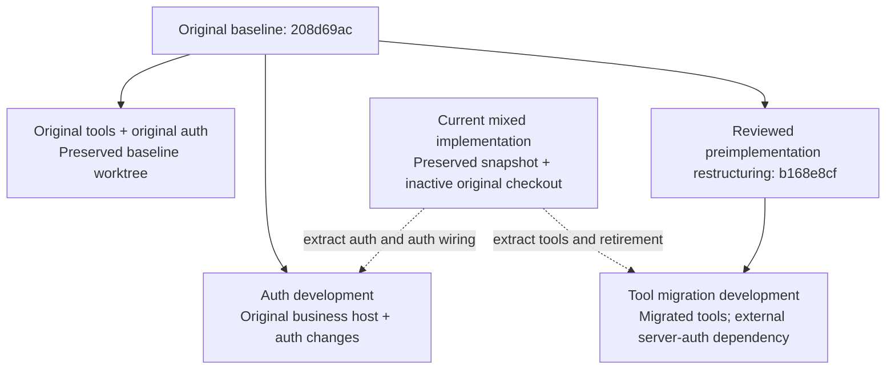
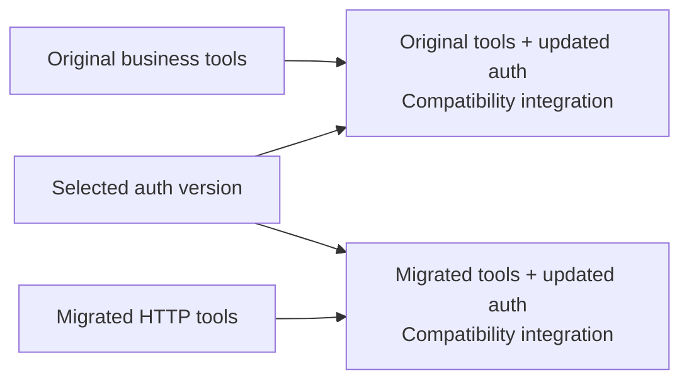

# Independent tool migration and MCP request-auth development

Maintained plan and operating guide. Established 20 October 2026, at the user's
explicit request to document and create separate development lines. This request
authorizes this local Git organization; it does not authorize deployment, feature
activation, academic operations, data cleanup or repair of recorded failed proofs.

## Purpose

Develop MCP authentication independently of the business-interface migration.
Preserve the original custom-endpoint system, develop request/session integration
using that original implementation as the host, and continue existing-HTTP tool
migration without changing the server auth framework in the same branch.

These are worktrees of **one Git repository**, with independent files and indexes
but shared commits/objects. They are not copies of the live application or database.
No code is lost merely because it is assigned to another line. Uncommitted mixed
work is captured in a named Git snapshot and private checkpoints before extraction.

## Three development lines

| Line | Directory under `/Users/burhanahmadkhan/Desktop/` | Branch | Purpose |
| --- | --- | --- | --- |
| Original baseline | `sakai-mcp-custom-native` | `codex/sakai-custom-native-api` | Preserve the original tools and original auth at `208d69ac`; compare behavior and recover original source. Leave this checkout untouched. |
| Auth development | `sakai-mcp-auth-development` | `codex/auth-development` | Original business implementation as host, plus the extracted native auth framework, auth-specific build/filter wiring and tests. Develop auth here. |
| Tool migration development | `sakai-mcp-tool-migration-development` | `codex/tool-migration-development` | Existing-HTTP Python tools, parsing/workflows/storage and focused native business retirement. New native servlet-auth framework/wiring is absent; declare the matching external auth requirement. |

The existing `sakai-mcp` checkout is retained as an **inactive mixed recovery
checkout**, on its original branch/HEAD, with its editor/private files and working
source preserved. It is an extra recovery location, not a fourth development
stream or an integration release. Do not continue implementation there. It also
holds the authoritative historical continuation chain and this organization record.

Dashed arrows mean selective reviewed extraction, not blanket merging of the mixed
branch. Machine-readable classification and exact source anchors are in
[`mcp/development-lines/arrangement.json`](mcp/development-lines/arrangement.json).
Each new worktree also has a local role/dependency record at
`docs/mcp/development-lines/role.json`.

## Historical boundaries

| Point | Meaning | Limit |
| --- | --- | --- |
| `208d69ac624910a29a7529934ddcc18bbac853e8` | Original custom endpoints, tools, original MCP auth and resources; existing baseline/main remain here. | Historical successful grading evidence does not mean every tool/role was accepted or that it is deployed today. |
| `062b2845d532136f85eeca0a92571b252687ac65` | Preserved operations/seeding/support work after the baseline. | Keep unrelated support fixes out of auth extraction. |
| `b168e8cfff28bfb178c0a6a06373b31bc7245576` | Preserved restructuring before the new shared servlet-auth module. | Includes unwired HTTP scaffolds; not a blanket claim of pure refactoring. |
| `d447ec4ef8c3e9efb0a768d693c568927eec7044` | First saved mixed HTTP-migration/shared-auth implementation. | Not suitable as an auth-only commit to cherry-pick wholesale. |
| `0f9f44a76f34777b52f56ae03634ffd3a0b3bc6c` plus preserved working files | Latest combined implementation and proof history before separation. | Substantial completed work was uncommitted; capture it explicitly before extraction. |

These preservation commits were made on 19 October; some archive earlier work.
The original 14 October workflow has recorded successful saves/returns and also
ambiguous receipt/reconciliation incidents. See
[evidence](evidence/mcp/assignment-grading-run-2026-10-14.md).

## Ownership boundary

| Area | Owner / treatment |
| --- | --- |
| `apps/sakai/mcp-auth/` | Auth development. JWT/account checks, native session selection/binding/cleanup, credential reach, flow ownership and response protection. No native business endpoints or permission bypasses. |
| Auth module declaration, servlet dependencies, filter registration | Auth integration changes, carried explicitly with auth development. Original business handlers remain unchanged in that host. |
| Native legacy bearer/JWT files | Original host retains baseline files. Tool line retains restructured legacy classes; normalized class bodies were compared to baseline excluding package/import/format changes. Any future behavior change belongs in auth development and must be ported deliberately. |
| Python inbound token/OBO modules | Existing original auth, retained in each implementation's existing layout. Do not redesign them during tool migration. Cross-layout changes require a reviewed port, not copying entire trees. |
| Python `security/sakai_flow.py` | Small client protocol contract needed by native-browser HTTP coordination. Retained unchanged/pinned in the tool line, mirrored as reference source in auth development. It is not the server auth framework. Change the protocol in auth development, then explicitly update the client pin and compatibility evidence. |
| Python existing transports, parsers, tool workflows and external durable records | Tool migration development. Keep identity invariants and explicit required server behavior; no legacy business fallback. |
| Existing business-handler characterization tests | Tool line unless directly exercising the auth/session framework. Auth-specific chain/servlet proofs move with auth development. |
| Frozen catalogs/contracts/evaluator/report baselines | Preserve exactly. Original host files match its baseline; migrated files match the saved mixed implementation. |
| Failed attachment readiness proofs | Preserve unchanged with auth evidence. Separation does not repair, skip away or establish acceptance of those failures. |

### An explicit dependency is not an accepted running combination

The tool worktree intentionally does **not** contain the new native auth module,
its build dependencies or servlet filter registrations. Its Python client still
expects the documented existing-HTTP/flow protocol when it runs against Sakai.
Its local native source cannot supply that capability by itself. A separately
assembled compatible auth-enabled native build is required before live use.
Do not deploy this tool-only native tree as though it contained the extracted auth.

Keeping the small client contract and the original token/OBO code does not mean
server auth development remains in the tool branch. The exact contract file/hash,
server requirements and extracted auth commit are pinned in its role record.
No source symlinks or imports from another worktree are used.

## Later combinations

Create these only when needed and explicitly authorized, using selected auth and
adapter commits rather than merging unrelated business histories:

| Business implementation | Original auth | Updated auth |
| --- | --- | --- |
| Original custom endpoints/tools | Preserved baseline. | Test original custom endpoint compatibility, ordinary login and sessions. |
| Migrated existing-HTTP tools | Not an assumed working pairing; original auth does not admit all required native interfaces. | Intended pairing, requiring matching route/filter/flow wiring and acceptance. |

Auth development already uses original tools as a host, but that does **not** mean
the combination is accepted, enabled or ready to deploy. Temporary integration
worktrees may be used during development; finishing both streams is not required
before checking compatibility. No integration worktree/release is created by the
initial separation operation.

## Creation and preservation procedure

1. Verify refs, worktrees, dirty/untracked paths, editor fingerprints and prior
   continuation/private-checkpoint hashes. Preserve current source privately.
2. Write this guide before creating the arrangement.
3. Save the current mixed source through an explicit path-reviewed Git snapshot
   on a recovery branch. Exclude editors, caches, credentials, uploads and runtime
   data; preserve those locally. Do not touch the current checkout's real index,
   branch or working files to manufacture a clean state.
4. From `208d69ac`, extract auth module/test files and minimal auth-only build/filter
   wiring. Assert all original business source, catalogs and client files unchanged.
5. From the reviewed preimplementation ancestry, reconstruct current tool migration
   source while removing native auth-owned source and restoring pre-auth wiring.
   Keep client protocol dependencies explicit and preserve all business/evaluator
   bytes outside documented integration/metadata changes.
6. Create new auth and tool worktrees from the resulting commits. Record exact
   anchors, transferred paths, shared client hashes and exclusions. Keep the old
   mixed checkout intact as recovery evidence.
7. Validate source inventories, native route counts, frozen bytes, clean new indexes
   and baseline integrity. These Git/source checks are not live role acceptance.
   Do not repair failed implementation/proof tests as part of organization.

## Working day to day

Open the worktree for the kind of change being made. No `git switch` is required
to move between them. Each worktree needs its own virtual environment, Maven output,
credentials/configuration and local ports. Do not share generated binaries or
running processes between versions. No runtime files are provisioned by separation.

- Auth change: commit only auth/framework/protocol changes in auth development.
- Tool change: commit only business HTTP/parser/workflow/retirement changes in tool
  development. If blocked by auth, record the requirement in the role/compatibility
  records; do not edit or copy in the server auth framework.
- Shared protocol change: originate in auth development, then deliberately port
  the client contract and update its pin in tool development. Never change both
  silently through shared folders.
- Compatibility change: isolate the original-versus-migrated route/filter adapter
  changes so they can be selected independently of the core auth behavior.
- Recovery: use the mixed preservation commit/private manifests. Compare individual
  source bytes before restoring; never extract archives over a worktree or use
  reset/clean to discard user work.

Source branches do not inventory or roll back deployed schema, storage, exports,
proposals, receipts or academic records. Deployment, activation, runtime/Azure
changes, schema/data cleanup and repairing failed proofs remain outside this task.

## Maintenance

Keep this guide and the machine arrangement/role records synchronized when branch
names, directories, source pins, ownership or compatibility requirements change.
Add a brief pointer in the relevant root/scoped guides. Preserve dated evidence,
original manifests and old continuation records; add new records for subsequent
work. Do not relabel inherited historical test counts as fresh verification.

The arrangement is verified by the separate source/commit checks described in
`docs/mcp/development-lines/verify_arrangement.py`. Historical migration preservation
checks remain available in the unchanged mixed recovery checkout. The tool line's
scope command additionally checks its extraction record; it does not rewrite the
old preservation chain or claim that the auth-free native tree is deployable.

## Established source anchors and verification — 20 October 2026

The three documented lines now exist. Their immutable extraction anchors are:

| Anchor | Commit | Meaning |
| --- | --- | --- |
| Original baseline | `208d69ac` | Untouched baseline/main/custom source. |
| Mixed recovery snapshot | `98364680` | Complete explicitly selected mixed working source, including failed proofs; editors/caches/private runtime excluded. |
| Portable native auth core | `98a4ca7d` | Auth module/test source extracted without business migration. |
| Auth integration source | `b5100547` | Auth build/filter wiring on the unchanged original business host. |
| Tool migration source | `0cb3f331` | Current migration source with new native auth module/wiring removed. |

Later commits on the new branches contain ownership/dependency metadata. Use branch
refs or `git worktree list` for current tips; the stable anchors above do not move.
The machine [verification record](mcp/development-lines/verification.json) describes
source comparisons, clean new worktrees, baseline/main/editor preservation and
scope checks. All current migrated Python implementation bytes match the mixed
snapshot, original auth-host business bytes match208d69ac, extracted auth source
and failed native proofs match the mixed snapshot, and the client protocol pin
matches in both locations. Source role verifiers and repository guidance passed.

No regression suite or package build was run as part of this Git-only separation;
prior test reports remain historical. No failed attachment proof was fixed or
newly accepted. Neither new source line is a deployment release. No worktree shares
runtime credentials, virtual environments, generated binaries or running services.
