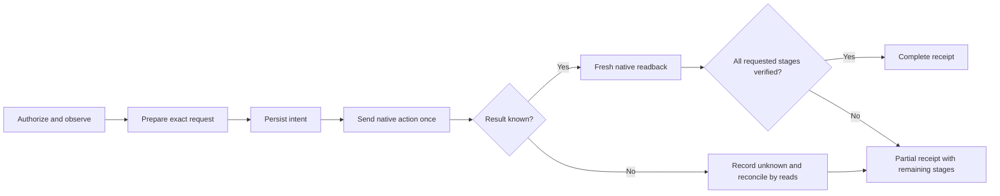
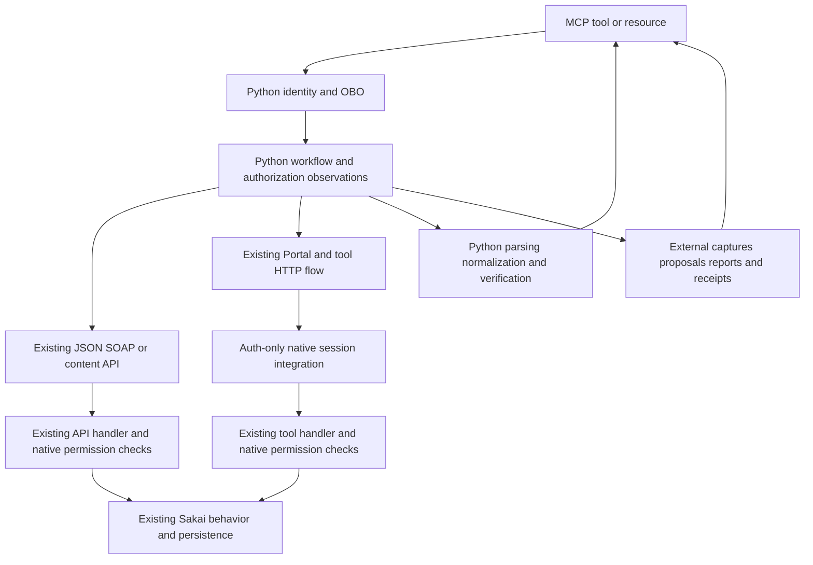

# Existing native browser HTTP research — derived plan excerpt

The complete authoritative plan is [implementation-plan.md](implementation-plan.md), including branch setup, local removal/release sequence and all earlier API/auth/data research. This companion reproduces section 16 for convenience and is not a separate implementation authority.

## 16. Expanded research: existing browser HTTP workflows for every tool and resource

**Amendment scope:** the user explicitly requested investigation of existing browser-facing requests and multi-request workflows for **every tool**, after discussing the earlier restriction to conventional APIs. This chapter is the current integration direction wherever it conflicts with an earlier exclusion of UI/HTML/Wicket paths. It does not authorize new native endpoints, domain code, permission bypasses, schema changes, ordinary-login changes, deployments or academic writes.

**Evidence:** source reconnaissance against the same imported Sakai 25.2 baseline and current checkout. No browser/network capture, delegated native probe, academic mutation or runtime start was performed for this amendment. A source-confirmed handler/form is a credible existing HTTP capability; its exact rendered request, installed configuration, role coverage and delegated-session integration still need the bounded verification specified below. Dynamic URLs shown with placeholders must be extracted, not invented. Partial Python client/parser scaffolding from the interrupted implementation turn remains unwired and unverified; no implementation was resumed for this research.

### 16.1 Corrected conclusions and selection policy

The earlier plan established several **conventional-API gaps**, not that the corresponding actions cannot be performed over HTTP. The expanded search finds:

- **Announcement creation:** existing `AnnouncementAction.doAnnouncement_form → doPost → postOrSaveDraft`, with the native revise form, current author, site/group controls, visibility and notification choices. No new announcement controller is needed. [U03]
- **Draft creation and publication:** existing `AssignmentAction.doAssignment_form`, `option=save` or `option=post`; draft edit and bulk publication also exist. The regular edit/post path includes native calendar and Gradebook integration. It is a better candidate for the current setup workflow than the immediately-posting SOAP create. [U04–U06]
- **Linked calendar deadlines:** ordinary Assignment publication already sets native Assignment↔Calendar linkage and tool ownership fields. Earlier conclusions based on generic SOAP calendar creation do not apply to that existing UI path. [U06]
- **Individual Gradebook scores and metadata:** existing Gradebook Wicket pages render per-student results, and the instructor table embeds a JSON data object including native user/item IDs, item metadata and a packed or JSON score matrix. Python can parse these existing contracts. They are not averaged WebAPI responses. Scope, precision and over-fetching still need review. [U09–U12]
- **Own grades:** the native Student page binds the current user and renders released grades with maximum points. It provides a genuine alternative/enrichment candidate, including for users who also have grader rights. Item-ID correlation needs a collision-safe method; the rendered HTML does not universally provide every Gradebook item ID directly. [U09, U11]
- **Submission evidence and grade state:** native list/detail HTML exposes additional state, including a release indicator. The modern grader uses existing Direct actions already researched; a browser trace must distinguish its data requests from older server-rendered grading forms. [U07, U08]

Prefer the narrowest existing interface that safely supplies each field/action. A workflow can combine JSON, HTML, existing AJAX, content streams and external Python records. Do not force every tool through a browser if an adequate existing API is simpler. Conversely, do not declare a tool unavailable merely because no conventional REST/Direct/SOAP operation exists.

A browser workflow is an existing HTTP interface, but is version-coupled to rendered forms, session state and callback protocols. The Python service owns that adaptation. No new Java controller/provider, hidden server-side workflow helper or custom native persistence is permitted. Existing UI business code remains unchanged. Its permission checks, validation and effects remain native behavior.

The migration should preserve useful tool functionality while honestly documenting guarantees added by the old custom implementation. Do not require every operation to provide a custom native row lock, private-first staging or all-or-none cross-tool transaction as a prerequisite for being usable. Do not silently retain descriptions that promise those guarantees after adopting ordinary native behavior.

### 16.2 Shared HTTP event flows and source-backed request cards

Every tool flow below refers to these cards. Each card identifies native entry, state, input/output, checks and recovery; the per-tool sections specify their order. `P` means a verified tool **placement ID**, distinct from site ID, tool registration ID, Assignment ID and Gradebook UID. `FORM_ACTION` and `CALLBACK_URL` mean URLs extracted from the current response, constrained to the configured HTTPS Sakai origin and the expected placement/handler family.

<a id="b0"></a>
#### B0 — Discover the acting user, course and placements

1. Validate the MCP token; perform existing OBO for a Sakai-audience token; compare tenant/object identity as in §7. Never accept a caller-selected acting account.
2. Use existing A0 current-user and site/access observations and A1 `/api/users/me/sites`. Retain exact membership/course semantics for discovery and native effective visit checks for action access. A public site response alone is not proof of the required course access.
3. Discover a required tool placement from the existing rich sites `tools[].url` only if unambiguous and validated, or `GET /direct/site/{SITE}/pages.json`. The latter is `SiteEntityProvider.getPagesAndTools`: authenticated membership is required (admin is a separate native branch); it returns page/tool data and URLs. Do not request admin-only `props/config` fields. Keep the original A0 visit rule distinct from the stricter membership requirement of this optional discovery route.
4. Verify returned site, tool registration (`sakai.announcements`, `sakai.assignment.grades`, `sakai.gradebookng`, Calendar where needed), placement and URL relationship. Handle multiple placements explicitly. Do not discover by display title alone or fabricate a placement from a site UUID.
5. Record a short-lived internal binding `(actor, site, tool-id, placement, base-origin)` for this invocation. If no permitted placement can be found, return an explicit placement/capability limitation; do not add native tools or enable features automatically.

The API sites response may omit pages containing multiple tools; `/pages` is the investigated fallback rather than assuming the convenient `tools` array is complete. Source returns explicit `toolId`, `placementId`, `context`, `siteId` and `pageId` per tool; `toolData.url` is a page URL, so do not mistake it for a unique tool-placement URL. The tool route uses the verified placement ID. Envelope and current placement fields need an exercised fixture. [U01, U02]

<a id="b1"></a>
#### B1 — Open and maintain an isolated native tool flow

**Existing entry:** `GET /portal/tool/{P}` (and tool-relative paths beneath it). `ToolHandler.doGet/doPost → doTool` resolves the native placement, checks site visit where the registered tool uses portal security, and invokes the existing active tool. `ActiveToolComponent` supplies native current Tool/Placement and the placement's ToolSession during cross-context dispatch, then restores prior state. The tool WAR's own `RequestFilter` participates on REQUEST/FORWARD/INCLUDE. [U01]

**Sequence:** establish an authenticated, actor-bound **flow session** through the permitted authentication integration; GET the existing tool route; retain only the flow nonce (and native cookie only if the separately reviewed cookie alternative is selected), CSRF token, rendered action URL, tool state and versioned page/callback identifiers privately; follow bounded same-origin expected redirects and tool dispatch; submit the selected existing action; parse the returned HTML/XML/JSON and update the flow's state.

**Why session continuity is required:** Velocity retains edit/attachment/selection state in ToolSession; CSRF checks compare form `sakai_csrf_token` to the native UsageSession token. Wicket callbacks refer to page/session/component state. Invalidating the delegated native session after every HTTP request would destroy those flows. This is a material revision to the stateless downstream design, not a request to collect passwords or reuse a human browser cookie. Section 16.6 defines the authentication-only design gate.

`#toolForm(...)` is the Velocity macro `$sakai_ActionURL.setAction()`, not a fixed `/api/...` route. Python submits the **rendered form action**. `eventSubmit_*` and `option` select existing native actions. `VelocityPortletPaneledAction` performs CSRF validation; never disable it, add the tool to insecure-tool settings or synthesize a token. Some navigation actions are GET links but mutate native UI state: serialize them and do not automatically replay them as stateless reads. [U02]

**Generic representative exchange (credentials and values are placeholders):**

```http
GET /portal/tool/<PLACEMENT_ID> HTTP/1.1
Authorization: Bearer <SAKAI_AUDIENCE_TOKEN>
X-MCP-Flow: <PRIVATE_FLOW_NONCE>
```

```html
<form action="<RENDERED_SAME_ORIGIN_ACTION>" method="post">
  <input name="eventSubmit_doAssignment_form" value="">
  <input name="option" value="">
  <input name="sakai_csrf_token" value="<CURRENT_NATIVE_CSRF>">
  <!-- Existing server-rendered controls, values and selection options -->
</form>
```

Do not treat this example as a captured response or assume all tools use this form. Distinguish authentication/login pages, access-denied pages, validation alerts, helper pages and successful target views. HTTP 200 is not the success criterion. No session cookie/token/page response goes into public MCP content, logs, durable proposal payloads or shared clients.

<a id="b2"></a>
#### B2 — Read and create announcements through the existing tool

**Source-confirmed existing flow:** B0 finds Announcements; B1 GETs it; use the rendered Add/new link (`doNewannouncement`) to initialize a new announcement state; parse `chef_announcements-revise.vm`; POST the form once with `eventSubmit_doAnnouncement_form`, `option=post`, `subject`, `body`, `announceTo=site`, `hidden=false`, the actual CSRF token and explicitly selected notification controls. Preserve appropriate framework hidden controls. For the current plain-text contract Python escapes/formats literal user text before submitting rich text and verifies the normalized rendered result. `readAnnouncementForm` unescapes subject and processes body, so test literal entities, line breaks and HTML-looking text; do not double escape. [U03]

```http
POST <FORM_ACTION> HTTP/1.1
Content-Type: application/x-www-form-urlencoded
Authorization: Bearer <SAKAI_AUDIENCE_TOKEN>
X-MCP-Flow: <PRIVATE_FLOW_NONCE>

 eventSubmit_doAnnouncement_form=&option=post&subject=<ENCODED_TITLE>
 &body=<ENCODED_SAFE_FORMATTED_PLAIN_TEXT>&announceTo=site&hidden=false
 &notify=n&sakai_csrf_token=<CURRENT_NATIVE_CSRF>
```

The display above breaks a single form body over lines for readability. Use a normal form encoder. `notify=n` selects no notification in the inspected handler; the old custom create's notification behavior must be compared explicitly, rather than inheriting the browser default (`optional`). Do not send selected role/group fields or public visibility for the existing course-wide tool. Clear/unselect release/retract scheduling for immediate publication; retain unrelated legitimate defaults only after review.

Native `postOrSaveDraft` obtains the channel, calls the **existing** add/edit operation, sets current author, draft/access/date/attachments and commits. Author and permission enforcement belong to that existing handler. Python must check the selected placement is the intended main course channel; a merged Announcement list is not proof of a valid write destination.

**Readback:** parse the returned list/detail's native message reference (`itemReference`), site/channel and content, and preferably cross-check an existing A3 read. Read UI pages/detail when A3's date window or merged-channel behavior would omit the just-created item. Preserve ID semantics (`announcementId` versus packed entity ID). Before sending, record the visible baseline IDs and request fingerprint externally. After a lost response, read the list and examine new candidate IDs/author/body/site/time; identical text alone is not unique proof. Mark ambiguous/unknown when multiple candidates remain; do not post again automatically. Browser state may retain a new object reference, but source does not establish a native idempotency key.

**Read-only listing:** paginate via the rendered page controls (`eventSubmit_doList_next/prev`, pagesize) and native detail links, preserving current visibility rules. Those POSTs alter UI navigation state, not academic records. Python produces its own bounded sorted cursor. A disabled next control or matched total and stable IDs is required for completeness, not an arbitrary page count. Instructor views may include drafts and scheduled items; explicitly preserve the public tool's intended visible-only semantics rather than leaking everything the instructor can edit.

**Evidence:** handler/form/CSRF/current-author and commit source-confirmed; complete delegated flow and exact output/readback fixtures unexercised. No conventional announcement POST was discovered; an existing browser POST has now been identified.

<a id="b3"></a>
#### B3 — Read Assignment metadata and setup context through native list/edit views

1. B0/B1 open Assignments with an isolated flow. Parse the existing list's IDs/references/status and native pagination. The list may initialize tool backing state and records access events; document those existing effects.
2. For instructor setup context, follow the **rendered** `doEdit_assignment` link with its native Assignment reference. `AssignmentAction` loads the existing Assignment into edit state, populates form controls and category/Gradebook choices, attachments, grading/submission types, dates, visibility and resubmission settings. Read these fields without posting a save. This avoids assuming A4's Direct list is metadata-only; its default serializer hydrates student submissions.
3. Parse rendered controls and their selected values; do not invent a JSON serialization of the entire Java object. Mark per-field availability and the exact tool/role/view used. DOM absence due to a disabled feature is not the same as false.
4. For grade-only TAs, use native grading/list/view paths or A4/A5 within proven scope. Do not require `asn.new`/edit rights or open an instructor edit page solely to populate a grading-context DTO. A field available to an instructor edit form is not thereby available to every grader.
5. Join Gradebook metadata/settings via B6 and Calendar observations via A10/B5, filtered to the requested window in Python. Record whether reads initialize previously absent backing objects; do not claim the old initialization-free existence check was preserved.

Native Assignment instruction HTML can reference additional content. Only resolve content references needed for the selected operation; do not crawl arbitrary embedded URLs or external/LTI content. Preserve native anonymous grading and no unnecessary submission-body reads during setup planning.

**Evidence:** edit/list handlers and form controls are source-confirmed; rendered per-role coverage, current backing-state effects and complete field extraction require fixtures. [U04–U06]

<a id="b4"></a>
#### B4 — Create a draft or publish through existing Assignment forms

**Existing handlers:** `doNew_assignment` checks native add/update permissions and initializes edit state; `doAssignment_form → option=save → doSave_assignment → post_save_assignment(...,"save")`; `option=post → doPost_assignment → post_save_assignment(...,"post")`. Both save/post handlers require POST. The ordinary form carries `assignmentId`, `eventSubmit_doAssignment_form`, `option`, selected controls and `sakai_csrf_token`. [U04, U05]

**New draft flow:** B3/B1 open the native Add/new form; parse every relevant default; replace only the requested values; coordinate native filepicker B8 if attachments are requested; journal an intent and baseline Assignment IDs; POST once with empty `assignmentId`, `option=save`; inspect alerts/list; reopen the new Assignment by extracted native ID and verify the actual draft/configuration/attachments.

**New published flow:** prepare the same form with requested Gradebook/calendar choices; submit `option=post` once; then perform B5/B6 readback and required flag coordination. For an existing draft publication, open its edit form, verify ID/site/configuration and current observation revision, preserve all existing controls, set requested Gradebook/calendar choices, and POST `option=post` with the existing `assignmentId`. Reopen that same ID and verify draft=false. This is an existing native handler, not a Python call into Java.

**Bulk publication alternative:** `doPublish_confirm_assignment` accepts `selectedAssignments` and stores selection; `doPublish_assignment` uses that stored list, sets draft=false, and conditionally integrates Gradebook/categories. It does **not** execute the same `integrateWithCalendar` sequence shown in ordinary edit/post. Prefer edit/post when calendar coordination is required; do not assume bulk publish completes all setup requirements. Discover/submit its confirmation form if using bulk, never guess a second action from the first response.

| Public setup input | Existing form/source mapping and Python treatment |
|---|---|
| `title`, `instructions` | Rendered fields backed by `new_assignment_title`, `new_assignment_description`; native title form has maxlength 100 while current public schema allows 200. Validate the actual native limit before mutation; this is a precise compatibility limit, not a missing create capability. |
| `visible_at`, `open_at`, `due_at`, `close_at`, `timezone` | Visibility toggle plus `new_assignment_{visible,open,due,close}_{year,month,day,hour,min}` controls. `putTimeInputInState` interprets components in the **acting user's native local timezone** and minute precision. Convert the requested instant using verified native timezone; detect DST gaps/folds and seconds truncation. Do not change the user's profile timezone to satisfy a tool argument. No new native custom timezone property is required. |
| `max_points`, score grade type | `new_assignment_grade_type` and `new_assignment_grade_points`; use native displayed units/decimal separator, observed scale/precision and existing enum options. Never reuse SOAP stored-unit semantics blindly. |
| `submission_type` | `new_assignment_submission_type`; select the native option corresponding to each public enum. Do not infer raw enum ordinals from English labels; use source enum/actual form values and fixture validation. |
| `resubmission` | Native resubmission toggle, count and close-date controls populated by `setNewAssignmentParameters`/time helpers. Include checked state and all required date parts explicitly; verify saved values. |
| `attachment_resource_refs` | B8 filepicker selects or copies existing Resources through native helper. Hidden attachment references in the template are not proof arbitrary reference injection will update native attachment state. Copy-versus-link semantics must be measured and reported. |
| `publication` | Existing `option=save` versus `option=post`; verify persisted draft/status after response. |
| `gradebook.mode/category_id` | `new_assignment_send_to_gradebook`, `new_assignment_add_to_gradebook`, `new_assignment_category` and native choices; select native new-external integration for `new_external`. Group Gradebooks can require per-Gradebook category selection. Never substitute a standalone internal item merely because association is easier. |
| Gradebook release/count flags | B6 existing external-item edit controls, following native item creation where required. Native defaults and transient effects are explicit; private-first creation is not assumed. |
| `calendar_deadline` | Existing `ResourceProperties.NEW_ASSIGNMENT_CHECK_ADD_DUE_DATE` field (rendered name) triggers B5 on `post`; absent backing calendar/permission is a partial/unsupported stage, not automatic provisioning. |

**Native effects and limits:** UI `post_save_assignment` initially calls ordinary `addAssignment(site)` and later fills/persists the object; it does not promise the old MCP factory's private-first first persistence. A returned draft can be achieved; identical internal staging is not established. Native post persists Assignment then coordinates Calendar/Announcement/Gradebook; errors may leave partial effects. Keep auto-announcement unchecked for an explicit separate announcement tool unless the approved workflow requests native-generated wording. Do not overwrite hand-authored existing fields while publishing.

**Reconciliation:** write intent→send once→extract native ID→reopen and compare→record complete/partial/unknown. Lost new-create responses require delta-ID/author/configuration evidence; do not simply POST empty-ID again. Existing-ID publication can be inspected by ID before any retry, but re-posting may regenerate linked events/notifications; it is not automatically idempotent. Public `expected_assignment_revision` becomes an observation comparison before send, not a native reservation. Do not reuse old native revision tokens as though equivalent.

<a id="b5"></a>
#### B5 — Calendar coordination already performed by native Assignment publication

`post_save_assignment` calls `integrateWithCalendar` only for `post`. `integrateWithCalendarTool` examines the existing scheduled/event properties; `updateAssignmentWithEventId` adds a Deadline event and stores its ID on the Assignment. `addAssignmentIdToCalendar` sets native `NEW_ASSIGNMENT_DUEDATE_CALENDAR_ASSIGNMENT_ID`, `EVENT_OWNED_BY_TOOL_ID=AssignmentConstants.TOOL_ID` and the opening-date field. These existing native links **are present in this baseline**. No custom Calendar controller or new property-writing endpoint is needed. [U06]

Flow: record selected calendar and preexisting relevant event IDs→submit B4 with the actual Add-due-date control→reopen Assignment metadata/form and inspect A10/native Calendar detail→identify new/updated event by authoritative native link where exposed→verify due instant/type/site/group/ownership and preserve ID→journal result. A matching title/time is supporting evidence, not an authoritative relationship. The UI and general API may not expose every ownership field; if raw link IDs cannot be read, distinguish native source-proven link creation from verified current link identity. Investigate existing Calendar detail HTML/serialization rather than asserting a link was verified from its title.

Native Calendar exceptions are logged and may not produce a failed Assignment save; verification is mandatory. Existing integration can remove/recreate events on later edits. Record successor IDs rather than treating an old event ID as permanent. A retry must first reconcile the Assignment and calendar; do not separately create a generic SOAP event as a shortcut, since it can duplicate/lose the native link.

For `calendar_deadline=none`, inspect what posting/editing an existing previously-linked Assignment does with an unchecked field. Do not delete a calendar record automatically just to match a guessed interpretation. Native backing-calendar initialization, existing linked events and student/group visibility belong in the acceptance fixture.

<a id="b6"></a>
#### B6 — Gradebook settings, individual score readback and item flag edits

**Browser entry:** B0 resolves Gradebook placement; B1 opens it. `GradebookNgApplication` mounts `/grades` (instructor table), `/settings`, `/importexport`, `/permissions` and `/gradebook` (StudentPage). Resolve the placement-relative mounted URL from native navigation/rewritten paths; do not assume `/gradebookng-tool/grades` has the correct site context. Wicket is served by its existing servlet and native RequestFilter with upload handling disabled there. [U09]

**Own released grades:** `StudentPage` obtains `getCurrentUser()` and passes that UID to `StudentGradeSummaryGradesPanel`. The panel retrieves grades for that user, filters released items and respects site display settings; `GradeSummaryTablePanel` renders title, score, out-of points, dates and comments. Request no selected-other-student UID. The constructor rejects role NONE but does not limit itself to role STUDENT; verify mixed-role behavior rather than assuming an instructor must use the aggregate WebAPI response.

**Item-ID correlation:** HTML title/points is not universally an item-ID mapping. For a student, combine the existing A2 **student-only** list of native item IDs with B6 own HTML only when an unambiguous same-Gradebook/item relation is established. For a mixed-role grader, use authorized item metadata (A2 item-data/current Gradebook) plus own StudentPage, avoiding the aggregate grade endpoint. Native Gradebook rejects conflicting item names in relevant creation paths, but multiple Gradebooks, excluded items or localized rendering still require unique exact correlation. If identity cannot be established, fail that mapping explicitly; do not invent stable numeric IDs from titles or row positions. This is a bounded verification task, not grounds to claim the score/maximum is unavailable over HTTP.

**Instructor/TA individual readback:** `GbGradeTable.renderHead` renders `var tableData = <GbGradebookData.toScript() JSON>`; the object has `students`, `columns`, `serializedGrades`, `rowCount`, `columnCount`, course-grade data and settings. Student rows have native UID/EID; Assignment columns have native item ID, title, points, external ID/app, category and release/include flags. Python selects the verified UID and the correct Assignment/Gradebook relationship, not an average or title guess. Only parse the JSON literal with a bounded parser; never execute returned JavaScript. [U10]

`serializedGrades` is deliberately inconvenient:

- `json:` contains a flat JSON list. Index is `student_row * columnCount + column_index`; null means blank, never zero.
- `packed:` is Base64 native byte packing. Value 127 is null; a byte with high bit clear is a small integer; high-bit 10 uses two bytes; 11 uses two bytes plus a fractional byte. Decode according to the existing Java serializer and `GbGradeTable.unpackPackedScores`, with bounds and exact dimensions. The fraction is rounded to hundredths by Java and rendered as fractional digits by the JS decoder. In the inspected code a rounded fractional byte of 100 is appended as `.100`, without an explicit integer carry; treat that edge as a suspected upstream display defect/precision limit requiring a fixture, never silently normalize or write a guessed original score. Do not claim arbitrary original decimal precision from a display-oriented packed representation.
- Column types include course/category data, not only assignments. Use each column's type and native ID; never assume the first column is the first assignment.

The instructor page/table may over-fetch other **natively authorized** students/items. That must be budgeted and minimized; use the existing selected-student summary/modal or group filters when they actually narrow returned data, but check the initial page's dataset too. A later filter cannot repair an unauthorized initial response. `GradebookPage`, `GradebookNgBusinessService.buildGradeMatrix` and selected-user/panel service paths must be tested for TA group/item restrictions. The native `ViewGradeSummaryAction` accepts `studentId`; that parameter is not itself permission proof. Do not use an administrator session or wider teacher permission to make a TA query work. [U10–U12]

**External item flags/category:** native Add/Edit item UI exposes released/count checkboxes even for externally-maintained items; title/points/due controls have external-item restrictions. Use the rendered edit action/form to set only accepted editable flags/category, not external ownership/title/score authority. The `AddOrEditGradeItemPanel` submit calls existing update/add functions. Reopen and inspect item-data/table metadata afterward. Wicket UI validation and user permissions remain authoritative. An edit method's source existence does not establish every TA is allowed to invoke it. [U12]

**Existing concurrency protection:** `GradeUpdateAction` explicitly sends `oldGrade` and `newGrade` to the native save service as a concurrency check. This corrects any broad suggestion that Sakai's UI has no such protections. That action updates a Gradebook cell; it is **not a substitute for saving/returning an Assignment submission**. Use it only for a separately appropriate native Gradebook operation, never to fake official Assignment status or bypass external-maintained item rules.

**Wicket HTTP exchange:** GET the actual page→extract callback/component binding from its scripts/markup→send the same native callback with required Wicket headers and `ajaxParams`/form fields→parse `<ajax-response>` component replacements, redirects, feedback and completion scripts→refresh page/callback state→verify by independent fresh view. `GbGradeTable` attaches an `AjaxEventBehavior("gbgradetable.action")`; its dynamic extra parameter is `ajaxParams=JSON.stringify(...)` and dispatch is `handleEvent(action,params,target)`. A selected-student request conceptually includes `studentId`, action name and native request correlation field; use the source-registered `viewGradeSummary` action (and verify its rendered binding) rather than inventing a callback. [U10]

Do not hardcode Wicket page numbers, callback URLs, component names/markup IDs or stale AJAX base URLs. No arbitrary JS evaluation, URL forwarding or hidden Java method invocation is needed. Exact request method/header/callback fixtures remain live verification items; historical seeding supports related Wicket interaction, not every proposed callback.

<a id="b7"></a>
#### B7 — Submission list, detail, evidence and official save/return

**List/detail entry:** native Assignment list action `doGrade_assignment` receives the Assignment reference and prepares native pagination, scope/search/group state. Existing `doGrade_submission` receives Assignment/submission/submitter references, uses `putSubmissionInfoIntoState`, populates resubmission/extension/feedback state and enters grading mode. Follow links generated in the verified list, not arbitrary IDs outside the selected site/Assignment. The existing UI `getSubmission` helper currently calls custom evidence hydration; restoring vanilla must retain ordinary UI attachment safety under D7. Browser-path existence does not authorize keeping that helper forever. [U07]

**Two native render modes:**

1. Default `assignment.usegraderbydefault=true`, optionally overridden by existing user preferences, renders `<sakai-grader>` with Assignment/submission IDs. Its JavaScript calls A5 `/direct/assignment/gradable.json` and `fullSubmissions.json`; source hydration/scope caveats remain. Using a browser does not magically make those actions narrower or complete.
2. The legacy server-rendered form `chef_assignments_instructor_grading_submission.vm` includes current grade/feedback/notes/resubmission controls and a literal hidden `grade-is-released`; the native list has a `headers="gradereleased"` cell with an indicator only when release is true. Read exact raw state only when this actual view is rendered and the cell/form is recognized. Do not change preferences or configuration to force another mode as an unannounced read side effect. Absence of a hidden field in modern mode remains unknown, not false.

Native list/detail views can expose expected eligible users with no submission (the list has an explicit no-submission branch), which is a better roster candidate than assuming Direct returned every orphan/missing row. Still test inactive/deleted users, mixed-group submissions, anonymity and pagination. Source does not prove historical orphan parity; native UI may omit records too. Preserve the original MCP's all-submitters scope check; UI/direct any-visible-submitter behavior is not automatically equivalent.

**Modern grader official write:** existing JavaScript builds FormData with `grade`, `feedbackText`, `feedbackComment`, `privateNotes`, `studentId`, `courseId`, `siteId`, `gradableId`, `submissionId`, per-user grade overrides when applicable, and resubmission/extension values when present. It POSTs `/direct/assignment/setGrade.json` and expects `{assignmentCloseTime,submission}`. Its default Save selects **`gradeOption=retract`**, Return selects **`gradeOption=return`**. The old A7 `save` candidate has different release behavior: `AssignmentToolUtils` explicitly retracts release/returned for `retract`, sets both for `return`, and `save` does not itself apply those branches. Select by the accepted public contract, not merely by a button caption. [U08]

**Legacy form write:** POST its current form with `eventSubmit_doAssignment_form`, `option=savegrade` or `returngrade`, exact submission reference and all preserved native controls/CSRF. Native dispatcher invokes `doSave_grade_submission` (RETRACT) or `doReturn_grade_submission` (RETURN). `readGradeForm` checks submission-state consistency and native grade permission, validates values and applies native scaling; then `grade_submission_option` calls existing `AssignmentToolUtils.gradeSubmission`. State consistency checks matching submission ID are not a client-supplied version/CAS guarantee. [U07]

**Required Python coordination:** capture a fresh native observation before approval/commit, verify actor/site/Assignment/submission/all-submitters relationship, preserve side fields/attachments/extension/resubmission, hash approved exact rows, journal intent and send each approved write once. Re-read Assignment status/score/feedback and B6 selected Gradebook projection afterward. A return operation must actually have returned=true and the expected release state; a released-only native state is distinct. Gradebook errors can be swallowed by native integration, so a successful Assignment response is not proof its projection succeeded. Native write results may be usable even where an extra old custom atomicity promise is removed; state that explicitly in the public behavior/provenance migration.

**Unknown outcome:** refresh the selected record and projection; if values match, record observed match with attribution uncertainty where appropriate. If they differ, do not immediately overwrite. Readback must not replay an unknown write, and a current match does not prove which concurrent actor produced it. No automatic resave on 401/timeout/stale form or session expiry. Resume through a new flow, reauthorize and reconcile using durable external receipts.

<a id="b8"></a>
#### B8 — Files, attachments and existing filepicker helper

For source evidence prefer native authorized `/access/content/{resource-id}` (A9), selected from current native Assignment/Submission attachment references. Verify native ACLs, availability/copyright and current source relationship; compute streamed hashes in Python. Same-origin content routes need their own scoped auth/session context. Do not fetch supplied URLs, thumbnail/LTI launches or embedded foreign origins as arbitrary files.

For assignment setup attachments, existing `AssignmentAction.doAttachmentsFrom/doAttachments` saves form state and enters `sakai.filepicker`; `ToolServlet` routes to the existing helper and returns to the originating tool. `FilePickerAction.doAttachitem` takes a rendered `itemId` and either copies or links according to helper state; `doAddattachments` updates the caller attachment list and completes the helper. Use the actual helper form/return URL and its CSRF. `sakai_filepicker_select.vm` contains the selection/add-attachments controls. Do not fabricate `attachments=<reference>` and assume it mutates the ToolSession list. [U13]

Copying an existing resource can create a new attachment object/ID. The public contract currently provides `attachment_resource_refs`; if exact reference preservation is required, verify the active helper's link mode and native eligibility. Otherwise report source versus attached IDs and the native copy semantics explicitly. No new uploaded content is needed for this public tool; do not add upload capability or silently alter retention/visibility just because the helper supports it. Generic upload and native feedback-file handling remain existing features, not permission to expose them through MCP.

Helper navigation can retain or create attachments before the final Assignment save. Journal newly created attachment references privately; if the final save fails, do not delete them automatically. Reconcile reference attachment and native cleanup policy. Read-only resource requests never launch the helper or create new files.

<a id="b9"></a>
#### B9 — Existing Assignment bulk download, evaluated without assuming manifest parity

The ordinary Assignment grading page emits an `accessPointUrl` from the configured access origin plus native Assignment reference (and optional selected group). Existing `AssignmentServiceImpl.getHttpAccess`/`getSubmissionsZip` parse download choices, authorize grading, and stream ZIP entries with submission text/attachments/grades/feedback as selected. The UI also has prepare/download actions and generated choice URLs. [U14]

This is a genuine existing HTTP read candidate for efficient export, not a new MCP endpoint. However native ZIP folder names/EIDs/timestamps are not the current immutable MCP export manifest with stable source IDs, ownership, expiry, digests and capture receipts. Python still constructs that manifest and external immutable capture. Never identify submission IDs solely from display-name ZIP folders; do not treat ZIP entry count or HTTP 200 as proof all requested evidence was captured. Native code logs/skips some invalid records/attachments. Scope/group filtering, missing/orphan coverage, ZIP traversal/bombs, byte limits and exact selected-submission mapping need acceptance before adoption. Prefer selected authorized A5/B7/A9 reads where the ZIP would fetch excess student content or cannot map every file unambiguously.

<a id="b10"></a>
#### B10 — External exports, proposals, reports and operation receipts

These are Python workflows, not missing native business operations. They compose B0/B3/B6/B7/B8 (or verified B9) for source reads and use an approved private external store for captures, manifests, proposal records, reports and journals. Preserve the existing evaluator/canonical serializer/report functions and public MCP resource presentation. A native UI does not need to store MCP proposal IDs or operation receipts; creating a new native UI page for them would repeat the prohibited architecture.

Authorize source IDs and current ownership on every read; conditionally create records under verified actor/site/Assignment/request ID/payload hash; retain pending/partial/unknown state; preserve source expiry and legacy links. Captures are immutable byte observations, not a native transactional snapshot. Separate validation-only proposal preparation from official save/return approval. A GET/read of a receipt must not execute unfinished academic writes.

### 16.3 Complete per-tool event sequences

The following flows cover the **22 tools** in the maximum source catalog. Gates remain independent: 00=5 tools/no templates; 10=8/no templates; 01=19/five templates; 11=22/five templates. A browser transport is an internal implementation choice, not another user-facing tool or a reason to enable a feature. Every sequence begins with current delegated identity and ends with a bounded MCP response/error and flow-session cleanup; these common steps are written explicitly where material.

<a id="t01"></a>
**T01 — `list_my_courses` (default).** Validate identity/OBO→A0 current actor→A1 `GET /api/users/me/sites` without pinned-only filtering→check course flag/membership and effective visit eligibility→map `siteId,title`, discard unrelated rich fields, sort/cap honestly→return. B0 supplies placement discovery only if later workflows need it; no browser form is needed for this tool. Source IDs and existing membership semantics are retained. Test unpublished/deleted/public-only sites, multiple page tools, empty lists and oversized responses. Do not open every course's tool page merely to list courses.

<a id="t02"></a>
**T02 — `get_my_grades` (default).** Validate actor/course→determine the native role/access without calling a known broad grader aggregate route→B0/B1 Gradebook→B6 current-user StudentPage→read released visible rows and maximums→establish native item IDs using a safe unambiguous metadata/own-API correlation→sort/normalize blank versus zero, points versus percentages, locale and IDs→return only the current user's grades. A2 is a student-only shortcut when its field coverage suffices; it is not a grader-own-score source. For mixed-role users test the StudentPage current-user binding and metadata permissions. Source-confirmed own-page behavior improves coverage; exact ID/precision/empty-setting semantics still require fixture proof. No arbitrary student target, title-derived ID or aggregate-to-own conversion.

<a id="t03"></a>
**T03 — `get_course_announcements` (default).** Validate course→A3 narrow read where coverage is proven, otherwise B0/B1 Announcements→B2 native list/detail pagination→apply the public visibility/main-channel rules and read authoritative native IDs→normalize title/plain body/author/date→bind local cursor to actor/query/observation→return. Stop on native completeness evidence and configured budgets; do not silently keep the browser's page-size default. For an instructor, distinguish permission to see drafts from the public tool's intended published-visible output. Test older announcements beyond A3's date window, merged channels, scheduled/retracted/group/role visibility and page changes.

<a id="t04"></a>
**T04 — `get_course_submissions` (default).** Validate course/Assignment relation and grade scope→B0/B1 Assignments→B7 native grade-assignment list (or verified A5)→collect submitted rows and exact submission/submitter references across native pages→prove all-submitters scope before retrieving evidence where the public contract requires it→filter submitted-only metadata, preserve original cap and sort/null-date policy→return cursor page. B7 list supplies missing-user metadata for other tools but this tool still outputs only submitted rows. Test student/outsider denial, grade-only TA, group submissions spanning allowed/unallowed users, anonymous mode and changed pagination. Unknown object equality/scope is not repaired after fetching forbidden bodies.

<a id="t05"></a>
**T05 — `create_course_announcement` (default write).** Validate approved title/body and actor/site→B0 placement/main-channel check→B1 isolated flow→B2 Add form→set literal-safe body, site-only visibility, no implicit scheduling/notifications beyond the current contract→journal pre-send baseline/request fingerprint→POST `option=post` once→parse alerts and new native reference→fresh list/detail/A3 readback→return receipt or partial/unknown. The existing UI is now the primary candidate, not an unavailable-write placeholder. Test actual current-author audit, literal HTML/entities, line breaks, disabled account, permission denial, native body sanitization, missing response, duplicate text and reconciliation without duplicate POST.

<a id="t06"></a>
**T06 — `get_course_assessment_context` (setup gate).** Validate instructor setup authority→B0 required placements→B3 Assignment list plus read-only edit/view forms→B6 Gradebook settings/categories/item metadata→A10/B5 calendar view→join native relationships, normalize timezone/window/configuration and produce explicit per-section completeness/revisions→return. Do not traverse student submission detail or call the default-hydrating A4 list just to get setup metadata. Tool initialization/preferences/access events are recorded as native read effects. Test not-initialized Gradebook/Calendar, category modes, drafts, multiple Gradebooks, missing permissions and unavailable fields. No native save, preview-save, new item or calendar creation is part of context discovery.

<a id="t07"></a>
**T07 — `create_assignment` (setup gate).** Validate the full approved setup contract→T06 context/preflight→B4 Add form with native values/date units→B8 attachment selection as needed→record intent/baseline IDs→submit the selected draft/save or published/post action once→reopen exact created ID/configuration→for published setup verify B5 linked deadline and B6 external item/category/flags, coordinating existing native item edits if allowed→record complete/partial/unknown with remaining steps→return. Preserve draft/publication functionality; enumerate title-length, minute/timezone, copy/link and transient Gradebook-default differences. A new internal Gradebook item is not equivalent to `new_external`. Reconciliation of a lost create response identifies the native object before any further creation.

<a id="t08"></a>
**T08 — `publish_assignment` (setup gate).** Validate actor and exact existing draft ID→B3 read edit form and current observation→compare the approved expected revision, fail/review if changed→preserve unrelated controls/attachments→B4 same-ID `option=post` with requested Gradebook/calendar choices→fresh same-ID draft/status read→B5 authoritative native deadline coordination→B6 external item/category/released/count flags readback and permitted edits→journal and return verified remaining steps. Prefer edit/post over bulk publication when deadline creation is needed. An observation match is not a native lock. If already posted, reconcile expected configuration first; do not recreate Assignment, calendar event or Gradebook item just to produce an unchanged result.

<a id="t09"></a>
**T09 — `get_assignment_grading_context` (grading gate).** Validate grader and Assignment/site relationship→B3 native grading-accessible metadata/view (instructor edit form only if independently permitted)→B7 native grade/list state and current scope→B6 linked Gradebook metadata and selected score-read capability where authorized→A12 rubric association only after native scope validation→assemble observed fields, supported variant flags and coverage→return revisioned context. Preserve grade-only TA support independently of setup permissions. Raw release/configuration/version not exposed by the active view stays unknown; use B7 rendered release state where available. Do not force legacy-grader preferences or invent raw native version fields.

<a id="t10"></a>
**T10 — `list_assignment_submissions` (grading gate).** Validate actor/site/Assignment/scope→B7 native grading list and its group/search/page controls→join permitted expected users and actual submission references→classify submitted/missing/allowed orphan cases from authoritative observations→produce stable observation/cursor and completeness reasons→return. Native no-submission rows make missing-user coverage a credible UI candidate. They do not prove all inactive/deleted/orphan rows exist. Reconcile observed counts and repeated IDs; test all-submitters scope, roster privacy, group changes and anonymity. No source body download is needed for metadata pagination.

<a id="t11"></a>
**T11 — `get_assignment_submission` (grading gate).** Validate selected target from T10/native scope and current Assignment→B7 follow the target's native detail link or scoped A5→identify active modern/legacy render mode→read exact submitted text, attachment references, feedback/notes/grade/status allowed by the contract→B8 metadata/bytes only as requested→calculate versioned observation/content hashes in Python→return with explicit missing/coverage fields. Check actual returned submission ID and all submitters; no synthetic sentinel submission ID to bootstrap a scoped roster. Do not leak private notes into public evidence/resources just because they were available internally for field preservation.

<a id="t12"></a>
**T12 — `export_assignment_submissions` (grading gate).** Validate request owner/site/Assignment and selected IDs→conditional external intent using request ID+payload hash→T09/T10/T11 current authorization/evidence→B8 bounded content streams (B9 only if safe mapping/over-fetch accepted)→verify before/after observations→write immutable external artifacts and canonical manifest→conditional receipt completion/partial state→return export ID/expiry/MCP links. Hash actual bytes; keep dropped or unreadable files explicit. Native bulk ZIP is a candidate transport optimization, not a required server-side export/proposal service. No native atomic snapshot is claimed. Test restart, partial capture, same-ID/different-payload conflict, permission revocation, unsafe ZIPs and changed submissions during capture.

<a id="t13"></a>
**T13 — `get_assignment_submission_export` (grading gate).** Load external record by bound actor/site/Assignment/export ID→check ownership/expiry and source references→fresh native scope/permission reauthorization through B0/B7→read immutable manifest/receipt→produce the same bounded pagination/status and links→return. Never launch/resume capture from a read or extend expiry. A historical partial receipt remains partial until a separately authorized workflow acts. Reconcile imported legacy ownership/IDs separately; no old custom endpoint fallback is a final dependency.

<a id="t14"></a>
**T14 — `save_assignment_grades` (grading gate).** Validate approved exact operation ID/payload hash/mode→T09/T10/T11 fresh scope/field-preservation observations→compare expected observation revisions and supported score units→for `validate`, return Python advisory checks with **no native grading POST**→for approved `commit`, conditionally journal each row before send→B7 existing Direct/form save action chosen for accepted save-versus-retract semantics→read Assignment and B6 linked Gradebook after each selected row→persist observed success/partial/unknown and return. Preserve current native side fields and attachment state. No blind retry, duplicate official write or batch-atomicity claim. Test grading permission changes, UI/student concurrent edits, lost responses, already-released submissions, resubmission/extension preservation, group overrides and swallowed projection errors.

<a id="t15"></a>
**T15 — `release_assignment_grades` (grading gate).** Validate the separately approved return payload and current actor/scope→preflight exact currently saved/approved scores and observations→journal per-row intent→B7 native `gradeOption=return` or legacy `option=returngrade` once→verify returned plus release state, score/feedback and B6 projection→persist receipt/unknown attribution→return. Native Return can rewrite score/feedback and emit notifications; it is not a passive toggle. Do not replace it with Gradebook `setScore`, native release-without-return, a custom boolean write, or a repeated request after timeout. Validation mode performs no academic write.

<a id="t16"></a>
**T16 — `get_assignment_grades` (grading gate).** Validate selected submission/user relationships and current scope→B7 current Assignment grade/release/return observations→B6 selected native Gradebook item and student row/summary readback→join by native external Assignment reference/item ID and native UID→normalize actual units/precision and distinguish blank/zero→return requested pairs with verification status. Gradebook table/summary is a new credible exact-selected read candidate; the prior average-only conclusion is superseded for the expanded HTTP surface. Never substitute Assignment score for an unreadable Gradebook score, bypass TA restrictions, identify an item by title alone, or mark a rounded display value exact beyond its representation.

<a id="t17"></a>
**T17 — `get_assignment_grading_operation` (grading gate).** Load the external owner-bound operation receipt→authorize current source targets→for unknown rows use T11/T16 readback only→record any new observations under receipt concurrency control, preserving original request and attribution uncertainty→return status. A read cannot replay native writes. Native UI has no need to implement MCP operation IDs. Import unresolved legacy receipts before retiring their native store; a current grade match does not prove exclusive authorship of a past write.

<a id="t18"></a>
**T18 — `prepare_assignment_grade_payload` (grading gate).** Validate input schema/targets/kind/score units→T09–T11 read-only preflight and observed revisions→retain existing canonical payload hashing and exact commit-arguments construction in Python→return advisory validation plus arguments for separate approval. Do not submit any existing save/return form with a fictitious `mode=validate`; native UI has no such dry-run contract. The current native validate call is replaced, not redirected to a mutating endpoint. Test hash/CSV/evaluator compatibility where applicable, changed state after preparation, invalid targets and no outgoing academic POSTs.

<a id="t19"></a>
**T19 — `list_assignments` (grading gate, setup independent).** Validate course/grader→B0/B1 native Assignment list/grading-accessible view or safely scoped A4 metadata→collect published assignments the actor can grade, exact references/titles/dates/max/status and completeness across pages→normalize stable order/cursor and observation revisions→return. Do not require Add/Edit/setup permissions. Exclude drafts per current grading discovery contract even if an instructor UI lists them; do not use default-hydrating A4 for broad metadata without an accepted over-fetch policy. Test grading-only flags, grade-only TA, group visibility and changes between pages.

<a id="t20"></a>
**T20 — `prepare_assignment_mcq_grades` (grading gate).** First reconcile owner-bound existing proposal ID/configuration→T13 export authorization/immutable manifest→T09/T10 current context/eligible scope→read captured bytes via external store, checking manifest digests→run the existing deterministic evaluator with the approved key/config→generate canonical rows/CSV/review reports in Python→conditionally persist proposal tied to original export/source expiry→return MCP links. No new native operation, announcement, Assignment grade save or student return occurs. Missing/changed/ambiguous evidence becomes review-required/conflict according to the accepted contract, never invented marks or guessed answer-key content.

<a id="t21"></a>
**T21 — `get_assignment_grading_proposal` (grading gate).** Load proposal under verified owner/site/Assignment→revalidate source export/lifetime and current native scope→verify frozen configuration/provenance/digests→paginate immutable proposal rows and provide report links→return. Do not recompute a legacy proposal against current submissions or refresh its expiry. Preserve existing canonical report formats where input/provenance semantics remain compatible; migrate old revisions explicitly.

<a id="t22"></a>
**T22 — `read_assignment_grading_resource` (grading gate).** Parse the fixed `sakai://` grammar using the existing URI parser→resolve one of R01–R05 below under the acting owner/current native scope→verify revision/digest/expiry→present exactly the SDK text/blob/MIME/EmbeddedResource output already used by the tool fallback→return. This remains the same evidence pipeline as `resources/read`. No arbitrary URL download, password prompt, native custom route, UI-generated external redirect or write occurs merely because a URI was supplied.

### 16.4 All five MCP resource event sequences

All resources retain the public root `sakai://courses/{C}/assignments/{A}`. Browser session credentials and native dynamic form/callback URLs never appear in these URIs. Source references are internal metadata resolved from verified native evidence.

| Resource | Ordered flow | Source of bytes/state and verification | Recovery/coverage |
|---|---|---|---|
| **R01** `/submissions/{S}/files/{F}{?revision}` | Validate URI/revision→B0/B7 exact source/submission scope→resolve F against freshly observed attachment refs or inline text→B8 bounded content/read observed inline bytes→compare expected observation/content digest→SDK text/blob | Existing `/access/content` for attachments; existing native detail/A5 for inline submission text. Preserve exact encoding where proven; a rich-text renderer's added markup is not necessarily the stored inline byte contract. | Stale/ambiguous source denies; no arbitrary ref/path. Hash actual content. Native content filtering/copyright/availability behavior remains. |
| **R02** `/files/{F}{?revision}` | Validate URI→B3/B7 grading-accessible Assignment attachment mapping→B8 native content→hash/length/revision→SDK presentation | Existing attachment references and native ACL, not a new Assignment-file endpoint. F may remain a digest-derived public ID if canonical reference behavior matches. | Copy/link changes during B8 setup can change attached ID; invalidate prior observation/revision, do not silently remap to a same-name file. |
| **R03** `/exports/{E}/submissions/{S}/files/{artifact}` | Load owner-bound export→check expiry/current B7 scope and S membership in manifest→fetch immutable external artifact→compare length/hash/MIME→SDK presentation | Python external capture, not a native UI download token. Legacy artifact UUIDs retained only through verified import/mapping. | No capture/retry-write during read. Revoked source authority or expired export denies access even when bytes still exist. |
| **R04** `/exports/{E}/manifest` | Load/re-authorize export→verify stored canonical manifest and aggregate pages/digests→bounded presentation | Python immutable manifest with source observations, artifact identities, capture completeness and expiry. | Detect duplicate artifacts, repeated cursors and mixed snapshots. Native ZIP contents are not silently substituted for the manifest. |
| **R05** `/proposals/{P}/reports/{report}` | T21 owner/source authorization→load frozen proposal→existing report functions for permitted report names→SDK text/blob | Python canonical proposals/marks/review-required reports, original evaluator provenance and export expiry. | No official save/return, recomputation or expiry extension. Do not expose answer keys/private notes through another user's report link. |

### 16.5 Representative combined request/response structures

These are **source-derived examples with placeholders**, not captured live fixtures. Extract dynamic controls from the actual current page.

**Assignment save draft, following B0/B1 and Add navigation:**

```http
POST <ASSIGNMENT_FORM_ACTION> HTTP/1.1
Content-Type: application/x-www-form-urlencoded
Authorization: Bearer <SAKAI_AUDIENCE_TOKEN>
X-MCP-Flow: <PRIVATE_FLOW_NONCE>

assignmentId=&eventSubmit_doAssignment_form=&option=save
&new_assignment_title=<ENCODED_TITLE>&new_assignment_description=<ENCODED_HTML>
&new_assignment_grade_type=<NATIVE_SCORE_OPTION>&new_assignment_grade_points=<DISPLAY_POINTS>
&new_assignment_submission_type=<VERIFIED_NATIVE_OPTION>
&new_assignment_open_year=<YEAR>&new_assignment_open_month=<MONTH>
&new_assignment_open_day=<DAY>&new_assignment_open_hour=<HOUR>&new_assignment_open_min=<MINUTE>
&<RENDERED_DUE_CLOSE_VISIBILITY_RESUBMISSION_AND_OTHER_REQUIRED_FIELDS>
&sakai_csrf_token=<CURRENT_NATIVE_CSRF>
```

An existing-draft publication uses its actual `assignmentId`, freshly read preserved fields, `option=post` and the requested rendered Gradebook/calendar controls. Successful HTTP status can still contain a validation form or partial-integration alerts. Parse the resulting native ID/list/detail and verify persisted values.

**Gradebook rendered data contract (simplified):**

```html
<script>
var tableData = {
  "students": [{"userId":"<SAKAI_UID>","eid":"<EID>","readonly":"<BITMASK>"}],
  "columns": [{"type":"assignment","assignmentId":1234,"title":"<TITLE>",
               "points":"10",
               "externalId":"<NATIVE_ASSIGNMENT_REFERENCE>","externalAppName":"<APP>"}],
  "serializedGrades":"json:[8.5]",
  "rowCount":1,"columnCount":1,"settings":{},"courseGrades":[]
};
</script>
```

Actual field serialization and optional fields must be verified against `GbGradebookData` and an exercised fixture. The actual table normally contains extra columns/data; do not assume this example's dimensions. A `packed:` string is decoded as B6 describes. The quoted bitmask and identifiers are private native response fields, not public log values.

**Selected-student Wicket callback, if returned by the actual current page:**

```http
POST <EXTRACTED_GBGRADETABLE_CALLBACK_URL> HTTP/1.1
Authorization: Bearer <SAKAI_AUDIENCE_TOKEN>
X-MCP-Flow: <PRIVATE_FLOW_NONCE>
Wicket-Ajax: true
Wicket-Ajax-BaseURL: <CURRENT_RENDERED_BASE_URL>
X-Requested-With: XMLHttpRequest
Content-Type: application/x-www-form-urlencoded

ajaxParams=<FORM_ENCODED_JSON>
```

```json
{"action":"viewGradeSummary","studentId":"<VERIFIED_NATIVE_UID>","_requestId":1}
```

`GradebookPage` registers exact `viewGradeSummary` and `editAssignment` actions; the latter uses `assignmentId`. This is not a new JSON endpoint: the existing Wicket callback URI and page/component/session state are required. Parse XML component replacements and updated callback/base information, not just a successful completion script. No callback for an unrequested grade mutation is invoked during readback.

**Modern grader save/return:** submit the actual source-documented FormData to A7 with `gradeOption=save`, `retract` or `return` only after choosing the intended semantics, all preserved fields and proven target relationships. The native UI's Save is `retract`; `save` is a separately exposed native action value whose behavior must be documented. The response is an object containing `assignmentCloseTime` and `submission`, which may omit false/empty fields. Rehydrate/re-read and verify external Gradebook effects independently; do not assume submitted form values equal persisted values merely because UI code assigns them locally after a response.

### 16.6 Authentication/session integration revised for multi-request native UI flows

The stateless MCP connection can remain unchanged. **Downstream HTTP calls inside one workflow need a bounded native conversation.** This replaces the earlier blanket assumptions that all downstream requests must be cookie-less/per-request-invalidated and that UI placement state must never be established. It does not replace Entra sign-in or introduce an authentication endpoint.

**Keep:** inbound token validation, certificate OBO to the distinct Sakai audience, downstream token verification/subject match, exact canonical Sakai account resolution with disabled-account checks, UsageSessionService native login/audit, fixed origin, secret redaction and native permission enforcement. No password collection, account provisioning, become-user action or administrator fallback.

**Source facts:** native `SessionManager` supports get/start/current session; `SessionComponent.startSession(String)` registers the supplied ID and uses an in-process session map, but overwrites on duplicate creation and logs a conflict. `RequestFilter` recovers sessions using configured cookie names/suffixes and supports several HttpSession modes; its default is ToolSession. The Portal establishes actual placement/tool session through native dispatch. Wicket and Velocity attach state to these existing session mechanisms. Native Session persistence, not a custom table or file store, is the permitted state substrate. [U01, U02, U15]

**Recommended auth-only candidate to prototype — private flow nonce, no exposed native session credential:**

1. Python allocates a random high-entropy per-invocation flow nonce and serializes requests within that flow. An internal bounded header (proposed `X-MCP-Flow`, not a public MCP argument) accompanies each request with a freshly valid Sakai-audience bearer. The nonce is not identity or permission and never substitutes for the bearer.
2. The guard validates token/account, route/method/dispatch and nonce grammar. It derives an unguessable internal native session key using a server-held auth secret and a domain-separated HMAC over the verified tenant/object/UID plus nonce. Python does not choose/learn a native session ID, and a copied nonce without the correct bearer/secret derivation cannot select a browser session or another user's native context. This derivation is proposed new **authentication/session integration**, not an existing Sakai facility; it needs focused implementation/security review and managed secret configuration.
3. Look up the existing standard native Session by that derived key; if absent, create and log in under the verified account. Bind auth-only owner/nonce/creation/deadline attributes in the native Session. On reuse revalidate identity, disabled status, owner, fixed maximum age and native active state. Do not log in another identity to an existing session or provision an account. Synchronize session creation/termination per key: `startSession(id)` is not an atomic get-or-create. Expire/dispose failed partial creations.
4. Before native `RequestFilter.assureSession`, wrap the request so the native framework resolves **this exact registered session** through the supported cookie/session mechanism. The virtual native cookie/session material is created internally only; reject real incoming Sakai cookies/session parameters/Basic/OAuth mixing. The response wrapper suppresses native session credentials; no new auth HTTP endpoint or session issuance response is added. If this pre-filter adapter cannot safely reproduce the configured native cookie/Basic principal behavior, the family remains unverified—do not globally change RequestFilter or ordinary login to fix it.
5. Native Portal/ActiveTool dispatch establishes the real placement/current tool/ToolSession; do not synthesize a tool placement in a business helper. The target tool's existing RequestFilter sees the same native actor/session. A shared immutable server-created auth marker coordinates nested guards/binders. A FORWARD from the permitted Portal flow may carry the verified context; an external request/header cannot forge the marker. Earlier reject-all-FORWARD advice applies to unexpected dispatch, not the required native cross-WAR forward.
6. Snapshot/restore thread current Session/ToolSession/Placement and request/response thread attributes on **every** HTTP request. Keep the native flow Session alive only between approved steps. End-of-request cleanup is not end-of-flow invalidation. Finally, on workflow completion/cancel, perform an authenticated termination using an auth-only end marker on an existing safe read, or another reviewed standard native cleanup mechanism; invalidate only this flow session. No academic operation or new logout endpoint is needed. On failed cleanup/token expiry, rely on the short standard native inactivity limit plus auth maximum-age denial; test eventual native usage/tool/Wicket cleanup rather than claiming immediate invalidation.
7. Python drops flow nonce/state at completion; no durable cookie/page-state cache across replicas. Do not resume a lost mutation by reopening a stale native page; start a new authenticated flow and reconcile durable operation IDs/source IDs. Native session state is local in this implementation, so backend affinity and restart loss must be explicit. Per-owner external workflow leases prevent two Python workers driving one native conversation concurrently; they do not lock Sakai business rows.

**Alternative to compare:** a native cookie retained in a private per-flow Python jar can also maintain state, with per-request bearer and owner checks. However exposing an ordinary reusable Sakai session credential increases custody/replay and cross-route risks and requires careful restrictions. Do not silently implement a shared cookie jar, borrow a human browser session or permit cookie-only delegated access. Prefer the nonce/internal-session candidate if its actual container tests succeed. A signed/encrypted auth carrier is another auth-only option, but is not needed to invent a business endpoint. Record the chosen mechanism and exact deployment secret/configuration implications before implementation/release.

**Required context registrations:**

| Context/path | Existing chain/dispatch and required integration proof |
|---|---|
| `/portal/tool/{P}[/native-tool-path]` | Portal RequestFilter→existing ToolHandler→ActiveTool named dispatch. Guard/binder ordering must establish the selected session before the Portal wrapper captures it. Restrict to configured reviewed placement/path/method families; do not enable `/portal/*`, admin/SU, arbitrary helper or arbitrary target routes. A source route template alone is not a safe production allowlist. |
| Assignment tool WAR | Existing named `sakai.assignment.grades`/`sakai.assignment` servlet, RequestFilter on REQUEST/FORWARD/INCLUDE. Shared auth library/marker visible across WARs; actual native ToolSession and CSRF remain intact. No new servlet mapping. |
| Announcements WAR | Existing `sakai.announcements`, its RequestFilter and native current-author/session binding. No auth on synoptic/admin/other servlet solely for convenience. |
| Gradebook WAR | Existing WicketServlet and RequestFilter; placement-relative mounted pages and opaque callback URLs within the reviewed Gradebook flow. Verify HttpSession/ToolSession identity, page continuity, Wicket base URL, callbacks and response headers. No generic callback proxy endpoint. |
| Content filepicker helper WAR | Only when B8 is requested, existing named helper reached through the original tool's native helper dispatch/return state. Prove the same actor and originating placement across helper transitions. Do not authorize unrelated content administration routes. |
| `/direct`, `/api`, `/access` | Preserve earlier family-specific OAuth/RequestFilter order. Either reuse a safely recognized flow context for calls needing it, or use isolated stateless bearer requests under the same verified actor where placement-free handlers suffice. Do not assume a Portal session makes every servlet accept a bearer or changes native ACLs. |
| CXF | Earlier explicit session-argument/network-policy integration still applies if selected. A successful UI flow is not proof SOAP accepts the current flow session automatically. |

A conservative first deployment can allowlist the exact already-discovered placement IDs and native families in authentication configuration, without querying domain services in the auth extension. New placements then require reviewed auth configuration expansion; this is a rollout limitation to track, not a hidden tool permission grant. If a scalable placement-family restriction is developed, prove it uses existing tool/session registration metadata and does not introduce business authorization logic or bypass native site checks. Python still validates placement/site/tool relationships from existing HTTP responses.

**Authentication acceptance is mandatory before adopting UI flows:** two users interleaved; same user/two flows; cross-site/group denial; unregistered placements/actions; nested forwards; borrowed cookie/session ID rejection; invalid/expired bearer on an active flow; disabled account mid-flow; flow-ID collision/replay; duplicate creation; browser/session fixation; Wicket stale page; cancellation/timeouts/disconnects; ordinary login/portal/Direct/OAuth consumers; session/usage/thread cleanup and restart. New auth code must not import Assignment/Gradebook/Announcement/Calendar business services, persist workflow state or grant security advisors. Route restrictions do not replace native permission checks.

### 16.7 Workflow guarantees, recovery and compatibility decisions

Use the ordinary native HTTP semantics as the starting point. A workflow can remain useful without an all-or-none transaction across multiple requests. The Python state machine should distinguish:



This diagram is conceptual planning only. Intent/receipt transitions use external store conditional writes; a process crash can occur at every edge. A sent request can succeed before its response is lost. UI submit controls, page versions and CSRF tokens are not idempotency keys. Do not automatically replay creates, returns, notification-producing publication, attachment copies or unknown academic writes. Readback/navigation POSTs need their own semantic classification rather than blanket POST=write or GET=retry-safe rules.

**Compatibility/decision ledger revised after the broader research:**

| Earlier decision | Revised finding and next gate |
|---|---|
| D1 announcement create | Existing browser POST found. Implement/test B2 before discussing catalog loss or an upstream upgrade. Conventional API gap remains, HTTP capability gap is no longer established. Confirm body formatting, notification/author/channel semantics and unknown-outcome reconciliation. |
| D2 controlled setup/publish | Native draft/save/edit/post and linked calendar/Gradebook flow found. Use B4–B6 rather than incompatible SOAP creation. Remaining decisions concern native staging/defaults, exact resource-copy semantics, title/date precision and whether every old policy is expressible—not whether publication exists. |
| D3 concurrency/save behavior | Preserve native permission/validation/state checks and make observation/recovery limits explicit. Native Gradebook UI has an old-grade concurrency check; Assignment actions do not expose the old custom submission CAS. Choose intended save versus retract behavior and retain field preservation. Stronger old guarantees are documented compatibility changes, not automatic grounds to disable the whole workflow. Do not claim the user has accepted every guarantee change merely by authorizing research. |
| D4 field/score coverage | UI forms/table/list expose additional settings, points, individual scores and release flags. Exhaust B3/B6/B7 correlation and active-mode coverage before classifying a field unavailable. Raw lockVersion, exact returnedAt and historical orphan inventory may still be absent. Never fabricate them. |
| D5 authentication | Continue Entra/OBO. Add bounded native flow-session design and real Portal/target-WAR forwarding tests; per-request invalidation is insufficient. This is still the sole permitted native extension. |
| D6 external store | Still needed for MCP captures/proposals/receipts. UI access does not replace ownership, retention, expiry, migration or durable conditional-write requirements. No backend provisioning/cleanup was authorized here. |
| D7 native retirement | Ordinary Assignment UI currently depends on a custom hydration caller hunk. Compare native baseline and retain safe ordinary behavior through separate review; do not declare UI fallback complete on an MCP-modified backend and then break it during retirement. Preserve unrelated course/roster changes. |
| D8 live/release authority | No live browser capture or mutation was performed. Prepare exact read-only capture and separately authorized synthetic-write acceptance; do not infer native version, feature state or resource availability from dated reports. |

Additional precise compatibility items:

- **Native IDs:** current public numeric Gradebook item IDs and UUID/reference semantics stay stable where authoritative sources establish them. Fail ambiguous correlations rather than manufacture replacements. Keep old MCP export/proposal/operation IDs when verified import permits; do not reset expiry.
- **Revisions:** introduce a versioned observation fingerprint for exposed fields, compare before sending and invalidate old approvals at migration. It detects observed changes; it does not reserve a native record. Public expected-revision fields may remain syntactically stable while their guarantee/provenance wording changes explicitly.
- **Dates/units:** native form date components use the user's timezone and minute precision; source setup inputs allow broader timestamps/title lengths. Verify representability before mutation, preserve approved instant semantics and document actual limits. Do not silently truncate/round or change user settings.
- **Native linked records:** ordinary Assignment→Calendar ownership exists and should be used. A simple title match cannot verify ownership. Gradebook external ownership is distinct from an associated internal item.
- **Transient defaults:** native external item creation can precede later flag edits; the old private-first release/count guarantee may not hold in the interval. Read/write orchestration cannot retroactively make an intermediate native state invisible. A postcondition can still be verified; describe the window and approval requirement accurately.
- **Scope and privacy:** normal UI access supplies native authorization evidence, but some UI endpoints accept target IDs or return broad data. Negative tests remain essential. Do not fix a native leak by filtering the payload or add native permissions in the auth layer.
- **Unsupported variants:** retain the existing tool's explicit restrictions for anonymous/peer/LTI/non-electronic variants where applicable; do not broaden access or claim exhaustive historical evidence just because a form is reachable.

### 16.8 Concrete implementation-plan amendment and completion gates

This amendment authorizes **research/documentation only**. The interrupted client scaffolding remains untouched. When implementation resumes, insert these reviewable increments before public routing changes or native retirement:

1. **Capture contracts and role coverage (read-only preparation).** Add source-derived HTML/XML/JSON fixtures labelled unexercised, plus request descriptors for B0–B10 with route/method **and semantic effect**. Add parsing interfaces for native forms, actions, CSRF, links, Wicket component/callback updates, `tableData` and packed scores. Keep conventional API clients. A tool never accepts an origin, callback, cookie, token, native session ID or selected acting-user input. Freeze all 22/five/four-gate public contracts.
2. **Prototype native auth-only conversations locally.** Shared auth module, per-context guard/binder/wrappers, private nonce/session lifecycle, account/usage audit and allowlist; no new business handler or ordinary-login changes. Prove actual existing Portal→target-tool chains and two-user isolation in local/container tests. Resolve session-ID creation races and backend affinity explicitly. No production registration/deployment is implied.
3. **Implement Python UI adapters in small layers.** Proposed `sakai/portal.py` (B0/B1 placement/native navigation), `sakai/velocity.py` (B2–B5/B7/B8 forms), `sakai/gradebook_ui.py` (B6 Wicket/packed data), and `security/sakai_flow.py` (flow lifetime/headers/serialized calls). Response parsing remains under `contracts/` or dedicated parser modules, coordination under `workflows/`; preserve existing evaluator/resource/presentation boundaries. Adapters invoke existing HTTP handlers, not Java methods. Missing rendered controls/callbacks fail closed with safe diagnostics.
4. **Migrate verified reads first.** T01–T04/T06/T09–T11/T16/T19 and native source portions of resources, each with its own role/field/over-fetch matrix. Add deterministic complete-page detection, bounded extraction, repeated-page/callback protection, content limits and source-observation revisions. Do not activate a fallback that merely hides a broader unauthorized read.
5. **External records and pure workflows.** T12/T13/T17/T18/T20/T21/T22 and R01–R05 external portions using a reviewed conditional store and existing pure functions. Import/drain old records and unresolved writes with verified owner binding and original expiry. Receipt reads never run writes.
6. **Existing native write workflows.** Implement T05 B2, T07/T08 B4–B6/B8, then T14/T15 B7 as separate reviewable changes with durable intent/readback/recovery. Select actual save/retract semantics, minimum field-preservation coverage and remaining compatibility changes before enabling. Use separately approved synthetic fixtures to demonstrate native effects and lost-response behavior; no real student records used for protocol discovery.
7. **Replacement, focused removal, release and client acceptance.** Follow §0’s branch/base and per-capability migration units: caller replacement and focused local retirement can be consecutive reviewed commits once tests/shared consumers permit. For runtime, additive auth support comes first; retain every route required by deployed Python until its tested existing-handler cutover passes exact-revision/host acceptance. Deploy retirement **last for that consumer set**, after reference scans and retained records/rollback are resolved, then perform the final auth-only audit. Deferred schema/storage cleanup remains separate and preservation-first.

Suggested operation coverage states are `source-candidate`, `fixture-confirmed`, `delegated-read-confirmed`, `synthetic-write-confirmed`, `client-confirmed`, `retirement-ready`. Store role, native revision, source/input fixture provenance, observed effects and gaps with each status. A source candidate is useful research, not a passed acceptance gate. Keep feature gates and exact image/native revision compatibility explicit.

### 16.9 Required live trace/evidence package for every tool and resource

The source-backed sequences above are sufficiently specific to prepare adapters and tests. They do not replace actual dynamic request evidence. Collect the following **when runtime access and the necessary synthetic mutations are separately authorized**:

- Source SHA/native build/configuration and tool mode/placement; actor role, group/section scope and synthetic dataset specification. No real account identifiers or academic content in Git.
- Ordered request method/path template, native handler/action name, parameter **names**, content type, redirect/forward/callback transitions and response shape. Redact Authorization, cookies, CSRF, session IDs, answer keys, native user IDs and bodies. HAR exports contain secrets/content and must remain private; commit only scrubbed schema/shape fixtures.
- Pre/post state for source IDs, Assignment draft/configuration, external Gradebook item/category/release/count and selected scores, linked calendar, announcement author/visibility/notification policy, attachments and audit actor. Rendered success text/HTTP 200 alone is insufficient.
- Negative cases per native interface: outsider/cross-course, student versus grader, scoped TA/item/group, mixed-group submitters, disabled/revoked user, hidden/scheduled/unreleased content, anonymous mode, missing/duplicate IDs, invalid dates/precision, stale page/CSRF, login redirect, timeout/disconnect and cold session/backend restart.
- Simulated interrupted/lost responses with private source/receipt readback and no automatic mutation retry. Verify partial setup can be reported/reconciled without duplicate Assignment/announcement/event/item/attachment creation.
- Complete all four flag combinations and all five resource templates through SDK and intended host; preserve text/binary/MIME/hash/size/expiry behavior and evaluator/report fingerprints where unchanged. A binary content stream does not need the old custom checksum header; Python computes the hash.

**Practical architecture checks:** all outgoing operation destinations come from fixed existing route/handler descriptors or validated rendered links on the configured origin; no runtime dependency on `/api/mcp/v1/*`; no new native controller/provider/servlet/job under another name; auth module imports only identity/session/tool-integration infrastructure; no domain permission advisor or custom native persistence; no ordinary login/API consumer change; all new coordination/storage is Python. Inspect actual HTTP traces as well as string scans—generated callback URLs will not be certified by a grep alone.

**Unproven after this research, with specific closure steps:**

| Unknown | How to close it without new native business code |
|---|---|
| Delegated UI session and cross-WAR continuity | Implement/test the auth-only flow candidate through existing Portal/Assignment/Announcements/Gradebook/filepicker handlers; verify wrappers/current user/CSRF/Wicket and cleanup. |
| Exact dynamic Wicket/Velocity envelopes | Capture the native rendered requests for synthetic users, freeze scrubbed action/form/callback fixtures and parser tests; distinguish native handler success from validation/authentication pages. |
| Own-grade item-ID mapping for all gradebook/group cases | Exercise StudentPage plus safe native metadata/student-only API; require unique native identity correlation; inspect selected Gradebook context and refuse ambiguity. |
| Scoped TA and mixed-group safety | Negative tests of native list/detail/A5/Gradebook table/modal under constrained permissions, including initial response over-fetch; block unsafe interface/role combinations and record upstream issues separately. |
| Gradebook display precision and raw score parity | Compare packed/JSON table, selected summary and approved source fixture values, including fractional rounding/carry; adopt exact available representation and explicitly limit any display-only verification. |
| Save versus retract; release flag in active grader mode | Capture current default grader/form/list behavior; preserve intended state with the correct existing action value and source fields. Do not mutate preferences to obtain hidden flags. |
| Complete setup fields/flags/attachments/timezone | Exercise draft→edit/post→native linked-calendar→external-item flag edit→reopen; enumerate representability and transient defaults; verify helper copy/link and exact native IDs. |
| Inactive/deleted/orphan completeness | Compare synthetic expected enrollment/submission fixture to native UI and API lists across pages; report uncovered historical rows explicitly. |
| Exact current deployed baseline and old artifact owners | Read-only native/config/schema/store inventory when available, then planned import/drain with verified owner mapping. Do not infer it from release history. |

### 16.10 Architecture request-flow diagrams for the expanded target



```mermaid
sequenceDiagram
  participant M as MCP invocation
  participant P as Python workflow
  participant X as Auth-only native integration
  participant T as Existing Portal/tool handler
  participant R as External receipt store
  M->>P: Approved bounded tool input
  P->>X: OBO bearer + private flow nonce on existing route
  X->>T: Verified actor + native session + real tool dispatch
  T-->>P: Native form/CSRF/page state
  P->>R: Intent and source observations
  P->>X: Same flow + one existing native action
  X->>T: Existing action and native permission validation
  T-->>P: Native response or lost response
  P->>T: Fresh authorized readback through auth integration
  T-->>P: Current native state
  P->>R: Complete/partial/unknown receipt
  P->>X: End owned flow through existing safe request
  X-->>P: Session cleanup; no new auth endpoint
  P-->>M: Verified result and honest remaining steps
```

The readback arrow abbreviates the same authenticated HTTP path; it never bypasses the auth integration. Approval is required only for the relevant write, not for every internal read/navigation step. A read-only tool omits the academic action/intent stages. The native auth layer handles identity/session only, never the workflow or its receipt.

### 16.11 Source index and upstream provenance for browser-flow research
Paths below identify inspected implementation, templates, JavaScript and servlet registration. Links use the current checkout; functions are durable locators. Every file was checked for existence in root import `e092fa04`; imported/current hashes and changed status are recorded in the machine-readable companion. Existing route/action discovery is distinct from verified live request capture.

<a id="u01"></a>
#### U01 — Portal, placement discovery and actual native cross-context dispatch
- [apps/sakai/portal/portal-impl/impl/src/java/org/sakaiproject/portal/charon/handlers/ToolHandler.java](/Users/burhanahmadkhan/Desktop/sakai-mcp/apps/sakai/portal/portal-impl/impl/src/java/org/sakaiproject/portal/charon/handlers/ToolHandler.java:77) — `doGet` (line 77), `doPost` (line 70), `doTool` (line 112).
- [apps/sakai/portal/portal-charon/charon/src/webapp/WEB-INF/web.xml](/Users/burhanahmadkhan/Desktop/sakai-mcp/apps/sakai/portal/portal-charon/charon/src/webapp/WEB-INF/web.xml:1).
- [apps/sakai/kernel/kernel-impl/src/main/java/org/sakaiproject/tool/impl/ActiveToolComponent.java](/Users/burhanahmadkhan/Desktop/sakai-mcp/apps/sakai/kernel/kernel-impl/src/main/java/org/sakaiproject/tool/impl/ActiveToolComponent.java:493) — `forward` (line 493).
- [apps/sakai/entitybroker/core-providers/src/java/org/sakaiproject/entitybroker/providers/SiteEntityProvider.java](/Users/burhanahmadkhan/Desktop/sakai-mcp/apps/sakai/entitybroker/core-providers/src/java/org/sakaiproject/entitybroker/providers/SiteEntityProvider.java:514) — `getPagesAndTools` (line 514).
- [apps/sakai/webapi/src/main/java/org/sakaiproject/webapi/controllers/SitesController.java](/Users/burhanahmadkhan/Desktop/sakai-mcp/apps/sakai/webapi/src/main/java/org/sakaiproject/webapi/controllers/SitesController.java:59) — `getSites` (line 59).

<a id="u02"></a>
#### U02 — Velocity action URLs, tool state, helper dispatch and CSRF
- [apps/sakai/velocity/tool/src/java/org/sakaiproject/cheftool/VelocityPortletPaneledAction.java](/Users/burhanahmadkhan/Desktop/sakai-mcp/apps/sakai/velocity/tool/src/java/org/sakaiproject/cheftool/VelocityPortletPaneledAction.java:705) — `actionDispatch` (line 705).
- [apps/sakai/velocity/tool/src/java/org/sakaiproject/cheftool/ToolServlet.java](/Users/burhanahmadkhan/Desktop/sakai-mcp/apps/sakai/velocity/tool/src/java/org/sakaiproject/cheftool/ToolServlet.java:150) — `doPost` (line 150), `doGet` (line 159).
- [apps/sakai/velocity/tool/src/java/org/sakaiproject/vm/ActionURL.java](/Users/burhanahmadkhan/Desktop/sakai-mcp/apps/sakai/velocity/tool/src/java/org/sakaiproject/vm/ActionURL.java:141) — `setAction` (line 141).
- [apps/sakai/velocity/tool/src/templates/VM_chef_library.vm](/Users/burhanahmadkhan/Desktop/sakai-mcp/apps/sakai/velocity/tool/src/templates/VM_chef_library.vm:1).

<a id="u03"></a>
#### U03 — Existing announcement creation/read forms and handler
- [apps/sakai/announcement/announcement-tool/tool/src/java/org/sakaiproject/announcement/tool/AnnouncementAction.java](/Users/burhanahmadkhan/Desktop/sakai-mcp/apps/sakai/announcement/announcement-tool/tool/src/java/org/sakaiproject/announcement/tool/AnnouncementAction.java:2365) — `doNewannouncement` (line 2365), `doAnnouncement_form` (line 2391), `readAnnouncementForm` (line 2441), `doPost` (line 2604), `postOrSaveDraft` (line 2612).
- [apps/sakai/announcement/announcement-tool/tool/src/webapp/vm/announcement/chef_announcements-revise.vm](/Users/burhanahmadkhan/Desktop/sakai-mcp/apps/sakai/announcement/announcement-tool/tool/src/webapp/vm/announcement/chef_announcements-revise.vm:1).
- [apps/sakai/announcement/announcement-tool/tool/src/webapp/vm/announcement/chef_announcements.vm](/Users/burhanahmadkhan/Desktop/sakai-mcp/apps/sakai/announcement/announcement-tool/tool/src/webapp/vm/announcement/chef_announcements.vm:1).
- [apps/sakai/announcement/announcement-tool/tool/src/webapp/WEB-INF/web.xml](/Users/burhanahmadkhan/Desktop/sakai-mcp/apps/sakai/announcement/announcement-tool/tool/src/webapp/WEB-INF/web.xml:1).

<a id="u04"></a>
#### U04 — Existing Assignment save, edit, publish and ordinary permissions
- [apps/sakai/assignment/tool/src/java/org/sakaiproject/assignment/tool/AssignmentAction.java](/Users/burhanahmadkhan/Desktop/sakai-mcp/apps/sakai/assignment/tool/src/java/org/sakaiproject/assignment/tool/AssignmentAction.java:7844) — `doNew_assignment` (line 7844), `post_save_assignment` (line 9006), `doSave_assignment` (line 10712), `doPost_assignment` (line 8920), `doEdit_assignment` (line 10899), `doPublish_confirm_assignment` (line 11429), `doPublish_assignment` (line 11463), `publishAssignment` (line 11498), `doAssignment_form` (line 12146).
- [apps/sakai/assignment/tool/src/webapp/vm/assignment/chef_assignments_instructor_new_edit_assignment.vm](/Users/burhanahmadkhan/Desktop/sakai-mcp/apps/sakai/assignment/tool/src/webapp/vm/assignment/chef_assignments_instructor_new_edit_assignment.vm:1).
- [apps/sakai/assignment/tool/src/webapp/WEB-INF/web.xml](/Users/burhanahmadkhan/Desktop/sakai-mcp/apps/sakai/assignment/tool/src/webapp/WEB-INF/web.xml:1).

<a id="u05"></a>
#### U05 — Existing setup controls, native time/unit semantics and Gradebook choices
- [apps/sakai/assignment/tool/src/java/org/sakaiproject/assignment/tool/AssignmentAction.java](/Users/burhanahmadkhan/Desktop/sakai-mcp/apps/sakai/assignment/tool/src/java/org/sakaiproject/assignment/tool/AssignmentAction.java:7902) — `setNewAssignmentParameters` (line 7902), `putTimeInputInState` (line 8764).
- [apps/sakai/assignment/tool/src/webapp/vm/assignment/instructor_new_edit/grading_section.vm](/Users/burhanahmadkhan/Desktop/sakai-mcp/apps/sakai/assignment/tool/src/webapp/vm/assignment/instructor_new_edit/grading_section.vm:1).
- [apps/sakai/assignment/tool/src/webapp/vm/assignment/instructor_new_edit/assignto_section.vm](/Users/burhanahmadkhan/Desktop/sakai-mcp/apps/sakai/assignment/tool/src/webapp/vm/assignment/instructor_new_edit/assignto_section.vm:1).

<a id="u06"></a>
#### U06 — Existing native Assignment-owned calendar/announcement/Gradebook integration
- [apps/sakai/assignment/tool/src/java/org/sakaiproject/assignment/tool/AssignmentAction.java](/Users/burhanahmadkhan/Desktop/sakai-mcp/apps/sakai/assignment/tool/src/java/org/sakaiproject/assignment/tool/AssignmentAction.java:10189) — `integrateWithCalendar` (line 10189), `integrateWithCalendarTool` (line 10208), `updateAssignmentWithEventId` (line 10266), `addAssignmentIdToCalendar` (line 10324), `integrateAssignmentWithGradebook` (line 9900), `integrateWithAnnouncement` (line 10035).
- [apps/sakai/assignment/tool/src/java/org/sakaiproject/assignment/tool/AssignmentToolUtils.java](/Users/burhanahmadkhan/Desktop/sakai-mcp/apps/sakai/assignment/tool/src/java/org/sakaiproject/assignment/tool/AssignmentToolUtils.java:433) — `integrateGradebook` (line 433).
- [apps/sakai/calendar/calendar-api/api/src/java/org/sakaiproject/calendar/api/CalendarConstants.java](/Users/burhanahmadkhan/Desktop/sakai-mcp/apps/sakai/calendar/calendar-api/api/src/java/org/sakaiproject/calendar/api/CalendarConstants.java:1).

<a id="u07"></a>
#### U07 — Existing grading list, detail, legacy form and state consistency
- [apps/sakai/assignment/tool/src/java/org/sakaiproject/assignment/tool/AssignmentAction.java](/Users/burhanahmadkhan/Desktop/sakai-mcp/apps/sakai/assignment/tool/src/java/org/sakaiproject/assignment/tool/AssignmentAction.java:12004) — `doGrade_assignment` (line 12004), `doGrade_submission` (line 11831), `putSubmissionInfoIntoState` (line 11864), `readGradeForm` (line 12794), `checkSubmissionStateConsistency` (line 12300), `doSave_grade_submission` (line 6980), `doReturn_grade_submission` (line 7085), `grade_submission_option` (line 7125), `useSakaiGrader` (line 4627).
- [apps/sakai/assignment/tool/src/webapp/vm/assignment/chef_assignments_instructor_list_submissions.vm](/Users/burhanahmadkhan/Desktop/sakai-mcp/apps/sakai/assignment/tool/src/webapp/vm/assignment/chef_assignments_instructor_list_submissions.vm:1).
- [apps/sakai/assignment/tool/src/webapp/vm/assignment/chef_assignments_instructor_grading_submission.vm](/Users/burhanahmadkhan/Desktop/sakai-mcp/apps/sakai/assignment/tool/src/webapp/vm/assignment/chef_assignments_instructor_grading_submission.vm:1).
- [apps/sakai/assignment/tool/src/webapp/vm/assignment/chef_assignments_instructor_grading_submission_withgrader.vm](/Users/burhanahmadkhan/Desktop/sakai-mcp/apps/sakai/assignment/tool/src/webapp/vm/assignment/chef_assignments_instructor_grading_submission_withgrader.vm:1).

<a id="u08"></a>
#### U08 — Modern grader existing Direct calls and precise save/return effects
- [apps/sakai/webcomponents/tool/src/main/frontend/packages/sakai-grader/src/sakai-gradable-data-mixin.js](/Users/burhanahmadkhan/Desktop/sakai-mcp/apps/sakai/webcomponents/tool/src/main/frontend/packages/sakai-grader/src/sakai-gradable-data-mixin.js:6) — `_loadGradableData` (line 6), `_fetchHydratedSubmissions` (line 80).
- [apps/sakai/webcomponents/tool/src/main/frontend/packages/sakai-grader/src/SakaiGrader.js](/Users/burhanahmadkhan/Desktop/sakai-mcp/apps/sakai/webcomponents/tool/src/main/frontend/packages/sakai-grader/src/SakaiGrader.js:455) — `_getFormData` (line 455), `_submitGradingData` (line 510).
- [apps/sakai/webcomponents/tool/src/main/frontend/packages/sakai-grader/src/submission.js](/Users/burhanahmadkhan/Desktop/sakai-mcp/apps/sakai/webcomponents/tool/src/main/frontend/packages/sakai-grader/src/submission.js:1).
- [apps/sakai/assignment/tool/src/java/org/sakaiproject/assignment/entityproviders/AssignmentEntityProvider.java](/Users/burhanahmadkhan/Desktop/sakai-mcp/apps/sakai/assignment/tool/src/java/org/sakaiproject/assignment/entityproviders/AssignmentEntityProvider.java:1002) — `getGradableForSite` (line 1002), `getFullSubmissions` (line 944), `submissionToMap` (line 668), `setGrade` (line 1223).
- [apps/sakai/assignment/tool/src/java/org/sakaiproject/assignment/tool/AssignmentToolUtils.java](/Users/burhanahmadkhan/Desktop/sakai-mcp/apps/sakai/assignment/tool/src/java/org/sakaiproject/assignment/tool/AssignmentToolUtils.java:301) — `gradeSubmission` (line 301).

<a id="u09"></a>
#### U09 — Wicket mount points and current-user StudentPage
- [apps/sakai/gradebookng/tool/src/java/org/sakaiproject/gradebookng/GradebookNgApplication.java](/Users/burhanahmadkhan/Desktop/sakai-mcp/apps/sakai/gradebookng/tool/src/java/org/sakaiproject/gradebookng/GradebookNgApplication.java:45) — `init` (line 45).
- [apps/sakai/gradebookng/tool/src/webapp/WEB-INF/web.xml](/Users/burhanahmadkhan/Desktop/sakai-mcp/apps/sakai/gradebookng/tool/src/webapp/WEB-INF/web.xml:1).
- [apps/sakai/gradebookng/tool/src/java/org/sakaiproject/gradebookng/tool/pages/StudentPage.java](/Users/burhanahmadkhan/Desktop/sakai-mcp/apps/sakai/gradebookng/tool/src/java/org/sakaiproject/gradebookng/tool/pages/StudentPage.java:48) — `StudentPage` (line 48).
- [apps/sakai/gradebookng/tool/src/java/org/sakaiproject/gradebookng/tool/panels/StudentGradeSummaryGradesPanel.java](/Users/burhanahmadkhan/Desktop/sakai-mcp/apps/sakai/gradebookng/tool/src/java/org/sakaiproject/gradebookng/tool/panels/StudentGradeSummaryGradesPanel.java:90) — `onBeforeRender` (line 90).
- [apps/sakai/gradebookng/tool/src/java/org/sakaiproject/gradebookng/tool/pages/BasePage.java](/Users/burhanahmadkhan/Desktop/sakai-mcp/apps/sakai/gradebookng/tool/src/java/org/sakaiproject/gradebookng/tool/pages/BasePage.java:354) — `getCurrentGradebookUid` (line 354), `getCurrentSiteId` (line 346).

<a id="u10"></a>
#### U10 — Gradebook native individual-score dataset, packing and scope
- [apps/sakai/gradebookng/tool/src/java/org/sakaiproject/gradebookng/tool/component/GbGradeTable.java](/Users/burhanahmadkhan/Desktop/sakai-mcp/apps/sakai/gradebookng/tool/src/java/org/sakaiproject/gradebookng/tool/component/GbGradeTable.java:118) — `renderHead` (line 118), `handleEvent` (line 69).
- [apps/sakai/gradebookng/tool/src/java/org/sakaiproject/gradebookng/tool/model/GbGradebookData.java](/Users/burhanahmadkhan/Desktop/sakai-mcp/apps/sakai/gradebookng/tool/src/java/org/sakaiproject/gradebookng/tool/model/GbGradebookData.java:272) — `toScript` (line 272), `serializeGrades` (line 310), `serializeSmallGrades` (line 350).
- [apps/sakai/gradebookng/tool/src/webapp/scripts/gradebook-gbgrade-table.js](/Users/burhanahmadkhan/Desktop/sakai-mcp/apps/sakai/gradebookng/tool/src/webapp/scripts/gradebook-gbgrade-table.js:64) — `GbGradeTable.unpackPackedScores` (line 64), `GbGradeTable.unpackJsonScores` (line 66).
- [apps/sakai/gradebookng/tool/src/java/org/sakaiproject/gradebookng/tool/pages/GradebookPage.java](/Users/burhanahmadkhan/Desktop/sakai-mcp/apps/sakai/gradebookng/tool/src/java/org/sakaiproject/gradebookng/tool/pages/GradebookPage.java:138) — `GradebookPage` (line 138).
- [apps/sakai/gradebookng/tool/src/java/org/sakaiproject/gradebookng/business/GradebookNgBusinessService.java](/Users/burhanahmadkhan/Desktop/sakai-mcp/apps/sakai/gradebookng/tool/src/java/org/sakaiproject/gradebookng/business/GradebookNgBusinessService.java:813) — `buildGradeMatrix` (line 813), `getGradesForStudent` (line 2187), `getGradebookAssignmentsForStudent` (line 362).

<a id="u11"></a>
#### U11 — Existing current/selected-user summaries and visible score/maximum fields
- [apps/sakai/gradebookng/tool/src/java/org/sakaiproject/gradebookng/tool/panels/GradeSummaryTablePanel.java](/Users/burhanahmadkhan/Desktop/sakai-mcp/apps/sakai/gradebookng/tool/src/java/org/sakaiproject/gradebookng/tool/panels/GradeSummaryTablePanel.java:1).
- [apps/sakai/gradebookng/tool/src/java/org/sakaiproject/gradebookng/tool/panels/GradeSummaryTablePanel.html](/Users/burhanahmadkhan/Desktop/sakai-mcp/apps/sakai/gradebookng/tool/src/java/org/sakaiproject/gradebookng/tool/panels/GradeSummaryTablePanel.html:1).
- [apps/sakai/gradebookng/tool/src/java/org/sakaiproject/gradebookng/tool/panels/StudentGradeSummaryPanel.java](/Users/burhanahmadkhan/Desktop/sakai-mcp/apps/sakai/gradebookng/tool/src/java/org/sakaiproject/gradebookng/tool/panels/StudentGradeSummaryPanel.java:1).
- [apps/sakai/gradebookng/tool/src/java/org/sakaiproject/gradebookng/tool/panels/InstructorGradeSummaryGradesPanel.java](/Users/burhanahmadkhan/Desktop/sakai-mcp/apps/sakai/gradebookng/tool/src/java/org/sakaiproject/gradebookng/tool/panels/InstructorGradeSummaryGradesPanel.java:1).
- [apps/sakai/gradebookng/tool/src/java/org/sakaiproject/gradebookng/tool/panels/StudentGradeSummaryGradesPanel.html](/Users/burhanahmadkhan/Desktop/sakai-mcp/apps/sakai/gradebookng/tool/src/java/org/sakaiproject/gradebookng/tool/panels/StudentGradeSummaryGradesPanel.html:1).

<a id="u12"></a>
#### U12 — Existing native Gradebook callbacks, external-item flags and old-grade check
- [apps/sakai/gradebookng/tool/src/java/org/sakaiproject/gradebookng/tool/actions/ViewGradeSummaryAction.java](/Users/burhanahmadkhan/Desktop/sakai-mcp/apps/sakai/gradebookng/tool/src/java/org/sakaiproject/gradebookng/tool/actions/ViewGradeSummaryAction.java:46) — `handleEvent` (line 46).
- [apps/sakai/gradebookng/tool/src/java/org/sakaiproject/gradebookng/tool/actions/EditAssignmentAction.java](/Users/burhanahmadkhan/Desktop/sakai-mcp/apps/sakai/gradebookng/tool/src/java/org/sakaiproject/gradebookng/tool/actions/EditAssignmentAction.java:40) — `handleEvent` (line 40).
- [apps/sakai/gradebookng/tool/src/java/org/sakaiproject/gradebookng/tool/actions/GradeUpdateAction.java](/Users/burhanahmadkhan/Desktop/sakai-mcp/apps/sakai/gradebookng/tool/src/java/org/sakaiproject/gradebookng/tool/actions/GradeUpdateAction.java:125) — `handleEvent` (line 125).
- [apps/sakai/gradebookng/tool/src/java/org/sakaiproject/gradebookng/tool/panels/AddOrEditGradeItemPanel.java](/Users/burhanahmadkhan/Desktop/sakai-mcp/apps/sakai/gradebookng/tool/src/java/org/sakaiproject/gradebookng/tool/panels/AddOrEditGradeItemPanel.java:1).
- [apps/sakai/gradebookng/tool/src/java/org/sakaiproject/gradebookng/tool/panels/AddOrEditGradeItemPanelContent.java](/Users/burhanahmadkhan/Desktop/sakai-mcp/apps/sakai/gradebookng/tool/src/java/org/sakaiproject/gradebookng/tool/panels/AddOrEditGradeItemPanelContent.java:1).
- [apps/sakai/gradebookng/tool/src/java/org/sakaiproject/gradebookng/tool/panels/AddOrEditGradeItemPanelContent.html](/Users/burhanahmadkhan/Desktop/sakai-mcp/apps/sakai/gradebookng/tool/src/java/org/sakaiproject/gradebookng/tool/panels/AddOrEditGradeItemPanelContent.html:1).

<a id="u13"></a>
#### U13 — Existing attachment selection/helper and copy-versus-link behavior
- [apps/sakai/assignment/tool/src/java/org/sakaiproject/assignment/tool/AssignmentAction.java](/Users/burhanahmadkhan/Desktop/sakai-mcp/apps/sakai/assignment/tool/src/java/org/sakaiproject/assignment/tool/AssignmentAction.java:12314) — `doAttachmentsFrom` (line 12314), `doAttachments` (line 12409).
- [apps/sakai/content/content-tool/tool/src/java/org/sakaiproject/content/tool/FilePickerAction.java](/Users/burhanahmadkhan/Desktop/sakai-mcp/apps/sakai/content/content-tool/tool/src/java/org/sakaiproject/content/tool/FilePickerAction.java:1323) — `doAttachitem` (line 1323), `doAddattachments` (line 1751), `attachCopy` (line 2058), `attachLink` (line 2239).
- [apps/sakai/content/content-tool/tool/src/webapp/vm/content/sakai_filepicker_select.vm](/Users/burhanahmadkhan/Desktop/sakai-mcp/apps/sakai/content/content-tool/tool/src/webapp/vm/content/sakai_filepicker_select.vm:1).
- [apps/sakai/content/content-tool/tool/src/webapp/vm/content/sakai_filepicker_attach.vm](/Users/burhanahmadkhan/Desktop/sakai-mcp/apps/sakai/content/content-tool/tool/src/webapp/vm/content/sakai_filepicker_attach.vm:1).
- [apps/sakai/kernel/api/src/main/java/org/sakaiproject/content/api/FilePickerHelper.java](/Users/burhanahmadkhan/Desktop/sakai-mcp/apps/sakai/kernel/api/src/main/java/org/sakaiproject/content/api/FilePickerHelper.java:1).

<a id="u14"></a>
#### U14 — Existing Assignment ZIP HTTP handling; not MCP manifest/storage
- [apps/sakai/assignment/impl/src/java/org/sakaiproject/assignment/impl/AssignmentServiceImpl.java](/Users/burhanahmadkhan/Desktop/sakai-mcp/apps/sakai/assignment/impl/src/java/org/sakaiproject/assignment/impl/AssignmentServiceImpl.java:641) — `getHttpAccess` (line 641), `getSubmissionsZip` (line 2544), `zipSubmissions` (line 3812), `zipGroupSubmissions` (line 4141).
- [apps/sakai/assignment/tool/src/java/org/sakaiproject/assignment/tool/AssignmentAction.java](/Users/burhanahmadkhan/Desktop/sakai-mcp/apps/sakai/assignment/tool/src/java/org/sakaiproject/assignment/tool/AssignmentAction.java:14895) — `doDownload_all` (line 14895), `doPrep_download_all` (line 15861).

<a id="u15"></a>
#### U15 — Native session lifecycle, local map, wrappers, audit and account resolution
- [apps/sakai/kernel/api/src/main/java/org/sakaiproject/tool/api/SessionManager.java](/Users/burhanahmadkhan/Desktop/sakai-mcp/apps/sakai/kernel/api/src/main/java/org/sakaiproject/tool/api/SessionManager.java:1).
- [apps/sakai/kernel/kernel-impl/src/main/java/org/sakaiproject/tool/impl/SessionComponent.java](/Users/burhanahmadkhan/Desktop/sakai-mcp/apps/sakai/kernel/kernel-impl/src/main/java/org/sakaiproject/tool/impl/SessionComponent.java:241) — `getSession` (line 241), `startSession` (line 348), `setCurrentSession` (line 418).
- [apps/sakai/kernel/api/src/main/java/org/sakaiproject/util/RequestFilter.java](/Users/burhanahmadkhan/Desktop/sakai-mcp/apps/sakai/kernel/api/src/main/java/org/sakaiproject/util/RequestFilter.java:1126) — `assureSession` (line 1126), `preProcessRequest` (line 1356).
- [apps/sakai/kernel/kernel-impl/src/main/java/org/sakaiproject/tool/impl/MySession.java](/Users/burhanahmadkhan/Desktop/sakai-mcp/apps/sakai/kernel/kernel-impl/src/main/java/org/sakaiproject/tool/impl/MySession.java:303) — `currentRequest` (line 303), `invalidate` (line 273).
- [apps/sakai/kernel/api/src/main/java/org/sakaiproject/event/api/UsageSessionService.java](/Users/burhanahmadkhan/Desktop/sakai-mcp/apps/sakai/kernel/api/src/main/java/org/sakaiproject/event/api/UsageSessionService.java:1).
- [apps/sakai/kernel/kernel-impl/src/main/java/org/sakaiproject/user/impl/UserAuthnComponent.java](/Users/burhanahmadkhan/Desktop/sakai-mcp/apps/sakai/kernel/kernel-impl/src/main/java/org/sakaiproject/user/impl/UserAuthnComponent.java:1).

**Important native difference:** `AssignmentAction.java` differs from the imported file only in its `getSubmission` hydration caller/catch hunk (five diff lines). Its existing UI create/save/post, linkage and grading actions are baseline functionality. The file still depends on the custom hydration helper today; D7 requires safe retirement. `AssignmentServiceImpl.java` contains other project changes, so ZIP/UI candidates must be tested again after domain customization retirement. These are not reasons to retain new native business code.

### 16.12 Updated outcome

Every current tool/resource now has an ordered existing-HTTP/Python event flow. Announcement creation, draft/save/publication, linked deadlines and individual Gradebook reads have newly identified native browser paths; they must not be labelled impossible merely because conventional APIs lacked equivalent operations. Dynamic request fixtures, delegated flow authentication, scope/precision/field coverage, native staging differences and legacy data/release compatibility remain explicit gates. No feature was removed and no implementation/runtime change was made by this amendment. The next step is bounded contract capture and auth-only local proof, followed by per-tool implementation and separately authorized synthetic acceptance—not another custom Sakai business endpoint.
