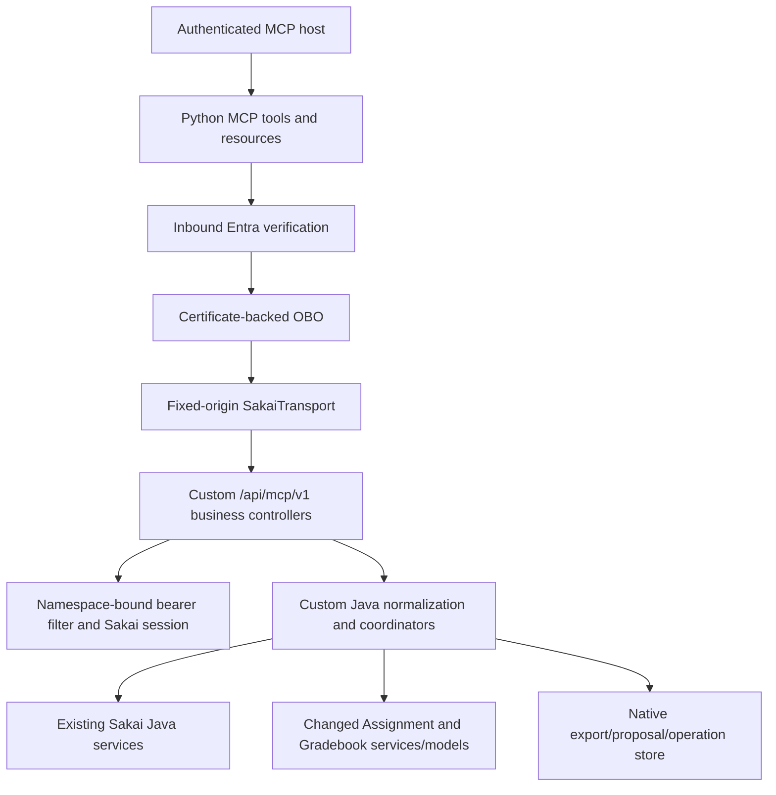
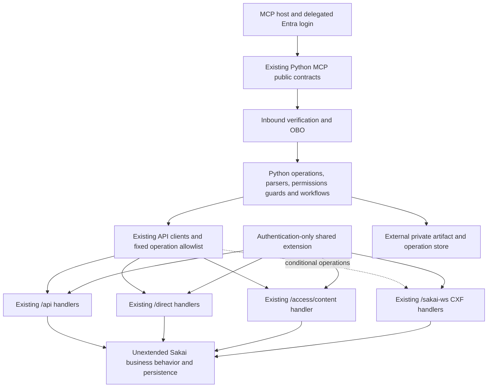
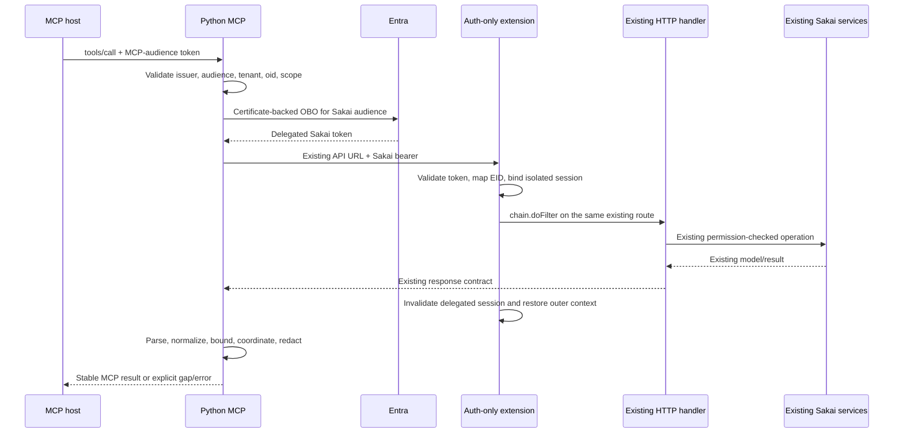
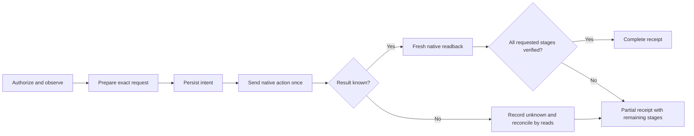
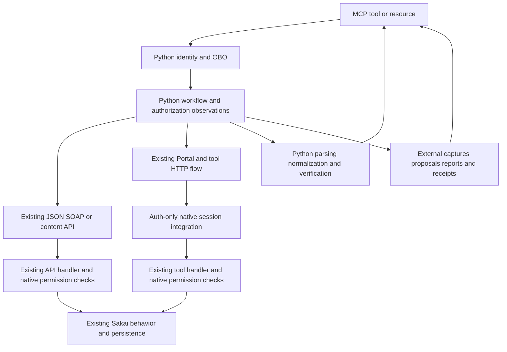

# Sakai existing-HTTP-API migration: implementation and retirement plan

**Research date:** 17 October 2026 (Asia/Karachi). **Repository:** `/Users/burhanahmadkhan/Desktop/sakai-mcp`. **Research baseline:** committed HEAD `208d69ac` plus the current, uncommitted restructuring and other edits described below. **Status:** local implementation resumed on 18 October 2026. See §§0.6–0.9 and `progress.json` for fresh bounded evidence. Historical research/amendment statements below retain their original scope.

## 0. Canonical plan, branch and removal sequence — clarified 18 October 2026

**This is the complete, canonical implementation and migration plan:** `docs/mcp/existing-api-migration/implementation-plan.md`. Implement from this one Markdown document, including its existing-HTTP research, all 22 tool/five resource flows, authentication design, file ledger, preservation requirements, tests, phases and release gates. The file in Downloads is a synchronized delivery copy, not a separate authority. JSON inventories and the browser-research companion are supporting evidence; they do not replace this plan or authorize a conflicting architecture. Update this canonical file first when decisions change and refresh its derived manifests/export deliberately.

**Target:** Python performs Sakai operations through existing HTTP handlers, including the native browser forms/AJAX researched in §16. Sakai retains only the permitted authentication/session integration for MCP; custom MCP business endpoints/services/models/persistence are retired. Ordinary Sakai UI/API functionality and unrelated project changes are retained. Database/storage preservation and rollback remain separate from code removal.

### 0.1 Why removal is not one destructive first step

The inspected Python implementation still calls the custom native endpoints. Deleting all of them first would leave the tools with no working implementation. Migration therefore pairs each replacement with retirement of its old dependency, rather than preserving the old architecture indefinitely or deleting it before its callers are ready.

The first substantive **Sakai application** work is the authentication-only integration and its existing-handler/session tests. Isolated Python parser/contract preparation can happen before or alongside that work because it does not change behavior. Clearly unused interrupted scaffolding can be reviewed and removed/reused early, after checking imports/tests/build consumers; dependency-bearing native business code needs the replacement and compatibility gate below.

### 0.2 Start on a separate Git branch, preserving the actual working tree

As of this documentation clarification, the checked-out branch is `main`; no migration branch has been created. The proposed implementation branch is **`codex/sakai-existing-http-migration`**. This is a proposed name, not evidence of a branch operation. Do not begin further migration implementation on `main`.

1. Inspect current branch/status/index/diffs and all nonignored untracked files again. Use the Phase 0 private checkpoint as recovery evidence, not as a reason to reset or overwrite anything changed later.
2. Review/classify the existing restructuring, unrelated CLI/SSH/CI/seeding/editor work, compatibility fixtures, four interrupted client/parser scaffold files and subsequent planning documents. Preserve them. Build explicit reviewed checkpoints/commits for the selected base; never `git add -A`, blanket commit all work, reset, clean or silently discard source moves. Keep credentials, editor connection configuration, runtime data and private checkpoints out of Git.
3. Create/switch to the agreed migration branch at the current reviewed starting point, ensuring no existing branch is overwritten. A branch is a history pointer: **uncommitted changes normally remain in the same checkout; creating a branch neither saves them nor isolates them.** Preserve/stage only reviewed paths and record which changes predate migration.
4. If filesystem isolation is desired later, a separate worktree must start from the reviewed committed base. Uncommitted/untracked changes are not automatically copied there. A branch alone is the default here; do not invent a second source checkout or start from the remote default branch and thereby lose the current restructuring.
5. Record base SHA, original dirty-tree fingerprint, selected checkpoint commits, branch name and exact migration diffs. Preserve the public catalog/evaluator baselines independently. Creating a branch or pushing commits does not deploy, enable features or change Azure resources.

**Gate:** recoverable reviewed base + migration branch + classified preexisting work + complete tool/route/record coverage. Phase 0's preservation inventory already exists; the branch/reviewed-base portion remains outstanding. No branch creation or source cleanup occurs merely because it is written in this plan.

### 0.3 The first implementation increments

| Order | Concrete work | What is removed or retained at that point | Completion evidence |
|---|---|---|---|
| 1 | Branch/checkpoint/reconcile the working tree; inspect the four unused interrupted Python scaffolds | Remove/reuse only proven unused scaffolding in a focused reviewed change. Preserve unrelated work and frozen contracts. | Baseline/diff/import checks, reviewed path list, no unintended source/data loss. |
| 2 | Prepare selected existing HTTP wire/permission fixtures; redesign/extract the native extension as auth/session-only; test actual existing handlers and multi-request UI state | Retain dependency-bearing legacy business routes temporarily for old Python. No new business controller/service/schema is added. Existing JWT/OBO/account mapping is reused where sound. | Real filter/servlet/forward/session tests; two-user isolation and ordinary login/API regression; auth dependency scan. |
| 3 | Migrate one bounded capability end-to-end, preferably a simple read first, then the existing announcement form flow | Replace its Python route/workflow; remove its custom controller/native helpers once **all** callers/shared consumers are accounted for and tests use the replacement. Do not remove shared helpers needed by another unmigrated capability. | Public contract/role/error tests, existing-handler HTTP trace, no old route dependency for that capability, native build and retention review. |
| 4 | Repeat for reads/files/context, external captures/proposals/receipts, setup/publication and official grading | Each completed capability gets its own retirement change; there is no need to postpone every local deletion until all 22 tools are finished. Native ordinary UI handlers remain. | Capability ledger records caller switch, local retirement, deployed compatibility and rollback separately. |
| 5 | Final auth-only native audit and remaining wiring retirement | Remove remaining MCP business/domain/model/build dependencies only after their last consumer is gone. Retain inert DB columns and old academic/artifact data pending separate cleanup. | All catalogs/resources and traces pass; no equivalent custom endpoint elsewhere; ordinary native consumers pass; data/rollback gates closed. |

Detailed contracts, affected files and tests remain in §§5–16. The sequencing here makes explicit **when to remove the previous additions**; it does not replace that research or authorize behavior loss.

### 0.4 Local removal and deployment removal are different gates

Local migration commits may delete a capability's old controller immediately after its replacement/caller tests pass. That does **not** authorize deploying that native revision while a deployed Python client still needs the deleted route. Keep a compatibility manifest for exact native/Python commits and capability route support.

| Release state | Native support | Compatible Python | Rule |
|---|---|---|---|
| N0/P0 | Current legacy auth/business routes | Legacy Python | Starting behavior only; not the target. |
| N1/P0 | Additive auth for selected existing handlers **plus required legacy routes** | Legacy Python | Safe compatibility stage after authorized native release and acceptance. |
| N1/P1 | Existing-handler auth and required legacy routes | Python switched to tested existing HTTP flows | Verify clients, permissions, records and unknown outcomes before native route retirement. |
| N2/P1 | Auth-only native integration for retired capabilities; their legacy routes removed | Python with no dependency on those routes | Deploy only after every known consumer for those routes is migrated/drained. Legacy P0 is incompatible for those capabilities. |

Repeat N1→P1→N2 per capability/cohort if that reduces risk, or use a consolidated final removal release. Do not deploy the latest native branch tip blindly: select an exact additive-auth revision retaining the routes required by the running client, then a compatible Python revision, then an authorized retirement revision. An older Python rollback may first require restoring a compatible native release; academic effects and new external records are not undone by code rollback. Preserve receipts/backups and invalidate obsolete approvals/revisions as specified in §10.

The phrase **“native retirement last”** elsewhere means last **for each deployed dependency/consumer set**, with a final audit after all capabilities are migrated. It is not an instruction to accumulate all unused native code until the end of local implementation.

### 0.5 Current status and authority

Completed locally: Phase 0 recovery/coverage evidence and source-backed conventional/browser HTTP research for all tools/resources. Four isolated Python client/parser scaffolds were added during an earlier interrupted implementation turn; they remain unwired and unverified. Outstanding: reviewed migration-base commits/branch, auth-only implementation/container proof, dynamic request fixtures, per-tool migration/removal, external-store decisions and live release acceptance.

The user's later requests paused implementation to expand/discuss the plan. This clarification consolidates documentation only. No branch, commit, source removal, schema/storage change, runtime action, feature activation, deployment or academic write is performed by this documentation update. Resume implementation only under the applicable current instruction; keep runtime and destructive/academic actions at their concrete separate authorization gates.

### 0.6 Implementation checkpoint — 18 October 2026

The current user instruction authorizes local implementation; it supersedes the historical paused/research-only statements in this plan. Runtime, academic writes and data cleanup remain unauthorized.

- Verified starting branch `main`, HEAD `208d69ac624910a29a7529934ddcc18bbac853e8`, empty index. Original `--verify-working-tree` passed for all 188 Phase 0 paths and the private archive before changes.
- Reviewed **201** expanded dirty paths: original restructuring/fixtures/unrelated work plus later research and four interrupted scaffolds. Created and read-back-verified a fresh owner-only checkpoint of 155 present non-editor files plus a tracked binary patch. `implementation-start.json` records hashes/classification/recovery metadata; editor configuration was fingerprinted and left untouched. No blanket stage/commit, reset, clean, deletion or source-move reversal occurred.
- Created `codex/sakai-existing-http-migration` at that HEAD. The archive is the recoverable reviewed starting point; no checkpoint commit was manufactured from unrelated work. All uncommitted files remain in the same checkout.
- Retained/revised all four scaffolds after confirming no runtime callers. Fixed current-user/content provenance locators, blocked unaccepted content/calendar execution, tightened reference/numeric/date/XML parsing and response media validation. Decoding errors fail without transient retry. Added explicit narrow WebAPI/EntityBroker clients and synthetic, source-derived wire fixtures with per-operation gaps.
- Fresh local checks: locked dependency sync; lint/format/mypy; **248 Python tests**, including **89 new cases**; all four public catalogs/five resource templates and evaluator/report baselines pass unchanged. All 17 descriptor source methods exist in the import and current source. No delegated/live/parser-capture claim follows from these checks.
- **Phase 0 branch/review/preservation gate is closed using the private checkpoint. Phase 1's initial adopted-read contract/client increment is implemented locally.** The broader browser form/Wicket/packed-score and streaming acceptance cases remain open; do not label the whole of Phase 1/2 complete. No public route switched, no custom native code retired, no Java behavior changed. All 23 legacy business routes remain until tested replacements and shared-consumer gates permit retirement.

Next concrete increment: implement/test the auth-only shared integration and exact chains for A0/A1 placement-free reads, followed by the bounded conversation prototype through real Portal→tool dispatch. Existing `RequestFilter` captures session wrappers and clears thread state; simply widening the legacy filter is insufficient. No new endpoint or domain-service change is authorized. Before T01 cutover, prove token↔native EID binding, effective published/unpublished/deleted-site access, ordinary consumers and cross-user cleanup on those actual handlers. Browser field/role capture and D3/D6 decisions remain later specific gates.

Progress and exact intentional path changes are in `progress.json`; run `check_scope.py --verify-progress`. Original `baseline.json` is immutable. Its original working-tree mode will correctly fail after intentional scaffold changes; that is not preservation loss. Derived canonical-plan hashes are refreshed explicitly; historical research hashes are retained. Downloads export is refreshed from this canonical source.

### 0.7 Authentication and first facade integration — 18 October 2026

The user requested continued local implementation and a more descriptive branch.
The checked-out branch is now **`codex/sakai-python-http-native-auth-only`**;
HEAD and the empty index remain unchanged. The branch rename did not isolate or
save dirty files; the reviewed private checkpoint remains the preservation base.

Implemented an authentication-only shared module and narrowly scoped existing
WebAPI/Direct/Portal/tool registration. Fresh Java 17 regression verification passes
**89 tests**, including the actual existing Sites controller and an embedded
Tomcat Portal/ActiveTool named dispatch with a synthetic receiving servlet. This
proves the tested session chain, not actual business form/rendered role acceptance.
No new native endpoint, business service, permission advisor, schema or persistent
store was added. Existing legacy auth/business routes remain for compatibility.

Python now includes bounded native form/XML/Wicket/Gradebook parsers, single-send
browser conversations, actor/native-visit checks and public course-facade selection
via `COURSE_READ_INTERFACE=existing`. The default stays `legacy` pending delegated
acceptance; failure in existing mode never falls back to a custom route. Public
nonmaintainer site masking and large-site parity remain explicit T01 gates.

External conditional private records, immutable artifacts, original-expiry checks,
managed-identity Blob storage and an observation-only durable send journal are
implemented locally. The store is not provisioned or wired into public grading;
SDK doubles do not prove Azure durability. D3 guarantee acceptance and D6
retention/owner migration remain pending before their respective cutovers.

Fresh Python checks pass **330 tests**, lint, formatting and mypy (56 source files),
including unchanged public catalog/schema/evaluator baselines. See
[the bounded local evidence and concrete gates](local-integration-2026-10-18.md)
and `progress.json`. No custom route is retired yet: default clients still need
all 23, and actual delegated/browser acceptance remains open. This is partial
implementation, not completion of the 22-tool/five-resource migration. No runtime,
academic or stored-data action occurred.

### 0.8 Whole-migration branch and existing reads/discovery — 18 October 2026

The current branch is **`codex/replace-custom-sakai-api`**, renamed after the user
clarified that the branch must communicate the complete architectural correction.
The former authentication-focused name described one final-state constraint, not
the task scope. All 22 tools/five resources and focused native retirement remain
in scope; authentication is a prerequisite. HEAD/index and preservation base are
unchanged.

Implemented B0 discovery from the existing Site pages action with exact actor,
site/page/tool/placement relationships, same-origin URLs and ambiguity handling.
Implemented a second public-facade existing read mode for T03:
`ANNOUNCEMENT_READ_INTERFACE=existing` uses existing Direct announcement reads,
main-channel/message-ID mapping, exact milliseconds and a Python-enforced intended
3650-day posting window. It has no failure fallback to a custom route. Native
request scope was narrowed to those selected existing reads/parameters; no business
handler behavior was changed. The default remains legacy pending acceptance.

T01 now handles published public courses through existing `/direct/site.json`
with explicit native `ACCESS` selection, fresh effective visit permissions and
non-deleted native SQL selection. The selection alone is not a permission grant.
Ambiguous masked false publication states remain explicit. Pagination advances by
observed rows to respect configured native page caps, rejects repeats and is
bounded to 20 pages. The original sorted 500-visitable-course cap is retained,
including Java UTF-16 title/ID ordering, instead of rejecting lists above 500.

Found a potential native Portal diagnostic-body credential exposure in source.
Auth-boundary response buffering now prevents partial emission, detects native
session credentials in body/headers, rejects unchecked compressed encodings and
sanitizes unhandled handler errors. This is credential handling, not Java parsing
of business content. Future large-file streaming needs its own reviewed solution.

Fresh verification: **360 Python tests**, lint/format/types (60 source files),
wheel/sdist; **100 Java tests** across actual existing providers, auth/container,
WebAPI and retained legacy/login regressions; native auth package build. See
[read/discovery evidence](read-discovery-2026-10-18.md). T01/T03 default cutover,
rendered browser flows/roles, other capability migrations and focused retirement
remain open. All 23 custom routes still have default/legacy consumers. D3/D6 do
not prevent independently answerable local implementation. No runtime, academic
write, schema or stored-record action occurred.

### 0.9 T01 actual default cutover and focused retirement — 19 October 2026

The user's instruction is to migrate each public tool through its actual facade,
test it, switch callers and retire its old dependency before moving on. Alternative
clients behind configuration flags do not by themselves complete a tool migration.

`list_my_courses` now always uses existing current-user, rich Sites and Direct
site/permission/ACCESS HTTP handlers. Its name, arguments and response contract
remain unchanged. `sakai/courses.py` owns the implementation; the duplicate
`existing_courses.py` helper and `COURSE_READ_INTERFACE` setting are removed.
Python keeps parsing, identity validation, eligibility checks, sorting and the
500-visitable-course cap. The actual native DTO/JSON encoder test establishes
that an exact nonempty DTO ID proves the publication field is unmasked; this
supports unpublished public members without granting extra permissions. Deleted
state still requires an independent native proof. Masked states with insufficient
proof fail explicitly; no legacy fallback or concurrency guarantee is introduced.

After facade/SDK pipeline tests passed, removed only `McpCourseController.courses`,
its `Course` record and private `canVisit` helper. The shared controller retains
announcement reads for their current callers. A negative Spring route test checks
that course listing is no longer registered, while announcement denial checks stay.
The 23-route historical inventory is retained: 22 remain active locally and the
course-list entry is marked `retired-local`. T01's former dependency is historical,
not a current caller. No native file, schema, export, proposal, receipt or academic
record was deleted in this increment. A read-back-verified owner-only T01 checkpoint
preserves the prior edited files in addition to the immutable implementation start.

See [T01 cutover evidence](t01-course-cutover-2026-10-19.md) and `progress.json`
for fresh checks and limitations. This is a **local source cutover**, not deployed
acceptance. Live native roles/cache/SQL, large-inventory performance and actual
configured auth remain release gates. The native branch tip is now incompatible
with P0 course clients. Prepare an exact additive N1 revision retaining their route,
then P1 acceptance, then N2 retirement per §0.4; do not deploy this dirty tip blindly.
No runtime action or feature activation is authorized by this local change.

Next capability is T03 announcement reads: resolve merged-channel ordering,
selected-role filtering, date windows and provider error/completeness behavior
before switching its default and removing its shared native read method. Other
21 tools and five resources still require their own migration/retirement evidence.

### 0.10 T03/T19 default read cohort and bounded retirement — 19 October 2026

`get_course_announcements` now always uses existing Direct HTTP from the original
`sakai/announcements.py`. Removed its duplicate helper and temporary selector.
Fresh provider characterization demonstrates selected-role inclusion/exclusion,
swallowed DTO decoration errors and empty missing-channel fallback. Therefore the
public dynamic result explicitly adds `coverage.complete=false` with bounded
provider-observation provenance; fewer than 1000 rows cannot certify completeness.
Public cursors bind the verified subject/site/delivered observation and reject
changed actors, changed observations and legacy numeric cursors. Every page
reauthorizes. The native provider still owns visibility; Python preserves native message IDs,
literal bodies, milliseconds, main-channel selection, intended 3650-day posting
window and 50-row cap. B2 native list/detail completeness remains open. This is
an actual default replacement with disclosed coverage limits, not full parity.

`list_assignments` now always uses existing Assignment site HTTP after fresh
actor/course/effective **site-wide asn.grade** evidence. This is a bounded deliberate
site-wide grading over-fetch, never setup planning or a group-TA read. Python drops
evidence/private fields before hashing/public output. Group-only TAs fail explicitly
before the hydrated route; B3/B7 metadata-only enumeration remains their concrete
next candidate. Source/live supplementary-content entitlement and serializer
completeness remain acceptance gates. No native permission or handler is changed.
The public schema stays unchanged; `http1-` metadata/snapshot revisions are limited
observations bound to actor/site, invalidate legacy cursors and promise no native
CAS/full configuration coverage. Unmigrated context/write tools still obtain their
own native revisions; discovery tokens do not replace those preconditions.

Removed the unused `McpCourseController` after its last announcement caller moved,
and `McpGradingAssignmentsController` plus the sole `listAssignments` service method.
Shared query/auth/evidence/metadata/store helpers and announcement creation remain.
Three old routes are now retired locally; twenty remain. Nineteen other tools and
all five resources still require replacement. This cohort does not close D3/D6,
role/completeness parity or delegated live acceptance.

See [cohort evidence](read-cohort-cutover-2026-10-19.md) and `progress.json` for
fresh verification and precise caller/retirement records. Individually checkpointed
native-source deletion is now verified without changing the original preservation
baseline/start archives; all other preexisting presence/modes remain protected.
The local native tip is also incompatible with older announcement/discovery clients.
Exact additive N1/P0 → accepted P1 → authorized N2 ordering remains mandatory.
No deployment, feature activation, academic write, schema/stored-record change or
Azure runtime action occurred. Next independently useful work is B2 completeness,
B3/B7 group-only metadata discovery and T02 current-user Gradebook correlation.

### 0.11 Five additional default tools and focused retirement — 19 October 2026

The original facades now replace T02 `get_my_grades`, T04
`get_course_submissions`, T05 `create_course_announcement`, T10
`list_assignment_submissions` and T11 `get_assignment_submission` through existing
HTTP, with no legacy fallback or implementation selector. Shared Python workflows
coordinate current-user Gradebook views, submitted evidence and native Add forms.
Eight of 22 tools have local default replacements; fourteen still need migration.
This count is implementation replacement, not complete functional/live acceptance.

T02 uses the actual current-user StudentPage with released item metadata and
collision-safe native ID/title/max correlation. The student A2 shortcut is used
only after fresh effective permissions exclude all native aggregate branches;
grader/mixed roles never call aggregate grades for an own score. Display precision,
localized/percentage formats, ambiguous identity and missing placements remain
explicit limits. Item-data may initialize Gradebook and is attempted once.

T04/T10/T11 require site-wide grading permission, then an existing native grading
list positively exposing individual identities before selected-item hydration.
Known anonymous/group assignments and group-only TAs fail before hydration.
Returned observations include only submitted individual rows; native DTOs may omit
inactive/failed records. Missing/unsubmitted/orphan roster entries are not proved.
Public completeness is false, flags/attempt/overrides remain unknown, displayed
scores are not rescaled, and second-resolution dates are disclosed. `http1-`
observations detect exposed changes, never native lock/CAS or attachment bytes.
The evaluator continues to reject incomplete evidence. R01 inline reads refetch and
check revision; attachment retrieval is explicitly unsupported pending content-route
scope/integrity proof. R01 is only partially replaced; all five resource families
still need completion.

T05 uses existing Add/reviseForm controls, plain-text escaping, immediate site/main
publication and **optional** notification priority (`notify=o`). The old native
`commitMessage(edit)` also delegates to `NOTI_OPTIONAL` (BaseMessage:2635).
A configured durable private store is mandatory before HTTP; no production memory
fallback or provisioning occurs. Intent/Sending persist before one POST. A matching
new native list reference plus existing-provider readback is an observation, not a
causal receipt. Timeout/error/ambiguous response remains journaled unknown and is
never automatically resent. A new invocation is a new intent; there is no public
idempotency key. D6 store/retention and actual notification/form acceptance remain
open; local tests send only mocked synthetic messages.

Retired six additional custom routes, three sole-purpose controllers and the
unreferenced list/detail/submission-file service methods. Fourteen business routes
remain for their actual callers; shared authorization/evidence/roster/export/
proposal/mutation/store helpers remain. Academic records/schema/private exports,
proposals and receipts are untouched. Original preservation baseline/start and
private checkpoints remain immutable. This local native tip cannot serve older
clients of the retired routes; N1/P0 -> accepted P1 -> N2 ordering still applies.
See [five-tool evidence](five-tool-cutover-2026-10-19.md), coverage and progress for
fresh checks and separate live/deployment gates. No activation or deployment occurred.


### 0.12 External captures and selected grade observations — 19 October 2026

Fresh Git verification matches the independent-line handoff: migration worktree
HEAD `0f9f44a7`, custom worktree/branch and main at `208d69ac`; original source,
archives and editor files preserved. See `git-worktrees.md` and the new explicit
`continuation-2026-10-19.json` preservation record, not a rewritten start manifest.

T12 export, T13 export read, T16 selected grades, T21 frozen proposal read and T22
resource fallback now use their actual default facades over existing HTTP/private
external records, without legacy fallback. **13 defaults locally replaced; nine
still require migration.** This records implementation replacement separately from
functionality/live acceptance. New captures contain inline bytes only, always
partial/incomplete. Same-ID requests never resume/recapture or extend expiry;
owner, current source scope, artifact integrity and original expiry are checked.
T16 establishes release from exact existing native list cells/links, distinct from
returned, but independent Gradebook readback stays unavailable and completeness
false. Source/representation/paging limits remain explicit. T21 reads frozen records;
legacy owner conversion/import is not implemented or authorized. T20 MCQ preparation
remains blocked on complete source evidence and is **not** counted as a completion.
The evaluator and its complete-input gate are unchanged.

Retired seven more custom routes and three unused native file/export/proposal
services plus the sole selected-grades query method. **16 retired locally, seven
remain.** Shared query/context/mutation/authorization/evidence/projection/native
store and domain/UI helpers remain for actual callers. Academic data/schema,
exports, proposals, receipts and native cleanup ownership are preserved. R01 stays
inline-only; R02 Assignment files explicitly unsupported; R03–R05 use external
records locally, with full family/legacy/live acceptance open. No native business
handler, permission, model or storage was added. No deployment/runtime/academic
operation occurred. Compatibility remains additive auth → accepted Python →
authorized native retirement, never a blind native-tip release against old clients.
See [fresh scoped evidence](external-capture-cutover-2026-10-19.md), current limits,
coverage and progress for exact verification and next gates.


The [current tool limitations reference](tool-limitations.md) consolidates per-tool
restrictions, caps, error behavior and unresolved acceptance gates. Keep it current
with capability changes; dated cutover reports remain historical evidence.


### 0.13 Selected Gradebook readback and paging — 20 October 2026

Fresh repository verification retained migration HEAD `0f9f44a7`, independent
custom baseline/main `208d69ac` and the saved support/restructuring/migration
ancestry. October 19 evidence is historical. A new owner-only 292-file checkpoint
precedes edits; `continuation-2026-10-20.json` chains exact prior record bytes and
source hashes without rewriting original manifests or the October 19 continuation.

T16's existing default now follows rendered Assignment grading-list Next controls
in bounded same-conversation enumeration before/after release observation. It also
reads independent B6 point display scores for instructors with fresh full grading,
item-edit and instructor-role functions. Site/Gradebook UID, external Assignment
reference/application and student UID bind the projection; no title correlation or
Assignment-score substitution. Other Assignment graders retain explicit unavailable
projection. Category-aware score decoding, precision restrictions, unavailable
comment bytes, non-atomic reads, native table over-fetch/initialization effects and
actual-view acceptance gates are documented in `tool-limitations.md`.

The native no-submission template branch lacks stable student IDs. Paging therefore
does not resolve B7 complete eligible roster; source hydration refuses all-missing
views without positive individual identity evidence. B8 attachment scope/fidelity,
strict context field coverage and T20 complete-input gate remain open. No new tool
is counted for these T16 improvements: **13 default replacements, nine remaining;
16 routes retired locally, seven active**. No additional native source retirement,
permission/service/model/schema change, runtime change or academic write occurred.
Shared native context/mutation/store/domain dependencies remain for actual callers.
See [fresh evidence](readback-2026-10-20.md); additive auth → accepted Python →
separately authorized native retirement ordering remains binding.

### 0.14 Practical setup defaults — 20 October 2026

The user prioritized a working useful subset and continuing independent migrations
before closing every previous read limitation. This does not authorize weaker
identity/permissions, fabricated values, automatic uncertain-write retries, native
business additions or runtime/academic operations. T06 assessment context, T07
creation and T08 publication now use their actual Python default facades over existing
Assignment list/edit/save/post and external journals, without legacy fallback.
**16 defaults locally replaced, six remaining; 19 routes retired locally, four active.**

T06 returns labelled metadata observations/revisions and bounded independently
observed Gradebook metadata from the existing item-data endpoint, without student
score/submission reads during setup. Strict full Assignment/Category fields remain unavailable,
with unavailable sections rather than fake flags or complete inventories. T07/T08
support individual points assignments, draft/posted create and current-draft publish,
minute dates converted to verified native user timezone, common submission/resubmission
modes, no current attachments/calendar deadline, and no-link or the native released/
counted external Gradebook policy. Native category/counting constraints are enforced.
Unsupported policies fail before POST. Normalized instructions or later Gradebook
verification gaps preserve known IDs and explicit partial review status. All successes
remain partial under the frozen full Assignment contract. No native private-first,
CAS, causation, atomic setup or automatic recovery guarantee is inferred.

Three unused native routes, their two controllers and setup coordinator are retired
locally with dedicated tests archived. Shared McpAssessmentService is reduced to its
unchanged revision method, required by retained grading context/evidence callers.
Ordinary Assignment/Gradebook/Calendar native handlers, auth, domain/schema/private
records and independent custom baseline remain untouched. Source and selected stale
generated classes are privately preserved. New named continuation
`continuation-2026-10-20-setup.json` pins the prior October 20 record; original
manifests and older continuation records remain unchanged.

See [setup cutover evidence](setup-cutover-2026-10-20.md), current limitations,
coverage, progress and native ledger. Local implementation is distinct from full
functionality, actual native rendered/delegated acceptance and deployment. Compatible
release remains additive native auth → accepted Python HTTP cutover → separately
authorized native retirement. The migration native tip cannot serve older clients
that require any retired route. No push, deployment, activation, academic operation,
Azure change, data import or cleanup occurred.

### 0.15 Grading-context and grade-payload dependency review — 20 October 2026

The next T09/T18 group was traced through the public grading facade, its native DTOs, current default callers, selected-grade readback, Assignment HTTP metadata and the retained Java revision consumer. Neither target was switched or counted.

T09's frozen context contract requires non-null configuration fields and booleans for deletion, native release, group/anonymous policy and capabilities; it has no unknown representation for several of these. The existing Assignment entity projection covers some settings but omits others. The setup edit form is permission-gated and does not establish those fields for a grade-only TA. Returning defaults would invent academic state; returning a different partial schema would change frozen contracts. Thus the strict context cannot currently be built from the verified existing-HTTP evidence without either an unproven role/form path or an inaccurate result.

There is a second dependency: current save/release requests consume the assignment revision returned by T09. `McpAssessmentService.revision(Assignment)` hashes persisted content and associations, including release, deleted/individual/content-review flags, attachments and the complete property map. Existing HTTP Assignment metadata and the setup form do not expose that exact semantic input. The new `http1-` observation revision is a different projection and is not accepted by the still-active native mutation service. Passing it through would make prepared arguments incompatible; substituting the old revision would retain the business route being migrated. The setup-specific form observation revision also remains a distinct projection and is not interchangeable.

T18 currently sends `mode=validate` to the native save or release route. That route does no academic commit in validation mode, but it does native assignment/submission authorization, semantic revision, row content/grade revision, score bound, and field-state validation. Its response shape and public description mean current state was validated. The existing native UI has no equivalent dry-run operation. A static Python-only result cannot claim that validation, and changing the frozen result/descriptions to label it schema-only is outside this increment.

Keep T09/T18 and their shared revision dependency intact until a coordinated plan preserves the grading-context → prepare → separately approved save/release chain. The next concrete research gate is to establish an existing-HTTP source for every revision input or sequence a compatible T14/T15 observation-revision cutover with the context/preparation callers; separately resolve D3 write/recovery semantics and D6 durable operation ownership before mutation migration. No custom endpoint/service, property, schema, permission or native API behavior may be added to bridge the gap. Evidence and exact source references are in [grading context/payload review](grading-context-payload-review-2026-10-20.md).

### 0.16 Revision input review and independent operation receipt default — 20 October 2026

The subsequent source review checked all 22 inputs to the old semantic Assignment hash against Direct JSON/XML, the curated PropertiesProvider map, Assignment SOAP lists, native edit/grading forms and the archive path. The full property map, raw scale/points, native release/deleted/individual/content-review flags and exact attachment-reference inventory cannot all be reconstructed from the researched delegated views. JSON/XML share the same DTO; requesting XML adds no fields. The archive contains raw data but its HTTP caller requires superuser authority and creates an archive, so it is not an accepted delegated read. T09/T18 remain unmigrated; their revision consumer coupling to current native writes is real.

Clarification of §0.15: an existing UI dry-run action is **not** required for Python advisory validation. The canonical T18 design is read-only preflight over existing evidence. Frozen schemas allow warnings and rejected/partial results. The actual unresolved issues are sufficient source/field evidence and compatible revision handling across still-native T14/T15, not the absence of a native `validate` action. Do not turn that earlier inference into a general prerequisite for Python preparation.

T17 `get_assignment_grading_operation` now uses its actual external-record default with fresh existing-HTTP owner/site/individual-submission authorization. This is a useful historical receipt subset: exact request/row/hash/binding checks, no pending execution or academic HTTP, immutable reads, withheld historical Gradebook values, and unchanged unknown outcomes. It does not claim causal readback reconciliation or import legacy native records. The former native operation reader also only reauthorized and returned its stored receipt; it did not reconcile unknown rows.

To keep receipt reads usable with the currently native T14/T15 writers, Python now journals commit intent externally before their one native POST, persists a confirmed native reply externally, and preserves unknown after lost/malformed replies or receipt-persistence failures. Repeated operation IDs return their existing external record and never send/resume; different hashes conflict. This is transitional external coordination, **not** migration of the underlying save/release business calls. Validation mode remains native and is not an academic commit. Configured durable storage is required before HTTP for commits; backend/retention/legacy/live gates stay open.

Removed only the unused native operation-read mapping and `McpGradeMutationService.operation`, plus its optional test emitter. Native grading context, save/release implementation, private store/writer/idempotency records, cleanup, domain/schema and ordinary handlers remain. **17 defaults locally replaced; five tools remain. Twenty historical routes retired locally; three active.** Public contracts/catalog/descriptions/evaluator/report baselines are preserved. See [operation receipt evidence](operation-read-2026-10-20.md). No runtime/deployment/academic operation occurred.

### 0.17 Existing HTTP grading write subset and advisory preparation — 20 October 2026

T14 `save_assignment_grades`, T15 `release_assignment_grades` and T18
`prepare_assignment_grade_payload` now use their actual default facades through
`workflows/grading_writes.py`, existing Direct `assignment/setGrade.json` and
read-only Python preflight. There is no native business-route fallback. T18 keeps
the frozen canonical payload hash and exact commit arguments; validation sends
no academic POST. This supersedes the T18/write status in §§0.15–0.16.

The useful subset is one submitted individual, site-wide points row, an integer
displayed score, English locale, an editable native Assignment with no Gradebook
integration and the existing instructor/item-edit authorities. Unsupported groups,
anonymous/peer/review/rubric/tag/calendar/attachment and policy variants fail before
mutation. Existing private notes, feedback text/comment and resubmission/extension
properties must be observable and exactly preservable; text is restricted to plain
ASCII. `save` retains an unreleased row; `return` performs native return/release
with its existing notification effects. Already released/returned rows are rejected.

Use the HTTP Assignment metadata revision returned by `list_assignments` or
`get_assignment_grades`, plus the current T11 submission grade revision or T16
composite grade/release revision and content revision. Both row projections are
explicitly checked against current observations. T09's native semantic revision
is not interchangeable; the retained context now advertises prepare/save/release
unsupported with a reason directing callers to HTTP observations. Its strict full
Assignment contract remains a migration gate; no missing configuration is guessed.

A configured durable external journal precedes academic HTTP. Prepared/Sending
precedes one POST, repeated IDs read their historical record without replay, and
uncertain writes remain unknown. A second read narrows races without acquiring
native locks/CAS; readback is not causal or atomic. Successful writes always return
`outcome=partial`, with explicit observed stages/revisions and warnings. No
Gradebook score/projection success, batch atomicity or concurrency protection is
claimed. D3 acceptance, D6 backend/retention/legacy compatibility and D8 real
native-role/rendered/deployment acceptance remain open.

The unused save/release mappings and `McpGradeMutationService` are retired after
actual default and caller review. Native context, shared helpers, original private
records, schema, domain helpers and cleanup remain preserved. Mutation-only helper
methods are explicitly recorded for subsequent D7 retirement review. **20 of 22
actual defaults are replaced locally; T09 and T20 remain. 22 of 23 historical
native business routes are retired; only grading-context remains.** No resource
family is fully migrated. See [fresh evidence](grading-write-2026-10-20.md).

### 0.18 Remaining evidence gates and focused helper retirement — 20 October 2026

The post-write review leaves totals unchanged: **20/22 actual defaults replaced,
22/23 historical native routes retired locally**. T09's frozen Assignment object
still requires a raw scale factor and native release flag which the researched
Direct DTO/edit forms do not certify; warnings cannot make invented required fields
valid. T20 still rejects current partial captures before native context/evaluation
or proposal persistence. No complete-input gate or evaluator fingerprint changed.

Additional roster research checked existing `assignment/gradable`, site membership
and role-permission reads. The modern grader enumerates stored submissions, not
students without records, despite computing allowed/visible users internally.
Membership responses offer stable IDs/active/roles with separate roster authority,
privacy and user-directory omission behavior. Site role permissions require site
maintainer authority and are not equivalent to Assignment-reference realm unlocks.
The membership provider's current start/limit loop also prevents using a normal
pagination exhaustion assertion as completeness proof. These remain candidates,
not adopted credential routes or complete eligible-roster replacements. No display
name, role name or empty page is used to infer missing-student identity/eligibility.

The four methods deferred in §0.17 now have no production/test caller after
`McpGradeMutationService` retirement and are removed: Gradebook projection
`writeTarget`/`target`, grading evidence `revision`/`current`. Removed only their
unused injected collaborators and mutation-only test mocks; retained context
`link`/`writable`, evidence mapping, authorizers and semantic metadata hash remain.
Actual Spring wiring verifies the smaller constructors and absent helper methods.
No native business operation/permission/model/schema/data behavior is added.

This closes only that focused D7 helper cleanup. Assignment factory, hydration,
version/lock, store/configuration and legacy record/cleanup reviews remain open.
See [review and fresh verification](evidence-review-2026-10-20.md). No deployment,
feature activation, runtime change or academic operation occurred.

### 0.19 Native attachment handler characterization — 20 October 2026

Nine new tests exercise the unchanged `BaseContentService.handleAccessResource`
with synthetic ACL/storage/resource collaborators: exact text bytes/MIME, read
permission and copyright gates, output-filter changes, truncated success, URL and
cloud redirects, sendfile success without body and the configured default HTML
filter's identity behavior on text/plain/PDF. They establish handler behavior,
not effective native-role ACL correctness or delegated AccessServlet integration.
HTTP 200 alone is demonstrably insufficient evidence of complete stored bytes.

A credential-guard regression keeps the unaccepted `/access/content` context
rejected before identity binding. Three Python checks cover the actual content
method and R01/R02 resource facades rejecting before HTTP/OBO. `CONTENT` remains
blocked; no new content credential reach, servlet registration or business code.
The next local implementation gate is a proven delegated RequestFilter → actual
AccessServlet → native permission/content chain, plus source-bound response
validation and the supported MIME/storage/filter policy. No attachment availability
or complete MCQ input is claimed from handler-only tests.

Additional source review found `roster-membership/{site}/get-membership` has
proper page/all/total structure but reports the already filtered roster: hidden
members, configured visible-role filters, group authority, caching and directory
omissions apply. Optional pronunciation integration can contact a third party.
Assignment-reference authorization also includes the Assignment's own realm,
so combining generic site memberships with site role functions is not a proven
eligible-submitter calculation. No roster route was adopted.

Totals remain 20/22 local actual defaults and 22/23 retired historical business
routes; T09/T20 and all full-resource-family gates remain. See
[native attachment proof](attachment-proof-2026-10-20.md). No runtime change.

### 0.20 Attachment proof audit: failures recorded without fixes — 20 October 2026

At the user's explicit direction, run proofs and record any failing test without
repairing it. Two actual AccessServlet.dispatch → unchanged native content-handler
cases pass using synthetic session/ACL/resource/storage collaborators. The positive
delegated chain probe fails HTTP403 at the current credential guard; RequestFilter,
binder and AccessServlet/content target are never reached. Missing Access servlet
auth filter registration is independently visible in source. Actual role grants,
source-binding/response validation, concurrency and live configuration remain
unproved. No content credential reach or production implementation was changed.

A separate Python positive-readiness probe errors during collection because its
external test path cannot import `tests` with the recorded invocation. No Python
capability result may be inferred from it; the harness failure is preserved without
fixing source or changing invocation/environment. Positive readiness probes are
explicitly selected outside the normal passing regression suite; a passing
regression run does not erase the failed proof. See [audit](attachment-audit-2026-10-20.md)
and [machine results](attachment-audit-results-2026-10-20.json).

Counts stay 20/22 actual defaults and 22/23 historical routes retired locally.
No deployment, feature activation, native record/schema change or academic operation.

## 1. Executive findings and binding decisions

The current implementation does not meet the required integration boundary. Its Python operations call project-created `/api/mcp/v1/*` HTTP handlers. Those handlers invoke Java services, normalize results, coordinate setup and grading, persist exports/proposals/receipts, and depend on changes to Assignment and Gradebook services and a submission version column. Delegated authentication is also restricted to that custom namespace. Calling an existing Java service inside one of these controllers is not using an existing Sakai HTTP API.

The target is an external Python integration over **unchanged, baseline Sakai HTTP operation handlers**, with an authentication-only extension binding a verified delegated identity to Sakai's existing session infrastructure. Python owns all response interpretation, identifier mapping, pagination, completeness, proposals, artifacts, workflow state, reconciliation, and audit translation. No new business or authentication HTTP endpoint is proposed.

**Expanded research amendment:** after the initial plan, the user explicitly required existing browser-facing HTTP requests and multi-request UI workflows to be investigated for every tool. **Section 16 supersedes the earlier exclusion of Portal/tool HTML and Wicket workflows.** It contains all 22 ordered tool flows, five resource flows, exact native action/form candidates, source references, verification and recovery, and revised authentication/session design.

The broader search identifies existing browser paths for announcement creation, Assignment draft saves and publication, native linked calendar deadlines, Gradebook metadata/individual scores and additional submission state. Those capabilities are **not established as missing over HTTP**. Conventional API cards A0–A14 remain useful interface research, but their gaps must be read together with B0–B10 and T01–T22 in section 16.

1. Use the narrowest adequate existing JSON/SOAP/content interface; use the existing native browser form/AJAX sequence where required. Python owns response parsing, state/navigation, normalization, evidence capture, proposals, reports and durable receipts.
2. Native UI flows need bounded actor-bound session continuity, real placement dispatch and native CSRF/Wicket state. A new authentication-only flow integration is required; per-request invalidation alone cannot support these flows. No new native HTTP endpoint, domain service or persistence is proposed.
3. Ordinary native saves/returns, publication and linked-tool integration are usable candidates without reproducing every extra lock/staging guarantee previously added for MCP. State actual native semantics, partial outcomes and remaining compatibility differences; do not silently promise CAS or atomic multi-request behavior.
4. Security, native object identity, active-mode field coverage, precision, scope/over-fetch and current role behavior still require explicit tests. Source-confirmed forms are credible candidates, not delegated live acceptance. Filtering unauthorized data afterward is never a security repair.
5. Preserve public catalogs/contracts where honest and exhaust the documented existing HTTP candidates before accepting a capability/schema reduction. New browser paths replace earlier absence-based conclusions; any remaining specific gap gets evidence and alternatives, not another native business wrapper.

**Authorization/state:** the original research was planning-only. Phase 0 later preserved the dirty tree; an interrupted implementation turn added four unwired client/parser scaffolds. This expanded research revision changes the plan and research metadata only. No deployment, Azure start/stop, schema/storage cleanup, feature activation or academic mutation occurred as part of this revision. Earlier dated source/deployment observations remain historical; no current native/live browser state is inferred from them.

## 2. Evidence, provenance, and observed state

### 2.1 Evidence vocabulary

| Label | Meaning |
|---|---|
| **SC** | Source-confirmed: traced in current local source and, for existing APIs, checked against the imported upstream tree. Establishes implementation, not deployed availability or live correctness. |
| **PE** | Previously exercised: a dated repository record describes an actual call. Its identity, version, role, and interface limits still apply. |
| **FV** | Freshly verified during this planning session, with the exact scope stated. |
| **I** | Inference or proposed design requiring implementation/testing; never call this a proven integration. |
| **U** | Unsupported or missing evidence for the required behavior in the searched interfaces. Negative catalog evidence is bounded to the inspected source, not a claim about every Sakai installation. |

The detailed existing-API cards in §5 are part of every replacement-matrix row in §6. Together they specify methods, paths, formats, scope, ordering, errors, side effects, authentication, and remaining probes. Representative payloads are **illustrations of source-backed fields**, not captured live fixtures. Optional fields and serializer envelopes still need sanitized fixtures from the selected deployed version.

### 2.2 Upstream baseline independently checked

`docs/SAKAI_SOURCE.md` records Sakai 25.2 at upstream `b5b7800f0fcddf9d0db47276a66065189365d905`. Root commit `e092fa04` imported the source as a normal tracked subtree, without upstream commit history or a nested repository. `apps/sakai/pom.xml` uses 25.2. [S01](#s01)

A fresh read of the official GitHub Git Trees API for that upstream revision was compared **in memory** with `git ls-tree e092fa04:apps/sakai`. All **105 upstream root children** had the same Git mode and object SHA as the import; the sole additional imported root entry was `AGENTS.md`. Matching subtree objects establish all descendants of those children, rather than merely matching version strings. The import tree was `56d81ebd06f22801f8411a121a381483d311f2c4`. A first recursive API download failed with `IncompleteRead`; no full recursive-JSON comparison is claimed. The successful nonrecursive object comparison provides the stronger compact provenance check needed here. [Official upstream tree](https://api.github.com/repos/sakaiproject/sakai/git/trees/b5b7800f0fcddf9d0db47276a66065189365d905), [upstream Assignment provider](https://github.com/sakaiproject/sakai/blob/b5b7800f0fcddf9d0db47276a66065189365d905/assignment/tool/src/java/org/sakaiproject/assignment/entityproviders/AssignmentEntityProvider.java).

Therefore unchanged providers/controllers in that import are genuine preexisting interfaces. Project changes are identified by `git diff e092fa04 -- apps/sakai`, plus untracked additions; the mere presence of a file under `apps/sakai` proves nothing about customization.

Relevant local history:

| Commit | Significance |
|---|---|
| `e092fa04` | Upstream source import. |
| `d97ce2f7` | Guarded custom MCP WebAPI adapter and preparation. |
| `4f2d932d`, `3ab72266`, `46fa4012` | Course layout, placement readiness, and roster visibility; separate customization. |
| `76fe89ff` | Optional setup tools and native setup support. |
| `98cbc53e` | Persisted Gradebook date comparison repair. |
| `ea2f041d`, `6dcad342` | Calendar nullability correction/release evidence. |
| `824f1caa` | Grading workflow, native persistence/concurrency support. |
| `10b1561e`, `36597479` | Transactional evidence hydration and ordinary student-page repair. |
| `d54bcc13` | Exclude grade-capable members from grading roster. |
| `208d69ac` | Grading resources/proposal extension and current committed HEAD. |

### 2.3 Working tree preservation

`git status --porcelain=v1` reported **118 entries**: 36 modified, 42 deleted, 40 untracked file/directory entries. A directory entry can contain several files. The current source reorganizes Java into `mcp/{security,courses,announcements,assessment,contracts,grading}` and Python into `security/`, `contracts/`, `sakai/`, `workflows/`, `grading/`, and `mcp/`. Deleted flat files plus untracked packages are moves/extractions, not an already completed architectural retirement. [S02–S04]

Preexisting unrelated or separable edits include CLI/SSH/Azure helpers, `.vscode`, `.github/copilot-instructions.md`, `.gitignore`, CI and packaging changes, seeding skill work, and evidence/documentation corrections. Do not reset, clean, stash indiscriminately, restore all deleted files, or replace the subtree with vanilla Sakai. Do not apply patches against the old flat filenames without inspecting their current destination.

Implementation phase 0 must record a reviewed checkpoint of tracked **and untracked** work, confidential files excluded. Identify which changes belong to the restructuring versus independent user work. A new worktree starts from a commit and does not automatically carry these uncommitted changes; do not assume otherwise. Preserve the current source map, public-schema fixtures, evaluator fingerprint, and lifecycle improvements where useful. This planning session left repository contents unchanged.

### 2.4 Fresh Azure observations versus deployment history

Read-only `./sakai status` checked the expected subscription and returned:

| Item | FV observation on 17 October 2026 | What it does not prove |
|---|---|---|
| Subscription | Expected Sakai subscription; display name Azure for Students | Authorization for a change. |
| `vm-sakai-dev` | **VM deallocated** | Which native source is installed, current properties, DB schema, or live handler behavior. |
| MySQL Flexible Server | **Ready**, public network access Disabled | Table contents, migration completion, or access from Sakai. |
| `ca-mcp-sakai-dev` | Control-plane Running, minReplicas 0, maxReplicas 2 | An active replica count, dependency health, or successful tools. |
| MCP revision | Latest and ready: `ca-mcp-sakai-dev--0000018`; ingress 100% latest | Fresh MCP discovery. |
| MCP image | Digest `sha256:5c1079b759f0c1af56dcefbbacee2152296285ca2e8247bec01982ec69a6db4b` | That current working-tree resources/22-tool implementation is deployed. |
| MCP feature env | Setup=true, grading=true | Matching native flags or client catalog. |

The image/revision/gates were selected read-only from `az containerapp show`; secrets and credentials were not retrieved. The status script skipped public Sakai HTTPS because the VM is deallocated. No resource was started, no SSH allowlist refreshed, and no authenticated API call or academic write was attempted. Do not call `./sakai shell` merely for status: it may refresh an NSG rule. Native runtime manifest, Tomcat WARs, properties, schema, private store inventory, and delegated API behavior remain unverified. [S05](#s05)

Historical evidence distinguishes:

- Setup development release on 9 October: eight tools and custom setup behavior, including concurrent promotion/readback checks.
- Grading release on 13 October: seventeen tools from the older image, native schema/storage preparation, student-page repair, and instructor reads. The 14 October retained run records approved saves/returns for 73 rows and ambiguous return/reconciliation limitations.
- Uncommitted restructuring evidence on 15 October: 159 Python tests, 72 focused Java/login tests, compatibility hashes; local evidence only.
- Current source: 5/8/19/22 tools and five grading resource templates. The historical image is not evidence that the newer 22-tool/resource catalog is live.

These tests are useful behavior and compatibility evidence. They do **not** establish compliance with the corrected API boundary. No tests were rerun in this planning-only session; running them may write caches/build outputs and was unnecessary to determine the source architecture. [S06](#s06)

## 3. Current and target request flows

### 3.1 Current architecture and divergence



The diagram groups the filter with its namespace; actual servlet order is RequestFilter → bearer filter → Spring controller. The problematic business dependency is Python → **custom controller**, even when that controller calls an ordinary Java service. Python currently performs useful validation/evaluation too; it is not a blank transport layer. The migration moves the *remaining* coordination and presentation/storage responsibilities out of Sakai rather than rewriting all Python. [S02–S04, S07–S12]

### 3.2 Target architecture



The authentication extension is invoked **inside each selected servlet context**, not via a new proxy route. It validates credentials, resolves the account, establishes session identity, and cleans up. It never fetches a course, checks Assignment business rules, builds a DTO, grades, stores a proposal, or decides a workflow outcome. Its route/method allowlist limits where bearer authentication is recognized; native handlers remain responsible for their permissions. Python guards narrow access and detect inconsistent relationships; they do not grant rights.



A live native dependency migration needs multiple compatible releases (§11). Coexistence of old routes during transition is explicitly transitional and remains noncompliant until no MCP revision depends on them and they are retired. A dual-capable revision must not silently fall back to custom APIs when an existing API fails.

## 4. Complete current dependency inventory

### 4.1 Public surface, gates, and transport

All public tools are registered in `services/mcp/src/sakai_mcp/mcp/tools.py`; `mcp/resources.py` owns templates and SDK reads. `bootstrap.py` constructs the client/lifecycle; `mcp/context.py` provides authenticated invocation and error wrapping. `SakaiClient` composes `CourseOperations`, `AnnouncementOperations`, `AssignmentOperations`, and `GradingOperations` over one `SakaiTransport`. [S02, S07]

| Setup gate | Grading gate | Source tool count | Resource templates |
|---|---|---:|---:|
| false | false | 5 | 0 |
| true | false | 8 | 0 |
| false | true | 19 | 5 |
| true | true | 22 | 5 |

Python defaults both optional gates false. Native setup/grading flags are independent, default false. `mcp.integration.enabled` gates the bearer namespace. `mcp.assignment.grading.storage` additionally controls native artifact availability. Grading discovery does not require setup permissions; preserve that separation. Gates must not become a pretext to omit optional combinations from migration testing.

The transport exchanges OBO for every operation through `security/obo.py`, uses fixed HTTPS origin, forbids redirects/environment proxy trust, retries GET up to three attempts, sends POST once, bounds JSON to 1,000,000 bytes, and bounds current binary transfers to 10 MiB with required native `Content-Length` and `X-Content-SHA256`. It assumes JSON objects and custom error/status semantics. Those assumptions must change for existing arrays, EntityBroker envelopes, strings, SOAP XML and ordinary content streams. Retain fixed-origin and uncertain-write protections. Do not continue classifying calls solely by HTTP verb: some existing CXF **GETs mutate**. [S08](#s08)

### 4.2 Native route catalog

Paths below include `/api`. Let `C=/api/mcp/v1/courses/{site}` and `A=C/assignments/{assignment}`. This is the full current business-route inventory, not an endorsed future API.

| Route(s) | Controller/current native path | Dependencies and custom responsibility | Classification |
|---|---|---|---|
| `GET /api/mcp/v1/courses`; `GET C/announcements` | `courses/McpCourseController.java` | Site visit/type filtering, sorting/caps, announcement service/filter/map | Move shaping to Python; retire controller. |
| `GET C/grades/me` | `courses/McpGradesController.java` | Own-grade permission, released items, exact acting UID query and DTO | Retire; replacement has material coverage gaps. |
| `GET A/submissions` | `courses/McpSubmissionsController.java` | Assignment/site equality, grade authorization, all-submitters group scope, submitted-only metadata | Move workflow/mapping; preserve scope through verified APIs. |
| `POST C/announcements` | `announcements/McpAnnouncementWriteController.java` | Plain-text escaping, current author, main channel add/commit, receipt | Retire; existing write API not found. |
| `GET C/assessment-context` | `assessment/McpAssessmentContextController.java` | `McpAssessmentService`: instructor authorization, gradebook existence/settings, semantic revisions, links, calendar, completeness | Move aggregation to Python; report inaccessible metadata. |
| `POST C/assignments`; `POST A/publish` | `assessment/McpAssignmentWriteController.java` | `McpAssignmentSetupService`: draft factory, row lock, timezone/plan props, resource/category validation, owned external item/deadline, release/count staging | Retire; several behaviors unsupported by existing APIs. |
| `GET C/grading-assignments` | `grading/McpGradingAssignmentsController.java` | `McpGradingQueryService.listAssignments`, published/gradable filtering, semantic revision, hashed cursor | Move list/normalization/cursor to Python. |
| `GET A/grading-context`; `GET A/grading-submissions`; `GET A/grading-submissions/{submission}`; `POST A/grading-grades/query` | `grading/McpAssignmentGradingController.java` | Query/authorization/evidence/projection services; eligible roster/missing/orphan rows, exact revisions and selected Assignment/Gradebook data | Move reads/coordination to Python, subject to scope/visibility gaps. |
| `GET A/grading-submissions/{submission}/files/{file}`; `GET A/grading-files/{file}` | Same | File/evidence services, digest-derived file identity, revision validation, inline HTML, bounded bytes | Move file mapping/checks to Python and use content API. |
| `POST A/grading-exports`; `GET A/grading-exports/{export}`; `GET A/grading-exports/{export}/artifacts/{artifact}` | Same | Export service/store, principal-bound immutable capture, manifests, expiry, hashes, artifact streaming | Move entirely to external Python storage/workflow, source reads through existing APIs. |
| `POST A/grading-proposals`; `GET A/grading-proposals/{proposal}` | Same | Proposal service/store, payload consistency, source export reauthorization/expiry | Move entirely to Python. |
| `POST A/grading-save`; `POST A/grading-release`; `GET A/grading-operations/{operation}` | Same | Mutation service, whole-batch preflight, per-row locks/version checks, native writes, external Gradebook projection, persistent receipts/reconciliation | Move coordination/receipts to Python; replace academic write via existing setGrade only after guarantee decision. |

There are fourteen mappings in the grading controller, plus grading-assignment discovery (fifteen combined). Public proposal preparation is partly Python already: `GradingWorkflow` uses the evaluator and report functions, but creates/reads durable records through native routes. MCP resources and `read_assignment_grading_resource` also depend on those routes. An SDK resource URI is not itself a direct Sakai URL. [S09–S12]

### 4.3 Native dependencies beyond controllers

| Item | Actual project change/purpose | Target treatment |
|---|---|---|
| `AssignmentService.addDraftAssignment`; private `createAssignment(context,draft)` | Makes first persisted object a draft. | Native customization to retire after setup dependency resolved; do not claim SOAP preserves it. |
| `AssignmentService.withAssignmentLock`; repository `lockAssignment` | Pessimistic row locking/refresh for publish/setup. | Retire custom call/API after no dependency; accept loss of conditional guarantee or block workflow. |
| `withGradingSubmissionLock`; repository `lockSubmission` | Assignment + submission row locks, evidence initialization, permission checks. | Retire with grading coordinator; cannot recreate against UI/student writers in Python. |
| `getAssignmentWithGradingEvidence`, `getSubmissionWithGradingEvidence`, initialization helper | Initializes lazy collections inside transactions. | Retire MCP-facing additions only with regression-safe ordinary UI restoration or separately approved upstream remedy. |
| `AssignmentSubmission.lockVersion` with `@Version`, `ASN_SUBMISSION.LOCK_VERSION` | Changes all native submission writers, not only feature-gated MCP code. | Separate ORM/code retirement from preserved DB column; no automatic DROP. |
| `AssignmentAction.getSubmission` caller changed to hydrated helper | Repairs ordinary student page after observed attachment-loading failure. | Separate compatibility blocker. Do not revert blindly and reintroduce page failure. |
| `AssignmentServiceImpl.isAvailableOrSubmitted` draft check | Changes ordinary by-ID draft visibility. | Security-sensitive divergence; separate upstream-defect review/retirement decision, not broad rollback. |
| `GradingService.addExternalAssessmentUnreleased`; implementation internal release flag | Private/un-counted Gradebook item from first persistence. | Retire after setup no longer uses it; existing SOAP integration defaults differ. |
| `GradingService.isGradebookInitialized` | Avoids lazy Gradebook creation during context read. | Retire helper with consumer; existing APIs may initialize backing state. |
| `GradingServiceImpl` null-category guard | Adjacent behavioral correction. | Review independently as a potential upstream fix; not authorization to retain an MCP-driven change indefinitely. |
| `McpGradingStore` and private `/var/lib/sakai-grading` | Hashed actor/site/assignment/UUID/kind directories; locks, `record.json`, artifact UUID files, atomic writes/fsync. | Move to external service store; preserve historical data and ownership. |
| `deployment/configure-assignment-grading-sakai.sh`, cleanup Python/systemd service/timer | Native flags, owner-only root, export byte expiry. | Retire only after drain/import and retention agreement; preserve receipts and backups. |
| `WebAppConfiguration` filter mapping, WebAPI JWT dependency | Namespace-bound auth inside one WAR. | Redesign as authentication-only integration across selected contexts. |
| `master/pom.xml` Nimbus 9.37.2→9.37.4 | Shared dependency version correction. | Retain pending security/dependency review; do not downgrade as cleanup. |
| Course layout/roster jobs, `kernel.properties`, `toolOrder.xml` | Course navigation/default roster visibility and explicit migration job. | Historical/unrelated customization: exclude from MCP retirement. |

Exact ledger and dependent tests/configuration are in §9. There is no evidence here of a new MCP database table in Sakai: custom exports/proposals/operations use private files; the identified native schema addition is the submission version column. Dynamic Assignment and Calendar properties are persistent records too and must be preserved. Absence of a standalone SQL migration file does not prove the column was never deployed. [S13–S18]

## 5. Existing HTTP API research cards

### A0. Actor identity and site authorization primitives

**Existing routes:** `GET /direct/user/current.json`; `GET /direct/session/current.json`; `GET /direct/site/{siteId}.json`; `GET /direct/site/{siteId}/userPerms.json` (optionally `/userPerms/{prefix}.json`). Source: `UserEntityProvider.getCurrentUser`, `SessionEntityProvider.getCurrentSession`, `SiteEntityProvider.getEntity`, `handleUserPerms`. [S19–S21]

All use the **EntityBroker `/direct` WAR**, not WebAPI. They accept the session established for that request. The current-session representation deliberately hides its session ID; do not turn it into a session-issuance trick. Current-user data supplies the internal Sakai UID/EID; compare the EID with the independently validated downstream-token identity. No user-selected UID establishes the actor.

`SiteEntityProvider.getEntity` checks `isAllowedAccessSite`. For nonpublic sites this calls `SiteService.allowAccessSite`; `BaseSiteService.allowAccessSite` and `getSiteVisit` share checks for `site.visit`, `site.visit.unp`, or softly-deleted-site access. **Public-view sites are a special case:** the EntityBroker provider bypasses the ordinary visit test when `site.isPubView()`. Thus a successful public site detail read alone is not equivalent to the old `getSiteVisit` boundary. For `list_my_courses`, retain the actor inventory/membership semantics. For an explicit target-course read, verify the appropriate effective visit function from `userPerms` plus published/deleted metadata, matching `BaseSiteService`; do not impose a new blanket membership restriction where native getSiteVisit legitimately permits access. If required evidence is absent, fail closed instead of accepting public-view success as visit authorization. Any stronger product membership policy is an explicit contract decision. [S21, S22]

`handleUserPerms` evaluates registered functions for the **current actor** against `/site/{id}`. It is not an arbitrary-user authorization oracle and does not prove per-submission, per-category, group-gradebook, or resource ACL permission. `GET /direct/site/{id}/perms.json` returns a role→functions map but requires admin/site-maintainer authority; it cannot be assumed available to grade-only TAs. `GET /api/sites/{id}/permissions/{tool}?ref=...` is a permission-editing UI support API restricted by realm-update permission; do not broaden roles to make it accessible. [S21, S23]

The request/session extension must be installed in `/direct` for bearer requests (§7). Native errors may use 403/404 and text rather than the current custom JSON codes. Date values, entity metadata, and envelope shape come from EntityBroker encoders. No pagination is relevant for current actor/permissions; bound response size and allowed function count. These calls are reads but may create request/usage sessions and audit activity; never describe them as physically write-free.

**Python result:** an immutable `ActorIdentity(tenant,oid,sakai_uid,sakai_eid)` and short-lived `CourseAccessEvidence(site_id,type,published,effective_functions,observed_at)`. Do not cache course permissions across users or indefinitely. Evidence: **SC**. Bearer cross-context invocation: **I**, needs verification.

**Implementation amendment (18 October): public-site visit proof.** Existing
`GET /direct/site.json?select=access&_start=0&_limit=100` uses
`SiteEntityProvider.getEntities` with explicit `SelectionType.ACCESS`, even for
admins. `DbSiteService.getSitesWhere` excludes softly deleted sites before
`SiteServiceSqlDefault.getSitesWhere11Sql` applies native access selection. Python
combines a fresh matching row with effective `userPerms` and the site observation:
true `published` is authoritative even where false can be masked; false requires
both published/unpublished visit permissions or an explicit ambiguity error.
Do not treat an ACCESS row alone as equivalent to `getSiteVisit`, reuse this
observation as an academic-write grant, or claim a lock/snapshot across requests.
The lookup advances by actual returned rows (native maxPageSize is configurable),
ends negatively only on an empty page, rejects duplicate/repeated pages, and fails
explicitly after 20 pages. Current provider/SQL behavior is source-confirmed;
provider/Python tests are local synthetic verification, not deployed DB/role proof.
See [current evidence](read-discovery-2026-10-18.md).

### A1. Course discovery

**Preferred existing route:** `GET /api/users/me/sites` without `pinned=true`. `SitesController.getSites(@PathVariable userId, @RequestParam Optional<Boolean> pinned)` checks a session, then uses **current** `siteService.getUserSites()` and current pinned sites/notifications; the path's `userId` is not used to select another account. Use literal `me`, never a tool-supplied person. Source shows `siteId`, `title`, optional short description, `url`, image, pinned flag, tools, `course=true`/term or `project=true`, plus an academic `terms` collection. [S24](#s24)

```http
GET /api/users/me/sites HTTP/1.1
Authorization: Bearer <SAKAI_AUDIENCE_DELEGATED_TOKEN>
Accept: application/json
```

```json
{
  "terms": [{"id":"<TERM_EID>","name":"<TERM_TITLE>"}],
  "sites": [{"siteId":"<SITE_ID>","title":"<COURSE_TITLE>","course":true,
             "term":"<TERM_ID>","pinned":false,"url":"<SAKAI_SITE_URL>",
             "tools":[{"id":"sakai.assignment.grades","title":"Assignments",
                       "url":"<TOOL_URL>","iconClass":"si-sakai-assignment-grades","hasAlerts":false}]}]
}
```

**Transform:** validate object and `sites` list; filter exact `course is true`; validate nonempty opaque site IDs; establish A0 visit eligibility; map `siteId→id`, retain only `id,title`; sort `(title,id)`; preserve documented cap/oversize behavior explicitly. Discard notifications, tools and other unrelated fields before public output/logging. No HTTP pagination or ordering is provided by this controller. A source list can exceed the old 500-course cap; preserve the cap only as documented compatibility, or introduce a paginated public version after review. Never call a truncated list complete.

**Alternative:** `GET /direct/site.json?select=access&_start=0&_limit=100`. `SiteEntityProvider.getEntities` uses `SelectionType.ACCESS`, title ordering, zero-based Search offset translated to one-based PagingPosition, default 50 and configured max (default 500). Page until exhaustion with duplicate/repeated-page protection, then filter `type == course` and A0 eligibility. It can include accessible sites beyond a strict membership list; intersect current memberships if preserving `getUserSites` semantics. `_start`/`_limit` are EntityBroker search parameters; verify their parsed values in a fixture. Do not use `select=any` or superuser discovery. [S21, S25]

Permissions/membership are native; Python does not expose other users' course lists. Errors include missing-session 403 from WebAPI, encoder/unknown-site failures and body shape failures. Evidence: **SC** for both; old seeding proves related site interfaces under development sessions (**PE**), not delegated bearer acceptance. Fresh live calls unavailable.

### A2. Own grades and Gradebook metadata

**Expanded HTTP coverage:** B6/§16 supplies existing current-user HTML, metadata and individual-score table candidates. Average-only API limitations below do not establish missing UI capability.

**Existing reads:**

- `GET /api/sites/{siteId}/grades` → `GradesController.getSiteGrades` and `gradeDataSupplierForSite`.
- `GET /api/users/me/grades` → pinned sites only; unsuitable as the general course-scoped replacement.
- `GET /api/sites/{siteId}/grading/item-data` → `{categories:[CategoryDefinition...],items:[Assignment...]}` for authorized Gradebook metadata.
- `GET /api/sites/{siteId}/categories` and `GET /api/sites/{siteId}/items/{appName}[/{userId}[/{gbUid}]]` → group Gradebook/category selection DTOs; not general student score APIs. [S26, S27]

The site-grades handler obtains viewable items via `GradingService.getViewableAssignmentsForCurrentUser`. Student-only access filters released/external-visible items, requests `List.of(currentUserId)`, and emits that student's score or empty string. The handler's `canGrade` is based on Gradebook-all, Assignment-grade, or Samigo-grade permissions; in that branch it requests gradable site users and emits an **average** and ungraded count. `GradeRestBean` has `id,name,score,notGradedYet,ungraded,url,siteTitle,siteId,canGrade`. It has **no student UID, points possible, or released field**. [S26–S28]

```json
{"grades":[{"id":1234,"name":"<ITEM_TITLE>","score":"8.5",
             "notGradedYet":false,"ungraded":0,"url":"<PORTAL_URL>",
             "siteTitle":"<COURSE_TITLE>","siteId":"<SITE_ID>","canGrade":false}]}
```

**Safe student transformation:** establish A0 course access and own-grade permission first; require site IDs match, valid numeric item IDs and `canGrade == false`; translate `id→itemId`, `name→title`, and empty/notGradedYet score to null under an explicitly tested rule. Never parse an empty grade as zero. Released visibility is established by the underlying student branch, not by inventing a `released` response field. This response is already current-user-selected; there is no additional student-ID filter to apply.

**Exact gaps:**

- For any `canGrade=true` result, `score` is aggregate data, not an identifiable student's score. Do not call it the acting user's own grade. If a user has both student and grader rights, this branch cannot preserve the old tool. Return explicit unsupported until a genuine alternative exists.
- Points possible is absent. Item-data returns metadata only where `GradingService.getAssignments` permits edit/grade access; it is **not** a student-accessible enrichment API. For Assignment-owned items, A4 may expose a maximum, but it cannot cover arbitrary Gradebook items. The existing output allows nullable `pointsPossible`; using null is an explicitly documented coverage loss, not exact parity.
- A grader response cannot satisfy `get_assignment_grades`' selected Gradebook-score readback. A2 item-data supplies IDs/ownership/settings for some roles, not scores.
- Source `getGradesWithoutCommentsForStudentsForItems` checks grade authority or own-user singleton and gradebook/item ownership, but does not apply every per-student grader restriction itself. Its use in the broad controller branch warrants a **suspected upstream scope defect** review. Python should avoid that branch; filtering aggregate output cannot fix possible overbroad backend access.

No conventional arbitrary-student score read action was found in `gbng` (ordering, editing notifications, comments/messaging) or the registered `SakaiGradebook` CXF service (grade-scale changes). The provider comment about a “standard gradebook entityprovider” is not evidence such a provider exists here. `SakaiReport.executeQuery*` is admin-only raw SQL reporting, not an acceptable delegated workaround. Gradebook UI/Wicket state is now an adopted research candidate under the expanded scope; B6 traces existing individual-score/current-user views and safe parsing requirements. [S29, S30]

**Ordering/limits/errors:** no controller pagination; viewable native ordering is not guaranteed with SORT_BY_NONE. Bound bytes/item count, sort deterministically, handle empty grades without treating lack of permission as “no grades.” Metadata calls can lazily initialize Gradebook backing data through `getGradebook`—unlike the retired custom existence-only helper. Inspect/approve that effect before adopting context reads on uninitialized sites. Evidence: **SC**; metadata reads described in seeding are **PE** under different sessions. Role/privacy tests remain mandatory.

**Existing write examined, not selected for Assignment grading:** `POST /api/sites/{siteId}/grades/{gradingItemId}/{userId}`, JSON `{grade,comment,reference}`. `GradesController.submitGrade` calls `setAssignmentScoreString` then nonblank comment write. The service checks item/student grading scope and requires a nonblank external reference for externally-maintained items, but no atomic multi-field or caller-supplied revision check exists; blank comments do not clear. It does not save/return an Assignment submission. Do not use it to fabricate independent Gradebook verification or bypass Assignment ownership. [S26, S28]

### A3. Announcement reads; creation gap

**Expanded HTTP coverage:** conventional API creation gap only. B2/§16 identifies existing native announcement creation forms and handlers; adopt/test that sequence before declaring the write unavailable.

**Preferred read candidate:** `GET /direct/announcement/site/{siteId}.json?n=100&d=3650&a=0`. `AnnouncementEntityProviderImpl.getAnnouncementsForSite` resolves the site; a logged-in nonpublic read enters `getAnnouncements`, which checks `annc.read` on the site and uses underlying message visibility/channel behavior. Explicitly establish A0 visitable course access as the MCP boundary. The provider obtains main/merged channels according to tool configuration. It can therefore over-fetch authorized merged announcements from other sites. Python must keep the approved course/main channel semantics, verify each row's `siteId/channel`, and exclude unrelated merged rows. It must not assume filtering widens native authority. [S31](#s31)

`n` is requested count; `d` is days back; `a=1` ascending, otherwise descending except tool-reorder behavior. This is **not offset pagination**; MCP pagination is over a bounded observation. Defaults can come from the synoptic tool (otherwise 3 announcements, 10 days). Larger n/d must be bounded, and omission does not mean “all history.” Inspect merged configuration and permission outcomes, not merely list length.

Source DTO fields include `title,body,createdByDisplayName,createdOn,attachments,siteId,announcementId,highlight,selectedRoles,siteTitle,channel`; `id` is a composite `siteId:channel:announcementId`. Python must use **`announcementId`** for the public stable message ID, rather than returning the composite or splitting an arbitrary colon string. Convert serializer Date to UTC RFC3339 for read output, and retain body as untrusted course content. Preserve exact source IDs/creation timestamp for reconciliation.

```json
{"entityPrefix":"announcement","announcement_collection":[
  {"id":"<SITE>:main:<MESSAGE_ID>","announcementId":"<MESSAGE_ID>",
   "siteId":"<SITE>","channel":"main","title":"<TITLE>","body":"<BODY>",
   "createdOn":"<SERIALIZED_DATE>","attachments":[]}
]}
```

The collection envelope above follows the normal EntityBroker collection encoder; custom action wrapping/date encoding must be frozen from a real fixture. `createDecoratedAnnouncement` obtains the channel from the parsed native reference container, so main-channel matching must use that canonical identifier, not a title. Never add a general “unwrap arbitrary nested lists” heuristic.

**Other existing reads:** `GET /api/sites/{id}/announcements` is session-only at controller entry, uses a ten-day channel query, and may return `{}` on failures; historical cross-site probes exposed unrelated data. Avoid it as the primary route. `GET /direct/announcement/message/{siteId}/{messageId}.json` is a by-ID candidate: `getAnnouncementByID` takes site and message ID path segments and reads the main channel. It computes an `onlyPublic` flag without visibly applying it to the final lookup; `findEntityById` can dereference a null message after a caught error and does not populate the same ID fields as the list DTO. Verify visibility/public/group behavior and identity before considering reconciliation; it is not currently selected as a safe by-ID replacement. The `msg` action is different and must not be substituted by name. [S31, S32]

**Lookback defect:** `BaseAnnouncementService.getMaxAgeInDaysAndAmountFilter` multiplies `Integer maxAgeInDays * 24 * 60 * 60 * 1000` before widening to long, so the custom reader's 3650-day request overflows. This is an actual upstream arithmetic issue, not something Python can fix inside that handler. The Direct provider has its own day/time logic; test historical date retrieval there separately. Do not modify the native helper as part of this MCP migration or declare that simply increasing d fixes it. [S33](#s33)

**Creation (amended):** the Announcement EntityBroker provider does not implement `Createable`, WebAPI has only GET handlers and inspected CXF services contain no announcement-create operation. That establishes a conventional-API gap only. Existing `AnnouncementAction` is reachable through its native Portal/tool HTTP form; B2/T05 now traces Add → CSRF form POST `option=post` → current-author commit → ID/detail readback. Research/test that existing handler before any unavailable-write/catalog decision. No `POST /direct/announcement` contract is assumed, and no new controller, SQL/admin session or import side effect is permitted.

Evidence: read interfaces **SC**, related Direct/development-session reads **PE**, known WebAPI exposure/overflow **PE+SC**. Delegated read acceptance and exact dates/envelopes remain unverified. Creation **U**.

### A4. Assignment metadata and published assignment discovery

**Existing routes:** `GET /direct/assignment/site/{siteId}.json`, `GET /direct/assignment/item/{assignmentId}.json`, and ordinary resolvable `GET /direct/assignment/{assignmentId}.json`. Source: `AssignmentEntityProvider.getAssignmentsForSite`, `getAssignment`, `getEntity`, `SimpleAssignment`. [S34](#s34)

The site action calls `getSiteVisit` and `getAssignmentsForContext`; it returns visible assignments, including accessible drafts according to native permissions. **Important constructor behavior:** `SimpleAssignment(Assignment)` delegates to `this(a,true)`. Thus the site action also hydrates submissions by default; it is not a metadata-only endpoint. The site action clears private notes and unreturned feedback in its non-grader branch, but graders may receive whole-assignment evidence. There is no source-exposed `hydrate=false` request parameter for this action. Do not add one or assume one works. Sitewide-authorized grading reads may deliberately use this bounded result after scope testing; group-restricted graders must not bootstrap through its broad hydration. For setup-only planning, this over-fetch violates the old metadata-only observation behavior and needs a different limited interface or explicit coverage/data-minimization decision.

`SimpleAssignment` fields include `id,context,title,draft,instructions,openTime,dueTime,closeTime,dropDeadTime`, string date variants, author/modification times, `groups,access,attachments,gradeScale,gradeScaleMaxPoints,maxGradePoint,submissionType,allowResubmission,gradebookItemId,gradebookItemName,anonymousGrading,allowPeerAssessment`, supplementary texts, and optional `submissions`. Maximums are already display strings computed using native scale factor. Do not divide them a second time. `maxGradePoint` naming is not a promise of raw stored integer units. Constructor dereferences some nullable dates; null source dates can throw. [S34](#s34)

```json
{"entityPrefix":"assignment","assignment_collection":[{
  "id":"<ASSIGNMENT_ID>","context":"<SITE_ID>","title":"<TITLE>","draft":false,
  "instructions":"<UNTRUSTED_HTML>","access":"SITE","groups":[],
  "openTimeString":"2026-10-01T04:00:00Z","dueTimeString":"2026-10-15T18:00:00Z",
  "closeTimeString":"2026-10-16T18:00:00Z","gradeScale":"SCORE_GRADE_TYPE",
  "gradeScaleMaxPoints":"10.0","submissionType":"ATTACHMENT_ONLY_ASSIGNMENT_SUBMISSION",
  "allowResubmission":false,"anonymousGrading":false,"allowPeerAssessment":false,
  "gradebookItemId":1234,"attachments":[]
}]}
```

This is a representative subset. Do not hardcode the example submission enum before verifying actual source enum values.

**Python aggregation:** validate context/site equality, filter known draft/publication state for `list_assignments`, determine grader capability with existing native evidence (A0 and A5), sort assignment IDs, compute an **observation revision**, and page locally. A stable public ID is the raw assignment ID, not `/assignment/a/{site}/{id}` reference or title. Deleted-state proof is limited by the emitted fields/native list semantics. For setup context, do not fetch hydrated A4 solely to discard student evidence. Existing SOAP `getAssignmentsForContext` is a lean metadata alternative (A8; [S36](#s36)): it emits only non-draft ID/title/gradeType/open/due/close XML attributes, so it preserves no-evidence fetching but loses draft/instructions/configuration coverage and needs the CXF auth adapter. `deepLink/{site}/{id}` returns ID/title/URL for an already-known Assignment after native getAssignment, but does not enumerate or supply full configuration. Prefer explicit incomplete context over fabricated full metadata. Keep other-author drafts permission-scoped and never claim exhaustive conflict search.

**Coverage limits:** `SimpleAssignment` is not a raw Assignment persistence dump. It does not expose every property, raw scale factor/configuration flag, visible date, custom plan/timezone property, exact resubmission count/deadline, native announcement ID, or calendar association needed by the current strict models/revision hash. The declared `content` field is not evidence that a complete raw model is populated. `setPropertyValue` is a TODO/no-op. Provider implements Inputable but **not Createable/Updateable**; that does not create a write API. `getProperties(reference)` exposes selected standard entity properties, not a general edit/read-all backdoor. These gaps in the primary DTOs require unavailable/unknown fields or explicit schema revisions unless the separately investigated raw-object helper A14 can safely establish them. Do not fabricate defaults or declare the A14 question answered by a DTO field list. [S34](#s34)

A13 additionally exposes a narrow existing date/group PATCH; it cannot supply missing publication/configuration fields. No native paging/cursor or snapshot consistency exists for this site action. The Python cap should reject/mark incomplete above approved budgets (current advanced workflow processes at most 500 roster rows; native read ceiling can differ). DTO serialization can omit failed lazy submissions/attachments; list length alone does not prove completeness. Current retained grading evidence documents an empty Direct embedded submissions list after restart while custom grading returned records. That is a real warning against using hydrated item lists as authoritative full rosters. [S06](#s06)

Evidence **SC**, site/item Direct calls **PE** under earlier development sessions; no fresh delegated tests. The native draft-visibility guard is a project change: test the eventual upstream-compatible service behavior, not only today's modified service.

### A5. Submission discovery, scoped evidence, and exact limitations

**Best scope-aware candidate:** `GET /direct/assignment/gradable.json?gradableId=<ASSIGNMENT_ID>&submissionId=<SUBMISSION_ID>`. Source `getGradableForSite` requires a logged-in user, retrieves the assignment, checks `canGrade`, obtains `getGroupsAllowGradeAssignment`, `allowAddSubmissionUsers`, and `getSelectedGroupUsers(ALL,...)`. It filters submissions by whether a submitter is in the visible-user set, sorts by the native comparator, hydrates the requested/neighboring rows, and returns others as metadata. Output map contains `submissions,totalSubmissions,gradable,groups,previewMimetypes,showOfficialPhoto,letterGradeOptions`. [S34, S35]

`submissionId` is required but source does not require that it matches an existing row before forming the list. Passing a fixed internal sentinel such as `__mcp_no_selected_submission__` appears to yield metadata plus a neighboring hydration (index starts -1). **This is an inference to test**, not a supported cursor or authorization bypass; it still requires all native grade checks. Prefer a documented existing selected ID when available. If no safe metadata bootstrap can be established, do not silently fall back to broad item hydration. A sitewide grader can use A4/A5 under confirmed permissions; a group grader needs a narrower proven path.

**Batch detail:** `GET /direct/assignment/fullSubmissions.json?gradableId=<A>&submissionIds=<S1>,<S2>`. `getFullSubmissions` loads the supplied assignment, then each submission with `getSubmission(id)` and serializes using the supplied assignment's context. It catches row exceptions and drops nulls. It does **not visibly validate that every submission belongs to gradableId** in the action. Python must only send IDs already discovered for that assignment/scope, verify IDs/relationships from authoritative reads, and not expose this as a free ID oracle. If native access would return an out-of-scope row, a Python post-filter is insufficient. Record a suspected upstream relationship/scope defect and do not use it for that role. [S34](#s34)

**Broader alternatives examined:**

- `GET /direct/assignment/itemSubmission/{assignmentId}.json`: `getItemSubmission` gives **all assignment submissions** when `canGrade` is true, not the A5 visible-user selection. For students it constructs own submission but does not apply all the site-action's unreleased-feedback clearing. Do not use it as the universal group-grader or own-grade fallback.
- Hydrated A4 item/resolvable responses likewise enumerate assignment submissions for any `canGrade` result. Native `getSubmissions(Assignment)` simply returns the collection. This is not proof of group filtering.
- `GET /sakai-ws/rest/assignments/getSubmissionsForAssignment?sessionId=...&assignmentId=...` and SOAP `getSubmissionsForAssignment`: XML string with feedback/grade/text/submitter and attachment URL attributes. Repeated attributes overwrite multiple submitters/attachments, stable submission ID is not populated, exceptions can look like empty XML. Reject as the principal evidence/export route.
- `GET /direct/assignment/getGrade.json?courseId=...&gradableId=...&studentId=...&submissionId=...`: action uses submission and native access; does not enforce all supplied relationships or released visibility explicitly, returns grade/comment, not independent Gradebook state. Restrict to known authorized grader targets if ever needed; avoid for own-grade privacy. [S34, S36]

**Representative `gradable` response subset:**

```json
{"gradable":{"id":"<A>","context":"<SITE>","anonymousGrading":false},
 "totalSubmissions":2,
 "groups":[{"id":"<GROUP>","reference":"/site/<SITE>/group/<GROUP>","title":"<TITLE>","users":["<UID>"]}],
 "submissions":[
   {"id":"<S>","hydrated":true,"submitted":true,"userSubmission":true,
    "dateSubmittedEpochSeconds":1791000000,"submittedText":"<UNTRUSTED_HTML>",
    "submitters":[{"id":"<UID>","displayId":"<EID>","displayName":"<NAME>"}],
    "submittedAttachments":[{"name":"answers.txt","ref":"/content/attachment/<PATH>",
                              "url":"<SAKAI_CONTENT_URL>","type":"text/plain","contentLength":"20"}],
    "grade":"8.0","feedbackComment":"<FEEDBACK>","returned":true,"properties":{}}
 ]}
```

A normal action can return a direct map rather than a collection envelope; A5 parser must be specific to that action and fixture. Several booleans/strings are **omitted when false/blank** in `submissionToMap`; a nonhydrated row's missing field means “not loaded,” not false. `SimpleSubmission` and map output are distinct contracts. Parse epoch seconds separately from milliseconds and localized `dateSubmitted`; use the numeric field where present. `submissionToMap.grade` is display-scaled, while submitter/`SimpleSubmission` grades may use service-specific display/raw values; freeze these variants against known point values and the source `getGradeForSubmitter`/`getGradeDisplay`. Never infer scale by looking at number magnitude.

**Unpreserved information:** raw `gradeReleased` and database lock version are not explicit fields in these DTOs; `returned` is not equivalent to `gradeReleased`. Returned-at timestamp, exact completeness, invalid/missing attachments and orphan identities can be absent. Both serializers filter submitters against active submission permission and may drop an entire record if no submitter remains. The old custom roster's orphan rows cannot be recreated from data never emitted. Missing draft text/attachments may be native visibility rules; do not expose it from an alternate unsafe endpoint to make the new output look complete.

**Scope caveat:** A5 filters with **any matching submitter**, whereas the old custom code requires all submitters within scope and the appropriate group. For mixed-group submissions this may expose data before Python can reject it. Anonymous output also still contains internal IDs in some branches, despite hidden display names. Restrict migration acceptance to proven contexts; preserve the existing unsupported anonymous/group write restrictions and add explicit gaps for reads. No new business permission filter may be hidden in the authentication extension.

**Pagination/errors:** no backend page limit; native list and hydration can be large. Build bounded Python snapshots with content digest/cursor; do not claim a native transactional snapshot. `fullSubmissions` may quietly omit failed IDs; selected IDs must match returned cardinality, otherwise mark incomplete and block writes/export readiness. Errors can be 400/403/404/500 or incomplete 200 data. Known exceptions were historically lazy-loading failures. Evidence **SC**, Direct metadata **PE**, authoritative replacement behavior **I** pending live/cold-restart/role testing.

### A6. Expected roster, identities, membership, and permissions

To retain missing-student rows, **submission lists are insufficient**. Existing candidate reads:

| Route | Source and semantics | Limits |
|---|---|---|
| `GET /direct/roster-membership/{siteId}/get-membership.json?page=0&pageSize=100` | `RosterSiteEntityProvider.getMembership`; `SakaiProxyImpl.getMembership`, `filterMembers`, `filterHiddenMembers`; current actor, group/role/enrollment filters; returns `RosterData.members,membersTotal,pageSize,roleCounts`. | Page index zero-based. Default page size 10; literal string `{"status":"END"}` on exhaustion in one path. Privacy/visible-role/group filters apply; not a guaranteed eligible-submitter census. |
| `GET /direct/membership/site/{siteId}.json` or `GET /direct/membership.json?locationReference=/site/{siteId}` | `MembershipEntityProvider.getEntities/getMembers`; `EntityMember` includes internal userId, userEid, memberRole, active, provided, locationReference and identity details. | Roster/view-hidden/group access rules; sanitized member fields; pagination implementation has suspicious counter/start/limit handling—do not trust offset scans as complete. |
| `GET /direct/site/{siteId}/perms/asn.json` | Role allowed-function map, maintainers only. | Grade-only TAs may be forbidden. Role names alone are not authority. |
| `GET /direct/site/{siteId}/groups.json` | `handleGroups` returns all groups for maintainer, otherwise actor's groups. | Membership in a group is not necessarily permission to grade it. |
| A5 `groups` | Native `getGroupsAllowGradeAssignment` for that assignment. | Prefer as assignment-grade scope evidence; do not substitute roster grouping. |

Source references [S21, S37–S39]. All use `/direct` auth. EntityMember membership identity is `userId::site:siteId` or `userId::group:groupId`, **not a submission ID**. Keep opaque IDs intact; do not split at arbitrary punctuation. EIDs/display IDs and internal UIDs are separate. Filenames never establish grade ownership.

**Algorithm:** establish course/assignment-grade scope; fetch a permitted complete roster under source-native privacy rules; determine active members whose role/effective permission permits `asn.submit` and excludes grader roles; intersect with assignment eligible scope; join current submissions by internal UID; detect duplicate submissions; represent missing, draft, submitted, placeholder and orphan only where evidence supports them. The custom roster required active membership plus role `asn.submit` and no role `asn.grade`, in addition to `allowAddSubmissionUsers`; do not replace this with “role == Student.” Use role-function evidence where available; additional native group/role inheritance still needs validation.

If a grader cannot read role functions, hidden enrollment, or a complete eligible roster through existing interfaces, return `permission_scoped`/unknown expected count and block completeness-dependent marking. Do not broaden `roster.viewHidden`, site-maintainer rights, or user permissions as part of the transport migration. If current strict public fields cannot represent unknown, version the contract. Grade-only TA expected-roster equivalence remains **unproven**; it is a product/acceptance gate, not solved by a generic roster fetch.

Read over-fetch includes names, email, profile/accessibility fields and group memberships; discard everything unnecessary before storage/model context. Even if the actor is allowed to see roster details, minimize use. Native privacy controls remain authoritative. Evidence **SC**; general roster/site seeding **PE** does not prove this scope.

### A7. Official grade save and return through existing Assignment action

**Existing operation:** `POST /direct/assignment/setGrade.json`, form-encoded (multipart only when an explicitly supported attachment workflow is later authorized). `@EntityCustomAction(action="setGrade", viewKey=VIEW_NEW)`, `AssignmentEntityProvider.setGrade`, then `AssignmentToolUtils.gradeSubmission`. [S34, S40]

Required action parameters: `courseId`, `gradableId`, `studentId`, `submissionId`, `grade` (allowed empty but not null). Also send authoritative `siteId`: `AssignmentToolUtils.integrateGradebook` otherwise may use `toolManager.getCurrentPlacement()` which a direct API request need not have. Server code checks native submission-read and assignment-grade authority; supplied identifiers are not all explicitly cross-checked in the action. Python resolves the submission from the already authorized assignment and verifies a single intended target before sending. Current custom writes already reject group, anonymous, non-point, peer-assessed, external-submission/rubric workflows and require a site grader; retain these restrictions until intentionally expanded.

```http
POST /direct/assignment/setGrade.json HTTP/1.1
Authorization: Bearer <SAKAI_AUDIENCE_DELEGATED_TOKEN>
Content-Type: application/x-www-form-urlencoded; charset=UTF-8
Accept: application/json

courseId=<SITE>&siteId=<SITE>&gradableId=<A>&studentId=<UID>&submissionId=<S>&grade=8.5&gradeOption=save&feedbackComment=<URL_ENCODED_APPROVED_FEEDBACK>&feedbackText=<URL_ENCODED_PRESERVED_INLINE_FEEDBACK>&privateNotes=<URL_ENCODED_PRESERVED_PRIVATE_NOTES>&resubmitNumber=<PRESERVED_COUNT>&resubmitDate=<PRESERVED_EPOCH_MS>&extensionDate=<PRESERVED_EPOCH_MS>
```

This structure is illustrative; omit date/count parameters **only if authoritative current state proves they are absent**. Do not insert placeholder text or a literal `null`. Read sensitive preserved values internally and never show private notes in the public result.

- Point `grade` is a **display point string**; `scalePointGrade` converts to stored units. Do not multiply it first.
- `gradeOption=save` saves without changing release/returned flags; it does not guarantee an already released row stays hidden. Reject previously released/returned/unknown rows before save.
- **`gradeOption=return`**, not `release`, sets `gradeReleased=true`, `returned=true`, and a return timestamp. `release` explicitly leaves `returned=false`. Use the former for the existing `release_assignment_grades` promise.
- `feedbackText`, `feedbackComment`, and `privateNotes` are escaped by the provider and set by the helper; omitted values can clear them. Resubmission/extension options can remove existing properties when absent. Existing feedback attachments are retained by the action's DONT_CLEAR option; do not upload new ones implicitly.
- Exact feedback patch `keep|replace|clear` must be implemented in Python from current state. HTML escaping/sanitization can alter byte-for-byte feedback hashes; re-read persisted values and record both approved input and observed result. Do not repeatedly re-escape existing HTML without fixture verification.
- `gradeSubmission` updates Assignment then attempts Gradebook integration. For unreleased rows it can write blank external scores/comments; on return it projects display grade/plaintext comment. These are **additional side effects** relative to the old custom “save only” coordinator. Repeated “save” is not harmless event-wise.
- Alerts or Gradebook integration exceptions can be logged/swallowed; the action returns a submission-looking result anyway. 200 does not prove independent Gradebook projection or absence of email/events. Assignment service update can trigger grading notifications/native events.

**Reconciliation:** save one row once, read the existing API again, compare the observed score/comment/returned state and evidence hashes. Journal “request may have been sent” durably before sending. Timeout/5xx/malformed result after send stays unknown until readback. Equal final fields mean *state consistent with intent*, not proof that this request caused the state or that events happened exactly once. Do not retry to recreate a receipt or repair a projection that cannot be independently verified.

**Non-equivalent guarantees:** no `If-Match`, expected content/grade revision, DB lock, idempotency operation ID, or atomic multi-row transaction is exposed by this action. A Python lock serializes cooperating MCP replicas only. A teacher UI or student resubmission can win between last read and POST; the existing ORM column does not bind the HTTP client's old snapshot to the loaded object. Removing that customization weakens internal concurrency too. Explicit D3 is required before enabling commit. Validation is an observation, not a reservation. Unknown release flags and unverified individual Gradebook readback require the B6/B7 UI coverage gates; do not infer `gradeReleased=false` solely from `returned=false`.

**Selected alternative rejected:** CXF `setAssignmentGradeCommentforUser` resolves its `userId` as an **EID**, saves with `gradeReleased=true`, may create a submission, and performs integration. It cannot preserve separate save/return and must not be used as a fallback. [S36](#s36)

Evidence **SC**; no existing-action mutation was exercised in this session. Old custom save/return tests/run evidence do not certify A7 behavior.

### A8. Assignment creation and publication: real SOAP interface, incompatible behavior

**Expanded HTTP coverage:** B3–B6/§16 identifies existing native draft/save/edit/post and linked Calendar/Gradebook workflows. The SOAP limitations below do not establish missing creation/publication capability.

Existing endpoint `POST /sakai-ws/soap/assignments` exposes RPC/literal `Assignments.createAssignment`. The same method is an existing **mutating GET** at `/sakai-ws/rest/assignments/createAssignment`. Registration is in CXF `applicationContext.xml`. Prefer SOAP if adopted; no grade/content in URL logs and no accidental GET retries/prefetch. [S36, S41]

Arguments in source order:

```text
sessionId, gradebookUid, context, title,
dueTime:long, openTime:long, closeTime:long,
maxPoints:int, gradeType:int, instructions, subType:int
```

Times are epoch milliseconds. `gradeType`/`subType` index native Java enums, not the public strings or arbitrary UI numeric labels. `maxPoints` is assigned directly to `Assignment.maxGradePoint` and passed through Gradebook integration; that integration divides by scale factor. Thus callers must verify the native scale factor/unit conversion and integer range, rather than send the display maximum unscaled. There is no general exposed scale-factor setting to assume; capture behavior with a synthetic known maximum and block unsupported precision. `gradebookUid` null becomes context. A caller-supplied unrelated UID must be rejected by Python, not accepted as a destination.

Representative SOAP body (binding namespace/part qualification must be pinned from the selected WSDL; this is not an exact generated envelope):

```xml
<soap:Envelope xmlns:soap="http://schemas.xmlsoap.org/soap/envelope/"
               xmlns:ws="http://webservices.sakaiproject.org/">
  <soap:Body><ws:createAssignment>
    <sessionId></sessionId><!-- auth-only interceptor substitutes request-bound session -->
    <gradebookUid>&lt;SITE_ID&gt;</gradebookUid><context>&lt;SITE_ID&gt;</context>
    <title>&lt;TITLE&gt;</title><dueTime>1792087200000</dueTime>
    <openTime>1790827200000</openTime><closeTime>1792173600000</closeTime>
    <maxPoints>&lt;VERIFIED_STORED_INTEGER_UNITS&gt;</maxPoints>
    <gradeType>&lt;VERIFIED_SCORE_ENUM_ORDINAL&gt;</gradeType>
    <instructions>&lt;ESCAPED_CONTENT&gt;</instructions>
    <subType>&lt;VERIFIED_SUBMISSION_ENUM_ORDINAL&gt;</subType>
  </ws:createAssignment></soap:Body>
</soap:Envelope>
```

Source calls `addAssignment`, sets draft=false, dates/drop-dead, grade/submission type, instructions, individuallyGraded=true, **releaseGrades=true**, saves, integrates a Gradebook item, then conditionally adds a `Deadline` event named `Due <title>` if a main calendar exists. The event is not linked using the custom owned-deadline fields/property. It returns the assignment ID on success, or Java exception-class/message strings in many failure cases. Partial creation before failure is possible. No exactly-once key or reliable lost-ID reconciliation exists.

**Cannot preserve current input dimensions:** requested draft; later publish of known draft; exact visible-at/timezone property; resource attachment refs; resubmission count/deadline; no Gradebook mode; selected category; release/count flags; course-calendar none/requested semantics; first-persisted private skeleton; verified owned calendar links; grade release false. Searching A4 provider actions found no generic Assignment update/publish; `setPropertyValue` is no-op. `Assignments.setAssignmentAcceptUntil`/`shiftAssignmentDates` update dates, not publication or the missing options. Generic XML import/admin archive remains an unacceptable privileged workaround. Existing native UI forms are now included by the user’s expanded direction; B4–B6 supplies those source-confirmed candidates.

**Plan (amended):** do not implement incompatible SOAP A8 behind the full setup contract. Use the existing native B4–B6 draft/save/edit/post/linked-tool flow and test its field/staging limits; native publication has now been found. An upstream upgrade or catalog loss is not assumed necessary. A “validate then create with the wrong policy” is not partial success. Reject unsupported requests **before** calling A8. Existing public tool registration may be preserved as an explicit error during transition, but full setup acceptance remains open.

SOAP requires more than a bound thread session because `establishSession(sessionId)` resolves its argument and replaces the current session. The authentication-only mechanism in §7 must address that argument safely; do not put shared/admin session IDs in Python/tool arguments. Host/network restrictions also apply. Evidence **SC**; SOAP creation was a source-only candidate in the prior integration guide, not proven delegated setup.

### A9. Files, attachments, inline text and content metadata

**Existing binary handler:** `GET /access/content/{resourceId-without-leading-slash}` where a ContentHosting ID such as `/attachment/<...>/answers.txt` becomes `/access/content/attachment/<...>/answers.txt`, and `/group/<site>/brief.pdf` becomes `/access/content/group/<site>/brief.pdf`. Source `AccessServlet`, EntityManager dispatch, `BaseContentService` HTTP access handling and `ContentHostingService.getResource`. The `/access` WAR has its own RequestFilter/OAuth chain. [S42–S44]

Use a **resource reference returned by an authorized A4/A5 response**, verify it belongs to the selected assignment/submission, strip only the exact `/content` reference prefix, and construct a fixed-origin path with path-component encoding. Never concatenate a supplied arbitrary URL, follow an external link, or derive student identity from filename. Some records point to URL/content-review resources, previews, or an external content domain. Treat them as unsupported file kinds; do not follow content redirects with bearer credentials.

The current handler applies native content ACLs, availability/copyright checks and configured content filters; it can emit Last-Modified, Content-Length, ranges, redirects/direct-storage links, or HTML/login/copyright responses. Ordinary content access does **not** guarantee the custom `X-Content-SHA256` header. Python computes SHA-256 while streaming, verifies declared lengths if present, enforces time/byte caps, validates MIME and allowed redirects (default deny), and matches observed bytes against its issued revision where available. Last-Modified is not a cryptographic revision. Content filters can make downloaded bytes differ from raw stored content; verify fidelity for each supported MIME/configuration before MCQ evidence acceptance. No user-selected URL is fetched.

**Other genuine HTTP candidates:**

- `GET /direct/content/site/{siteId}.json`: resource tree listing, `ContentEntityProvider.getContentCollectionForSite`.
- `GET /direct/content/resources/group/{siteId}/<collection>.json?depth=1` (collection syntax/escaping verified against `getResources`); native per-child permission checks, timestamp/depth controls. Do not recurse `depth=all` by default. `EntityDataUtils.getResourceDetails`/`EntityContent` expose resource ID/reference, string size, MIME, hidden/release/retract times and additional native properties. A resource SHA-256 property may therefore be available where present and readable; check its exact key/value and compare actual bytes rather than asserting that no metadata hash can ever be obtained. Nullable Time getters also need fixtures. It is collection-oriented; do not assume it retrieves arbitrary attachment metadata by ID.
- `POST /sakai-ws/soap/contenthosting` operation `getContentData(sessionid,resourceId)`: source obtains resource through native permissions and returns base64. It can return null after exceptions and loads full data natively; use only as an approved bounded fallback, not for arbitrarily large resources. `getInfo` returns an XML string with resource `id,name,type,url`, not authoritative checksum/ACL policy.
- `POST /direct/content/direct-upload` exists for editor upload, accepts `context` and multipart `upload`, chooses instructor/student upload folders, uses native advisor logic, may create folders and rename files. It does **not** attach an uploaded resource to an Assignment or solve the missing setup write API. Upload was outside the current public contract; no new upload tool is proposed here.

**Inline submission:** comes from an authorized A5 submission response. Python can serve the exact captured UTF-8 HTML bytes through the existing `file_id=inline` MCP URI, bounded to 65,535 bytes, without a new Sakai content endpoint. Do not normalize whitespace/BOM/newlines or render/execute it.

**Revision/identity mapping:** preserve old file IDs where derived from SHA-256 of a canonical native reference; verify the exact old `digest(reference)` algorithm. For current file URIs, recompute content hashes/read observations and detect mismatch before serving. A public resource ID is an opaque key resolved from authorized metadata, never a filesystem path. The standard DTO may omit SHA or invalid attachments; a Python observation hash cannot claim complete native attachment identity or concurrency protection. Old authoritative content hashes can be validated against actual downloaded bytes, but no missing hash should be invented.

Evidence **SC**, content downloads/Direct resource operations **PE** under development sessions. Fresh delegated `/access` authentication, MIME/hash parity, release-window/group permission, and cross-user isolation are unverified. The authentication extension must not introduce an ACL-granting advisor to make an inaccessible attachment downloadable.

### A10. Calendar and Gradebook coordination

**Existing calendar reads:** `GET /api/sites/{siteId}/calendar` (`CalendarController.getSiteCalendar` → `CalendarEventRestBean`) and `GET /direct/calendar/site/{siteId}.json?firstDate=YYYY-MM-DD&lastDate=YYYY-MM-DD&detailed=true` (`CalendarEventEntityProvider.getCalendarEventsForSite`). The Direct route optionally supports `merged=true`; leave false for main-course-calendar semantics. A single-event read is `GET /direct/calendar/event/{siteId}/{eventId}.json`. [S45, S46]

WebAPI emits `{events:[{id,siteId,title,type,assignmentId,start,duration,creator,viewText,attachments,recurrence,url,...}]}` with start/duration in milliseconds. It fetches a whole native list without the desired request window; filter precisely in Python. Direct accepts **date-only** firstDate/lastDate and emits eventId/siteId/firstTime/duration/assignmentId plus details/lastTime/description/reference. Account for date boundary/timezone semantics and recurrence, then apply the exact RFC3339 instant window in Python. A default window remains UTC today−14 through +42 days, max 90 days, unless an explicit verified course policy is supplied; never infer course timezone from the execution host or a user's locale.

Neither selected DTO exposes all custom ownership fields. WebAPI `tool="assignments"` is inferred from nonnull assignmentId, not proof of `EVENT_OWNED_BY_TOOL_ID`. An empty string may represent absent owner/assignment metadata; normalize to null. An empty Direct calendar list can mean missing backing calendar **or permission failure** because exceptions are swallowed. Do not set section status complete merely from `[]`. Read side effects/initialization must be separately characterized; the mere presence of a calendar tool is not proof of a backing calendar or permission.

**Existing write:** SOAP `POST /sakai-ws/soap/sakai`, `SakaiScript.addCalendarEvent(sessionid,sourceSiteId,startTime,endTime,startIncluded,endIncluded,displayName,description,type,location,descriptionFormatted,recurrenceFrequency,recurrenceInterval)`. REST equivalent is mutating GET `/sakai-ws/rest/sakai/addCalendarEvent`. Source edits the main calendar, adds/commits an event; returns **`success` rather than event ID**, or exception text. Null recurrence must be encoded as XML nil according to WSDL, not an empty string that triggers new recurrence. It cannot set all owned Assignment-link fields through these parameters. No exact idempotency or lost-response event ID guarantee; title/time matches are not unique. [S47](#s47)

Gradebook context can use A2 item-data for item/category definitions, and group selectors for group Gradebooks. Full Gradebook settings (category mode/grade-entry/release/course-grade visibility/backing existence) are not all exposed by those reads. Do not derive authoritative settings from “categories list empty” or tool placement. Generic item/category/settings CRUD was not found in the inspected public provider/CXF surface. Existing SOAP Assignment creation's built-in Gradebook behavior is not independently controllable.

**Consequences:** metadata/context is feasible with explicit incomplete sections. Exact assignment-managed external item staging and category/release/count selection, owned/replayable deadline coordination, and promised no-initialization context are **not** established by the existing APIs. Python can record verified links externally where an API supplies IDs, but cannot set missing native linkage/ownership fields or fake native deletion/update coordination. D2/D4 decide required product behavior. No new standalone Gradebook/calendar tool is added by this plan.

### A11. Interface selection and rejection summary

| Family/mechanism | What is real here | Selection rule |
|---|---|---|
| WebAPI `/api` | Existing Spring controllers; cookie/request-bound session, no general Entra bearer handling before this extension | Prefer narrow data reads with verified native authorization; no changes to controller/business behavior. |
| EntityBroker `/direct` | Existing provider actions/serialization; RequestFilter plus OAuth1 filters | Primary Assignment/evidence and site/permissions candidates; action-specific parsing and role/security tests. |
| CXF `/sakai-ws` SOAP/JAX-RS | Registered genuine interfaces, RPC/literal, session-ID arguments and host restriction | Conditional only; auth argument bridge required; existing mutating GETs never treated as safe reads. |
| `/access/content` | Existing native content HTTP handler | Primary binary candidate with independently scoped auth extension and native ACLs. |
| Existing OAuth implementation | OAuth1 accessor/consumer/signature mechanism, principally registered on Direct/access | Different credential/consent model; not Entra OAuth2 and not universal route authentication. |
| Existing `/api/login`, Direct session create, SOAP login | Password-based existing login/session interfaces | Do not use for intended Entra sign-in or ask for Sakai passwords. Preserve for ordinary consumers. |
| Portal/tool HTML and Wicket | Existing baseline UI forms/AJAX, real placement/session/CSRF state | Included by the user’s expanded direction: B0–B10 and T01–T22 in §16. Source/fixture/role/session/recovery verification is required; no new native endpoints or business code. |
| Internal Java services, Spring/JMX/Quartz/SQL/admin report/import | Existing internal/privileged implementation surfaces | No new controller, arbitrary job, SQL or import-wrapper workaround. |

All endpoint candidates must be proven against the **final unextended business-service version**, not only today's MCP-modified native classes. Authentication-only installation must leave the existing operation handler implementation and normal credential path behavior intact.

### A12. Existing rubric-association detection for grading safety

`GET /api/sites/{siteId}/rubric-associations/tools/sakai.assignment.grades/items/{assignmentId}` is an existing WebAPI route in `RubricsRestController.getAssociationForToolAndAssignment`. It checks a Sakai session and calls `RubricsServiceImpl.getAssociationForToolAndItem`; found association returns 200 with `AssociationTransferBean`, absent association returns **204 No Content**. This can replace the custom grader's internal `hasAssociatedRubric` check without implementing rubric grading. Representative response: `{"id":42,"itemId":"<ASSIGNMENT_ID>","parameters":{},"rubricId":7,"siteId":"<RUBRIC_OWNER_SITE>","toolId":"sakai.assignment.grades"}`. The route's tool constant must match `AssignmentConstants.TOOL_ID`; it is the grading tool ID, not the EntityBroker prefix `assignment`. [S56](#s56)

The service lookup is by tool/item and does not visibly enforce site/role authorization or filter by its siteId argument. Therefore first establish assignment/site identity and grading permission through A0/A4/A5, send only that verified item, keep association metadata internal, and classify any cross-site disclosure as a suspected upstream authorization issue. Rubric ownership can be shared/copy-related; do not equate the bean's siteId with Assignment context without checking its documented meaning (bean sets it from rubric owner). This is a constrained existing-interface guard, not permission to call the route as an arbitrary association oracle. A native handler authorization deficiency cannot be claimed fixed by a response filter. If the safe role boundary cannot be demonstrated, mark rubric-presence knowledge unavailable and block writes requiring a verified no-rubric condition.

Parse 204 as absent only after successful authorized request; 403/404/timeout/malformed 200 never means no rubric. No pagination; bound metadata. No POST/PATCH/evaluation action is adopted. SC existence/shape, I delegated/role safety; existing rubric/peer/nonpoint grading remains unsupported. Include this request in auth allowlist/egress tests only after acceptance.

### A13. Existing limited entity PATCH: date/group changes are not publication

`PATCH /api/sites/{siteId}/entities`, JSON array of `SiteEntityRestBean`, is a genuine existing WebAPI interface in `SiteEntityController.updateSiteEntities`. For a row with `type="ASSIGNMENT"`, source retrieves the Assignment, checks `canUpdateAssignment`, then optionally sets `openDate`, `dueDate`, `closeDate`, and `groupRefs`/SITE-vs-GROUP access before `updateAssignment`. It returns a set of the updated date/group beans. Representative body: `[{"id":"<A>","type":"ASSIGNMENT","dueDate":"2026-10-15T18:00:00Z"}]`; epoch-millis versus ISO binding must be verified against the existing `EpochMillisFormatter`/Jackson behavior before use. [S57](#s57)

There is **no draft/publication/title/instructions/points/resource/resubmission/release/category field** in this bean or Assignment branch. Thus it does not make current `create_assignment`/`publish_assignment` implementable by issuing a later PATCH after SOAP create. It also has no expected revision/CAS and separate validation/persistence loops, so no all-or-nothing guarantee. Treat mismatched request-site/object relationships as a security test case; resolve IDs in Python before any candidate use and verify backend permission behavior, not only its outer site lookup. No use is proposed in the current tool migration because no public date/group edit tool exists.

Its existing `GET /api/sites/{siteId}/entities/assessments` concerns published Samigo assessments, not Assignment metadata, and `GET .../entities/resources` uses a broad native resource collection API; do not substitute them for A4/A9 merely because their names are generic. This card records the independently researched alternative, preserving the exact conclusion that the missing capability is **general controlled setup/publication**, not that Sakai has no Assignment HTTP mutation whatsoever. SC; no live exercise.

### A14. Existing raw Assignment announcement helper: fields may exist, safety is unproven

`GET /direct/assignment/annc/{siteId}/{assignmentId}.json[?messageId=<MESSAGE_ID>]` is a genuine baseline action, `AssignmentEntityProvider.getAssignDataForAnnouncement`. It returns a map containing `assignment` as the **raw native Assignment object**, `context`, and `assignmentId`; matching an associated announcement message can add link/title fields. This is a candidate for raw Assignment configuration/properties/scale/flags omitted by `SimpleAssignment`, so those fields are **not proved absent from every HTTP interface**. Do not confuse it with announcement creation or a new MCP route. [S34](#s34)

However, the action temporarily pushes a SecurityAdvisor that allows the current user `asn.new` on the Assignment-context reference, explicitly to view possible drafts, before retrieving the object. The raw object can include relationships/submissions/lazy collections; serializer depth, circular handling, nullability, exact raw fields and persistence/property fidelity are not exercised evidence. This is a potentially overprivileged upstream helper and is **not selected as the general replacement**.

Before any adoption: independently establish current course and Assignment access/grade authority via existing handlers and exact IDs; restrict to a role/context already entitled to every relationship the raw object may emit; prove the helper returns no unauthorized hidden/draft/student evidence and that required properties are actually serialized within bounded size/depth; compare against known synthetic configuration under the unextended business baseline. Setup-only planning must not use it if it necessarily transfers student evidence contrary to that workflow. If it reveals unauthorized data, classify the native issue separately and reject it, not filter-and-claim-fixed. Do not port its advisor into the permitted auth extension or supply guessed `messageId` to gain authority.

Possible outcome: safe complete configuration for an already sitewide-authorized actor could reduce context/revision gaps without changing native code. Otherwise use explicit partial/unsupported context. It cannot be assumed to expose all hidden submission grade-release/version fields or solve publish/write/CAS. SC raw-object route/service behavior; I exact response fidelity and security; U as a proven general replacement. Phase 1/3 must close this bounded research branch before treating primary DTO omissions as final product losses.

## 6. Exhaustive tool/resource replacement matrices

**Current selection amendment:** these conventional-API rows are extended by the complete ordered tool/resource flows in §16.3–16.4. Where a browser HTTP candidate is identified there, it supersedes an earlier “no equivalent found”/UI-exclusion conclusion here.

**Reading these matrices:** A0–A14 (§5) supply the exact HTTP methods/paths, source functions, parameters, response shapes, permissions, session family, pagination and error behavior for each candidate. Every A-card is normative to the corresponding row. `C` and `A` use the custom prefixes defined in §4.2. All native candidates need the context-specific authentication design in §7. “External” means Python service storage/computation, not a new native route. No row authorizes a write.

### 6.1 Default five tools

| Public MCP tool and Python implementation | Current custom dependency | Existing API replacement and Python work | Permissions, side effects, parity/evidence gate |
|---|---|---|---|
| `list_my_courses` → `sakai/courses.py:CourseOperations.list_my_courses` | `GET /api/mcp/v1/courses` → `McpCourseController.courses` | A0/A1 rich existing sites → Python extraction/access/sort; B0 only for later placement discovery. Ordered T01 (§16). | Source-confirmed existing API; current delegated/native role fixtures pending. No UI workflow required merely to list courses. |
| `get_my_grades(course_id)` → `CourseOperations.get_my_grades` | `GET C/grades/me` → `McpGradesController.ownGrades` | A2 student-only shortcut plus B6 current-user StudentPage and safe metadata/item-ID correlation. Ordered T02. | Own HTML exposes score/max/released visibility; never call grader aggregates own scores. Exact native IDs, mixed-role scope and display precision require fixtures. |
| `get_course_announcements(course_id,cursor,limit)` → `sakai/announcements.py` + `mcp/presenters.py:paginate_rows` | `GET C/announcements` → `McpCourseController.announcements` | A3 when coverage suffices; B2 existing paginated native list/detail when window/merged visibility needs it. Ordered T03. | Native visibility/main-channel rules, local sorted cursor and bounded completeness. Instructor edit visibility must not leak drafts/scheduled content into the intended output. |
| `get_course_submissions(course_id,assignment_id,cursor,limit)` → `sakai/assignments.py` | `GET A/submissions` → `McpSubmissionsController.submissions` | B7 native grading list/detail or scoped A5, with Python submitted-only mapping and all-submitters checks. Ordered T04. | Verify exact site/Assignment/submission scope before evidence reads; grade-only TA and mixed-group negative tests. Native UI is not proof of orphan/completeness or authorization parity. |
| `create_course_announcement(course_id,title,body)` → `AnnouncementOperations.create_course_announcement` | `POST C/announcements` → custom plain add/commit | B2 existing `AnnouncementAction` Add → form POST `option=post` → native reference/detail readback. Ordered T05. | Source-confirmed existing browser write; current-author/plain-body/main-channel/notification and unknown-outcome verification pending. No nonexistent-operation/catalog-loss assumption. |

### 6.2 Three optional setup tools

| Public tool and Python implementation | Current custom dependency | Existing API candidates and Python changes | Coverage and completion gate |
|---|---|---|---|
| `get_course_assessment_context(course_id,window_start,window_end)` → `AssignmentOperations.get_course_assessment_context`; `contracts/assignment_setup.py` | `GET C/assessment-context` → `McpAssessmentService.context` | B3 Assignment list/edit controls without submission-body hydration + B6 Gradebook settings/items + A10/B5 calendar; Python aggregate. Ordered T06. | Per-field role/feature coverage, native backing initialization and timezone representation need fixtures. Read-only context must not save forms or create linked records. |
| `create_assignment(...)` → `AssignmentOperations.create_assignment` + setup validation | `POST C/assignments` → `McpAssignmentSetupService.create` plus changed Assignment/Gradebook services | B4 existing Add form with `option=save` or `post`, B8 filepicker, B5 native linked deadline and B6 external-item flags. Ordered T07. | Draft/publication functionality source-confirmed. Test title/date/timezone/attachment semantics, native intermediate defaults and partial integration. Do not substitute internal for new external Gradebook ownership. |
| `publish_assignment(course_id,assignment_id,expected_assignment_revision,gradebook,calendar_deadline)` → `AssignmentOperations.publish_assignment` | `POST A/publish` → custom locks/staged links | B4 reopen same-ID draft and POST edit form `option=post` with requested native Gradebook/calendar controls; B5/B6 readback. Ordered T08. | Existing native publication found. Prefer edit/post over bulk where calendar integration is required. Observation comparison is not a lock; reconcile linked IDs before retry. |

### 6.3 Fourteen optional grading tools

| Public tool and current Python path | Current custom dependency and native services | Existing API/external replacement | Exact limits, retry and decision gates |
|---|---|---|---|
| `get_assignment_grading_context` → `GradingOperations.get_assignment_grading_context` | `GET A/grading-context`; Query/Authorization/Evidence/Projection | B3 grading-accessible metadata + B7 current scoped state + B6 linked Gradebook + safely authorized A12. Ordered T09. | Preserve grade-only TA and setup independence; modern/legacy field availability and supported Assignment variants explicit. No fabricated raw lock/release/version state. |
| `list_assignment_submissions` → `GradingOperations.list_assignment_submissions` | `GET A/grading-submissions`; custom roster with missing/orphan rows and hash cursor | B7 native list/no-submission rows and scope/paging plus A5/A6 where proven; Python joins/classification/cursor. Ordered T10. | UI improves missing-user candidates; deleted/inactive/orphan/group/privacy completeness still needs exact fixture reconciliation. |
| `get_assignment_submission` → `GradingOperations.get_assignment_submission` | `GET A/grading-submissions/{S}`; hydrated detail/revisions | B7 current selected detail/modern Direct data plus B8 authorized file evidence; Python typed fields/observation hashes. Ordered T11. | Exact selected identity, active render mode and field omission checked; preserve private side fields internally and no unauthorized body over-fetch. |
| `export_assignment_submissions` → `GradingOperations.export_assignment_submissions` | `POST A/grading-exports`; Export/Evidence/Store | T09–T11 + B8 streams, optional verified B9 native ZIP, external immutable capture/manifest. Ordered T12. | No native transactional snapshot; conditional owner/request hash record, actual byte hashes, before/after observations, explicit partial capture. |
| `get_assignment_submission_export` → `GradingOperations.get_assignment_submission_export` | `GET A/grading-exports/{E}`; Export/Store reauthorization | B10 external manifest/receipt + fresh native B0/B7 authorization. Ordered T13. | Owner/source/expiry every read; never resume capture from read; preserve imported IDs and original expiry. |
| `save_assignment_grades` → `GradingOperations.save_assignment_grades` | `POST A/grading-save`; Mutation/Projection/Store/row locks | Python preflight/journal + B7 existing Direct/form operation chosen for `save` versus native UI `retract`, then B6 readback. Ordered T14. | Native ordinary checks retained; no academic POST in validate mode; side-field preservation, no blind retry, observed revisions and exact save/retract guarantees documented. |
| `release_assignment_grades` → `GradingOperations.release_assignment_grades` | `POST A/grading-release`; lock/save/projection/receipt | Python approved workflow + B7 actual native `return`/`returngrade`, then Assignment and B6 projection verification. Ordered T15. | Returned differs from released-only; native return can rewrite fields/notify. Per-row receipt, partial/unknown outcomes and no whole-batch atomicity promise. |
| `get_assignment_grades` → `GradingOperations.get_assignment_grades` | `POST A/grading-grades/query`; Query/Projection reads exact selected values | B7 Assignment state + B6 existing individual Gradebook table/summary, joined by native UID/item/external relationship. Ordered T16. | New source-confirmed selected-score candidate; scope/over-fetch/precision/correlation must pass. No aggregate conversion or fabricated Assignment=Gradebook equality. |
| `get_assignment_grading_operation` → `GradingOperations.get_assignment_grading_operation` | `GET A/grading-operations/{O}`; native persistent receipt + readback | B10 external journal + T11/T16 current read-only reconciliation. Ordered T17. | Read does not replay writes. Preserve original payload/attribution uncertainty/legacy unresolved receipts; current matching values do not prove authorship. |
| `prepare_assignment_grade_payload` → `workflows/grading.py:prepare_grade_payload` | Python canonical hash then native save/release validation POST | Existing canonical hash/commit arguments with Python T09–T11 advisory preflight; no native validation POST. Ordered T18. | Preparation is an observation, not reservation. Do not send fictitious dry-run fields to existing mutating UI/Direct operations; preserve exact approval boundary. |
| `list_assignments` → `GradingOperations.list_assignments` | `GET C/grading-assignments`; Query list/semantic revision | B3/B7 existing published/gradable native list or safe scoped A4; Python bounded order/cursor/revision. Ordered T19. | Grading flag alone and grade-only TA must work; no new asn.new/edit requirement; native drafts excluded per tool contract. |
| `prepare_assignment_mcq_grades` → `GradingWorkflow.prepare_mcq/_prepare_mcq`, `grading/evaluator.py` | Reads native context/roster/exports/files; `POST A/grading-proposals` | B10 immutable export/current scope, existing pure evaluator/reports and external conditional proposal record. Ordered T20. | No official grade mutation; complete approved inputs, source hashes/expiry/provenance retained; no native proposal service required. |
| `get_assignment_grading_proposal` → `GradingWorkflow.get_proposal` | `GET A/grading-proposals/{P}`; Proposal/Export/Store | B10 external frozen proposal + source-export/current authorization + same Python paging/reports. Ordered T21. | Preserve config, digests, owner, expiry and report formats; no re-evaluation of old records against changed submissions. |
| `read_assignment_grading_resource(uri)` → tool wrapper → `workflows/resources.py:read_resource` | Dispatches custom current-file/export/proposal routes | Shared R01–R05 (§16.4): B7/B8 native current source or B10 external immutable files/reports; existing SDK presentation. Ordered T22. | Strict URI grammar/revision/owner/scope/hash/MIME/expiry; no arbitrary URL, session exposure or write on resource read. |

### 6.4 Five resource templates and all resource reads

Common root is `sakai://courses/{course_id}/assignments/{assignment_id}`. They are advertised only when grading=true; `resources/list` does not enumerate every student file. `mcp/resources.py:SakaiResourceServer.read_resource` and tool fallback both use the same authorization/parser. [S07, S48]

| URI suffix | Current Python/native dependency | Existing/external replacement and identity | Revision, permissions, completeness |
|---|---|---|---|
| `/submissions/{S}/files/{F}{?revision}` | `read_grading_file`; `GET A/grading-submissions/{S}/files/{F}?revision=...`; File/Evidence | Fresh A4/A5 authorize selected submission; map hashed canonical reference to A9 content GET. `F=inline` reads exact A5 HTML bytes. | Require revision; compare bytes/observed content. No raw path/URL from URI. Lost authoritative version/hash semantics explicitly changed; unavailable state denies. |
| `/files/{F}{?revision}` | `read_grading_file(submission=None)`; `GET A/grading-files/{F}` | A4 assignment attachment mapping + A9. | Assignment-grade permission plus native content ACL and hash. Keep digest-derived file IDs if reference canonicalization matches. |
| `/exports/{E}/submissions/{S}/files/{artifact}` | `export_manifest`, `read_grading_artifact`; `GET A/grading-exports/{E}/artifacts/{artifact}` | External immutable object indexed by E/S/artifact under principal/site/assignment; reauthorize source A4/A5. | Exact byte length and SHA-256, original MIME, export expiry; source removed/permission revoked denies. Existing UUIDs retained on import. |
| `/exports/{E}/manifest` | `export_manifest` aggregates native export pages | External immutable manifest, same public shape; page only presentation, verify complete inventory digest | Read never starts capture; duplicate artifact IDs/repeated cursors/changed manifest reject. Native source snapshot cannot be claimed atomic. |
| `/proposals/{P}/reports/{report}` | `get_proposal` then canonical JSON / `report_csv` | External proposal; same `proposals`, `marks`, `review-required` report names and pure Python rendering | Frozen configuration/results; ownership, current scope and source export expiry; no answer-key leakage to unrelated users. |

Public resource outputs already use v2 and native grading DTOs v1. Preserve those where feasible; new observation semantics must use a documented provenance/revision version even when URI grammar stays stable. Keep exact text/binary behavior: UTF-8 text as TextResourceContents without normalization, invalid-UTF8/binary as BlobResourceContents, same fallback MIME and SHA/size metadata. Preserve current limits (10 MiB file, 100 MiB capture, 100 selections, 20 attachments/submission, bounded inline text, two concurrent byte transfers/preparations) unless a separate reviewed contract change is needed. No additional artifact-download/auth endpoint is necessary in Sakai or Python; existing MCP resources deliver content.

### 6.5 Native-only operations covered by these matrices

To avoid losing functionality hidden behind public tools, the following internal responsibilities are explicitly accounted for:

| Native behavior | New responsibility/candidate | Cannot be carried over automatically |
|---|---|---|
| Site-type/visit check, effective actor | A0/A1 Python guard and native handler | Public-view success alone is insufficient. |
| Plain announcement escaping/author/receipt | Existing B2 Announcement form/handler; Python literal-body preparation and reconciliation | Native current-author/main-channel/visibility/notification behavior verified; no new native endpoint. |
| Full Assignment semantic revision | Python versioned observation digest of exposed fields | Missing raw config/property/lock fields; old hashes are not reusable. |
| Gradebook existence/settings/categories/items/link detection | A2/A4/A10 context aggregator | Initialization-free read, all settings and per-student score readback not established. |
| Site-wide resource access across assignment window | A9 native metadata/permissions + explicit limitation | A current successful download does not prove all students can read throughout a future interval. |
| Owned deadline flags and reciprocal links | Existing B4/B5 Assignment post → native calendar linkage; Python readback | Generic SOAP limitation does not apply to native Assignment-owned events. Verify exposed current IDs/fields and partial outcomes. |
| Submission evidence hashing, attachment IDs, point/decimal conversion | Python typed parsers + actual byte hashing | Native dropped records/hidden flags/raw version cannot be inferred. |
| Eligible missing/orphan roster, all-submitters scope | A5/A6 join and completeness model | Native omissions/hidden membership require gap handling. |
| Native storage keys, file lock/atomic records/expiry | External conditional store and per-owner records (§8) | POSIX locks do not transfer across replicas; old records lack explicit Entra owner fields. |
| Whole-batch validation; per-row native locks/CAS; exact projection | Python advisory preflight/A7/receipts | No lock against ordinary native writers, no native atomic batch, no guaranteed independent Gradebook verification. |
| Grading proposal provenance/report output | Existing evaluator/serializer/reports retained | Input revision and source completeness changes may require new provenance version. |
| Native audit session and grade author | Authentication-only UsageSessionService + existing handler events | Do not set an admin actor or fabricate new native business audit events. |


## 7. Authentication/session redesign without endpoints

**Browser-flow amendment:** this section’s request-isolated mode remains suitable for placement-free API calls. §16.6 defines the additional actor-bound native conversation required for UI workflows; its approved forwards/tool state and auth-only flow marker supersede blanket cookie/forward/per-request-invalidation assumptions for that mode. No new endpoint, ordinary-login change or business permission grant is allowed.

### 7.1 What remains and why OBO stays

Keep `security/auth.py` MCP-audience signature/issuer/audience/tenant/delegated-scope/expiry verification and trusted JWKS configuration. Keep separate Sakai audience and certificate-backed `OBOProvider.acquire`, including independent validation of the returned Sakai token and matching `tid/oid` to the inbound principal. Current OBO checks the downstream `extn.SakaiEid` singleton and expected scope. Preserve token isolation, credential mounts, errors/redaction, pinned SDK behavior, and bounded caches. [S49](#s49)

**Recommended mechanism remains OBO + per-request bearer/session binding.** Ordinary Sakai APIs do not themselves need to understand OBO; the permitted auth extension validates the correct resource token and establishes the identity they already use. OBO is necessary for this selected design because Sakai is a distinct audience/resource; forwarding the MCP token would violate the audience separation. Request-bound authentication does not eliminate OBO.

OBO could be removed only after an explicitly selected different authentication mechanism, such as a user-consented Sakai OAuth1 accessor or native browser session, supplies equivalent delegated identity and access. Those change credentials/consent/operational behavior and are D5 product choices, not an implicit transport refactor. No passwords in MCP arguments/configuration; no superuser/shared privileged session, become-user action, or arbitrary impersonation.

### 7.2 Account mapping and failure policy

1. Verify Sakai token RS256 signature and trusted JWKS source, exact configured issuer/tenant/audience, exp/nbf with bounded skew, delegated scope, oid, and one nonblank bounded `extn.SakaiEid` value. Do not accept unvalidated arbitrary identity headers, tool arguments, email-name guesses, or app-only role tokens.
2. Resolve via `AuthenticationManager.authenticate(new ExternalTrustedEvidence(eid))`. `UserAuthnComponent` uses `getUserByAid`, rejects missing accounts and `disabled=true`, and returns UID/EID. Verify nonblank UID and exact canonical EID equality. AID/EID alias mapping is not permission to accept a different identity silently. No automatic provisioning/persistence.
3. Bind `UsageSessionService.login(uid,eid,remoteAddr,<honest auth user-agent>,EVENT_LOGIN_WS)` under the fresh current session; check its return value and UID/EID after login. It refreshes provided realms and records events; do not replace it by simply setting UID attributes.
4. After calls, invalidate only the delegated session; UsageSessionService logout invalidates the current session and generates cleanup/events through native infrastructure. Test invalidation closes usage state; never call logout while a browser session is current. Restore all prior thread/request state in nested finally blocks.

| Condition | Required behavior |
|---|---|
| No bearer on ordinary existing route | Pass unchanged into the existing credential/session path; do not globally require Entra. |
| Missing downstream bearer from an MCP operation | Python rejects before HTTP; no anonymous fallback. An auth-only route cannot distinguish every ordinary consumer, so do not break them to enforce a Python invariant. |
| Bearer present but malformed/invalid/expired/wrong audience/tenant/scope | 401 + Bearer challenge, no native operation, no fallback to a cookie/basic/OAuth identity. |
| JWKS/verification dependency unavailable | 503, no fallback or identity guess. |
| Unknown/disabled account, mapping mismatch | 403; do not provision or substitute. |
| Native operation permission denial | Preserve denial; Python translates safely without a second privileged call. |
| Ambiguous/multiple credentials | For the new delegated path reject mixed Bearer + cookies/session parameters/Basic/OAuth credential material. Preserve ordinary non-Bearer behavior. |
| Successful auth on nonallowlisted route/method | Reject delegated use (403 or configured nondisclosing error); never fall through to an authenticated arbitrary handler. |
| Exception/disconnect/cancellation/timeout | Finally cleanup; no thread/session/actor leakage. |

A 403 is not an invitation to re-exchange for an administrator. New current-user HTTP reads compare EID to the downstream token and obtain UID; tool-selected student UID can identify a target only after course/assignment authorization, never the actor. Re-check disabled/account mapping on every bearer request, not merely once at MCP login.

### 7.3 Packaging and exact registration boundaries

**Proposed new authentication-only Java module:** `apps/sakai/mcp-auth/` (name proposed, not created), a shared JAR with **only** JWT verification, account resolution, request-route recognition, session bind/cleanup, request wrappers and the optional CXF session-argument adapter. Register it in the Sakai Maven reactor and deploy **one reviewed copy** using existing shared-library packaging. Alternative WAR-local copies require a deliberate classloader/dependency plan; do not place a class in WebAPI and assume Direct/CXF/access can see it. No servlet, controller, DTO for courses/grades, schema/ORM mapping, persistent custom token/session table, or domain-service dependency is permitted in this module.

Use native kernel API/util/component-manager and Nimbus dependencies; the optional CXF adapter may be a separate authentication subartifact to avoid forcing CXF into every WAR. Retrieve Sakai shared services via the established component manager or explicit existing application context wiring; `/direct` uses web.xml and does not share WebAPI's Spring component scan. A module README/scoped AGENTS guide must enforce import/dependency boundaries. Deployment/source-layout updates require `scripts/check-repo-context.sh` in the future implementation.

**Proposed two auth filters:**

- `DelegatedCredentialGuard`: recognizes a new bearer request on the exact allowlist, verifies JWT/mapping before letting it reach operation dispatch, rejects mixed credentials/unsafe URI forms, attaches a server-created immutable validated identity. On non-Bearer ordinary requests it is a transparent pass-through. It creates no business data and does not parse operation data except protocol fields needed to prevent alternate session selection.
- `DelegatedSessionFilter`: after the ordinary request/OAuth infrastructure, creates and binds the isolated native session, invokes the **existing** handler through `chain.doFilter`, then restores/invalidates. It requires the guard's internal marker, not a caller-writable header.

These two steps can share one library; the split establishes order without altering kernel RequestFilter or globally replacing it. A simpler single after-RequestFilter binder can work for session-manager-only handlers, but cannot by itself prevent mixed credentials/previous wrapper identity and unverified-request effects. Use the two-stage design for explicit credential isolation. This is proposed integration logic, **not yet tested**.

| Context | Existing current order (source) | Proposed order for REQUEST; normal non-Bearer path unchanged |
|---|---|---|
| `/api` | `WebAppConfiguration`: RequestFilter → DelegatingFilterProxy(mcpBearerFilter) on `/mcp/v1/*` → DispatcherServlet | CredentialGuard → RequestFilter → SessionFilter → DispatcherServlet, only selected existing-route bearer branches; old filter retained temporarily solely for legacy compatibility. Registration order asserted by container tests, not assumed from bean order. |
| `/direct` | `entitybroker/tool/WEB-INF/web.xml`: OAuthPreFilter → RequestFilter (`sakai.session.auth=basic`) → OAuthPostFilter → SakaiDirectServlet | CredentialGuard → OAuthPreFilter → RequestFilter → OAuthPostFilter → SessionFilter → **same SakaiDirectServlet**. Reject OAuth/Bearer mixing; existing OAuth signature path remains unmodified. |
| `/access` | `access/access-tool/tool/WEB-INF/web.xml`: OAuthPreFilter → RequestFilter → OAuthPostFilter → AccessServlet | CredentialGuard → OAuthPreFilter → RequestFilter → OAuthPostFilter → SessionFilter → **same AccessServlet**; restrict to proven content paths. No auth changes to `/access/login`, unrelated entity handlers or WebDAV. |
| `/sakai-ws` | `webservices/cxf/WEB-INF/web.xml`: RequestFilter → CXFServlet; CXF network interceptor USER_LOGICAL → operation invoker | CredentialGuard → RequestFilter → SessionFilter → CXFServlet → existing network restriction → optional PRE_INVOKE session-argument auth adapter → **same existing service method**. Bound operation allowlist in addition to servlet path. |

All current servlet contexts use `javax.servlet` APIs; implement against the baseline's Java/container versions. Map new filters only to REQUEST and selected paths; reject delegated ASYNC/FORWARD/INCLUDE/ERROR dispatch unless a specific handler requires and tests it. Do not rely on a root-context filter automatically covering cross-WAR dispatch. Preserve existing RequestFilter dispatcher mappings for normal requests. Synchronous existing operation handling is the initial supported mode; async code must not capture thread-bound authentication after cleanup. Streaming must authorize/open the resource within the request and finish using that request's valid scope; no new asynchronous thread receives a lingering current user. [S04, S41–S43, S50]

### 7.4 Session wrappers, cookies, thread locals, and cleanup

The current filter saves SessionManager.currentSession, starts a new one, logs in, and restores it after invalidation. That is a useful core but insufficient evidence for every API family. `RequestFilter.assureSession` stores `sakai.session`, sets the current session, and `preProcessRequest` creates a `WrappedRequest` whose **m_session captures the outer session**. Its `getSession()`/`getRemoteUser()` can therefore disagree with a later SessionManager swap. It also binds current HTTP request/response and tool-session/context thread locals; postprocessing may issue an outer cookie. [S50, S51]

Required implementation details:

1. For delegated bearer calls, Python uses no downstream cookie jar and sends no Sakai cookie/session credential. CredentialGuard rejects such mixed credentials. It validates token before normal request work; ordinary requests without bearer are untouched.
2. RequestFilter still establishes outer framework context normally. SessionFilter records prior SessionManager session and tool session, `sakai.session` request attribute, and current HTTP request/thread-bound wrappers needed by native kernel calls. It creates a **new registered session via startSession()**, never modifies the previous object, clears/isolates tool-session context, and binds the new session before native UsageSession login.
3. Construct a delegated request wrapper with aligned current principal/remote-user/session access. `getUserPrincipal` identifies the resolved native user consistently with the selected handlers; `getRemoteUser` uses the native EID where expected. `getSession(boolean)` must expose the correct delegated native/context session under the context's RequestFilter setting, not the original captured outer session or an unrelated new container session. Supply `sakai.session` as the delegated session and ensure `RequestFilter.CURRENT_HTTP_REQUEST` points to the delegated wrapper for native `MySession.currentRequest()` callers. Snapshot/restore the previous thread values rather than calling a broad clear that destroys the outer context.
4. Do not introduce ordinary tool placement state or borrow a browser tool session. Callers send required native `siteId` parameters for placement-free handlers (A7). A handler that genuinely requires UI placement state remains unsupported until a genuine API path is selected.
5. Suppress newly issued delegated/anonymous session credentials on bearer responses (`Set-Cookie`, `X-Sakai-Session` where applicable); never return the new session ID or convert it into a reusable login. Use an outer auth-only response wrapper that also covers RequestFilter postprocessing. Do not discard unrelated required operation headers such as MIME/length. Ordinary cookie responses are unchanged.
6. In finally, run cleanup with delegated session current, close/invalidate it and verify usage cleanup; restore previous tool/current sessions, request attributes and thread wrappers even when login or handler throws. Existing RequestFilter then performs its normal outer postprocessing/clear. An anonymous outer session created exclusively for this bearer request needs deterministic disposal after its framework processing; no browser-owned session is invalidated. Verify this in load/leak tests.
7. No static current user, process-global identity, shared default cookie client, bearer-to-UID map with indefinite validity, or shared privileged session. Caches of token verification keys may be shared; identity/session state is request-owned. Test interleaved A/B requests, same-user concurrent requests, thread reuse, nested failure, timeout and cancellation.

The wrapper/cleanup mechanics are part of the allowed authentication exception. Adding an advisor that grants `asn.grade`/`content.read`, changing native permission behavior, reading domain objects in this filter, or persisting workflow state there is outside it.

### 7.5 CXF session-ID arguments without an authentication endpoint

`AbstractWebService.establishSession(String)` does **not** consume only the current thread session. It calls `sessionManager.getSession(argument)`, activates it and replaces the current session. Thus merely mapping the current bearer filter to `/sakai-ws/*` would fail or allow an alternate session argument. Existing SOAP login uses passwords and `webservices.allowlogin`; it is not the solution. [S36, S41, S52]

**Conditional design if a CXF operation is adopted:** add an authentication-only CXF interceptor on the selected existing service(s) at PRE_INVOKE, after argument unmarshalling and the existing USER_LOGICAL network policy. Resolve the actual bound operation/method from CXF metadata, not an untrusted SOAPAction string alone. Accept only a reviewed `(service,operation,signature)` allowlist. Locate the declared `@WebParam` session credential part (`sessionId` versus `sessionid` varies); require the incoming part to be empty/no alternate credential, then substitute the **server-created request session's ID** in the in-memory argument list. Do not change method signatures, WSDL, operation parameters other than that credential, business payload, return values, or native service method implementation.

The same argument hook must be proven for the selected JAX-RS binding if used; do not assume a SOAP interceptor automatically handles JAX-RS. Prefer SOAP for mutating operations. Reject extra/batched SOAP bodies, alternate operation dispatch, mixed sessions, parameter pollution and malformed XML. A WSDL GET is not an operation or a session issuance call. No session ID is exposed to Python or retained beyond request; native existing session persistence remains Sakai's standard mechanism, not a custom token table.

This adapter is an **I** design requiring focused CXF integration tests. If the baseline CXF version/order cannot safely substitute the credential through supported interceptors, CXF adoption is blocked. Do not modify `establishSession` semantics globally, add an auth endpoint to return IDs, or use an admin session as a workaround. Most primary reads and A7 avoid CXF; the lean SOAP Assignment-metadata alternative also needs this adapter; the creation candidate is blocked by product semantics even after authentication works.

Existing `NetworkAddressValidatingInterceptor` in USER_LOGICAL applies `RemoteHostMatcher` and configured `webservices.allow`, `webservices.deny`, `webservices.allow-request`. Preserve it. An Entra token does not override its network denial. Container App egress/proxy addresses may not match default private ranges; read-only inventory and a separately authorized **narrow** network configuration are prerequisites. Never add a broad `/sakai-ws` prefix bypass simply to pass a probe.

### 7.6 Alternatives and route restrictions

| Approach | Technically viable scope/evidence | Recommendation/tradeoff |
|---|---|---|
| Per-request OBO bearer → native session in selected contexts | Source supports mapping/login/session infrastructure; registration/wrapping redesign above required | Recommended. Keeps intended Entra experience, no endpoint/session issuance, independent context tests. |
| Existing Sakai OAuth1 request/accessor flow | `OAuthPreFilter` validates OAuth requests, supplies accessor UID principal and security advisor; RequestFilter basic-principal mode; `OAuthPostFilter` logs in via UID/EID. Direct/access registrations proven; WebAPI/CXF not generally covered | Different app registration/consent/access-token lifecycle. Does not accept Entra OAuth2 tokens or establish all route coverage. Do not assume it checks disabled users equivalently; explicit review needed. D5 if selected. |
| Native browser cookie/session | Native RequestFilter across contexts; SOAP has explicit ID argument | Can support ordinary consumers, but changes intended sign-in/credential custody and expiry. No cookie extraction or password collection as a quiet migration. D5. |
| Reuse old filter with `/*` mapping | Only current SessionManager swap proven on custom WebAPI | Reject. Would broaden identity to unrelated handlers, ignore wrappers/CXF sessions and route-specific security. |
| Container principal/basic auth using user passwords | Existing login/basic functionality | Reject for intended user experience; not delegated OBO. |
| New proxy/controller or auth-session HTTP endpoint | Could be engineered, but not permitted | Prohibited, even if it delegates to old services or has a different route name. |

Build the allowlist from **operation descriptors**, initially A0, A1, selected A2 student/metadata reads, A3, A4 only within proven evidence scope, verified A5/A6, A9 content, A10 read, and the narrowly scoped A12 association read if accepted; enable A7 only after its decision/test gate, and CXF only after operation-specific acceptance. Restrict path templates/methods, query parameter families and decoded path grammar; disallow traversal, encoded slash ambiguity, double decoding, semicolon path parameters, userinfo, arbitrary destination, duplicate credential parameters and alternate methods. No `/api/login`, Direct session create/becomeuser, site mutation, arbitrary provider, admin report, Quartz/import, or entire SOAP namespace is delegated by default. Route restriction concerns authentication reach, not a new domain authorization engine.

## 8. External Python implementation design

**Browser adapter amendment:** add the Python native Portal/Velocity/Wicket adapters and bounded flow lifecycle in §16.6–16.8. Existing stateless transport restrictions apply to that mode; UI navigation uses manually validated same-origin rendered actions/redirects and semantic retry classification. No generic URL proxy, arbitrary JavaScript execution or native business extension.

### 8.1 Retain the current organization; change the boundary

Keep public registration in `mcp/tools.py`, SDK presentation/resources in `mcp/`, Entra/OBO in `security/`, wire/public contracts in `contracts/`, pure evaluation/serialization/report generation in `grading/`, and lifecycle/audit/error modules. Current restructuring already separates these concerns usefully. Do not restore the removed flat `server.py`, `sakai_client.py`, `grading_tools.py`, etc., or introduce a generic dynamic tool dispatcher. [S02, S07–S08, S48–S49]

Proposed files below are design names, **not created in this session**. `services/mcp/src/sakai_mcp/` is abbreviated `PY`.

| Module | Concrete responsibility/interface | Retain/change/remove |
|---|---|---|
| `PY/sakai/client.py` | Own transport(s), ExistingApiClients and operation facades; injected ownership/close semantics | Retain composition shape; remove direct native export/proposal services after callers move. |
| `PY/sakai/transport.py` | Fixed origin, TLS/timeouts, bounded JSON/XML/form/binary, operation-aware retry, no redirects/cookie jar; correlation/redaction | Refactor current object-only JSON transport. No caller path/URL dispatch. |
| proposed `sakai/operations.py` | Immutable descriptor per allowed existing HTTP operation: family, method/path builder, query/form/body schema, credential mode, semantic read/mutation, max bytes, parser, retry policy | Central API provenance/allowlist, including mutating GETs; not an LLM-selected operation registry. |
| proposed `sakai/webapi.py`, `sakai/entitybroker.py`, `sakai/cxf.py`, `sakai/content.py` | Explicit methods wrapping A-card endpoints, returning typed native response observations | Add only adopted families. CXF conditional; no unrestricted SOAP method facility. |
| `PY/sakai/courses.py`, `announcements.py`, `assignments.py`, `grading.py` | Public-domain operation facades that call existing clients and normalization/authorization helpers | Change endpoint calls; preserve names where feasible; split large aggregation into workflows. |
| proposed `security/sakai_session.py` | Downstream auth context factory OBO bearer, actor identity comparison; no native session credential cache | Small interface over existing OBO; no Sakai password/session acquisition endpoint. |
| proposed `contracts/existing_api.py` (or family-specific files) | Typed `SitesResponse`, `GradeSummary`, `SimpleAssignment`, `GradableResponse`, `FullSubmission`, `EntityMember`, `Calendar`, `ContentMetadata`; distinguish omitted/null/hydrated fields | Keep native schema quirks here, separate from public models. |
| proposed `sakai/identifiers.py` plus `paths.py` | Canonical UID/EID/site/Assignment/reference/numeric-item/resource-ID conversions; allowlisted content path generation | Retain validation/encoding primitives; no identity lookup by filename/title. |
| proposed `workflows/access.py` | Build current Actor/Course/Assignment/Submission scope evidence from APIs; consistency checks, data minimization | Domain guards belong in Python, not auth JAR. Never grants native rights. |
| proposed `workflows/assessment.py` | Aggregate A4/A2/A10 into completeness-aware setup context, detect existing links/duplicate configuration | Move McpAssessmentService computation; explicit field coverage model and no assumption of a lean Direct site-list serializer. |
| proposed `workflows/assignment_setup.py` | Preflight selected supported setup behavior; journal known IDs/partial outcomes; blocked operations reject before HTTP | Only after D2. Do not port unavailable native writes into Java elsewhere. |
| `PY/workflows/grading.py` | Existing proposal/payload coordinator plus new advisory validation/save/return coordinator using A7 and external journal | Retain deterministic input/configuration validation; replace native validation/storage calls. |
| proposed `workflows/exports.py` | Capture selected authorized bytes, before/after observations, immutable manifests and partial status | Move native ExportService. |
| `PY/workflows/resources.py` | Parse existing MCP URI grammar, resolve metadata/files/captures/reports with current authorization | Retain parser/presentation boundary, replace custom route calls. |
| proposed `storage/base.py`, `storage/blob.py`, `storage/records.py` | Typed external store protocol, conditional creates/ETags/leases, encrypted private blobs, ownership, expiry, receipts | New external service persistence only; no new Sakai persistence. |
| `PY/grading/evaluator.py`, `serialization.py`, `reports.py` | Pure MCQ scoring, canonical JSON/payload hashing, CSV reports | Retain; no HTTP/storage/skills imports. Preserve source fingerprint unless intentionally versioned. |
| `PY/bootstrap.py`, `asgi.py`, `config.py` | Construct existing clients/store, validate feature/capability config, close owned HTTP/storage clients | Preserve stable Uvicorn entrypoint and SDK lifespan; health local only. |
| `PY/audit.py`, `errors.py`, `mcp/context.py` | Correlation, actor/target hashed references, safe public errors, explicit unknown/partial outcomes | Retain redaction; richer internal diagnostics kept private, never raw native exception strings. |

Example **design interfaces**, not implementation code:

```python
class ExistingSakaiApis:
    async def current_actor(self, auth) -> ActorObservation: ...
    async def sites(self, auth) -> SitesObservation: ...
    async def assignments_for_site(self, auth, site_id) -> AssignmentObservation: ...
    async def scoped_gradable(self, auth, assignment_id, selected_id) -> GradingObservation: ...
    async def set_grade(self, auth, verified_target, preserved_form) -> MutationObservation: ...
    async def content(self, auth, verified_resource) -> BoundedByteStream: ...

class PrivateRecordStore:
    async def create_if_absent(self, owner_key, record_id, payload_hash, record): ...
    async def read_authorized_record(self, owner_key, record_id): ...
    async def update_if_match(self, owner_key, record_id, etag, record): ...
    async def acquire_lease(self, owner_key, record_id): ...
```

`auth`, `verified_target`, and `verified_resource` are internal typed values constructed from verified API evidence, not raw MCP arguments. Protocol errors and native payloads never leak through these interfaces.

### 8.2 Transport, parsers, identifiers and bounded aggregation

**Operation descriptors must distinguish semantic side effects.** A read-only SOAP operation uses POST and may be retried under a read policy; CXF `createAssignment`/`setAssignmentGradeCommentforUser`/`addCalendarEvent` use GET but are mutations and must never receive generic GET retries. Existing A7 writes send once; content streams can retry only as a new authorized read before content is published, verifying revision/hash consistency. Classify a connection failure conservatively: once bytes may have left the process, a write can be unknown. Do not automatically re-login or retry a 401 on an uncertain write.

Provide `request_json` returning typed object/list as appropriate, `request_form`, `request_soap` parsing envelopes/faults/return strings, and `stream_content`. Do not require a dictionary for every response or change Sakai to make it return one. Action-specific parsing handles EntityBroker collection envelopes, direct maps, JSON strings, dates and extra entity metadata. Require a fixture for each shape; accept only documented variants. Disable external XML entities/DTDs and unbounded expansion; reject malformed XML rather than using regex. Never log entire SOAP/XML/JSON bodies.

Normalize IDs with explicit types: internal Sakai UID, institutional EID/AID, site ID, Assignment ID, submission ID, assignment reference `/assignment/a/{site}/{id}`, submission reference, numeric Gradebook item/category ID, external item reference, `/content/...` reference versus resource ID, and opaque public file/artifact IDs. Gradebook IDs serialize as decimal strings where existing public models require; retain int for default `itemId` if that's its actual existing response. Validate int range instead of lossy float conversion. No public input can select origin/actor/token/native session ID.

Preserve missing-vs-null-vs-false: `hydrated=false` with no grade is unknown; no `returned` in a hydrated map may mean false under that exact serializer, but no raw `gradeReleased` remains unknown. `[]` from a catch-and-return API is not a proven empty collection. Retain `Decimal` for scores, handle raw/display grade variants with known fixture scales, preserve null/blank/zero separately, and never recompute official course grades as authoritative.

Pagination rules:

1. Use native paging only where the provider actually implements it (A1 site list; A6 roster). Supply fixed bounds, cap total pages/rows/bytes/time, detect repeated IDs/cursors/pages, and compare total/count observations where available.
2. Assignment/announcement actions are not paged merely because MCP exposes cursor/limit. Fetch a bounded authorized observation, normalize/sort once and bind cursor to actor/site/assignment/query+snapshot digest. Re-fetch-and-hash cursors may legitimately conflict if native observations change. Store short-lived external snapshots only if needed and approved; then reauthorize every page.
3. A stable Python digest provides consistent pagination over captured data; it does not establish a transactional Sakai snapshot. Permission revocation must invalidate access even to a previously captured page.
4. Membership provider offset logic appears defective (`continue` before counter advancement and questionable limit comparison); do not silently paper over it with guessed offsets. Prefer roster paging where proven, or a bounded whole permitted result, and mark incomplete if no reliable enumeration exists.
5. Keep current UI/output caps separate from native-source over-fetch budgets. `complete=false`/reason is required for uncertain coverage; do not silently truncate and mark complete.

### 8.3 Authorization safeguards and over-fetch policy

Python guards are justified for the MCP contract: visitable course access and operation-specific membership, exact object/site equality, selected submission/target equality, approved narrower write subset, public resource mapping, ownership/expiry, and avoiding a broad native endpoint when a narrower one exists. Use native APIs as evidence of *current* authority and require actual operation permission checks to succeed. No tool argument or persisted artifact can grant a role.

For each operation record an `AuthorizationEvidence` with actor, effective site functions, relevant native scope observations, object references, acquisition time and API provenance. Keep it internal, short-lived, and re-read on commit/resource access. A cache TTL is not a guarantee against concurrent permission changes; the existing handler must still authorize the final request.

Forbidden patterns include:

- Fetch all student grades with admin credentials and filter to own UID.
- Fetch all submissions through an overbroad group-grader endpoint and describe the post-filter as repaired authorization.
- Use `studentId`/`courseId` metadata to claim the server enforced relationships it did not check.
- Ask the auth filter to inspect Assignment membership or push a content/grade security advisor.
- Broaden course or roster permissions, turn off anonymous grading, or read hidden students to obtain “complete” output.

An actor legitimately entitled to site-wide grading may receive more data than the MCP tool needs from an existing sitewide response; that is **authorized over-fetch**, still minimized and bounded. An actor not entitled to those rows receiving them is a **backend authorization problem**, not an inconvenience. Source-suspected defects require targeted negative tests and a separately approved upstream defect report/fix/version strategy; this plan makes no Sakai business correction under the auth exception. If no safe interface exists for that role, preserve the gap and block it.

### 8.4 External durable storage and retention

**Recommended concrete storage design:** a private Azure Blob account/container set owned by the Python service, using its managed identity and scoped data-plane permissions. Separate prefixes/containers for exports, proposals, operation journals and short-lived observations. Use conditional creation (`If-None-Match: *`), ETags for record updates, and bounded blob leases for cooperating writers. Local tests use an in-memory/fake adapter with equivalent conflict semantics. Production storage must survive restarts/revisions and work across the current max two replicas; an ephemeral Container App filesystem is unsuitable.

This introduces service-side infrastructure/dependency work, not Sakai schema changes. The repository's current MCP infrastructure has no equivalent declared artifact store; provisioning, private networking, backup, role assignments, retention/cost settings, and SDK dependency/lock updates require their own reviewed implementation and deployment authorization. Do not reuse a Key Vault, registry, database, public resource folder or ad hoc VM path as workflow storage. A different approved durable backend can replace Blob, but it must meet the same typed conditional-write/ownership/retention contract before activation.

Owner namespace should bind `(validated tenant_id, object_id, resolved Sakai UID, site ID, Assignment ID, record kind, caller UUID)`, using an internal hash/HMAC key and explicit encrypted record metadata. No object path, SAS/public URL or key is returned to MCP clients. A delegated caller cannot choose a different owner. Access requires both owner match and fresh source scope; a resource URI is an identifier, not a bearer capability. Do not store Entra tokens/cookies/credentials or passwords in artifacts.

Records contain a schema/provenance version, owner binding, request and canonical payload hashes, source identifiers/revisions, observation timestamps, outcome, byte descriptors, expiry and reconciliation state. Export artifact bytes are immutable. Manifest and proposal hashes refer to frozen bytes/configuration; report generation is deterministic and may be cached in external storage but never silently recomputed against newer source content. Preserve names, MIME, byte size, SHA-256 and UUIDs on authorized legacy import.

**Retention:** preserve current 24-hour export access window; proposals expire no later than source export; resource access always checks expiry even if deletion is delayed. Never reset expiry at cutover. Blob lifecycle policies are secondary cleanup, not the access-control clock. Operation receipts require longer explicit retention for dispute/reconciliation and must survive export expiry. Legacy `record.json` can contain source content/config/answer keys even after artifact bytes expire; preserve required evidence but define a reviewed redaction/purge policy instead of assuming “metadata” is nonsensitive. D6 sets receipt/backup/key retention, owner reassignment policy and deletion authorization.

Do not introduce blanket deletion at code retirement. Keep a read-only retained original store/snapshot through rollback and the agreed retention period. Store integrity/migration receipts separately, encrypted and private. A revoked grader is denied historical artifact access even if owner ID matches; historical records remain available only to an explicitly authorized institutional archival process outside the normal tool contract.

### 8.5 Exports, proposals, revisions and provenance

New capture procedure:

1. Validate current actor/course/assignment/scope, exact selected submission IDs, assignment observation revision and expected content observations.
2. Conditionally create the export record in a capturing state, freezing payload hash, source selections and original expiry. A reused UUID with different payload is conflict; same payload returns existing state without restarting.
3. For each selected source, fetch permitted detail and bytes, enforce file/type/count/total limits, hash during streaming and persist immutable bytes with IDs. Inline HTML remains bytes, no rendering/execution/extraction.
4. Re-read source detail and hashes after capture. If observable content changed, mark row `source_changed` or incomplete. No guarantee against an invisible ABA change or unexposed native field; this is an observed capture, not a DB snapshot. Capture exact bytes even when source changes, but do not make it eligible for automatic marking.
5. Commit ready/partial/failed manifest conditionally, including evidence coverage and reasons. Interrupted capture stays partial/unknown until read-only reconciliation, never silently switches to newer content.
6. Reauthorize every export/resource/proposal read against the current existing API scope and expiry.

`McpAssessmentService.revision` hashes full raw config/properties; `McpGradingEvidence.gradeRevision` includes `lockVersion`; the primary Direct DTOs cannot recreate either exactly. A14 may expose raw Assignment configuration but its safety/serialization must first be proven; it is not evidence of submission row-version or gradeReleased coverage. Introduce a distinct internal **revision algorithm/version** for observations, including exposed semantic fields and downloaded hashes. Preserve opaque string fields where possible but invalidate outstanding expectations/cursors/proposals made under the old algorithm. Old hashes cannot be treated as new preconditions. Imported artifacts/proposals retain **legacy** provenance and are readable under an explicit compatibility reader; they are not automatically eligible for commit.

Keep the MCQ evaluator's exact source fingerprint and canonical outputs. Its inputs require a complete authorized export/roster/config; if those inputs are insufficient after migration, return review-required/unsupported rather than assign invented zeros. If changes to completeness/revision metadata alter deterministic proposal JSON/report hashes, version that input/provenance format deliberately and add migration fixtures. Never regenerate pre-refactor snapshots to hide the difference.

### 8.6 Write coordination, idempotency, reconciliation and real guarantees

Use an external operation state machine, for example:

```mermaid
stateDiagram-v2
  [*] --> Prepared
  Prepared --> Rejected: Invalid or stale observable preflight
  Prepared --> Sending: Durable intent recorded before HTTP
  Sending --> Observed: Response and readback consistent
  Sending --> Unknown: Timeout, crash, malformed reply or uncertain side effects
  Observed --> Partial: Required independent verification unavailable or failed
  Unknown --> Observed: Read-only reconciliation consistent with intended state
  Unknown --> HumanReview: Divergent or insufficient evidence
  Partial --> HumanReview
  HumanReview --> [*]: Explicit resolution recorded; no blind replay
```



Each operation and row retains kind, actor binding, exact approved payload hash, old observed evidence, sent timestamp/attempt state, known native IDs, response classification, readback and projection-verification coverage. The existing `operation_id` is an **external journal key**, not native exactly-once protection. A duplicate same-hash request returns the historical receipt; different hash conflicts. A lease timeout never authorizes repeating a Sending/Unknown row. If an old process can still send after losing a lease, external fencing alone cannot stop the native HTTP operation; terminate/confirm sender state and reconcile before any manual resend.

For multi-row save/return: preflight all selected rows, persist the intent, process one row at a time (bounded rate), reauthorize/reobserve immediately before sending, preserve side fields, send once, read back, and persist result. Stop dependent rows according to explicit failure policy. No automatic rollback of saved grades, retract/return, student data or generated deadlines. A compensation is itself an academic mutation requiring a new approved payload, and may not undo native notifications/events.

**Guaranteed by Python after implementation:** immutable payload/bytes/provenance, conditional journal record creation, deterministic reports, no intentional automatic write replay, observed object relationship validation, bounded transfers, current-owner/scope checks, explicit partial/unknown state. **Not guaranteed by available HTTP interfaces:** native compare-and-set against the client's prior revision, lock against UI/student/other clients, atomic cross-service/batch write, event exactly-once, causal attribution from matching readback, or independent per-student Gradebook projection where A2 lacks it. D3 must decide whether the actual best-effort semantics are acceptable; otherwise official writes remain blocked.

### 8.7 Compatibility strategy and error translation

Preserve the default tool names/signatures, optional setup/grading gates, resource URI grammar, annotations, and SDK host integration where accurate. Keep separate approval of save and return; receipt/proposal persistence does not imply human approval. Approval evidence remains in host/workflow context, and an old approved payload is invalid after revision/semantics migration.

Exact compatibility issues to track explicitly:

| Contract area | Required change or gate | Consumers |
|---|---|---|
| Default own grades | Missing maxima; no grader/mixed-role own-score branch | MCP tools, UI/agent logic expecting pointsPossible/current own score. |
| Setup context | Unknown raw config/flags/links/backing settings; strict bool/required fields cannot honestly stand for unknown | `contracts/assignment_setup.py`, setup skill/JSON references, public fixtures. |
| Create/publish | Existing endpoint semantics incompatible/missing | Three setup tools, setup skill expectations and already-created drafts. |
| Grading context/roster | Completeness/release/rubric/expected count/orphan coverage may be unknown | Native/public grading models, evaluator preconditions, grading skill. |
| Expected revisions/cursors | New observation algorithm, no native CAS | Stored proposals, operation payloads, old cursor/file links and clients reusing revision strings. |
| Grade readback/receipts | Assignment observed state vs independently verified Gradebook state; advisory validation | Save/return/proposal tools, reconciliation/report logic. |
| Resource artifacts | External storage/provenance backend, same UUID/URI where imported | Existing host links, resources/read and fallback tool. |

Prefer an explicit public v3 advanced result model with coverage/guarantee metadata and nullable unsupported fields if the existing strict v1/v2 models cannot represent reality. That is a proposed versioning decision, not an automatic rewrite. Add a capability/reason field through a reviewed contract change; do not silently fill false, empty list, zero, `complete`, or “verified” to satisfy Pydantic. If maintaining the exact schema is mandatory, return `UNSUPPORTED_CAPABILITY` before the unsupported operation instead. Default dynamic dict results still need documented semantic changes.

Transport errors should be operation-aware: valid native 401/403/404/409/429 translate to existing safe codes, but missing session in WebAPI is 403, SOAP may return faults or exception strings at 200, Direct may return partial maps/JSON strings, and resource handlers may return HTML/redirect/copyright content. A malformed success after a mutation is ambiguous; after a read it is dependency/contract failure. Sanitize exception detail and distinguish a parser incompatibility from a real permission denial in private structured diagnostics. Audit only correlation, operation/version/family, safe status/outcome/duration/bytes and keyed actor/target references—no tokens, raw UID/EID, grades, feedback, key/config, student content, resource paths or SOAP bodies.

## 9. Proposed file/module retirement and change ledger

All actions below are **future proposed changes**, conditional on the phase gates. Paths are repository-relative here; source index §14 links the actual files. “Retire” means remove active code/wiring in a reviewed release after dependencies are gone; it never means delete deployed data automatically. Current moved paths take precedence over deleted flat HEAD paths. Review Git diffs before editing, not just this list.

### 9.1 Sakai authentication and business modules

| File/module/path | Current purpose / old-architecture dependency | Proposed action and replacement | Dependencies, compatibility risks and validation |
|---|---|---|---|
| `apps/sakai/webapi/src/main/java/org/sakaiproject/webapi/mcp/security/McpJwtVerifier.java` | Downstream JWT verification and token-to-EID extraction | Extract/retain authentication-only logic in proposed shared `mcp-auth`; preserve validation contract | Nimbus/classloader/security tests; no domain imports; token/issuer/audience/disabled-user negatives. |
| `.../mcp/security/McpBearerFilter.java` | Isolated session bound only to custom namespace | Redesign as §7 guard/binder with wrappers, exact routes and context registration; retain legacy path temporarily | RequestFilter/UsageSession/tool/session/cookie cleanup and concurrency tests; remove legacy registration only after old Python drained. |
| `apps/sakai/webapi/src/main/java/org/sakaiproject/webapi/WebAppConfiguration.java` | Registers current request and MCP bearer filters | Add scoped auth-only shared-library filters in tested order; later remove `/mcp/v1/*` proxy mapping | Existing login/controller mappings unchanged. Test actual container startup order, all dispatcher types. |
| `apps/sakai/webapi/pom.xml` | WebAPI JWT dependency; section API test dependency | Shared auth JAR dependency; remove only no-longer-used MCP business/test dependencies | Preserve upstream WebAPI dependencies and Nimbus security version; packaging/wiring tests. |
| `apps/sakai/entitybroker/tool/pom.xml`, `tool/src/webapp/WEB-INF/web.xml` | Existing Direct servlet and OAuth/request filters | Add auth-only dependency/registrations from §7 | No provider/controller change; OAuth1/Basic/cookie regressions, direct method resolution and ordinary consumers. |
| `apps/sakai/access/access-tool/tool/pom.xml`, `tool/src/webapp/WEB-INF/web.xml` | Existing content handler/context | Add narrowly registered auth filters/shared dependency | Native ACL/availability/copyright/content-filter behavior untouched; byte/header and ordinary session tests. |
| `apps/sakai/webservices/cxf/pom.xml`, `src/webapp/WEB-INF/web.xml`, `src/resources/applicationContext.xml` | Existing SOAP/JAX-RS services and network interceptor | Optional auth-only filter/CXF argument interceptor wiring on selected existing methods; no new server/endpoint bean | Conditional on adoption; WSDL hash/operation list identical, network restrictions preserved, no session leakage. |
| proposed `apps/sakai/mcp-auth/` and root reactor `apps/sakai/pom.xml` | New shared packaging only for permitted auth exception | Auth-only module/subartifact, README/AGENTS/tests, reactor/shared library deployment wiring | No servlet/new endpoint/domain code/persistence. Verify module child guides; exact dependency manifest. |
| `.../mcp/courses/McpCourseController.java` | Courses/announcements native response shaping | Retire after A1/A3 Python cutover | Source caps/sorting/visit semantics, announcement date/merged/channel tests; legacy consumers drain. |
| `.../mcp/courses/McpGradesController.java` | Exact own-user released-grade custom service query | Retire after D4 own-grade policy/compatibility accepted | Preserve released privacy; reject aggregate substitution; student/grader/mixed-role tests. |
| `.../mcp/courses/McpSubmissionsController.java` | Custom submitted-only/group-safe metadata | Retire after A5 scope tests and replacement | All-submitters/group equality, missing/draft/submitted limits/order; no overbroad backend path. |
| `.../mcp/announcements/McpAnnouncementWriteController.java` | New announcement-create business API | Retire only after D1 resolution and client transition | No existing equivalent currently; cannot label full functionality preserved. Preserve created announcements/IDs; uncertain writes not replayed. |
| `.../mcp/assessment/McpAssessmentContextController.java`, `McpAssessmentService.java` | Context DTOs/links/revisions, native existence check | Move aggregation to `workflows/assessment.py`; retire native code | Strict fields not exposed by native API need D4/versioning; no student evidence over-fetch for setup; no silent initialization. |
| `.../mcp/assessment/McpAssignmentWriteController.java`, `McpAssignmentSetupService.java` | Native create/publish workflow, plan/timezone props, private-first staging/locks | Retire after D2 and outstanding draft/partial setup decisions | Do not replace with incompatible SOAP or lose linkage; preserve all known native IDs/properties; no automatic compensation. |
| `.../mcp/contracts/McpContractSupport.java` | Shared JSON maps, hashes, references/errors reused by business services | Move required algorithms/fixtures to Python; retire native helper when no consumer | Auth code gets its own minimal token/error primitives, not domain maps. Preserve canonical hashes for legacy record reader. |
| `.../mcp/grading/McpAssignmentGradingController.java`, `McpGradingAssignmentsController.java` | Sixteen custom grading/list routes | Retire after full Python/store/consumer cutover | Enumerate mappings before/after, no renamed replacement routes, lingering old clients blocked only after transition. |
| `.../grading/McpGradingAuthorization.java` | Assignment/site/group grader scope and unsupported feature classification | Python evidence/guards plus existing native permission checks; retire | Do not port to auth extension; negative site/group/mixed-submitter/anonymous tests. |
| `.../grading/McpGradingEvidence.java`, `McpGradingQueryService.java` | Hydration, identity, revisions, missing/orphan roster, selected detail/grades | Move parsers/aggregation to Python A4–A6/A2 | Cannot reproduce unexposed properties/lockVersion/gradeReleased/orphans; version/reject honestly. |
| `.../grading/McpGradebookProjection.java` | Owned external link eligibility and exact target checks | A2/A4 Python link validation; native A7 integration remains as existing behavior | Selected individual Gradebook readback gap; cannot claim read-verified projection. |
| `.../grading/McpGradingFileService.java` | Bounded current inline/file access, hashes/revision | A9 client + Python resource resolver | Content ACL and byte-fidelity/hash semantics; no privileged advisor workaround. |
| `.../grading/McpGradingExportService.java` | Immutable capture/manifest/expiry/artifact reads | External Python export workflow/store | Legacy captures/UUIDs/expiry imported or retained through drain; no snapshot atomicity claim. |
| `.../grading/McpGradingProposalService.java` | Native durable owner-bound proposals | External Python record store plus existing evaluator/workflow | Preserve frozen key/config/output, ownership/source lifetime; import provenance and hashes. |
| `.../grading/McpGradeMutationService.java` | Native locks/preconditions/save/return/receipts | Python journal/coordination and A7 after D3 | No native CAS; field-preservation/notification/projection differences; uncertain outcomes stay open. |
| `.../grading/McpGradingStore.java`, `McpGradingJson.java` | POSIX locks/atomic/fsynced records/UUIDs/decimals | External conditional JSON/blob adapter and current Python canonical serializer | Data migration ledger, owner key compatibility, JSON/decimal byte fixtures, no native storage dependency afterward. |
| `apps/sakai/webapi/src/main/java/org/sakaiproject/webapi/mcp/README.md` | Current native source map | Replace with auth/retirement pointer or remove obsolete business map in final code retirement | Keep historical architecture in dated evidence, not active guide. |

The `.../mcp` abbreviation above expands exactly to `apps/sakai/webapi/src/main/java/org/sakaiproject/webapi/mcp`; the grading package is beneath it. No existing baseline controller under `webapi/controllers/` or existing provider is deleted/replaced. Their source behavior remains unchanged for this migration.

### 9.2 Assignment/Gradebook changes outside WebAPI

| Exact path/group | Purpose and architectural issue | Proposed future action | Compatibility/data prerequisites and tests |
|---|---|---|---|
| `apps/sakai/assignment/api/src/java/org/sakaiproject/assignment/api/AssignmentService.java` | Added draft factory, setup lock, grading lock and evidence helpers | Remove MCP-driven methods only after zero callers; use existing HTTP APIs from Python | Compile entire reactor; ordinary UI caller currently exists. |
| `.../assignment/api/model/AssignmentSubmission.java` | Added lockVersion JPA @Version changes all submission persistence | Remove active MCP-driven ORM field only in separately reviewed native code retirement | Keep physical `LOCK_VERSION` column/data through rollback; verify old/new binaries and defaults; student/UI resubmission concurrency acceptance. |
| `.../assignment/api/persistence/AssignmentRepository.java` | Added lockAssignment/lockSubmission | Remove custom declarations with implementation consumers | No native lock guarantee advertised afterward; full compile/call graph check. |
| `apps/sakai/assignment/impl/src/java/org/sakaiproject/assignment/impl/AssignmentServiceImpl.java` | Draft factory/locks/evidence initialization + draft visibility correction | Separate hunks: retire MCP helper implementations; review draft security fix independently | Never restore entire file wholesale. Baseline draft access behavior is security-sensitive; retirement blocked pending upstream-compatible remedy or explicit separately reviewed decision. No new business fix under auth exception. |
| `.../assignment/impl/persistence/AssignmentRepositoryImpl.java` | Pessimistic lock/refresh functions | Remove custom functions/imports after consumers gone | DAO/transaction regression and raw content/grade persistence tests. |
| `apps/sakai/assignment/tool/src/java/org/sakaiproject/assignment/tool/AssignmentAction.java` | Ordinary student page now calls `getSubmissionWithGradingEvidence` | Resolve ordinary UI dependency before helper retirement; upstream-compatible source/version or proven safe original path | Exact synthetic attachment submission page regression, cold restart, submit/re-submit/view/grade, permissions. Do not reintroduce documented failure. |
| `assignment/impl/src/test/org/sakaiproject/assignment/impl/AssignmentGradingConcurrencyTest.java`; added methods in `AssignmentServiceTest.java` | Tests custom version/locks/draft behavior | Preserve regression intent; replace/remove assertions of retired custom API only after decision; archive baseline evidence | Tests passing before migration do not justify retaining forbidden features. New tests characterize actual existing HTTP semantics. |
| `apps/sakai/gradebookng/api/src/main/java/org/sakaiproject/grading/api/GradingService.java` | Added unreleased external-assessment creator and existence-only reader | Remove methods after custom consumers retired | External item rows/grades remain, ordinary native services/UI can maintain them; no new HTTP use of Java interface. |
| `apps/sakai/gradebookng/impl/src/main/java/org/sakaiproject/grading/impl/GradingServiceImpl.java` | Internal release parameter/private-first creation; existence method; adjacent null guard | Remove MCP-specific helper paths, carefully restore baseline API behavior; separately assess null guard | Existing MCP-created unreleased/not-counted items must retain stored flags. No bulk setting update. Verify external IDs/scale/categories/course-grade display. |
| `gradebookng/impl/src/test/java/org/sakaiproject/grading/impl/test/GradingServiceTests.java` | Custom helper tests | Replace helper-only tests with needed persisted-state compatibility checks | Existing non-MCP Gradebook tests remain; no snapshot regeneration masking behavior. |
| `apps/sakai/master/pom.xml` | Nimbus patch version | Retain reviewed security dependency unless independent dependency change is approved | Shared consumers beyond MCP; no blind downgrade to imported baseline. |

Here `.../assignment/api/...` expands beneath `apps/sakai/assignment/api/src/java/org/sakaiproject/assignment/`; implementation abbreviations expand beneath the explicitly named implementation base. The plan's source index links the exact files.

**Unrelated native customization to preserve:** `kernel/component-manager/src/main/bundle/org/sakaiproject/config/{kernel.properties,toolOrder.xml}`, `site-manage/site-manage-impl/impl/src/java/org/sakaiproject/sitemanage/impl/job/{SeedSitesAndUsersJob,StandardCourseLayout,StandardCourseLayoutMigrationJob,StandardCourseRosterPermissions}.java`, its `StandardCourseSetupTest.java` and `src/webapp/WEB-INF/components.xml`. They alter fixture/course layout and roster visibility and predate the grading architecture. Keep them outside this retirement PR unless a concrete dependency demonstrates otherwise. Existing data created through these features is not to be reverted.

### 9.3 Python, deployment, tests, documentation and skills

| Files/groups | Proposed change | Dependencies/validation |
|---|---|---|
| `services/mcp/src/sakai_mcp/sakai/{courses,announcements,assignments,grading,transport,client,paths}.py` | Replace custom endpoints per §6; keep operation facades and fixed-origin lifecycle | No runtime `/api/mcp/v1` strings/descriptors in final client; correct arrays/XML/forms/content tests. |
| `.../contracts/{assignment_setup,assignment_setup_validation,grading_native,grading_public,grading_proposals}.py` | Separate existing-API wire shapes, public compatibility/version changes, explicit unknown/completeness | Do not relax invariants into fabricated complete output. Input schema/hash diff reviewed for all four flag combinations. |
| `.../workflows/{grading,resources}.py`, new assessment/export/mutation/storage modules | Move native workflow/storage behavior to external service, retain pure evaluator integration | Ownership/expiry/revocation/race/uncertainty tests; immutable legacy fixtures. |
| `.../{bootstrap,config,asgi,audit,errors}.py`, `security/*`, `mcp/*` | Auth/session transport configuration, store lifecycle, safe capabilities/errors/presentation | Canonical `/mcp` OAuth resource unchanged; health performs no network operation; graceful cleanup/injected-client ownership. |
| `services/mcp/{pyproject.toml,uv.lock,Dockerfile}` | Add only selected parser/storage dependencies, locked/scanned; package new modules | Non-root image, wheel-install tests, bounded secrets/cert mounts, no ephemeral durable data assumption. |
| `deployment/infra/mcp-{foundation,app}.bicep`, relevant `deployment/infra/README.md` | Declare separately approved external store/network/RBAC/settings; no auto-start/feature activation | Bicep build/lint, least privilege/read-only plans, costs/rollback, subscription verification before any deployment. |
| `deployment/configure-mcp-sakai.sh` | Auth-only property/allowlist configuration; preserve legacy flags during transition, later retire business flag ownership | Exact block backup and source revision; no blanket rewrite of local.properties, no global bearer trust. |
| `deployment/configure-assignment-grading-sakai.sh` | Legacy business store/gate configuration | Deprecate after drain/retirement. Never run provisioning/DDL/cleanup as implicit release side effect. |
| `deployment/cleanup-assignment-grading-exports.py`, `sakai-grading-cleanup.service`, `.timer` | Native export retention | Coordinate expiry/import first; defer disable/removal until retention gate; external cleanup equivalent tested. Preserve metadata/receipts and rollback. |
| `scripts/deploy-sakai-release.sh`, `rollback-sakai-release.sh`, `deployment/release-sakai-vm.sh`, release/build scripts | Include auth JAR/registrations in exact-commit manifest and backups; prevent stale duplicate auth libraries | Native-first additive compatibility; rollback binaries/config separately from data; do not start paused VM. Preserve unrelated SSH/helper edits. |
| `deployment/release-mcp.sh`, `scripts/build-mcp-image.sh`, `.github/workflows/*` | Exact image and compatibility manifest; scans and new route-boundary checks | Prevent promotion after removal of still-required interface; source/image/version provenance and client tests. |
| `services/mcp/tests/contracts/{catalog,grading}.json`; `protocol/test_contract_compatibility.py` and grading/server/resource tests | Preserve baseline as historical fixture; add intentionally versioned new fixtures and compare public differences | 5/8/19/22 source catalogs, all resource templates, annotations/results/hashes; no silently regenerated golden files. |
| `services/mcp/tests/{unit,integration,security}` | Add action parsers/clients/scope/store/race/fault tests; retain auth/OBO/audit/lifecycle/untrusted-content tests | Existing `test_architecture.py` checks organization only; add actual API-provenance/runtime egress checks. |
| `apps/sakai/webapi/src/test/java/org/sakaiproject/webapi/mcp/{courses,announcements,assessment,grading}/` | Custom-controller/service tests retired with code after behavior requirements moved into Python/API acceptance | Preserve semantic cases; do not delete tests to erase missing features. `McpGradingWiringTest` currently checks old routes and must be replaced by auth wiring/vanilla-handler mapping tests. |
| `.../mcp/security/*Test.java`, existing `webapi/test/*` and `LoginControllerTests` | Move auth tests to shared module/actual contexts; keep upstream tests | Existing normal login, OAuth1, Basic, cookie, content and CXF regressions required. |
| `docs/mcp/{architecture,sakai-adapter,restructuring-plan}.md`, `docs/MCP_IMPLEMENTATION_RUNBOOK.md` | Replace active target/route/research direction; mark old choices historical | Remove the integration guide's old suggestion to add a narrow native endpoint; no stale authorization claims. |
| `docs/{SAKAI_INTEGRATION_GUIDE,SAKAI_ASSIGNMENT_SETUP,SAKAI_ASSIGNMENT_GRADING,SAKAI_GRADING_MCP_RESOURCES,GRADING_MCP_RESOURCE_RELEASE,SAKAI_RELEASES,MCP_RELEASES,SAKAI_SOURCE}.md` | Update API cards, guarantees, release order and compatibility; preserve dated evidence instead of rewriting history | Distinguish source/deployed/live and unsupported role/operation combinations. |
| Root/scoped `AGENTS.md`, service/native/module READMEs, `deployment/README.md` | Point to auth-only ownership/existing API requirement and new source locations | Resolve active scoped guidance that currently says preserve forbidden native service/locks; root/user boundary takes precedence. Context/layout check after new module/storage-service layout. |
| `skills/sakai-assignment-setup/{SKILL.md,references/tool-contracts.json,references/client-constraints.md}` | Replace custom coordinator promises and unsupported create/publish/announcement behavior with accepted contracts/capability gates | Discover catalog each session; no imaginary tools, SOAP/password tricks or UI fallback. No silent loss of requested policy/attachment/announcement. |
| `skills/sakai-assignment-grading/{SKILL.md,references/client-constraints.md,references/workspace.md}` | New completeness/observation/approval/uncertainty semantics, external resources, legacy proposal incompatibility | Exact save/return approvals, immutable reports, no local importer revival. |
| `skills/sakai-test-data-seeding/{SKILL.md,references/general.md,references/assignment-submissions.md,references/lessons.md}` | Clarify fixture-only privileged/UI evidence, existing HTTP options and unextended-business target | Keep seeding separate from production MCP; preserve lessons/recipes and unrelated current edits. |
| Installed skill copies under `~/.codex/skills/` and isolated `services/mcp/codex-host-test/...` | Update only in separately authorized client-compatibility step | Check installed/repository hashes; do not assume editing repository updates clients. No install/update performed here. |

The ledger includes existing historical artifacts such as `docs/mcp/*contracts*.json`, dated evidence and ignored seeding/import scripts as **consumers/reference material**. Inventory their references during phase 0; retain historical schema/data fixtures when needed, mark superseded commands explicitly, and exclude private content from Git. Do not delete ignored import packages or old records simply because their old HTTP path is retired.

## 10. Data and compatibility migration

### 10.1 Preserve academic records and native links

Retiring code must leave existing courses, announcements, assignments/drafts, submissions, grades, feedback, attachments, Gradebook external items/categories/score rows, calendar events, native associations, audit events and operation records intact. The migration performs no academic “repair” or delete/recreate cleanup by default.

Inventory, through separately authorized operational access, at least:

- Physical `ASN_SUBMISSION.LOCK_VERSION` definition/default/nullability, data distribution and the binaries that map it; database backup/restore evidence and automatic schema-management settings.
- Assignments with `mcp.assignment.timezone`, `mcp.assignment.setup.plan`, standard Gradebook association properties, deadline event ID/scheduled properties, native announcement IDs and any incomplete setup state.
- Gradebook items created via custom staged publication with their numeric IDs, external IDs/references, category/released/count flags and current score rows; do not reinitialize/relink by title.
- Main calendar deadline events and reciprocal ownership fields; preserve existing links even if new APIs cannot create the same links.
- Pending, partial, unknown and completed grading receipts, export manifests/artifacts, proposal records/frozen configuration, source UUIDs/hashes, owner keys and original expiry.
- Backups, release manifests, original source/image revisions and external client/ignored-script consumers of old URLs.

Do not perform a broad DB content dump for ordinary tool research. Operational schema/storage inventory is separate from MCP API access and must be private, minimal and approved. Live inventory was impossible with the VM down in this session; the source plan is not proof of actual deployed records.

### 10.2 Schema/code separation

1. **Keep the physical version column initially.** Remove active ORM/API dependency only after all custom callers are retired and ordinary UI/persistence regression checks pass. Baseline code should tolerate an unused extra DB column; verify Hibernate schema-validation/update behavior and insert defaults on the real supported database. This is a testable compatibility expectation, not blanket permission to restore arbitrary old binaries.
2. Preserve column values and backups through rollback and retention. Old binaries using @Version must not be restarted against a dropped/missing column. Rolling forward after version-unaware writers ran may not preserve the old optimistic-concurrency semantics, even if the column still exists; require review/controlled transition rather than claiming transparent rolling mixed-version operation.
3. Do not drop columns, tables, dynamic properties or files in the code-retirement release. Any later cleanup gets a separate data-retention decision, dependency scan, verified backup/restore, migration/rollback scripts, maintenance authorization and evidence.
4. No schema/storage cleanup is needed to prove Python uses existing HTTP APIs. Final active code must no longer extend Sakai business/persistence for MCP; retained inert historical data is a separate preservation concern.

### 10.3 Legacy artifact/proposal/receipt continuity

Native key algorithm is `sha256(actorUID + '\n' + site + '\n' + assignment + '\n' + UUID + '\n' + kind)`; the record path itself is not an authorization token. Current native records are keyed by Sakai UID and do not encode tenant/oid ownership in that hash. External owners include both Entra identity and native UID, so import requires a **verified mapping**, not guessing from display names. [S12, S16]

Recommended transition:

- Classify every retained record as ready/partial/failed/unknown, expired/unexpired, and export/proposal/operation. Index it privately; record counts/byte hashes and reference relationships without publishing student content.
- Drain new legacy captures/mutations at a separately authorized cutover point; finish/read-only reconcile in-flight operations before removing the old writer. A process/revision still sending a write must not coexist with a replacement blindly reusing its operation ID.
- Use an explicitly authorized **offline operational copy/import**, outside normal MCP operation traffic, to transfer legacy private store records/bytes to the external encrypted store. This is not a new Sakai endpoint or a permanent Python filesystem/SQL business integration. Preserve originals and raw format in a read-only archival namespace and write a migration manifest with original hash/owner/revision/expiry.
- Verify every copied byte length/hash and record relationship; conditionally create translated lookup metadata while preserving original UUIDs and canonical payload/provenance. A mismatch fails the migration for that record; never “repair” stored academic data or overwrite an original proposal.
- Bind external access only after verified Entra↔Sakai owner mapping and fresh existing-API scope check. Unknown owner stays archived/unavailable, with an institutional decision required. Do not make records public or transfer ownership to whoever knows a UUID.
- Old MCP `sakai://` links can retain their grammar and UUIDs; route them to the external legacy reader. Current-file revision links from the old algorithm may conflict and require a fresh observation. Legacy HTTP `/api/mcp/v1/...` download paths embedded in private records are historical provenance, never a fallback egress URL.
- Legacy proposals can remain readable until original expiry; **do not commit them automatically** after revision/guarantee changes. Re-observe source, prepare a new reviewed payload and obtain fresh exact approval. Unknown old operations must be reconciled using old receipt + observable native state; lack of a new-store record is not proof of no legacy mutation.
- Retain unresolved operation receipts beyond artifact expiry according to D6. Do not extend expired exports/proposals or recreate their deleted bytes from newer submissions. Clearly report expired/unavailable records.

An alternative is to let all short-lived exports/proposals expire before cutover, while preserving long-lived receipts/archival obligations and explicitly telling users which links expire. This simplifies active data transfer but is a **product/retention decision**, not automatic deletion. Even under that option, unknown operations and audit/dispute evidence still require migration/preservation.

### 10.4 Rollback across data boundaries

Keep a versioned compatibility reader for imported records; do not make the old native process read a new external record format. Rollback retains the original private store and database/schema/configuration backups. Once new writes/artifacts exist only in the Python store, reverting an old Python revision can hide their receipts; retain an approved compatible reader or a documented read-only reconciliation procedure. Never replay native writes to “rebuild” missing receipts.

Business-code rollback does not undo announcements, saved grades, returned scores, emails, calendar events or Gradebook projections. A downgrade must not automatically reopen legacy mutation traffic while external operations remain Sending/Unknown. Prefer reverting routing/configuration to an already-tested compatible revision with commits stopped, then reconcile; any restart/deploy is separately authorized.

## 11. Ordered implementation, verification and release phases

**Current sequence amendment:** §0 is the authoritative branch/local-removal/release sequence. Phase 0 preservation evidence exists but reviewed base/branch remain outstanding. Incorporate §16.8’s browser contracts/auth/session/adapters into phases 1–6. Pair each capability’s caller replacement with focused local code retirement; deploy retirement only after its consumer cutover, retaining native-first additive auth/Python-next compatibility. This documentation update does not resume implementation.

Each phase should be a small PR or several focused PRs when indicated. None of these changes is started by this document. Commit/push/CI do not deploy. The current uncommitted restructuring must be reconciled first. Every gate records source revision, tests, API/role/environment scope, failures, and remaining unknowns without student content or credentials.

### Phase 0 — Create the migration branch, preserve the reviewed base and freeze scope

**Objective:** work on a separate migration branch from a recoverable reviewed base, without losing user work or pretending historical reports are live state. Follow §0.2; the private source checkpoint alone does not complete branch/base review.

**Affected:** root/scoped guides, `docs/mcp/architecture.md`, proposed migration evidence/operation-coverage manifest; source checkout inventory only. No Sakai/Python behavior change.

**Preconditions:** this plan reviewed as the proposed direction; no runtime authorization required for local preparation.

**Steps:**

1. Re-read Git branch/status/index/diffs and untracked packages; identify independent edits, source moves, compatibility fixtures and interrupted scaffolding. Record HEAD, import provenance, working-tree fingerprint and all future base revisions; follow §0.2 to create `codex/sakai-existing-http-migration` without assuming uncommitted files are saved/isolated by a branch.
2. Prepare reviewed commits/checkpoints without committing private/runtime artifacts. Preserve existing source structure and unrelated CLI/seeding/layout work.
3. Create a machine-readable checklist of all 22 tools, five resources, fifteen grading/list routes and other custom routes, classifying each against §6 and D1–D8.
4. Inventory all old native route strings in runtime source, tests, contracts, docs, skills, release scripts and ignored operational consumers. Separate runtime dependencies from historical references.
5. Record current Azure control-plane observations afresh if needed; do not infer native version/gates/schema. Prepare read-only live inventory commands for a later already-running environment.

**Tests/acceptance:** no lost/unclassified user changes; baseline import proof reproducible; four catalogs captured from current contract fixtures; every tool/resource has a matrix row/owner/coverage gate. Existing tests may be run in the later implementation phase, with their generated files kept out of Git.

**Evidence:** baseline/working-tree manifest, source maps, consumer list, unresolved-decision ledger.

**Failure modes:** treating moved code as deleted; building a worktree without uncommitted changes; overwriting source fixtures/evidence.

**Rollback:** documentation/checkpoint-only changes can be reverted selectively; no resets/cleans on user work.

**Completion gate:** agreed reviewed base + migration branch + preserved work + complete operation manifest. The existing Phase 0 checkpoint satisfies preservation evidence, not yet branch/base review. **First implementation phase begins here.**

### Phase 1 — Freeze existing-API wire contracts and permission coverage

**Objective:** create testable existing-API client/parser contracts before changing public behavior.

**Affected:** proposed `contracts/existing_api*`, `sakai/{operations,webapi,entitybroker,content,cxf}.py`, transport tests and sanitized fixture definitions; no default routing switch.

**Preconditions:** phase 0; select primary A-card endpoints; no live academic writes.

**Steps:** implement read transport forms/envelopes/action-specific parsers in isolation; define immutable operation descriptors with upstream provenance; distinguish semantic mutation from HTTP method; add typed identity/reference/unit normalization and coverage model. For source-only fields mark unknown. Build fixtures derived from source and later replace/add **scrubbed exercised fixtures** without claiming they are equivalent before measurement.

**Tests/acceptance:** correct rich sites extraction; student-vs-grader grade summaries; EntityBroker map/collection/string variants; omission/hydrated semantics; seconds/ms/ISO/Date formats; decimal raw/display known values; malformed/oversize responses; SOAP faults/200 exception text; null/empty privacy errors; content hashes/missing headers/redirects; GET mutation never retried. No custom endpoint descriptor in the new client family.

**Evidence:** per-operation fixture/provenance/permission matrix; parser coverage and unknown-field list.

**Failure modes:** guessing serializer shape, interpreting omitted data as false, leaking metadata, infinite pagination, HTTP-verb-only retries.

**Rollback:** new clients remain unused; current public behavior intact. **Gate:** adopted reads parse deterministically and unsupported coverage fails explicitly. Actual delegated live behavior still pending.

### Phase 2 — Implement authentication-only shared integration locally

**Objective:** let existing handlers run under a properly isolated delegated identity without new endpoints or business behavior.

**Affected:** proposed `apps/sakai/mcp-auth`, reactor/dependency packaging; WebAPI startup; Direct/access/CXF web.xml and optional CXF auth wiring; auth tests; minimal config/release manifest/docs. No existing business controller/provider/service/model/schema change.

**Preconditions:** route allowlist from phase 1; agreed OBO design; shared-classloader packaging decision verified against actual Maven/Tomcat layout. CXF adapter optional and excluded until needed.

**Steps:** extract verifier, implement guard/binder/request-response wrappers and finally cleanup per §7; retain ordinary credential behavior; register exact chains in each adopted context. For CXF, add only a signature-bound credential interceptor to selected existing handlers; assert WSDL unchanged. Keep current legacy bearer route working for old Python during additive release.

**Tests/acceptance:** run focused auth/JWT/account/session tests and actual embedded/container servlet-chain tests for all adopted contexts. Test existing handler—not a fake new business test controller—receives intended native UID. Two-user interleaving, old browser cookie isolation, session/usage/thread cleanup, malformed/mixed credentials, invalid/disabled/mismatched users, unauthorized routes/dispatches, normal cookies/Basic/OAuth1/login and all response headers. Auth module dependency/AST checks show no domain services/persistence/controllers.

**Evidence:** packaged JAR/dependency inventory, actual mapping/filter order, identity/accessor consistency and leak tests. Fixture tokens remain synthetic/private.

**Failure modes:** class invisible in another WAR, conflicting Nimbus versions, stale wrapper identity, outer cookie leak, cross-WAR assumption, SOAP rebinding alternate session, OAuth advisor carryover, async identity escape.

**Rollback:** additive local changes unused until deployment; retain exact previous package/config/mapping for release rollback. **Gate:** auth-only code and normal consumers pass; no business endpoint added.

### Phase 3 — Move reads and context aggregation to existing clients

**Objective:** migrate course/announcement/Assignment/evidence/context reads while retaining honest public contracts.

**Affected:** `sakai/{courses,announcements,assignments,grading}.py`, `workflows/{access,assessment,resources}.py`, relevant contracts/presenters/tests. No official write route switches.

**Preconditions:** phases 1–2 locally; decisions for unknown fields/public versioning (D4) where required. Native deployed auth support required only for live verification, not local development.

**Steps:** implement A0/A1 discovery; A2 student own-grade branch with explicit incompatible-role behavior; A3 main-channel reads; A4 scoped evidence (its list hydrates by default)/limited SOAP metadata/A5 scope/A6 expected roster; A9 current resources and A10 context windows. Add per-operation mode for controlled migration testing but no silent fallback. Do not expose asn.new requirements to grading-only discovery. Maintain unchanged old adapters until explicitly switched in transition revision.

**Tests/acceptance:** all four feature-gate combinations; no student content in setup public context; exact object/scope identity; students/outsiders denied grader tools; published/unpublished/public sites; drafts/release/hidden/merged/group behavior; missing roster/submission/attachment omissions never complete; stable bounded paging; grade aggregate rejected; known own-grade/maxima differences explicitly documented.

**Evidence:** operation-specific parity report, public schema/behavior diff, selected fixture source/native versions, API egress trace. Live checks are separately gated in phase 7.

**Failure modes:** broad hydration for a group TA, serialized empty list falsely “complete,” stale permissions, conflating member with visitable public site, incorrect point scaling/date.

**Rollback:** switch operation descriptors back only to an explicitly supported legacy-mode revision while old endpoints still exist; record noncompliance during transition. No automatic fallback on 403/parse failure. **Gate:** source-read migration and explicit unsupported matrix accepted; full write/setup parity remains open.

### Phase 4 — External artifact store and Python export/proposal pipeline

**Objective:** remove native storage dependency for new captures/proposals/reports/receipts.

**Affected:** new `storage/*`, `workflows/exports.py`, existing grading/resource workflow/facades, bootstrap/config, locked dependency/package/tests; reviewed Bicep/RBAC/network declarations and migration tooling design. No resource creation yet.

**Preconditions:** reliable scoped source reads; D6 ownership/retention/backend decision; D4 coverage model. Infrastructure deployment separate.

**Steps:** implement conditional store protocol and fake adapter; immutable capture/manifest/proposal/report behavior per §8; expiry on access; operation UUID conflict handling; legacy raw record reader/import validator; preserve public resource grammar and evaluator fingerprint. Prepare infrastructure what-if/check-only and cost/prerequisite review without applying it. Artifact import tooling is operator-only, not a new Sakai/Python business HTTP endpoint.

**Tests/acceptance:** cross-user/tenant/site denial, revoked grader denies old capture, record/hash mismatch, duplicate request IDs, two replicas/leases/ETags, crash during capture, partial object writes, expiry with delayed physical deletion, legacy keys/UUIDs/provenance, same deterministic bytes/reports, resource SDK text/blob/EmbeddedResource. No new artifact uses the native store.

**Evidence:** storage threat/ownership/retention contract, fake/real-backend conditional-write tests, legacy import dry-run fixtures and comparison, Bicep/scan results. No private fixture data in Git.

**Failure modes:** ephemeral disk data loss, inferred owner, expiry reset, replayed capture against new content, JSON record size overflow, proposal key leakage, revocation ignored.

**Rollback:** retain original store untouched; new store records versioned; do not run old native reader against new format. **Gate:** external pipeline can be locally verified across replicas, with deployment/import plan ready; real resources await authorization.

### Phase 5 — Decide blocked setup/announcement semantics; implement only the accepted contract

**Objective:** prevent false equivalence or silent capability removal.

**Affected:** `mcp/tools.py`, setup/announcement operations/workflows/contracts, setup skill/JSON references/docs/tests; any baseline upgrade is a separate project decision.

**Preconditions:** D1 (announcement creation), D2 (setup/publish), D4 (schema/metadata coverage) resolved by owner. No new Sakai endpoints/services allowed.

**Steps:** if an independently existing API/version is selected, update its source-backed card and compatibility tests before adoption. If accepted behavior is narrower, version/document exact schema/semantic change and migration for consumers; preserve unsupported requests as explicit errors. If owner requires full present behavior and no suitable API exists, leave this phase **blocked**, do not proceed to final retirement of those dependencies. No automatic switch to SOAP create.

**Tests/acceptance:** every current setup option either has a verified matching operation or a deliberate preflight rejection/product change. Requested draft/visible/timezone/resources/resubmission/Gradebook/category/flags/deadline/announcement is never silently discarded. No write emitted for a rejected request. Synthetic create acceptance only under separate fixture mutation authorization; compare actual IDs/flags/calendar/Gradebook/student visibility. No real class mutation for deployment smoke tests.

**Evidence:** signed-off product/contract decision record and consumer transition plan, source/API proof, before/after schema/behavior examples.

**Failure modes:** reducing functionality behind unchanged descriptions, adding a renamed controller, unwanted immediate publication/release/notification, incomplete native side effects.

**Rollback:** retain legacy code/interface until explicit cutover gate; preserve any created records/IDs. **Gate:** all blocking functionality decisions closed or retirement stays open.

### Phase 6 — Python official grading coordinator and uncertainty handling

**Objective:** replace custom mutation/validation/operation endpoints with honest A7 behavior and external receipts.

**Affected:** grading facade/workflow, operation-journal storage, public/native/proposal contracts, errors/presenters, grader skill/reference docs, test suite.

**Preconditions:** D3 concurrency/side-effect/independent-verification decision and D4 release/coverage fields; phases 3–4. Native A7 mutation tested only against explicitly authorized synthetic fixtures later.

**Steps:** implement advisory validation and canonical payload preparation, exact feedback patch expansion/preserved side fields, separate save/return using `gradeOption=save|return`, durable Sending before HTTP, single-send rows, read-only reconciliation, batch partial status and no compensating writes. Import/reconcile legacy IDs before allowing same operation namespace to write. Preserve no-silent-release guard; if raw release state cannot be proven, reject affected commits.

**Tests/acceptance:** score scale/precision/max/negative constraints, feedback keep/replace/clear, existing inline feedback/private notes/resubmission/extension/attachments unchanged unless explicitly approved; released/unknown rows rejected; native method preserves actual intended flags; no blind retries after timeout/malformed/500. Faults before send, after send, after native commit/before receipt, after return/before projection, lost lease/process crash, concurrent UI/student writes and permission revocation are represented honestly. Test that “matched readback” does not become exactly-once or independently verified Gradebook.

**Evidence:** synthetic outcomes/receipts/side effects, concurrency failure-window report and accepted limitation text, exact payload/schema hashes and approval boundaries.

**Failure modes:** save clears extensions/feedback, `release` used instead of `return`, double HTML escaping, repeated emails/events, false completed projection, process-local lock advertised as native lock.

**Rollback:** stop new coordinator sends under authorized release controls, preserve journals, read-only reconcile. Reverting code cannot undo grades/returns. **Gate:** accepted semantics tested and receipts survive restart/two replicas. No official real-student write without separate exact approval.

### Phase 7 — Prepare and authorize additive native auth and external-store deployment

**Objective:** put the authentication-only capability and external prerequisites in the development environment while keeping the old client usable.

**Affected:** exact committed auth/native build, packaging/configuration, Bicep/managed identity/storage, release evidence. No business endpoint retirement yet.

**Preconditions:** local/CI checks pass for the selected full source SHA; D5 auth choice and D6 storage accepted; read-only native/schema/store inventory completed when available; rollback points/backups/disk capacity checked. The current VM is deallocated; **explicit start permission is needed before any start**. Do not bundle starts into deploy.

**Prepare before asking for authorization:** choose exact commit/image/JAR manifest, affected WARs/context registrations and properties, existing-interface compatibility, storage/RBAC/network plan, expected new cost, Tomcat downtime, rollback config and release IDs, read-only/synthetic acceptance scripts. Native release stops Tomcat during full build in this environment; obtain a window with margin before 19:00 Asia/Karachi auto-shutdown. Read-only health is not acceptance.

**Future authorized sequence:** verify subscription and live prerequisites; separately provision approved external store/network/RBAC if selected; release **additive native auth support first**, retaining old business routes; verify existing-API delegated reads and ordinary login/API consumers. Record current native release/war/lib/config identities, not just public portal HTTP 200. Do not enable new academic writes/optional features merely because deployment passed.

**Tests/evidence:** Java 17 focused/relevant reactor tests plus actual Direct/access/WebAPI/CXF auth tests; student/instructor/scoped TA/outsider/disabled identity; unauthorized route and cross-course denial; current source fixture read/hash; ordinary login/Basic/OAuth/cookie/portal/student attachment page; source/WAR/JAR hashes and no new routes. No real grades/announcements/assignments mutated by smoke tests.

**Failure/rollback:** classloader/filter order or login regression → restore exact previous application libraries/WARs/config with retained backups; storage retained for diagnosis. Code-file release backups do not back up MySQL—separate preservation required. No emergency capacity/start/DDL changes. **Gate:** authorized additive release passes selected real existing-API read acceptance and ordinary consumers.

### Phase 8 — Release Python cutover and verify clients

**Objective:** use existing APIs/external store from the public MCP endpoint with reviewed compatibility.

**Affected:** exact MCP source/image/lock, configuration, public catalogs/resources, installed skill copies only when separately authorized, release/compatibility records.

**Preconditions:** phase 7 native support; phases 3–6 decisions and required capabilities closed; external storage ready; legacy records imported/drain plan ready; no unknown operation can be accidentally resent. All four source gate combinations pass. Ready/health alone is insufficient.

**Steps:** build/scan exact committed wheel/image using existing check-only release path; record source SHA/uv.lock SHA/image digest and previous revision. Deploy only after explicit authorization; configure adopted operations to existing-api mode, no fallback. Check actual host discovery and compatible client behavior, then perform bounded synthetic resource/proposal workflows. Optional gates are preserved unless an explicit user-approved activation/catalog change is required. Do not enable features as an automatic side effect.

**Tests/acceptance:** MCP OAuth canonical identity/challenge, actual 5/8/19/22 contracts as appropriate to test config, normal-host resources/templates/read and fallback EmbeddedResource, byte/MIME/hash metadata, large bounded file behavior, deterministic proposal/report pages, unknown/partial operation presentation, user cancellation/approval UI, credential persistence across host reconnect and multi-user isolation. Existing clients and installed skills match accepted contract version. At least one controlled trace proves **every exercised tool/resource uses only allowed existing native paths** or the external store. Unexercised cases stay open.

**Evidence:** native/Python compatibility manifest, exact prior/current revisions/digests and feature state, host/version/protocol capabilities, route egress record, public schema diff and explicit unsupported behavior. A test through one host does not certify every host.

**Failure/rollback:** revert to previously tested dual-compatible Python revision while native legacy routes still exist; preserve new-store records/journals and prevent duplicate sends. Do not infer code rollback undoes academic effects. **Gate:** accepted public behavior works through selected host, no custom business-route dependency in the cutover revision, data continuity verified.

### Phase 9 — Complete capability retirement and audit the auth-only native target

**Scope clarification:** this is the final audit/remaining retirement phase, not the first opportunity for local deletion. Capability-specific removals happen with their tested replacements under §0.3–0.4; deployed removals still follow consumer cutover.

**Objective:** finish architecture correction after actual consumers have moved.

**Affected:** all native business files/helpers and domain service/ORM changes in §9; old filter registration/business flags; docs/release/test manifests. Retained auth module only.

**Preconditions:** phase 8 accepted, all known Python/native/ignored external consumers drained, D1–D4 blockers resolved, no live request/in-flight operation depends on old routes; artifact preservation/import and rollback approved; ordinary UI helper/draft security compatibility resolved without an unauthorized new business customization. Do not proceed because a calendar date elapsed.

**Steps:** remove business mappings/controllers/services/DTO helpers; remove custom domain service/DAO APIs/callers and active ORM version field in reviewed subchanges; retain inert DB column and historical store/backup; remove old auth namespace only after legacy clients cannot reach it. Build full module graph to catch UI/helper dependencies. Ensure no new business route is introduced elsewhere. New native release manifest explicitly declares legacy route support=false; reject rollout of a Python revision that requires it.

**Tests/acceptance:** route manifest and baseline diff show only allowed authentication integration plus separately classified unrelated preexisting changes; existing business handler code unchanged for MCP; no runtime old endpoint calls; student attachment page/cold restart/draft visibility and ordinary Assignment/Gradebook writes work; new operation tests run against the unextended business baseline. Live native retirement requires separate deployment authorization/window, followed by MCP/client read acceptance and protected operation smoke tests on synthetic data only if authorized.

**Evidence:** final native customization ledger, runtime mapping/egress scans, no-domain-import auth JAR audit, removed-symbol dependency scan, preserved schema/store manifest, negative old-route results and client acceptance.

**Failure/rollback:** native business removal can make old Python incompatible; choose a tested **pair** of native/Python revisions. Restoring old active version mapping after version-unaware writes requires controlled data/concurrency review. No schema drop/data deletion; all academic effects persist. **Gate:** no MCP runtime dependency on `/api/mcp/v1/*` or any replacement custom business route; permitted extension is auth-only and ordinary clients pass.

### Phase 10 — Deferred schema/storage/config cleanup (optional, separate authorization)

**Objective:** remove genuinely unused retained artifacts only when retention and rollback needs permit.

**Affected:** optional physical LOCK_VERSION cleanup, old private store/cleanup timer/config blocks, old release backups/compatibility readers, obsolete docs pointers.

**Preconditions:** proven zero dependencies/consumers, rollback horizon closed, D6 retention/dispute obligations satisfied, private inventory, backup/restore test, exact deletion/DDL plan, independent explicit authorization. This phase is **not required** to establish API-boundary compliance and must not block safe preservation.

**Steps:** first produce a dry-run inventory and retention classification; separately propose any DDL/file removal with counts/bytes/owners/outstanding receipts, precise targets and recovery. Do not execute a blanket drop/recursive delete. Update guides/runbooks after approved cleanup; retain immutable migration/provenance evidence with appropriate access controls.

**Tests/evidence:** recovery drill, dependency/record-reference checks, no active artifact link broken before original expiry, academic rows/content untouched, cleanup only eligible records and failure-safe permissions/symlink handling.

**Failure/rollback:** destructive deletion may be unrecoverable without verified backup; no claim of “rollback by Git.” **Gate:** owner-approved maintenance completed and verified, or deliberately deferred with preserved data.

### 11.1 Compatibility/release dependency matrix

| Release state | Native capability | Python dependency | Safe deployment rule |
|---|---|---|---|
| **L: current legacy** | Custom namespace + existing APIs; old bearer only on custom namespace | Current deployed older image uses custom business routes; current source adds more routes | Keep usable until planned transition. Historical image/native source must be freshly inventoried. |
| **A: additive auth** | Old business routes retained + selected existing handlers accept scoped delegated auth | L still works; new clients may be tested | Native A before Python existing-api cutover. No endpoint removal yet. |
| **T: transition Python** | A | Explicit per-operation legacy/existing mode; external store staged | No silent fallback; record which operations still violate target and block final retirement. |
| **E: existing-only Python** | A or final N | All operation egress goes to existing APIs; external storage active; reviewed unsupported/schema decisions | E accepted before custom native removal. All consumers/receipts/links migrated or preserved. |
| **N: native retirement** | Auth-only extension; existing business behavior; no custom operation routes | Requires E or later | Do not deploy L/T afterward. Keep pair-aware rollback manifest. |
| **S: optional cleanup** | N | E; no legacy active-reader dependency | Separate retention/DDL/deletion approval; never prerequisite for a normal MCP image release. |

Implement a release manifest with exact native source/JAR/WAR hashes, existing API baseline ID, auth integration version/contexts/allowlist, `legacy_business_routes` availability, Python image source/lock digest, operation-mode requirements, record-schema/revision algorithm versions and accepted public contracts. CI can validate pair compatibility statically; operators verify it against actual runtime manifests. Do not add a new Sakai “capabilities” endpoint for this: use release/configuration artifacts and existing read probes.

Existing release runbooks remain the execution mechanism, but their old “native first” meaning must change from “add more custom business routes” to “install authentication support before selecting existing handlers.” Follow `docs/SAKAI_RELEASES.md`, `docs/MCP_RELEASES.md`, and reviewed migration-specific compatibility gates. Their checks/push paths never authorize resource starts or real academic mutations. [S53–S55]

## 12. Architecture acceptance criteria and practical regression checks

### 12.1 Mandatory final acceptance

| Requirement | Practical proof and test | Failure condition |
|---|---|---|
| Only existing Sakai operation HTTP APIs | Immutable operation descriptor catalog links each method/path/action to upstream baseline source; integration egress captures for every tool/resource and gate combination; native route map diff | Any `/api/mcp/v1` operation call, renamed replacement endpoint, Java-service shortcut, SQL/UI/admin fallback or undocumented destination. |
| Auth extension is authentication/session-only | Review JAR/classes/dependencies/AST imports and filter/interceptor code; no domain service APIs, controller/servlet registration, business DTOs/models/storage/DDL; WSDL/handler signatures unchanged | Course/grade/export/permission computation or custom persistence in auth code, advisor grants or new HTTP endpoint. |
| Sakai business behavior/persistence not extended for MCP | Diff against independently verified upstream import, with exact hunk classification; active MCP helper/ORM/domain additions gone; final tests run on those business modules | Leaving custom locks/services/model mapping active and claiming completion because Python stopped calling them. Retained inert data separately documented. |
| Inconvenient responses handled externally | Tests using rich sites, aggregate grades, map-vs-collection wrappers, omitted fields, malformed/null data, SOAP string faults and content streams | Changing native response or inventing field/default to satisfy Python/public model. |
| Identity is delegated and isolated | Inbound/OBO downstream subject binding; mapped native UID/EID; all contexts and concurrent users; ordinary login unchanged | Shared/admin/user-selected identity, cookie/token leakage, stale thread/tool session, invalid token fallback. |
| Own-grade privacy and scope | Student released-only tests; staff aggregate never own score; mixed-role/outsider/unreleased/group/cross-course negatives | Returning aggregate as own, reading another user's data through broad endpoint and calling a Python filter sufficient. |
| Grader scope and evidence completeness | Scoped TA/group/mixed-submitter/anonymous/hidden member/removed user/cold-restart fixtures, exact selected IDs and missing counts | Overbroad native data transfer or false complete roster/evidence. |
| Public MCP compatibility | Actual SDK catalog/resource/result snapshots across 5/8/19/22 configurations, intentional reviewed version diff, selected real host reconnect/approval/resource tests | Silent removal/renaming/annotation/schema/semantic change or stale installed skills. |
| Honest writes/retries/concurrency | Synthetic fault injection, durable journal, no automatic resend, UI/student race demonstrations, explicit gap text and product acceptance | Claiming native CAS/transaction/exactly-once, native projection verification from aggregate/equal Assignment grade, unknown result called failure/retried. |
| Artifact continuity/privacy | Legacy import/drain manifest and hashes, UUID link tests, owner mapping/current-scope/expiry, external multi-replica persistence and backup | Lost operation record, reset expiry, cross-owner access, ephemeral storage or unapproved data deletion. |
| Ordinary existing consumers work | Portal/student/instructor login, Basic/OAuth1/cookie/Direct/access/CXF normal credential regression and attachment student page | Broad bearer mapping, changed login/API signatures/behavior, introduced UI regression. |
| Documentation/skills/release reflect boundary | Active guides/README/skills updated, old custom designs explicitly historical, pair-aware release check | Advice to create a narrow custom controller, treat historical release as authorization, or silently start/deploy/activate. |

No single green unit suite, HTTP 200, source scan, or happy-path instructor demo proves this table. Each row needs scoped evidence; unsupported behavior/roles remain explicitly open rather than folded into an overall PASS.

### 12.2 Automated checks to prevent reintroduction

1. **Runtime egress allowlist tests:** inject an HTTP transport recording every requested origin/method/path/action. Exercise each tool and resource template with all feature gates. Assert calls match a small explicit existing-operation descriptor; reject `/api/mcp/v1`, arbitrary URL, redirects, unapproved family/credential and unknown action. Include proposal/export/resource and reconciliation paths, not just default tools.
2. **Source boundary scan:** fail CI for custom-business-route constants/imports in production Python and for newly introduced native controller/servlet/JAX-RS/EntityCustomAction mappings outside the baseline approved route manifest. Historical docs/tests can contain old paths only in explicit excluded historical fixtures; do not use a broad blanket ignore for runtime source.
3. **Native route inventory:** compare Spring mappings, EntityBroker action/provider signatures, CXF endpoint registration/WSDL operations, and servlet mappings with baseline plus auth-only filter registrations. Scanning only `/mcp` strings is insufficient: a new `/api/integration` controller must also fail.
4. **Auth module dependency rules:** allow only authentication/session/framework/JWT APIs; fail domain Assignment/Gradebook/Announcement/Calendar/Content business-service imports, controllers, persistence annotations, filesystem/blob store code, domain object checks and security advisors. The CXF credential adapter is separately allowlisted and signature-tested.
5. **Domain diff inventory:** compare `apps/sakai` against the upstream import with an exact reviewed hunk allowlist for unrelated historic changes/auth wiring. Any new business-service/model/schema delta triggers architecture review; schema/resource files and dependency changes included. Git filename-only checks are insufficient.
6. **No silent fallback tests:** simulate 403/404/500/invalid schema/timeout on every selected existing API. Assert Python never retries via legacy custom route, another user's session, Basic password, UI endpoint, SQL/admin report or a broader evidence API.
7. **Semantic retry tests:** for a mutating GET descriptor and A7 POST, inject timeout/lost reply and verify only one possible send; read-only POST/SOAP classification distinct. Reconciliation GET/tool reads cannot initiate a write.
8. **Public contract/provenance tests:** preserve frozen original fixtures; add versioned new fixtures with explicit reviewed differences. Fingerprint evaluator source/canonical hash/reports; test imported legacy records and refusal to use old revision approvals for new commits.
9. **Release pair check:** fail promotion when selected Python descriptor requirements exceed native auth contexts/baseline or require retired business routes; retain previous digest/release/config. No auto-discovery endpoint added to native Sakai.
10. **Scrubbed acceptance artifact:** record operation ID class, source/API baseline, selected identity role, request descriptor and safe result category/hash/counts; no raw bearer/PII/academic payload. Keep complete private failure details only in approved evidence storage.

### 12.3 Targeted verification matrix

Execute tests on synthetic fixtures under separate fixture/write authorization; read-only source research alone cannot close them:

- Accounts: student, instructor, grade-only TA, group-restricted TA, mixed student/grader, outsider, disabled/unmapped/mismatched Entra account, two concurrent users and same-user parallel requests.
- Sites: normal published course, unpublished course, public-view nonmember site, softly deleted site, project/workspace, membership revoked mid-workflow.
- Assignment/evidence: future/visible/draft/deleted/closed; individual/group/mixed submitters/anonymous/peer/rubric/external type; missing, placeholder, draft, submitted, ungraded resubmission, orphan/removed user; multiple/null/invalid/URL/restricted/late-released attachments; cold restart/lazy serialization omission.
- Grades: null/blank/zero/decimal/max/over-max, unreleased/released/returned, feedback keep/clear/replace, private/inline feedback, resubmission and extension properties, independent Gradebook settings/score coverage, known concurrent UI/student changes and native notifications.
- Calendar/announcements: date boundaries/timezones/DST/recurrence/merged channels, hidden/unpublished/group/scheduled messages, old history/count cap/by-ID, missing calendar/permission swallowed as empty, null/empty assignment/owner fields.
- Files/resources: exact text whitespace/BOM/invalid UTF-8, PDF/binary/MIME, 10 MiB boundary/oversize, absent/mismatched length/hash, content-filtered bytes, redirect/login/copyright responses, external URL refusal, resource URI traversal/double encoding/query abuse, revoked scope/expired capture/proposal.
- Operations/storage: duplicate UUID same/different hash, crash before send/after send/after commit before receipt, retry/reconcile without send, lost lease/ETag races/two replicas, partial capture, delayed cleanup, old record import and old links/expiry, unknown owner/legacy operation.

## 13. Open decisions, risks and how to close the remaining evidence

**Updated decision status:** the absence-based D1/D2 choices and narrow D4 scope below are superseded by §16.7. Existing UI candidates must be exercised before proposing lost functionality/upstream upgrades. D3 distinguishes ordinary native behavior from additional custom guarantees; no blanket rejection of useful workflows is required.

Research has answered the independently source-answerable questions. The following decisions are not disguised requests for another architecture to be invented. They are the precise points where the existing baseline does not supply the desired behavior or where environment-specific evidence is unavailable.

| Decision | Established evidence/gap | Alternatives that respect the boundary | Required gate |
|---|---|---|---|
| **D1 Announcement create** | No conventional write API found; existing native form/handler now source-confirmed in B2 | Implement/test existing announcement HTTP flow and its author/body/notification/reconciliation behavior; no catalog reduction assumed | Delegated/synthetic write acceptance before cutover; no new native endpoint. |
| **D2 Controlled setup/publish** | SOAP differs; existing native draft/save/edit/post and linked-tool workflows now found (B3–B6) | Preserve setup using those existing HTTP flows; enumerate native limits/staging differences and verify external flags/attachments/timezone | Per-field and partial-outcome acceptance before routing switch; no automatic loss of setup functionality. |
| **D3 Concurrency, save side effects and verification** | A7 lacks client CAS/native idempotency; may clear side fields/write blank projections; independent conventional-API score readback absent; B6 native UI readback candidate now identified | Accept tested best-effort observed writes with strict guard/journal/manual reconciliation and explicitly changed guarantee; require stronger guarantees and leave commit unavailable; evaluate independently existing future/version API separately. | Before enabling existing-API commit; no Python lock marketed as native serialization. |
| **D4 Public schema/coverage** | Conventional DTO gaps remain; UI supplies additional points/settings/scores/release state (B3/B6/B7) | Exhaust safe UI/API correlation, role coverage and exact representation before schema decisions; raw lock/orphan/timestamp fields may still be unavailable | Field/role/precision fixtures and honest versioned provenance; no fabricated values or silent schema reduction. |
| **D5 Auth mechanism** | Recommended OBO/session integration is source-supported design, not deployed across contexts. Native OAuth1 is different consent/credential model | Keep intended OBO with auth-only per-context extension (recommended); explicitly choose a different user-consented credential UX with separate evidence. | Local design approval; native deployment separately authorized. No admin/password shortcut. |
| **D6 Store/retention/legacy ownership** | Native private files/UID-only keys/24h captures and persistent sensitive receipts; current MCP lacks declared external durable store | Private managed-identity Blob design; another approved conditional durable backend; import active records or allow short-lived records to expire with preserved receipts/archive | Before provisioning/import/cutover. Set receipt/backups retention and verified owner mapping; no automatic deletion/expiry reset. |
| **D7 Ordinary UI/security retirement** | Current AssignmentAction depends on custom hydration helper; draft access guard corrects baseline behavior; restoring vanilla can reintroduce bugs | Establish that removing MCP changes restores safe ordinary behavior with regression proof; select an independently reviewed upstream fix/version; otherwise keep native retirement gate open | Before deleting helper/security hunks or declaring unextended native business completion. Separate defect work, not a new MCP business extension. |
| **D8 Runtime/release/academic authority** | VM currently down; native version/schema/storage inaccessible; no current delegated handler probes | Prepare exact revisions/read-only probes and request explicit start/deploy/activation/fixture/academic-write authority in the future relevant phase | No runtime action in this planning session. Source findings remain valid with FV live gates open. |

### 13.1 Evidence still needed, with bounded next checks

1. **Actual native release/schema/store inventory:** when already running or separately authorized to start, use private read-only manifest/config/schema/storage metadata inspection. Do not run SSH helpers that alter firewall rules without appropriate authorization. Establish native code/config/JAR/column/store states and known consumers before any retirement.
2. **Serializer fixtures:** under synthetic delegated accounts, GET selected A0–A6/A9/A10 routes and record scrubbed shapes/field presence/native baseline and role. Do not copy real grades/submissions/keys into repository evidence. Verify action envelope/date/numeric/hydrated variants instead of generic guessing.
3. **Role-scope safety:** targeted outsider/unreleased/group/mixed-submitter tests establish whether suspected source flaws are real on the selected handlers. A backend leak blocks adoption for that role; it does not authorize changing Sakai business code in this migration. Keep upstream defect record distinct from integration guard choices.
4. **Cold restart/lazy loading:** compare Direct metadata and expected synthetic submissions/attachments after a normal restart during an authorized window. Source serializer silently drops rows; reconcile raw expected fixture counts and ordinary student page. No restart solely for this plan.
5. **A7 actual field/notification/projection behavior:** separately authorize disposable synthetic write fixtures. Freeze before/after full relevant settings/content/grades/events, send save then return once, verify distinct results and side fields. Do not use live students to establish a transport contract.
6. **Auth packaging/order:** embedded/container tests first; then authorized deployment of selected contexts. Verify native UID seen by existing handler/usage event, no cookies/session ID returned, no cross-user or ordinary login change. CXF argument substitution and network restriction require their own integration proof.
7. **Content integrity:** compare exact source fixture bytes with delegated `/access` stream and SOAP fallback if chosen, including filtered content/availability/redirect branches. Hash header absence is a client parsing issue; actual unauthorized download is a native security issue.
8. **External storage:** exercise create-if-absent/ETag/lease/restart/access expiry and actual backup restoration before using for durable academic workflow receipts. Deployment and lifecycle deletion are separately authorized.
9. **Host/client acceptance:** actual tool/resource discovery and selected workflow through intended product host, with reconnect/credential persistence, approvals/cancel and large content boundaries. SDK success in tests does not certify host controls.

### 13.2 Principal risks and containment

The largest risks are **false parity**, unsafe backend scope, lost uncertain-write receipts, and reintroducing ordinary student-page/draft-security failures. Contain them by gating at the individual operation/role/guarantee level, preserving old records, using additive auth before Python cutover and native retirement last, and treating unknown fields/outcomes as unknown.

Operational risks include full Tomcat build/restart downtime, VM disk space, a shutdown window, new external-store cost/private-network prerequisites, shared-library version/classloader conflicts, and client version skew. Resolve them in concrete release preparation and explicit authorization. Do not turn budget alerts, paused compute, a push, health failure or a local test into runtime-change permission.

A baseline upgrade may be a valid future product choice, but this plan does not assume the latest Sakai fixes these gaps. Any selected upgrade must repeat targeted source/API/migration/security compatibility research against its exact revision. An “upstream fix” that is merely another local unreviewed controller is outside the boundary.

## 14. Source index and reproducible research references
Links below point to the current working-tree source researched for this plan; line numbers are a convenience and can shift during implementation. Function names are the durable locator. For baseline API provenance compare the same relative path under upstream commit `b5b7800f0fcddf9d0db47276a66065189365d905` and root import `e092fa04`. Changed native business methods are identified in §9; a source location alone does not assert upstream status or live deployment.

<a id="s01"></a>
### S01 — Provenance and repository boundaries
- [docs/SAKAI_SOURCE.md](/Users/burhanahmadkhan/Desktop/sakai-mcp/docs/SAKAI_SOURCE.md:1).
- [docs/REPOSITORY_STRATEGY.md](/Users/burhanahmadkhan/Desktop/sakai-mcp/docs/REPOSITORY_STRATEGY.md:1).
- [apps/sakai/pom.xml](/Users/burhanahmadkhan/Desktop/sakai-mcp/apps/sakai/pom.xml:1).

<a id="s02"></a>
### S02 — Public tools and all registration gates
- [services/mcp/src/sakai_mcp/mcp/tools.py](/Users/burhanahmadkhan/Desktop/sakai-mcp/services/mcp/src/sakai_mcp/mcp/tools.py:63) — `def register_tools` at line 63; `def register_grading_tools` at line 277; `def register_proposal_tools` at line 594.

<a id="s03"></a>
### S03 — Current uncommitted source organization and scoped guidance
- [services/mcp/README.md](/Users/burhanahmadkhan/Desktop/sakai-mcp/services/mcp/README.md:1).
- [services/mcp/AGENTS.md](/Users/burhanahmadkhan/Desktop/sakai-mcp/services/mcp/AGENTS.md:1).
- [apps/sakai/webapi/src/main/java/org/sakaiproject/webapi/mcp/README.md](/Users/burhanahmadkhan/Desktop/sakai-mcp/apps/sakai/webapi/src/main/java/org/sakaiproject/webapi/mcp/README.md:1).
- [apps/sakai/AGENTS.md](/Users/burhanahmadkhan/Desktop/sakai-mcp/apps/sakai/AGENTS.md:1).
- [docs/mcp/architecture.md](/Users/burhanahmadkhan/Desktop/sakai-mcp/docs/mcp/architecture.md:1).

<a id="s04"></a>
### S04 — WebAPI servlet and component registration
- [apps/sakai/webapi/src/main/java/org/sakaiproject/webapi/WebAppConfiguration.java](/Users/burhanahmadkhan/Desktop/sakai-mcp/apps/sakai/webapi/src/main/java/org/sakaiproject/webapi/WebAppConfiguration.java:34) — `void onStartup` at line 34.
- [apps/sakai/webapi/src/main/java/org/sakaiproject/webapi/WebMvcConfiguration.java](/Users/burhanahmadkhan/Desktop/sakai-mcp/apps/sakai/webapi/src/main/java/org/sakaiproject/webapi/WebMvcConfiguration.java:26) — `@ComponentScan` at line 26.

<a id="s05"></a>
### S05 — Read-only status versus mutating operational helpers
- [scripts/status-env.sh](/Users/burhanahmadkhan/Desktop/sakai-mcp/scripts/status-env.sh:1).
- [scripts/lib/azure.sh](/Users/burhanahmadkhan/Desktop/sakai-mcp/scripts/lib/azure.sh:18) — `sakai_require_azure_login` at line 18; `sakai_require_vm_running` at line 37.
- [docs/VM_ACCESS.md](/Users/burhanahmadkhan/Desktop/sakai-mcp/docs/VM_ACCESS.md:1).
- [docs/PAUSE_AND_RESUME.md](/Users/burhanahmadkhan/Desktop/sakai-mcp/docs/PAUSE_AND_RESUME.md:1).

<a id="s06"></a>
### S06 — Historical release/local evidence, not current acceptance
- [docs/evidence/mcp/assignment-setup-release.md](/Users/burhanahmadkhan/Desktop/sakai-mcp/docs/evidence/mcp/assignment-setup-release.md:1).
- [docs/evidence/mcp/assignment-grading-release.md](/Users/burhanahmadkhan/Desktop/sakai-mcp/docs/evidence/mcp/assignment-grading-release.md:1).
- [docs/evidence/mcp/assignment-grading-run-2026-10-14.md](/Users/burhanahmadkhan/Desktop/sakai-mcp/docs/evidence/mcp/assignment-grading-run-2026-10-14.md:1).
- [docs/evidence/mcp/restructuring-local.md](/Users/burhanahmadkhan/Desktop/sakai-mcp/docs/evidence/mcp/restructuring-local.md:1).
- [docs/evidence/mcp/assignment-grading-local.md](/Users/burhanahmadkhan/Desktop/sakai-mcp/docs/evidence/mcp/assignment-grading-local.md:1).

<a id="s07"></a>
### S07 — Python composition, SDK presentation/resources
- [services/mcp/src/sakai_mcp/sakai/client.py](/Users/burhanahmadkhan/Desktop/sakai-mcp/services/mcp/src/sakai_mcp/sakai/client.py:14) — `class SakaiClient` at line 14.
- [services/mcp/src/sakai_mcp/bootstrap.py](/Users/burhanahmadkhan/Desktop/sakai-mcp/services/mcp/src/sakai_mcp/bootstrap.py:1).
- [services/mcp/src/sakai_mcp/mcp/resources.py](/Users/burhanahmadkhan/Desktop/sakai-mcp/services/mcp/src/sakai_mcp/mcp/resources.py:21) — `TEMPLATES =` at line 21; `class SakaiResourceServer` at line 39.
- [services/mcp/src/sakai_mcp/mcp/presenters.py](/Users/burhanahmadkhan/Desktop/sakai-mcp/services/mcp/src/sakai_mcp/mcp/presenters.py:1).
- [services/mcp/src/sakai_mcp/mcp/context.py](/Users/burhanahmadkhan/Desktop/sakai-mcp/services/mcp/src/sakai_mcp/mcp/context.py:1).

<a id="s08"></a>
### S08 — Current custom transport/operations and error assumptions
- [services/mcp/src/sakai_mcp/sakai/transport.py](/Users/burhanahmadkhan/Desktop/sakai-mcp/services/mcp/src/sakai_mcp/sakai/transport.py:18) — `class SakaiTransport` at line 18; `async def request` at line 111; `def _raise_for_status` at line 203.
- [services/mcp/src/sakai_mcp/sakai/courses.py](/Users/burhanahmadkhan/Desktop/sakai-mcp/services/mcp/src/sakai_mcp/sakai/courses.py:19) — `class CourseOperations` at line 19.
- [services/mcp/src/sakai_mcp/sakai/announcements.py](/Users/burhanahmadkhan/Desktop/sakai-mcp/services/mcp/src/sakai_mcp/sakai/announcements.py:13) — `class AnnouncementOperations` at line 13.
- [services/mcp/src/sakai_mcp/sakai/assignments.py](/Users/burhanahmadkhan/Desktop/sakai-mcp/services/mcp/src/sakai_mcp/sakai/assignments.py:25) — `class AssignmentOperations` at line 25.
- [services/mcp/src/sakai_mcp/sakai/grading.py](/Users/burhanahmadkhan/Desktop/sakai-mcp/services/mcp/src/sakai_mcp/sakai/grading.py:20) — `class GradingOperations` at line 20.

<a id="s09"></a>
### S09 — Custom default course/grade/submission/announcement handlers
- [apps/sakai/webapi/src/main/java/org/sakaiproject/webapi/mcp/courses/McpCourseController.java](/Users/burhanahmadkhan/Desktop/sakai-mcp/apps/sakai/webapi/src/main/java/org/sakaiproject/webapi/mcp/courses/McpCourseController.java:52) — `Map<String, List<Course>> courses` at line 52; `Map<String, List<Announcement>> announcements` at line 66.
- [apps/sakai/webapi/src/main/java/org/sakaiproject/webapi/mcp/courses/McpGradesController.java](/Users/burhanahmadkhan/Desktop/sakai-mcp/apps/sakai/webapi/src/main/java/org/sakaiproject/webapi/mcp/courses/McpGradesController.java:59) — `ownGrades(` at line 59.
- [apps/sakai/webapi/src/main/java/org/sakaiproject/webapi/mcp/courses/McpSubmissionsController.java](/Users/burhanahmadkhan/Desktop/sakai-mcp/apps/sakai/webapi/src/main/java/org/sakaiproject/webapi/mcp/courses/McpSubmissionsController.java:62) — `submissions(` at line 62.
- [apps/sakai/webapi/src/main/java/org/sakaiproject/webapi/mcp/announcements/McpAnnouncementWriteController.java](/Users/burhanahmadkhan/Desktop/sakai-mcp/apps/sakai/webapi/src/main/java/org/sakaiproject/webapi/mcp/announcements/McpAnnouncementWriteController.java:59) — `@PostMapping` at line 59.

<a id="s10"></a>
### S10 — Custom setup context, publication and validation
- [apps/sakai/webapi/src/main/java/org/sakaiproject/webapi/mcp/assessment/McpAssessmentService.java](/Users/burhanahmadkhan/Desktop/sakai-mcp/apps/sakai/webapi/src/main/java/org/sakaiproject/webapi/mcp/assessment/McpAssessmentService.java:138) — `String revision(` at line 138; `Map<String, Object> context(` at line 437.
- [apps/sakai/webapi/src/main/java/org/sakaiproject/webapi/mcp/assessment/McpAssignmentSetupService.java](/Users/burhanahmadkhan/Desktop/sakai-mcp/apps/sakai/webapi/src/main/java/org/sakaiproject/webapi/mcp/assessment/McpAssignmentSetupService.java:43) — `String PLAN` at line 43; `Map<String, Object> create(` at line 311; `Map<String, Object> publish(` at line 375; `void linkCalendar(` at line 542.
- [apps/sakai/webapi/src/main/java/org/sakaiproject/webapi/mcp/assessment/McpAssessmentContextController.java](/Users/burhanahmadkhan/Desktop/sakai-mcp/apps/sakai/webapi/src/main/java/org/sakaiproject/webapi/mcp/assessment/McpAssessmentContextController.java:1).
- [apps/sakai/webapi/src/main/java/org/sakaiproject/webapi/mcp/assessment/McpAssignmentWriteController.java](/Users/burhanahmadkhan/Desktop/sakai-mcp/apps/sakai/webapi/src/main/java/org/sakaiproject/webapi/mcp/assessment/McpAssignmentWriteController.java:1).

<a id="s11"></a>
### S11 — Custom grading route registrations
- [apps/sakai/webapi/src/main/java/org/sakaiproject/webapi/mcp/grading/McpAssignmentGradingController.java](/Users/burhanahmadkhan/Desktop/sakai-mcp/apps/sakai/webapi/src/main/java/org/sakaiproject/webapi/mcp/grading/McpAssignmentGradingController.java:19) — `@RequestMapping` at line 19; `@PostMapping("/grading-save")` at line 149.
- [apps/sakai/webapi/src/main/java/org/sakaiproject/webapi/mcp/grading/McpGradingAssignmentsController.java](/Users/burhanahmadkhan/Desktop/sakai-mcp/apps/sakai/webapi/src/main/java/org/sakaiproject/webapi/mcp/grading/McpGradingAssignmentsController.java:1).

<a id="s12"></a>
### S12 — Custom native grading services, evidence, projections and records
- [apps/sakai/webapi/src/main/java/org/sakaiproject/webapi/mcp/grading/McpGradingAuthorization.java](/Users/burhanahmadkhan/Desktop/sakai-mcp/apps/sakai/webapi/src/main/java/org/sakaiproject/webapi/mcp/grading/McpGradingAuthorization.java:1).
- [apps/sakai/webapi/src/main/java/org/sakaiproject/webapi/mcp/grading/McpGradingEvidence.java](/Users/burhanahmadkhan/Desktop/sakai-mcp/apps/sakai/webapi/src/main/java/org/sakaiproject/webapi/mcp/grading/McpGradingEvidence.java:1).
- [apps/sakai/webapi/src/main/java/org/sakaiproject/webapi/mcp/grading/McpGradingQueryService.java](/Users/burhanahmadkhan/Desktop/sakai-mcp/apps/sakai/webapi/src/main/java/org/sakaiproject/webapi/mcp/grading/McpGradingQueryService.java:1).
- [apps/sakai/webapi/src/main/java/org/sakaiproject/webapi/mcp/grading/McpGradebookProjection.java](/Users/burhanahmadkhan/Desktop/sakai-mcp/apps/sakai/webapi/src/main/java/org/sakaiproject/webapi/mcp/grading/McpGradebookProjection.java:1).
- [apps/sakai/webapi/src/main/java/org/sakaiproject/webapi/mcp/grading/McpGradingFileService.java](/Users/burhanahmadkhan/Desktop/sakai-mcp/apps/sakai/webapi/src/main/java/org/sakaiproject/webapi/mcp/grading/McpGradingFileService.java:1).
- [apps/sakai/webapi/src/main/java/org/sakaiproject/webapi/mcp/grading/McpGradingExportService.java](/Users/burhanahmadkhan/Desktop/sakai-mcp/apps/sakai/webapi/src/main/java/org/sakaiproject/webapi/mcp/grading/McpGradingExportService.java:1).
- [apps/sakai/webapi/src/main/java/org/sakaiproject/webapi/mcp/grading/McpGradingProposalService.java](/Users/burhanahmadkhan/Desktop/sakai-mcp/apps/sakai/webapi/src/main/java/org/sakaiproject/webapi/mcp/grading/McpGradingProposalService.java:1).
- [apps/sakai/webapi/src/main/java/org/sakaiproject/webapi/mcp/grading/McpGradeMutationService.java](/Users/burhanahmadkhan/Desktop/sakai-mcp/apps/sakai/webapi/src/main/java/org/sakaiproject/webapi/mcp/grading/McpGradeMutationService.java:1).
- [apps/sakai/webapi/src/main/java/org/sakaiproject/webapi/mcp/grading/McpGradingStore.java](/Users/burhanahmadkhan/Desktop/sakai-mcp/apps/sakai/webapi/src/main/java/org/sakaiproject/webapi/mcp/grading/McpGradingStore.java:1).
- [apps/sakai/webapi/src/main/java/org/sakaiproject/webapi/mcp/grading/McpGradingJson.java](/Users/burhanahmadkhan/Desktop/sakai-mcp/apps/sakai/webapi/src/main/java/org/sakaiproject/webapi/mcp/grading/McpGradingJson.java:1).

<a id="s13"></a>
### S13 — Changed Assignment service contract
- [apps/sakai/assignment/api/src/java/org/sakaiproject/assignment/api/AssignmentService.java](/Users/burhanahmadkhan/Desktop/sakai-mcp/apps/sakai/assignment/api/src/java/org/sakaiproject/assignment/api/AssignmentService.java:302) — `addDraftAssignment` at line 302; `withAssignmentLock` at line 307; `withGradingSubmissionLock` at line 484; `getAssignmentWithGradingEvidence` at line 488; `getSubmissionWithGradingEvidence` at line 491.

<a id="s14"></a>
### S14 — Changed submission model and repository contract
- [apps/sakai/assignment/api/src/java/org/sakaiproject/assignment/api/model/AssignmentSubmission.java](/Users/burhanahmadkhan/Desktop/sakai-mcp/apps/sakai/assignment/api/src/java/org/sakaiproject/assignment/api/model/AssignmentSubmission.java:86) — `@Version` at line 86; `LOCK_VERSION` at line 87.
- [apps/sakai/assignment/api/src/java/org/sakaiproject/assignment/api/persistence/AssignmentRepository.java](/Users/burhanahmadkhan/Desktop/sakai-mcp/apps/sakai/assignment/api/src/java/org/sakaiproject/assignment/api/persistence/AssignmentRepository.java:38) — `lockAssignment` at line 38; `lockSubmission` at line 59.

<a id="s15"></a>
### S15 — Changed Assignment implementations, UI caller and tests
- [apps/sakai/assignment/impl/src/java/org/sakaiproject/assignment/impl/AssignmentServiceImpl.java](/Users/burhanahmadkhan/Desktop/sakai-mcp/apps/sakai/assignment/impl/src/java/org/sakaiproject/assignment/impl/AssignmentServiceImpl.java:936) — `Assignment addDraftAssignment` at line 936; `withGradingSubmissionLock` at line 1716; `Assignment getAssignmentWithGradingEvidence` at line 1735; `private boolean isAvailableOrSubmitted` at line 3573.
- [apps/sakai/assignment/impl/src/java/org/sakaiproject/assignment/impl/persistence/AssignmentRepositoryImpl.java](/Users/burhanahmadkhan/Desktop/sakai-mcp/apps/sakai/assignment/impl/src/java/org/sakaiproject/assignment/impl/persistence/AssignmentRepositoryImpl.java:69) — `lockAssignment(` at line 69; `lockSubmission(` at line 158.
- [apps/sakai/assignment/tool/src/java/org/sakaiproject/assignment/tool/AssignmentAction.java](/Users/burhanahmadkhan/Desktop/sakai-mcp/apps/sakai/assignment/tool/src/java/org/sakaiproject/assignment/tool/AssignmentAction.java:1632) — `rv = assignmentService.getSubmissionWithGradingEvidence` at line 1632.
- [apps/sakai/assignment/impl/src/test/org/sakaiproject/assignment/impl/AssignmentGradingConcurrencyTest.java](/Users/burhanahmadkhan/Desktop/sakai-mcp/apps/sakai/assignment/impl/src/test/org/sakaiproject/assignment/impl/AssignmentGradingConcurrencyTest.java:1).
- [apps/sakai/assignment/impl/src/test/org/sakaiproject/assignment/impl/AssignmentServiceTest.java](/Users/burhanahmadkhan/Desktop/sakai-mcp/apps/sakai/assignment/impl/src/test/org/sakaiproject/assignment/impl/AssignmentServiceTest.java:1).

<a id="s16"></a>
### S16 — Native storage and expiration implementation
- [apps/sakai/webapi/src/main/java/org/sakaiproject/webapi/mcp/grading/McpGradingStore.java](/Users/burhanahmadkhan/Desktop/sakai-mcp/apps/sakai/webapi/src/main/java/org/sakaiproject/webapi/mcp/grading/McpGradingStore.java:71) — `String key(` at line 71; `requireUnexpired(` at line 132; `void write(` at line 149.
- [deployment/cleanup-assignment-grading-exports.py](/Users/burhanahmadkhan/Desktop/sakai-mcp/deployment/cleanup-assignment-grading-exports.py:17) — `def main` at line 17.
- [deployment/sakai-grading-cleanup.service](/Users/burhanahmadkhan/Desktop/sakai-mcp/deployment/sakai-grading-cleanup.service:1).
- [deployment/sakai-grading-cleanup.timer](/Users/burhanahmadkhan/Desktop/sakai-mcp/deployment/sakai-grading-cleanup.timer:1).
- [deployment/configure-assignment-grading-sakai.sh](/Users/burhanahmadkhan/Desktop/sakai-mcp/deployment/configure-assignment-grading-sakai.sh:1).

<a id="s17"></a>
### S17 — Changed Gradebook contract/implementation/tests
- [apps/sakai/gradebookng/api/src/main/java/org/sakaiproject/grading/api/GradingService.java](/Users/burhanahmadkhan/Desktop/sakai-mcp/apps/sakai/gradebookng/api/src/main/java/org/sakaiproject/grading/api/GradingService.java:753) — `addExternalAssessmentUnreleased` at line 753; `isGradebookInitialized` at line 1000.
- [apps/sakai/gradebookng/impl/src/main/java/org/sakaiproject/grading/impl/GradingServiceImpl.java](/Users/burhanahmadkhan/Desktop/sakai-mcp/apps/sakai/gradebookng/impl/src/main/java/org/sakaiproject/grading/impl/GradingServiceImpl.java:4270) — `void addExternalAssessmentUnreleased` at line 4270; `boolean isGradebookInitialized` at line 5357.
- [apps/sakai/gradebookng/impl/src/test/java/org/sakaiproject/grading/impl/test/GradingServiceTests.java](/Users/burhanahmadkhan/Desktop/sakai-mcp/apps/sakai/gradebookng/impl/src/test/java/org/sakaiproject/grading/impl/test/GradingServiceTests.java:1).

<a id="s18"></a>
### S18 — Other native changes to classify separately
- [apps/sakai/master/pom.xml](/Users/burhanahmadkhan/Desktop/sakai-mcp/apps/sakai/master/pom.xml:88) — `sakai.nimbus.jose.jwt.version` at line 88.
- [apps/sakai/kernel/component-manager/src/main/bundle/org/sakaiproject/config/kernel.properties](/Users/burhanahmadkhan/Desktop/sakai-mcp/apps/sakai/kernel/component-manager/src/main/bundle/org/sakaiproject/config/kernel.properties:199) — `quartz.course.layout.migration.autorun` at line 199.
- [apps/sakai/kernel/component-manager/src/main/bundle/org/sakaiproject/config/toolOrder.xml](/Users/burhanahmadkhan/Desktop/sakai-mcp/apps/sakai/kernel/component-manager/src/main/bundle/org/sakaiproject/config/toolOrder.xml:1).
- [apps/sakai/site-manage/site-manage-impl/impl/src/java/org/sakaiproject/sitemanage/impl/job/StandardCourseLayout.java](/Users/burhanahmadkhan/Desktop/sakai-mcp/apps/sakai/site-manage/site-manage-impl/impl/src/java/org/sakaiproject/sitemanage/impl/job/StandardCourseLayout.java:1).
- [apps/sakai/site-manage/site-manage-impl/impl/src/java/org/sakaiproject/sitemanage/impl/job/StandardCourseRosterPermissions.java](/Users/burhanahmadkhan/Desktop/sakai-mcp/apps/sakai/site-manage/site-manage-impl/impl/src/java/org/sakaiproject/sitemanage/impl/job/StandardCourseRosterPermissions.java:1).

<a id="s19"></a>
### S19 — Existing current-user API
- [apps/sakai/entitybroker/core-providers/src/java/org/sakaiproject/entitybroker/providers/UserEntityProvider.java](/Users/burhanahmadkhan/Desktop/sakai-mcp/apps/sakai/entitybroker/core-providers/src/java/org/sakaiproject/entitybroker/providers/UserEntityProvider.java:80) — `getCurrentUser(EntityView` at line 80.

<a id="s20"></a>
### S20 — Existing current-session API hides session ID
- [apps/sakai/entitybroker/core-providers/src/java/org/sakaiproject/entitybroker/providers/SessionEntityProvider.java](/Users/burhanahmadkhan/Desktop/sakai-mcp/apps/sakai/entitybroker/core-providers/src/java/org/sakaiproject/entitybroker/providers/SessionEntityProvider.java:134) — `Object getCurrentSession()` at line 134; `es.setId(null)` at line 139.

<a id="s21"></a>
### S21 — Existing site APIs and effective permission actions
- [apps/sakai/entitybroker/core-providers/src/java/org/sakaiproject/entitybroker/providers/SiteEntityProvider.java](/Users/burhanahmadkhan/Desktop/sakai-mcp/apps/sakai/entitybroker/core-providers/src/java/org/sakaiproject/entitybroker/providers/SiteEntityProvider.java:1127) — `Object getEntity(` at line 1127; `handleUserPerms(` at line 471; `handlePerms(` at line 222; `handleGroups(` at line 317; `List<?> getEntities(` at line 1199.
- [apps/sakai/entitybroker/core-providers/src/java/org/sakaiproject/entitybroker/providers/model/EntitySite.java](/Users/burhanahmadkhan/Desktop/sakai-mcp/apps/sakai/entitybroker/core-providers/src/java/org/sakaiproject/entitybroker/providers/model/EntitySite.java:64) — `@ReflectIgnoreClassFields` at line 64.

<a id="s22"></a>
### S22 — Native visit authorization semantics
- [apps/sakai/kernel/kernel-impl/src/main/java/org/sakaiproject/site/impl/BaseSiteService.java](/Users/burhanahmadkhan/Desktop/sakai-mcp/apps/sakai/kernel/kernel-impl/src/main/java/org/sakaiproject/site/impl/BaseSiteService.java:552) — `boolean allowAccessSite(` at line 552; `void allowAccessSite(Site` at line 577; `Site getSiteVisit(` at line 842.

<a id="s23"></a>
### S23 — Existing permission-editing support API is maintainer restricted
- [apps/sakai/webapi/src/main/java/org/sakaiproject/webapi/controllers/PermissionsController.java](/Users/burhanahmadkhan/Desktop/sakai-mcp/apps/sakai/webapi/src/main/java/org/sakaiproject/webapi/controllers/PermissionsController.java:73) — `getPermissions(` at line 73.

<a id="s24"></a>
### S24 — Existing rich sites response
- [apps/sakai/webapi/src/main/java/org/sakaiproject/webapi/controllers/SitesController.java](/Users/burhanahmadkhan/Desktop/sakai-mcp/apps/sakai/webapi/src/main/java/org/sakaiproject/webapi/controllers/SitesController.java:59) — `getSites(` at line 59.

<a id="s25"></a>
### S25 — EntityBroker paging/search and collection encoding
- [apps/sakai/entitybroker/utils/src/java/org/sakaiproject/entitybroker/util/request/RequestUtils.java](/Users/burhanahmadkhan/Desktop/sakai-mcp/apps/sakai/entitybroker/utils/src/java/org/sakaiproject/entitybroker/util/request/RequestUtils.java:408) — `"_limit".equals` at line 408; `"_start".equals` at line 419.
- [apps/sakai/entitybroker/rest/src/java/org/sakaiproject/entitybroker/rest/EntityEncodingManager.java](/Users/burhanahmadkhan/Desktop/sakai-mcp/apps/sakai/entitybroker/rest/src/java/org/sakaiproject/entitybroker/rest/EntityEncodingManager.java:420) — `void internalOutputFormatter` at line 420; `ref.getPrefix() + COLLECTION` at line 459.

<a id="s26"></a>
### S26 — Existing grade reads, metadata, aggregate branch and single-grade write
- [apps/sakai/webapi/src/main/java/org/sakaiproject/webapi/controllers/GradesController.java](/Users/burhanahmadkhan/Desktop/sakai-mcp/apps/sakai/webapi/src/main/java/org/sakaiproject/webapi/controllers/GradesController.java:75) — `gradeDataSupplierForSite =` at line 75; `getSiteGrades(` at line 212; `getSiteCategories(` at line 220; `submitGrade(` at line 228; `getSiteItems(` at line 242.

<a id="s27"></a>
### S27 — Grade summary response contract
- [apps/sakai/webapi/src/main/java/org/sakaiproject/webapi/beans/GradeRestBean.java](/Users/burhanahmadkhan/Desktop/sakai-mcp/apps/sakai/webapi/src/main/java/org/sakaiproject/webapi/beans/GradeRestBean.java:26) — `class GradeRestBean` at line 26.
- [apps/sakai/webapi/src/main/java/org/sakaiproject/webapi/beans/GradebookRestBean.java](/Users/burhanahmadkhan/Desktop/sakai-mcp/apps/sakai/webapi/src/main/java/org/sakaiproject/webapi/beans/GradebookRestBean.java:1).
- [apps/sakai/webapi/src/main/java/org/sakaiproject/webapi/beans/GradebookItemRestBean.java](/Users/burhanahmadkhan/Desktop/sakai-mcp/apps/sakai/webapi/src/main/java/org/sakaiproject/webapi/beans/GradebookItemRestBean.java:1).

<a id="s28"></a>
### S28 — Native Gradebook visibility/own-data/item-student checks
- [apps/sakai/gradebookng/impl/src/main/java/org/sakaiproject/grading/impl/GradingServiceImpl.java](/Users/burhanahmadkhan/Desktop/sakai-mcp/apps/sakai/gradebookng/impl/src/main/java/org/sakaiproject/grading/impl/GradingServiceImpl.java:1425) — `List<Assignment> getViewableAssignmentsForCurrentUser` at line 1425; `getGradesWithoutCommentsForStudentsForItems(` at line 1764; `void setAssignmentScoreString(` at line 2486; `List<Assignment> getAssignments(String gradebookUid` at line 216.

<a id="s29"></a>
### S29 — Existing gbng provider and CXF Gradebook catalog
- [apps/sakai/gradebookng/tool/src/java/org/sakaiproject/gradebookng/rest/GradebookNgEntityProvider.java](/Users/burhanahmadkhan/Desktop/sakai-mcp/apps/sakai/gradebookng/tool/src/java/org/sakaiproject/gradebookng/rest/GradebookNgEntityProvider.java:120) — `String getEntityPrefix` at line 120; `String getComments` at line 228; `checkInstructorOrTA` at line 150.
- [apps/sakai/webservices/cxf/src/java/org/sakaiproject/webservices/SakaiGradebook.java](/Users/burhanahmadkhan/Desktop/sakai-mcp/apps/sakai/webservices/cxf/src/java/org/sakaiproject/webservices/SakaiGradebook.java:67) — `createOrUpdateGradeScale(` at line 67.

<a id="s30"></a>
### S30 — Admin SQL report API rejected as delegated fallback
- [apps/sakai/webservices/cxf/src/java/org/sakaiproject/webservices/SakaiReport.java](/Users/burhanahmadkhan/Desktop/sakai-mcp/apps/sakai/webservices/cxf/src/java/org/sakaiproject/webservices/SakaiReport.java:173) — `Non super user attempted` at line 173.

<a id="s31"></a>
### S31 — Existing Announcement provider/actions/DTOs
- [apps/sakai/announcement/announcement-tool/tool/src/java/org/sakaiproject/announcement/entityprovider/AnnouncementEntityProviderImpl.java](/Users/burhanahmadkhan/Desktop/sakai-mcp/apps/sakai/announcement/announcement-tool/tool/src/java/org/sakaiproject/announcement/entityprovider/AnnouncementEntityProviderImpl.java:95) — `class AnnouncementEntityProviderImpl` at line 95; `getAnnouncementsForSite(` at line 564; `getAnnouncements(String` at line 130; `createDecoratedAnnouncement(AnnouncementMessage` at line 348; `getAnnouncementByID(` at line 695; `findEntityById(String` at line 419; `class DecoratedAnnouncement` at line 805.

<a id="s32"></a>
### S32 — Existing WebAPI announcement reads
- [apps/sakai/webapi/src/main/java/org/sakaiproject/webapi/controllers/AnnouncementsController.java](/Users/burhanahmadkhan/Desktop/sakai-mcp/apps/sakai/webapi/src/main/java/org/sakaiproject/webapi/controllers/AnnouncementsController.java:97) — `getSiteAnnouncements(` at line 97.

<a id="s33"></a>
### S33 — Upstream announcement day arithmetic
- [apps/sakai/announcement/announcement-impl/impl/src/java/org/sakaiproject/announcement/impl/BaseAnnouncementService.java](/Users/burhanahmadkhan/Desktop/sakai-mcp/apps/sakai/announcement/announcement-impl/impl/src/java/org/sakaiproject/announcement/impl/BaseAnnouncementService.java:1278) — `Filter getMaxAgeInDaysAndAmountFilter` at line 1278.

<a id="s34"></a>
### S34 — Existing Assignment EntityBroker actions and serialization

Additional source locators: `getAssignDataForAnnouncement` (line 180), `SimpleAssignment(Assignment)` (line 1900, delegates hydrate=true), and `getAssignmentDeepLink` (line 361).
- [apps/sakai/assignment/tool/src/java/org/sakaiproject/assignment/entityproviders/AssignmentEntityProvider.java](/Users/burhanahmadkhan/Desktop/sakai-mcp/apps/sakai/assignment/tool/src/java/org/sakaiproject/assignment/entityproviders/AssignmentEntityProvider.java:395) — `getAssignmentsForSite(` at line 395; `SimpleAssignment getAssignment(` at line 463; `getFullSubmissions(` at line 944; `getGradableForSite(` at line 1002; `ActionReturn getGrade(` at line 1171; `ActionReturn setGrade(` at line 1223; `getItemSubmission(` at line 1593; `void setPropertyValue(` at line 1551; `SimpleAssignment(Assignment a, boolean` at line 1904; `SimpleSubmission(AssignmentSubmission` at line 2117.

<a id="s35"></a>
### S35 — Native submission and group selection behavior
- [apps/sakai/assignment/impl/src/java/org/sakaiproject/assignment/impl/AssignmentServiceImpl.java](/Users/burhanahmadkhan/Desktop/sakai-mcp/apps/sakai/assignment/impl/src/java/org/sakaiproject/assignment/impl/AssignmentServiceImpl.java:2102) — `AssignmentSubmission getSubmission(String submissionId)` at line 2102; `Set<AssignmentSubmission> getSubmissions(Assignment` at line 2239; `List<User> getSelectedGroupUsers` at line 3133; `Collection<Group> getGroupsAllowGradeAssignment` at line 750.

<a id="s36"></a>
### S36 — Existing Assignments SOAP/REST operations
- [apps/sakai/webservices/cxf/src/java/org/sakaiproject/webservices/Assignments.java](/Users/burhanahmadkhan/Desktop/sakai-mcp/apps/sakai/webservices/cxf/src/java/org/sakaiproject/webservices/Assignments.java:67) — `@SOAPBinding` at line 67; `String getAssignmentsForContext(` at line 79; `String getSubmissionsForAssignment(` at line 153; `String setAssignmentGradeCommentforUser(` at line 207; `String createAssignment(` at line 304; `String setAssignmentAcceptUntil(` at line 405; `String shiftAssignmentDates(` at line 429.

<a id="s37"></a>
### S37 — Existing paged roster provider and model
- [apps/sakai/roster2/tool/src/java/org/sakaiproject/roster/tool/entityprovider/RosterSiteEntityProvider.java](/Users/burhanahmadkhan/Desktop/sakai-mcp/apps/sakai/roster2/tool/src/java/org/sakaiproject/roster/tool/entityprovider/RosterSiteEntityProvider.java:109) — `Object getMembership(` at line 109.
- [apps/sakai/roster2/tool/src/java/org/sakaiproject/roster/api/RosterMember.java](/Users/burhanahmadkhan/Desktop/sakai-mcp/apps/sakai/roster2/tool/src/java/org/sakaiproject/roster/api/RosterMember.java:55) — `class RosterMember` at line 55.
- [apps/sakai/roster2/tool/src/java/org/sakaiproject/roster/api/RosterData.java](/Users/burhanahmadkhan/Desktop/sakai-mcp/apps/sakai/roster2/tool/src/java/org/sakaiproject/roster/api/RosterData.java:1).

<a id="s38"></a>
### S38 — Roster privacy/filtering and active members
- [apps/sakai/roster2/tool/src/java/org/sakaiproject/roster/impl/SakaiProxyImpl.java](/Users/burhanahmadkhan/Desktop/sakai-mcp/apps/sakai/roster2/tool/src/java/org/sakaiproject/roster/impl/SakaiProxyImpl.java:382) — `List<RosterMember> getMembership(` at line 382; `filterHiddenMembers(` at line 523; `filterMembers(` at line 353.

<a id="s39"></a>
### S39 — Existing membership provider and UID/EID/role fields
- [apps/sakai/entitybroker/core-providers/src/java/org/sakaiproject/entitybroker/providers/MembershipEntityProvider.java](/Users/burhanahmadkhan/Desktop/sakai-mcp/apps/sakai/entitybroker/core-providers/src/java/org/sakaiproject/entitybroker/providers/MembershipEntityProvider.java:634) — `List<EntityData> getEntities(` at line 634; `List<EntityMember> getMembers(` at line 1034; `isAllowedAccessMembers(` at line 1009.
- [apps/sakai/entitybroker/core-providers/src/java/org/sakaiproject/entitybroker/providers/model/EntityMember.java](/Users/burhanahmadkhan/Desktop/sakai-mcp/apps/sakai/entitybroker/core-providers/src/java/org/sakaiproject/entitybroker/providers/model/EntityMember.java:38) — `class EntityMember` at line 38; `String makeId(` at line 133.

<a id="s40"></a>
### S40 — Existing grade save/return/helper side effects
- [apps/sakai/assignment/tool/src/java/org/sakaiproject/assignment/tool/AssignmentToolUtils.java](/Users/burhanahmadkhan/Desktop/sakai-mcp/apps/sakai/assignment/tool/src/java/org/sakaiproject/assignment/tool/AssignmentToolUtils.java:301) — `void gradeSubmission(` at line 301; `List<String> integrateGradebook(` at line 537.
- [apps/sakai/assignment/api/src/java/org/sakaiproject/assignment/api/AssignmentConstants.java](/Users/burhanahmadkhan/Desktop/sakai-mcp/apps/sakai/assignment/api/src/java/org/sakaiproject/assignment/api/AssignmentConstants.java:33) — `TOOL_ID =` at line 33; `SUBMISSION_OPTION_RELEASE` at line 332; `SUBMISSION_OPTION_RETURN` at line 333; `SUBMISSION_OPTION_SAVE` at line 334.
- [apps/sakai/assignment/api/src/java/org/sakaiproject/assignment/api/model/Assignment.java](/Users/burhanahmadkhan/Desktop/sakai-mcp/apps/sakai/assignment/api/src/java/org/sakaiproject/assignment/api/model/Assignment.java:278) — `enum SubmissionType` at line 278; `enum GradeType` at line 289.

<a id="s41"></a>
### S41 — CXF registrations and servlet context
- [apps/sakai/webservices/cxf/src/resources/applicationContext.xml](/Users/burhanahmadkhan/Desktop/sakai-mcp/apps/sakai/webservices/cxf/src/resources/applicationContext.xml:66) — `id="AssignmentsRS"` at line 66; `id="Assignments"` at line 164; `id="SakaiGradebook"` at line 196.
- [apps/sakai/webservices/cxf/src/webapp/WEB-INF/web.xml](/Users/burhanahmadkhan/Desktop/sakai-mcp/apps/sakai/webservices/cxf/src/webapp/WEB-INF/web.xml:1).
- [apps/sakai/webservices/cxf/pom.xml](/Users/burhanahmadkhan/Desktop/sakai-mcp/apps/sakai/webservices/cxf/pom.xml:1).

<a id="s42"></a>
### S42 — Existing content access servlet/context

- [apps/sakai/access/access-impl/impl/src/java/org/sakaiproject/access/tool/AccessServlet.java](/Users/burhanahmadkhan/Desktop/sakai-mcp/apps/sakai/access/access-impl/impl/src/java/org/sakaiproject/access/tool/AccessServlet.java:79) — `class AccessServlet`; existing entity HTTP dispatcher.
- [apps/sakai/access/access-tool/tool/src/webapp/WEB-INF/web.xml](/Users/burhanahmadkhan/Desktop/sakai-mcp/apps/sakai/access/access-tool/tool/src/webapp/WEB-INF/web.xml:1).
- [apps/sakai/access/access-tool/tool/pom.xml](/Users/burhanahmadkhan/Desktop/sakai-mcp/apps/sakai/access/access-tool/tool/pom.xml:1).

<a id="s43"></a>
### S43 — Direct servlet/context and its existing auth path
- [apps/sakai/entitybroker/tool/src/webapp/WEB-INF/web.xml](/Users/burhanahmadkhan/Desktop/sakai-mcp/apps/sakai/entitybroker/tool/src/webapp/WEB-INF/web.xml:1).
- [apps/sakai/entitybroker/tool/src/java/org/sakaiproject/entitybroker/servlet/SakaiDirectServlet.java](/Users/burhanahmadkhan/Desktop/sakai-mcp/apps/sakai/entitybroker/tool/src/java/org/sakaiproject/entitybroker/servlet/SakaiDirectServlet.java:59) — `class SakaiDirectServlet` at line 59.

<a id="s44"></a>
### S44 — Content bytes, metadata, download and SOAP alternatives
- [apps/sakai/kernel/kernel-impl/src/main/java/org/sakaiproject/content/impl/BaseContentService.java](/Users/burhanahmadkhan/Desktop/sakai-mcp/apps/sakai/kernel/kernel-impl/src/main/java/org/sakaiproject/content/impl/BaseContentService.java:6400) — `void handleAccessResource(` at line 6400; `HttpAccess getHttpAccess()` at line 6844.
- [apps/sakai/content/content-tool/tool/src/java/org/sakaiproject/content/entityproviders/ContentEntityProvider.java](/Users/burhanahmadkhan/Desktop/sakai-mcp/apps/sakai/content/content-tool/tool/src/java/org/sakaiproject/content/entityproviders/ContentEntityProvider.java:199) — `getContentCollectionForSite(` at line 199; `List<EntityContent> getResources(` at line 216; `String uploadFileToSite(` at line 295.
- [apps/sakai/entitybroker/utils/src/java/org/sakaiproject/entitybroker/util/EntityDataUtils.java](/Users/burhanahmadkhan/Desktop/sakai-mcp/apps/sakai/entitybroker/utils/src/java/org/sakaiproject/entitybroker/util/EntityDataUtils.java:383) — `EntityContent getResourceDetails(` at line 383.
- [apps/sakai/entitybroker/utils/src/java/org/sakaiproject/entitybroker/util/model/EntityContent.java](/Users/burhanahmadkhan/Desktop/sakai-mcp/apps/sakai/entitybroker/utils/src/java/org/sakaiproject/entitybroker/util/model/EntityContent.java:1).
- [apps/sakai/webservices/cxf/src/java/org/sakaiproject/webservices/ContentHosting.java](/Users/burhanahmadkhan/Desktop/sakai-mcp/apps/sakai/webservices/cxf/src/java/org/sakaiproject/webservices/ContentHosting.java:416) — `String getContentData(` at line 416; `String getInfo(` at line 557.

<a id="s45"></a>
### S45 — Existing WebAPI calendar response
- [apps/sakai/webapi/src/main/java/org/sakaiproject/webapi/controllers/CalendarController.java](/Users/burhanahmadkhan/Desktop/sakai-mcp/apps/sakai/webapi/src/main/java/org/sakaiproject/webapi/controllers/CalendarController.java:101) — `getSiteCalendar(` at line 101.
- [apps/sakai/webapi/src/main/java/org/sakaiproject/webapi/beans/CalendarEventRestBean.java](/Users/burhanahmadkhan/Desktop/sakai-mcp/apps/sakai/webapi/src/main/java/org/sakaiproject/webapi/beans/CalendarEventRestBean.java:49) — `CalendarEventRestBean(CalendarEvent` at line 49.

<a id="s46"></a>
### S46 — Existing Direct calendar reads/details
- [apps/sakai/calendar/calendar-tool/tool/src/java/org/sakaiproject/calendar/entityproviders/CalendarEventEntityProvider.java](/Users/burhanahmadkhan/Desktop/sakai-mcp/apps/sakai/calendar/calendar-tool/tool/src/java/org/sakaiproject/calendar/entityproviders/CalendarEventEntityProvider.java:129) — `getCalendarEventsForSite(` at line 129; `getCalendarEventDetails(` at line 204; `buildTimeRangeFromRequest(` at line 143.
- [apps/sakai/calendar/calendar-tool/tool/src/java/org/sakaiproject/calendar/entityproviders/CalendarEventSummary.java](/Users/burhanahmadkhan/Desktop/sakai-mcp/apps/sakai/calendar/calendar-tool/tool/src/java/org/sakaiproject/calendar/entityproviders/CalendarEventSummary.java:1).
- [apps/sakai/calendar/calendar-tool/tool/src/java/org/sakaiproject/calendar/entityproviders/CalendarEventDetails.java](/Users/burhanahmadkhan/Desktop/sakai-mcp/apps/sakai/calendar/calendar-tool/tool/src/java/org/sakaiproject/calendar/entityproviders/CalendarEventDetails.java:1).

<a id="s47"></a>
### S47 — Existing SOAP calendar write without returned event ID
- [apps/sakai/webservices/cxf/src/java/org/sakaiproject/webservices/SakaiScript.java](/Users/burhanahmadkhan/Desktop/sakai-mcp/apps/sakai/webservices/cxf/src/java/org/sakaiproject/webservices/SakaiScript.java:2932) — `String addCalendarEvent(` at line 2932.

<a id="s48"></a>
### S48 — Current external evaluator/resource/proposal behavior
- [services/mcp/src/sakai_mcp/workflows/resources.py](/Users/burhanahmadkhan/Desktop/sakai-mcp/services/mcp/src/sakai_mcp/workflows/resources.py:34) — `async def export_manifest` at line 34; `def parse_uri` at line 78; `async def read_resource` at line 101.
- [services/mcp/src/sakai_mcp/workflows/grading.py](/Users/burhanahmadkhan/Desktop/sakai-mcp/services/mcp/src/sakai_mcp/workflows/grading.py:17) — `class GradingWorkflow` at line 17; `async def prepare_grade_payload` at line 143.
- [services/mcp/src/sakai_mcp/grading/evaluator.py](/Users/burhanahmadkhan/Desktop/sakai-mcp/services/mcp/src/sakai_mcp/grading/evaluator.py:13) — `def evaluate_mcq` at line 13.
- [services/mcp/src/sakai_mcp/grading/serialization.py](/Users/burhanahmadkhan/Desktop/sakai-mcp/services/mcp/src/sakai_mcp/grading/serialization.py:1).
- [services/mcp/src/sakai_mcp/grading/reports.py](/Users/burhanahmadkhan/Desktop/sakai-mcp/services/mcp/src/sakai_mcp/grading/reports.py:1).
- [services/mcp/src/sakai_mcp/contracts/grading_native.py](/Users/burhanahmadkhan/Desktop/sakai-mcp/services/mcp/src/sakai_mcp/contracts/grading_native.py:1).
- [services/mcp/src/sakai_mcp/contracts/grading_public.py](/Users/burhanahmadkhan/Desktop/sakai-mcp/services/mcp/src/sakai_mcp/contracts/grading_public.py:1).
- [services/mcp/src/sakai_mcp/contracts/grading_proposals.py](/Users/burhanahmadkhan/Desktop/sakai-mcp/services/mcp/src/sakai_mcp/contracts/grading_proposals.py:1).

<a id="s49"></a>
### S49 — Entra/OBO and native verifier/account mapping
- [services/mcp/src/sakai_mcp/security/auth.py](/Users/burhanahmadkhan/Desktop/sakai-mcp/services/mcp/src/sakai_mcp/security/auth.py:23) — `class EntraTokenVerifier` at line 23.
- [services/mcp/src/sakai_mcp/security/obo.py](/Users/burhanahmadkhan/Desktop/sakai-mcp/services/mcp/src/sakai_mcp/security/obo.py:114) — `async def acquire` at line 114; `jwt.decode(` at line 153.
- [services/mcp/src/sakai_mcp/config.py](/Users/burhanahmadkhan/Desktop/sakai-mcp/services/mcp/src/sakai_mcp/config.py:1).
- [apps/sakai/webapi/src/main/java/org/sakaiproject/webapi/mcp/security/McpJwtVerifier.java](/Users/burhanahmadkhan/Desktop/sakai-mcp/apps/sakai/webapi/src/main/java/org/sakaiproject/webapi/mcp/security/McpJwtVerifier.java:83) — `Identity verify(` at line 83.
- [apps/sakai/webapi/src/main/java/org/sakaiproject/webapi/mcp/security/McpBearerFilter.java](/Users/burhanahmadkhan/Desktop/sakai-mcp/apps/sakai/webapi/src/main/java/org/sakaiproject/webapi/mcp/security/McpBearerFilter.java:63) — `void doFilter(` at line 63.
- [apps/sakai/kernel/kernel-impl/src/main/java/org/sakaiproject/user/impl/UserAuthnComponent.java](/Users/burhanahmadkhan/Desktop/sakai-mcp/apps/sakai/kernel/kernel-impl/src/main/java/org/sakaiproject/user/impl/UserAuthnComponent.java:135) — `e instanceof ExternalTrustedEvidence` at line 135.

<a id="s50"></a>
### S50 — RequestFilter captured wrappers, cookie and session context
- [apps/sakai/kernel/api/src/main/java/org/sakaiproject/util/RequestFilter.java](/Users/burhanahmadkhan/Desktop/sakai-mcp/apps/sakai/kernel/api/src/main/java/org/sakaiproject/util/RequestFilter.java:365) — `void doFilter(` at line 365; `Session assureSession(` at line 1126; `HttpServletRequest preProcessRequest(` at line 1356; `class WrappedRequest extends` at line 1548; `HttpSession getSession(boolean` at line 1586.

<a id="s51"></a>
### S51 — Native session/usage cleanup and identity
- [apps/sakai/kernel/kernel-impl/src/main/java/org/sakaiproject/tool/impl/SessionComponent.java](/Users/burhanahmadkhan/Desktop/sakai-mcp/apps/sakai/kernel/kernel-impl/src/main/java/org/sakaiproject/tool/impl/SessionComponent.java:396) — `Session getCurrentSession()` at line 396; `void setCurrentSession(` at line 418; `void setCurrentToolSession(` at line 448.
- [apps/sakai/kernel/kernel-impl/src/main/java/org/sakaiproject/tool/impl/MySession.java](/Users/burhanahmadkhan/Desktop/sakai-mcp/apps/sakai/kernel/kernel-impl/src/main/java/org/sakaiproject/tool/impl/MySession.java:273) — `void invalidate()` at line 273; `void destroy()` at line 287.
- [apps/sakai/kernel/kernel-impl/src/main/java/org/sakaiproject/event/impl/UsageSessionServiceAdaptor.java](/Users/burhanahmadkhan/Desktop/sakai-mcp/apps/sakai/kernel/kernel-impl/src/main/java/org/sakaiproject/event/impl/UsageSessionServiceAdaptor.java:429) — `boolean login(String uid` at line 429; `void logout()` at line 473.
- [apps/sakai/oauth/api/src/java/org/sakaiproject/oauth/filter/OAuthPreFilter.java](/Users/burhanahmadkhan/Desktop/sakai-mcp/apps/sakai/oauth/api/src/java/org/sakaiproject/oauth/filter/OAuthPreFilter.java:63) — `void doFilter(` at line 63.
- [apps/sakai/oauth/api/src/java/org/sakaiproject/oauth/filter/OAuthPostFilter.java](/Users/burhanahmadkhan/Desktop/sakai-mcp/apps/sakai/oauth/api/src/java/org/sakaiproject/oauth/filter/OAuthPostFilter.java:68) — `void doFilter(` at line 68.
- [apps/sakai/oauth/impl/src/java/org/sakaiproject/oauth/service/OAuthHttpServiceImpl.java](/Users/burhanahmadkhan/Desktop/sakai-mcp/apps/sakai/oauth/impl/src/java/org/sakaiproject/oauth/service/OAuthHttpServiceImpl.java:98) — `boolean isValidOAuthRequest(` at line 98.

<a id="s52"></a>
### S52 — Explicit webservice session argument and network gate
- [apps/sakai/webservices/cxf/src/java/org/sakaiproject/webservices/AbstractWebService.java](/Users/burhanahmadkhan/Desktop/sakai-mcp/apps/sakai/webservices/cxf/src/java/org/sakaiproject/webservices/AbstractWebService.java:114) — `Session establishSession(` at line 114.
- [apps/sakai/webservices/cxf/src/java/org/sakaiproject/webservices/SakaiLogin.java](/Users/burhanahmadkhan/Desktop/sakai-mcp/apps/sakai/webservices/cxf/src/java/org/sakaiproject/webservices/SakaiLogin.java:115) — `webservices.allowlogin` at line 115.
- [apps/sakai/webservices/cxf/src/java/org/sakaiproject/webservices/interceptor/NetworkAddressValidatingInterceptor.java](/Users/burhanahmadkhan/Desktop/sakai-mcp/apps/sakai/webservices/cxf/src/java/org/sakaiproject/webservices/interceptor/NetworkAddressValidatingInterceptor.java:48) — `super(Phase.USER_LOGICAL)` at line 48; `void handleMessage(` at line 53.
- [apps/sakai/webservices/cxf/src/java/org/sakaiproject/webservices/interceptor/RemoteHostMatcher.java](/Users/burhanahmadkhan/Desktop/sakai-mcp/apps/sakai/webservices/cxf/src/java/org/sakaiproject/webservices/interceptor/RemoteHostMatcher.java:101) — `void init()` at line 101; `boolean isAllowed(` at line 115.
- [apps/sakai/webapi/src/main/java/org/sakaiproject/webapi/controllers/LoginController.java](/Users/burhanahmadkhan/Desktop/sakai-mcp/apps/sakai/webapi/src/main/java/org/sakaiproject/webapi/controllers/LoginController.java:63) — `ResponseEntity<String> login(` at line 63.

<a id="s53"></a>
### S53 — Sakai exact-commit release/rollback boundaries
- [docs/SAKAI_RELEASES.md](/Users/burhanahmadkhan/Desktop/sakai-mcp/docs/SAKAI_RELEASES.md:1).
- [scripts/deploy-sakai-release.sh](/Users/burhanahmadkhan/Desktop/sakai-mcp/scripts/deploy-sakai-release.sh:1).
- [scripts/rollback-sakai-release.sh](/Users/burhanahmadkhan/Desktop/sakai-mcp/scripts/rollback-sakai-release.sh:1).

<a id="s54"></a>
### S54 — MCP exact image release and old resource migration runbook
- [docs/MCP_RELEASES.md](/Users/burhanahmadkhan/Desktop/sakai-mcp/docs/MCP_RELEASES.md:1).
- [deployment/release-mcp.sh](/Users/burhanahmadkhan/Desktop/sakai-mcp/deployment/release-mcp.sh:1).
- [scripts/build-mcp-image.sh](/Users/burhanahmadkhan/Desktop/sakai-mcp/scripts/build-mcp-image.sh:1).
- [docs/GRADING_MCP_RESOURCE_RELEASE.md](/Users/burhanahmadkhan/Desktop/sakai-mcp/docs/GRADING_MCP_RESOURCE_RELEASE.md:1).

<a id="s55"></a>
### S55 — Infrastructure and repository validation constraints
- [docs/INFRASTRUCTURE.md](/Users/burhanahmadkhan/Desktop/sakai-mcp/docs/INFRASTRUCTURE.md:1).
- [deployment/infra/mcp-foundation.bicep](/Users/burhanahmadkhan/Desktop/sakai-mcp/deployment/infra/mcp-foundation.bicep:1).
- [deployment/infra/mcp-app.bicep](/Users/burhanahmadkhan/Desktop/sakai-mcp/deployment/infra/mcp-app.bicep:1).
- [deployment/AGENTS.md](/Users/burhanahmadkhan/Desktop/sakai-mcp/deployment/AGENTS.md:1).
- [scripts/check-mcp.sh](/Users/burhanahmadkhan/Desktop/sakai-mcp/scripts/check-mcp.sh:1).
- [scripts/check-repo-context.sh](/Users/burhanahmadkhan/Desktop/sakai-mcp/scripts/check-repo-context.sh:1).
- [services/mcp/tests/unit/test_architecture.py](/Users/burhanahmadkhan/Desktop/sakai-mcp/services/mcp/tests/unit/test_architecture.py:1).
- [services/mcp/tests/protocol/test_contract_compatibility.py](/Users/burhanahmadkhan/Desktop/sakai-mcp/services/mcp/tests/protocol/test_contract_compatibility.py:1).

<a id="s56"></a>
### S56 — Existing rubric association detection and its authorization limits
- [apps/sakai/webapi/src/main/java/org/sakaiproject/webapi/controllers/RubricsRestController.java](/Users/burhanahmadkhan/Desktop/sakai-mcp/apps/sakai/webapi/src/main/java/org/sakaiproject/webapi/controllers/RubricsRestController.java:374) — `getAssociationForToolAndAssignment(` at line 374.
- [apps/sakai/rubrics/impl/src/main/java/org/sakaiproject/rubrics/impl/RubricsServiceImpl.java](/Users/burhanahmadkhan/Desktop/sakai-mcp/apps/sakai/rubrics/impl/src/main/java/org/sakaiproject/rubrics/impl/RubricsServiceImpl.java:793) — `getAssociationForToolAndItem(String` at line 793; `boolean hasAssociatedRubric(` at line 1018.
- [apps/sakai/rubrics/api/src/main/java/org/sakaiproject/rubrics/api/beans/AssociationTransferBean.java](/Users/burhanahmadkhan/Desktop/sakai-mcp/apps/sakai/rubrics/api/src/main/java/org/sakaiproject/rubrics/api/beans/AssociationTransferBean.java:26) — `class AssociationTransferBean` at line 26.

<a id="s57"></a>
### S57 — Existing narrow date/group PATCH is not publication
- [apps/sakai/webapi/src/main/java/org/sakaiproject/webapi/controllers/SiteEntityController.java](/Users/burhanahmadkhan/Desktop/sakai-mcp/apps/sakai/webapi/src/main/java/org/sakaiproject/webapi/controllers/SiteEntityController.java:112) — `getSiteAssessments(` at line 112; `getSiteResources(` at line 143; `updateSiteEntities(` at line 163; `boolean canUpdateAssignment(` at line 489.
- [apps/sakai/webapi/src/main/java/org/sakaiproject/webapi/beans/SiteEntityRestBean.java](/Users/burhanahmadkhan/Desktop/sakai-mcp/apps/sakai/webapi/src/main/java/org/sakaiproject/webapi/beans/SiteEntityRestBean.java:44) — `class SiteEntityRestBean` at line 44; `of(Assignment assignment)` at line 87.

<a id="s58"></a>
### S58 — Binding requirement and dependent workflow documentation/skills
- [AGENTS.md](/Users/burhanahmadkhan/Desktop/sakai-mcp/AGENTS.md:1).
- [docs/SAKAI_INTEGRATION_GUIDE.md](/Users/burhanahmadkhan/Desktop/sakai-mcp/docs/SAKAI_INTEGRATION_GUIDE.md:1).
- [docs/SAKAI_ASSIGNMENT_SETUP.md](/Users/burhanahmadkhan/Desktop/sakai-mcp/docs/SAKAI_ASSIGNMENT_SETUP.md:1).
- [docs/SAKAI_ASSIGNMENT_GRADING.md](/Users/burhanahmadkhan/Desktop/sakai-mcp/docs/SAKAI_ASSIGNMENT_GRADING.md:1).
- [docs/SAKAI_GRADING_MCP_RESOURCES.md](/Users/burhanahmadkhan/Desktop/sakai-mcp/docs/SAKAI_GRADING_MCP_RESOURCES.md:1).
- [skills/sakai-assignment-setup/SKILL.md](/Users/burhanahmadkhan/Desktop/sakai-mcp/skills/sakai-assignment-setup/SKILL.md:1).
- [skills/sakai-assignment-grading/SKILL.md](/Users/burhanahmadkhan/Desktop/sakai-mcp/skills/sakai-assignment-grading/SKILL.md:1).
- [skills/sakai-test-data-seeding/SKILL.md](/Users/burhanahmadkhan/Desktop/sakai-mcp/skills/sakai-test-data-seeding/SKILL.md:1).

## 15. Closing summary and next step after expanded research

The current custom native business architecture must be replaced by Python orchestration of existing Sakai HTTP interfaces. The expanded direction includes existing native browser forms and AJAX, with explicit source-backed flows for all 22 tools and five resource families in §16. Announcement creation, draft saves/publication, linked deadlines and individual Gradebook reads now have credible native UI paths. They are not automatically missing capabilities.

The remaining work is exact request/response capture, scoped-role and field/precision validation, bounded native conversation authentication, external record preservation and honest write recovery. Additional old custom guarantees are documented separately from ordinary useful functionality. No capability is silently removed, and no new native business endpoint/service/schema is the answer to a gap.

Phase 0 is recorded in `docs/mcp/existing-api-migration/README.md`. The next implementation preparation is the contract/auth-only proof sequence in §16.8, followed by verified reads, external workflows and existing native writes. Runtime and academic changes remain separately authorized; this amendment is research and planning only.

## 16. Expanded research: existing browser HTTP workflows for every tool and resource

**Amendment scope:** the user explicitly requested investigation of existing browser-facing requests and multi-request workflows for **every tool**, after discussing the earlier restriction to conventional APIs. This chapter is the current integration direction wherever it conflicts with an earlier exclusion of UI/HTML/Wicket paths. It does not authorize new native endpoints, domain code, permission bypasses, schema changes, ordinary-login changes, deployments or academic writes.

**Evidence:** source reconnaissance against the same imported Sakai 25.2 baseline and current checkout. No browser/network capture, delegated native probe, academic mutation or runtime start was performed for this amendment. A source-confirmed handler/form is a credible existing HTTP capability; its exact rendered request, installed configuration, role coverage and delegated-session integration still need the bounded verification specified below. Dynamic URLs shown with placeholders must be extracted, not invented. Partial Python client/parser scaffolding from the interrupted implementation turn remains unwired and unverified; no implementation was resumed for this research.

### 16.1 Corrected conclusions and selection policy

The earlier plan established several **conventional-API gaps**, not that the corresponding actions cannot be performed over HTTP. The expanded search finds:

- **Announcement creation:** existing `AnnouncementAction.doAnnouncement_form → doPost → postOrSaveDraft`, with the native revise form, current author, site/group controls, visibility and notification choices. No new announcement controller is needed. [U03]
- **Draft creation and publication:** existing `AssignmentAction.doAssignment_form`, `option=save` or `option=post`; draft edit and bulk publication also exist. The regular edit/post path includes native calendar and Gradebook integration. It is a better candidate for the current setup workflow than the immediately-posting SOAP create. [U04–U06]
- **Linked calendar deadlines:** ordinary Assignment publication already sets native Assignment↔Calendar linkage and tool ownership fields. Earlier conclusions based on generic SOAP calendar creation do not apply to that existing UI path. [U06]
- **Individual Gradebook scores and metadata:** existing Gradebook Wicket pages render per-student results, and the instructor table embeds a JSON data object including native user/item IDs, item metadata and a packed or JSON score matrix. Python can parse these existing contracts. They are not averaged WebAPI responses. Scope, precision and over-fetching still need review. [U09–U12]
- **Own grades:** the native Student page binds the current user and renders released grades with maximum points. It provides a genuine alternative/enrichment candidate, including for users who also have grader rights. Item-ID correlation needs a collision-safe method; the rendered HTML does not universally provide every Gradebook item ID directly. [U09, U11]
- **Submission evidence and grade state:** native list/detail HTML exposes additional state, including a release indicator. The modern grader uses existing Direct actions already researched; a browser trace must distinguish its data requests from older server-rendered grading forms. [U07, U08]

Prefer the narrowest existing interface that safely supplies each field/action. A workflow can combine JSON, HTML, existing AJAX, content streams and external Python records. Do not force every tool through a browser if an adequate existing API is simpler. Conversely, do not declare a tool unavailable merely because no conventional REST/Direct/SOAP operation exists.

A browser workflow is an existing HTTP interface, but is version-coupled to rendered forms, session state and callback protocols. The Python service owns that adaptation. No new Java controller/provider, hidden server-side workflow helper or custom native persistence is permitted. Existing UI business code remains unchanged. Its permission checks, validation and effects remain native behavior.

The migration should preserve useful tool functionality while honestly documenting guarantees added by the old custom implementation. Do not require every operation to provide a custom native row lock, private-first staging or all-or-none cross-tool transaction as a prerequisite for being usable. Do not silently retain descriptions that promise those guarantees after adopting ordinary native behavior.

### 16.2 Shared HTTP event flows and source-backed request cards

Every tool flow below refers to these cards. Each card identifies native entry, state, input/output, checks and recovery; the per-tool sections specify their order. `P` means a verified tool **placement ID**, distinct from site ID, tool registration ID, Assignment ID and Gradebook UID. `FORM_ACTION` and `CALLBACK_URL` mean URLs extracted from the current response, constrained to the configured HTTPS Sakai origin and the expected placement/handler family.

<a id="b0"></a>
#### B0 — Discover the acting user, course and placements

1. Validate the MCP token; perform existing OBO for a Sakai-audience token; compare tenant/object identity as in §7. Never accept a caller-selected acting account.
2. Use existing A0 current-user and site/access observations and A1 `/api/users/me/sites`. Retain exact membership/course semantics for discovery and native effective visit checks for action access. A public site response alone is not proof of the required course access.
3. Discover a required tool placement from the existing rich sites `tools[].url` only if unambiguous and validated, or `GET /direct/site/{SITE}/pages.json`. The latter is `SiteEntityProvider.getPagesAndTools`: authenticated membership is required (admin is a separate native branch); it returns page/tool data and URLs. Do not request admin-only `props/config` fields. Keep the original A0 visit rule distinct from the stricter membership requirement of this optional discovery route.
4. Verify returned site, tool registration (`sakai.announcements`, `sakai.assignment.grades`, `sakai.gradebookng`, Calendar where needed), placement and URL relationship. Handle multiple placements explicitly. Do not discover by display title alone or fabricate a placement from a site UUID.
5. Record a short-lived internal binding `(actor, site, tool-id, placement, base-origin)` for this invocation. If no permitted placement can be found, return an explicit placement/capability limitation; do not add native tools or enable features automatically.

The API sites response may omit pages containing multiple tools; `/pages` is the investigated fallback rather than assuming the convenient `tools` array is complete. Source returns explicit `toolId`, `placementId`, `context`, `siteId` and `pageId` per tool; `toolData.url` is a page URL, so do not mistake it for a unique tool-placement URL. The tool route uses the verified placement ID. Envelope and current placement fields need an exercised fixture. [U01, U02]

<a id="b1"></a>
#### B1 — Open and maintain an isolated native tool flow

**Existing entry:** `GET /portal/tool/{P}` (and tool-relative paths beneath it). `ToolHandler.doGet/doPost → doTool` resolves the native placement, checks site visit where the registered tool uses portal security, and invokes the existing active tool. `ActiveToolComponent` supplies native current Tool/Placement and the placement's ToolSession during cross-context dispatch, then restores prior state. The tool WAR's own `RequestFilter` participates on REQUEST/FORWARD/INCLUDE. [U01]

**Sequence:** establish an authenticated, actor-bound **flow session** through the permitted authentication integration; GET the existing tool route; retain only the flow nonce (and native cookie only if the separately reviewed cookie alternative is selected), CSRF token, rendered action URL, tool state and versioned page/callback identifiers privately; follow bounded same-origin expected redirects and tool dispatch; submit the selected existing action; parse the returned HTML/XML/JSON and update the flow's state.

**Why session continuity is required:** Velocity retains edit/attachment/selection state in ToolSession; CSRF checks compare form `sakai_csrf_token` to the native UsageSession token. Wicket callbacks refer to page/session/component state. Invalidating the delegated native session after every HTTP request would destroy those flows. This is a material revision to the stateless downstream design, not a request to collect passwords or reuse a human browser cookie. Section 16.6 defines the authentication-only design gate.

`#toolForm(...)` is the Velocity macro `$sakai_ActionURL.setAction()`, not a fixed `/api/...` route. Python submits the **rendered form action**. `eventSubmit_*` and `option` select existing native actions. `VelocityPortletPaneledAction` performs CSRF validation; never disable it, add the tool to insecure-tool settings or synthesize a token. Some navigation actions are GET links but mutate native UI state: serialize them and do not automatically replay them as stateless reads. [U02]

**Generic representative exchange (credentials and values are placeholders):**

```http
GET /portal/tool/<PLACEMENT_ID> HTTP/1.1
Authorization: Bearer <SAKAI_AUDIENCE_TOKEN>
X-MCP-Flow: <PRIVATE_FLOW_NONCE>
```

```html
<form action="<RENDERED_SAME_ORIGIN_ACTION>" method="post">
  <input name="eventSubmit_doAssignment_form" value="">
  <input name="option" value="">
  <input name="sakai_csrf_token" value="<CURRENT_NATIVE_CSRF>">
  <!-- Existing server-rendered controls, values and selection options -->
</form>
```

Do not treat this example as a captured response or assume all tools use this form. Distinguish authentication/login pages, access-denied pages, validation alerts, helper pages and successful target views. HTTP 200 is not the success criterion. No session cookie/token/page response goes into public MCP content, logs, durable proposal payloads or shared clients.

<a id="b2"></a>
#### B2 — Read and create announcements through the existing tool

**Source-confirmed existing flow:** B0 finds Announcements; B1 GETs it; use the rendered Add/new link (`doNewannouncement`) to initialize a new announcement state; parse `chef_announcements-revise.vm`; POST the form once with `eventSubmit_doAnnouncement_form`, `option=post`, `subject`, `body`, `announceTo=site`, `hidden=false`, the actual CSRF token and explicitly selected notification controls. Preserve appropriate framework hidden controls. For the current plain-text contract Python escapes/formats literal user text before submitting rich text and verifies the normalized rendered result. `readAnnouncementForm` unescapes subject and processes body, so test literal entities, line breaks and HTML-looking text; do not double escape. [U03]

```http
POST <FORM_ACTION> HTTP/1.1
Content-Type: application/x-www-form-urlencoded
Authorization: Bearer <SAKAI_AUDIENCE_TOKEN>
X-MCP-Flow: <PRIVATE_FLOW_NONCE>

 eventSubmit_doAnnouncement_form=&option=post&subject=<ENCODED_TITLE>
 &body=<ENCODED_SAFE_FORMATTED_PLAIN_TEXT>&announceTo=site&hidden=false
 &notify=n&sakai_csrf_token=<CURRENT_NATIVE_CSRF>
```

The display above breaks a single form body over lines for readability. Use a normal form encoder. `notify=n` selects no notification in the inspected handler; the old custom create's notification behavior must be compared explicitly, rather than inheriting the browser default (`optional`). Do not send selected role/group fields or public visibility for the existing course-wide tool. Clear/unselect release/retract scheduling for immediate publication; retain unrelated legitimate defaults only after review.

Native `postOrSaveDraft` obtains the channel, calls the **existing** add/edit operation, sets current author, draft/access/date/attachments and commits. Author and permission enforcement belong to that existing handler. Python must check the selected placement is the intended main course channel; a merged Announcement list is not proof of a valid write destination.

**Readback:** parse the returned list/detail's native message reference (`itemReference`), site/channel and content, and preferably cross-check an existing A3 read. Read UI pages/detail when A3's date window or merged-channel behavior would omit the just-created item. Preserve ID semantics (`announcementId` versus packed entity ID). Before sending, record the visible baseline IDs and request fingerprint externally. After a lost response, read the list and examine new candidate IDs/author/body/site/time; identical text alone is not unique proof. Mark ambiguous/unknown when multiple candidates remain; do not post again automatically. Browser state may retain a new object reference, but source does not establish a native idempotency key.

**Read-only listing:** paginate via the rendered page controls (`eventSubmit_doList_next/prev`, pagesize) and native detail links, preserving current visibility rules. Those POSTs alter UI navigation state, not academic records. Python produces its own bounded sorted cursor. A disabled next control or matched total and stable IDs is required for completeness, not an arbitrary page count. Instructor views may include drafts and scheduled items; explicitly preserve the public tool's intended visible-only semantics rather than leaking everything the instructor can edit.

**Evidence:** handler/form/CSRF/current-author and commit source-confirmed; complete delegated flow and exact output/readback fixtures unexercised. No conventional announcement POST was discovered; an existing browser POST has now been identified.

<a id="b3"></a>
#### B3 — Read Assignment metadata and setup context through native list/edit views

1. B0/B1 open Assignments with an isolated flow. Parse the existing list's IDs/references/status and native pagination. The list may initialize tool backing state and records access events; document those existing effects.
2. For instructor setup context, follow the **rendered** `doEdit_assignment` link with its native Assignment reference. `AssignmentAction` loads the existing Assignment into edit state, populates form controls and category/Gradebook choices, attachments, grading/submission types, dates, visibility and resubmission settings. Read these fields without posting a save. This avoids assuming A4's Direct list is metadata-only; its default serializer hydrates student submissions.
3. Parse rendered controls and their selected values; do not invent a JSON serialization of the entire Java object. Mark per-field availability and the exact tool/role/view used. DOM absence due to a disabled feature is not the same as false.
4. For grade-only TAs, use native grading/list/view paths or A4/A5 within proven scope. Do not require `asn.new`/edit rights or open an instructor edit page solely to populate a grading-context DTO. A field available to an instructor edit form is not thereby available to every grader.
5. Join Gradebook metadata/settings via B6 and Calendar observations via A10/B5, filtered to the requested window in Python. Record whether reads initialize previously absent backing objects; do not claim the old initialization-free existence check was preserved.

Native Assignment instruction HTML can reference additional content. Only resolve content references needed for the selected operation; do not crawl arbitrary embedded URLs or external/LTI content. Preserve native anonymous grading and no unnecessary submission-body reads during setup planning.

**Evidence:** edit/list handlers and form controls are source-confirmed; rendered per-role coverage, current backing-state effects and complete field extraction require fixtures. [U04–U06]

<a id="b4"></a>
#### B4 — Create a draft or publish through existing Assignment forms

**Existing handlers:** `doNew_assignment` checks native add/update permissions and initializes edit state; `doAssignment_form → option=save → doSave_assignment → post_save_assignment(...,"save")`; `option=post → doPost_assignment → post_save_assignment(...,"post")`. Both save/post handlers require POST. The ordinary form carries `assignmentId`, `eventSubmit_doAssignment_form`, `option`, selected controls and `sakai_csrf_token`. [U04, U05]

**New draft flow:** B3/B1 open the native Add/new form; parse every relevant default; replace only the requested values; coordinate native filepicker B8 if attachments are requested; journal an intent and baseline Assignment IDs; POST once with empty `assignmentId`, `option=save`; inspect alerts/list; reopen the new Assignment by extracted native ID and verify the actual draft/configuration/attachments.

**New published flow:** prepare the same form with requested Gradebook/calendar choices; submit `option=post` once; then perform B5/B6 readback and required flag coordination. For an existing draft publication, open its edit form, verify ID/site/configuration and current observation revision, preserve all existing controls, set requested Gradebook/calendar choices, and POST `option=post` with the existing `assignmentId`. Reopen that same ID and verify draft=false. This is an existing native handler, not a Python call into Java.

**Bulk publication alternative:** `doPublish_confirm_assignment` accepts `selectedAssignments` and stores selection; `doPublish_assignment` uses that stored list, sets draft=false, and conditionally integrates Gradebook/categories. It does **not** execute the same `integrateWithCalendar` sequence shown in ordinary edit/post. Prefer edit/post when calendar coordination is required; do not assume bulk publish completes all setup requirements. Discover/submit its confirmation form if using bulk, never guess a second action from the first response.

| Public setup input | Existing form/source mapping and Python treatment |
|---|---|
| `title`, `instructions` | Rendered fields backed by `new_assignment_title`, `new_assignment_description`; native title form has maxlength 100 while current public schema allows 200. Validate the actual native limit before mutation; this is a precise compatibility limit, not a missing create capability. |
| `visible_at`, `open_at`, `due_at`, `close_at`, `timezone` | Visibility toggle plus `new_assignment_{visible,open,due,close}_{year,month,day,hour,min}` controls. `putTimeInputInState` interprets components in the **acting user's native local timezone** and minute precision. Convert the requested instant using verified native timezone; detect DST gaps/folds and seconds truncation. Do not change the user's profile timezone to satisfy a tool argument. No new native custom timezone property is required. |
| `max_points`, score grade type | `new_assignment_grade_type` and `new_assignment_grade_points`; use native displayed units/decimal separator, observed scale/precision and existing enum options. Never reuse SOAP stored-unit semantics blindly. |
| `submission_type` | `new_assignment_submission_type`; select the native option corresponding to each public enum. Do not infer raw enum ordinals from English labels; use source enum/actual form values and fixture validation. |
| `resubmission` | Native resubmission toggle, count and close-date controls populated by `setNewAssignmentParameters`/time helpers. Include checked state and all required date parts explicitly; verify saved values. |
| `attachment_resource_refs` | B8 filepicker selects or copies existing Resources through native helper. Hidden attachment references in the template are not proof arbitrary reference injection will update native attachment state. Copy-versus-link semantics must be measured and reported. |
| `publication` | Existing `option=save` versus `option=post`; verify persisted draft/status after response. |
| `gradebook.mode/category_id` | `new_assignment_send_to_gradebook`, `new_assignment_add_to_gradebook`, `new_assignment_category` and native choices; select native new-external integration for `new_external`. Group Gradebooks can require per-Gradebook category selection. Never substitute a standalone internal item merely because association is easier. |
| Gradebook release/count flags | B6 existing external-item edit controls, following native item creation where required. Native defaults and transient effects are explicit; private-first creation is not assumed. |
| `calendar_deadline` | Existing `ResourceProperties.NEW_ASSIGNMENT_CHECK_ADD_DUE_DATE` field (rendered name) triggers B5 on `post`; absent backing calendar/permission is a partial/unsupported stage, not automatic provisioning. |

**Native effects and limits:** UI `post_save_assignment` initially calls ordinary `addAssignment(site)` and later fills/persists the object; it does not promise the old MCP factory's private-first first persistence. A returned draft can be achieved; identical internal staging is not established. Native post persists Assignment then coordinates Calendar/Announcement/Gradebook; errors may leave partial effects. Keep auto-announcement unchecked for an explicit separate announcement tool unless the approved workflow requests native-generated wording. Do not overwrite hand-authored existing fields while publishing.

**Reconciliation:** write intent→send once→extract native ID→reopen and compare→record complete/partial/unknown. Lost new-create responses require delta-ID/author/configuration evidence; do not simply POST empty-ID again. Existing-ID publication can be inspected by ID before any retry, but re-posting may regenerate linked events/notifications; it is not automatically idempotent. Public `expected_assignment_revision` becomes an observation comparison before send, not a native reservation. Do not reuse old native revision tokens as though equivalent.

<a id="b5"></a>
#### B5 — Calendar coordination already performed by native Assignment publication

`post_save_assignment` calls `integrateWithCalendar` only for `post`. `integrateWithCalendarTool` examines the existing scheduled/event properties; `updateAssignmentWithEventId` adds a Deadline event and stores its ID on the Assignment. `addAssignmentIdToCalendar` sets native `NEW_ASSIGNMENT_DUEDATE_CALENDAR_ASSIGNMENT_ID`, `EVENT_OWNED_BY_TOOL_ID=AssignmentConstants.TOOL_ID` and the opening-date field. These existing native links **are present in this baseline**. No custom Calendar controller or new property-writing endpoint is needed. [U06]

Flow: record selected calendar and preexisting relevant event IDs→submit B4 with the actual Add-due-date control→reopen Assignment metadata/form and inspect A10/native Calendar detail→identify new/updated event by authoritative native link where exposed→verify due instant/type/site/group/ownership and preserve ID→journal result. A matching title/time is supporting evidence, not an authoritative relationship. The UI and general API may not expose every ownership field; if raw link IDs cannot be read, distinguish native source-proven link creation from verified current link identity. Investigate existing Calendar detail HTML/serialization rather than asserting a link was verified from its title.

Native Calendar exceptions are logged and may not produce a failed Assignment save; verification is mandatory. Existing integration can remove/recreate events on later edits. Record successor IDs rather than treating an old event ID as permanent. A retry must first reconcile the Assignment and calendar; do not separately create a generic SOAP event as a shortcut, since it can duplicate/lose the native link.

For `calendar_deadline=none`, inspect what posting/editing an existing previously-linked Assignment does with an unchecked field. Do not delete a calendar record automatically just to match a guessed interpretation. Native backing-calendar initialization, existing linked events and student/group visibility belong in the acceptance fixture.

<a id="b6"></a>
#### B6 — Gradebook settings, individual score readback and item flag edits

**Browser entry:** B0 resolves Gradebook placement; B1 opens it. `GradebookNgApplication` mounts `/grades` (instructor table), `/settings`, `/importexport`, `/permissions` and `/gradebook` (StudentPage). Resolve the placement-relative mounted URL from native navigation/rewritten paths; do not assume `/gradebookng-tool/grades` has the correct site context. Wicket is served by its existing servlet and native RequestFilter with upload handling disabled there. [U09]

**Own released grades:** `StudentPage` obtains `getCurrentUser()` and passes that UID to `StudentGradeSummaryGradesPanel`. The panel retrieves grades for that user, filters released items and respects site display settings; `GradeSummaryTablePanel` renders title, score, out-of points, dates and comments. Request no selected-other-student UID. The constructor rejects role NONE but does not limit itself to role STUDENT; verify mixed-role behavior rather than assuming an instructor must use the aggregate WebAPI response.

**Item-ID correlation:** HTML title/points is not universally an item-ID mapping. For a student, combine the existing A2 **student-only** list of native item IDs with B6 own HTML only when an unambiguous same-Gradebook/item relation is established. For a mixed-role grader, use authorized item metadata (A2 item-data/current Gradebook) plus own StudentPage, avoiding the aggregate grade endpoint. Native Gradebook rejects conflicting item names in relevant creation paths, but multiple Gradebooks, excluded items or localized rendering still require unique exact correlation. If identity cannot be established, fail that mapping explicitly; do not invent stable numeric IDs from titles or row positions. This is a bounded verification task, not grounds to claim the score/maximum is unavailable over HTTP.

**Instructor/TA individual readback:** `GbGradeTable.renderHead` renders `var tableData = <GbGradebookData.toScript() JSON>`; the object has `students`, `columns`, `serializedGrades`, `rowCount`, `columnCount`, course-grade data and settings. Student rows have native UID/EID; Assignment columns have native item ID, title, points, external ID/app, category and release/include flags. Python selects the verified UID and the correct Assignment/Gradebook relationship, not an average or title guess. Only parse the JSON literal with a bounded parser; never execute returned JavaScript. [U10]

`serializedGrades` is deliberately inconvenient:

- `json:` contains a flat JSON list. Index is `student_row * columnCount + column_index`; null means blank, never zero.
- `packed:` is Base64 native byte packing. Value 127 is null; a byte with high bit clear is a small integer; high-bit 10 uses two bytes; 11 uses two bytes plus a fractional byte. Decode according to the existing Java serializer and `GbGradeTable.unpackPackedScores`, with bounds and exact dimensions. The fraction is rounded to hundredths by Java and rendered as fractional digits by the JS decoder. In the inspected code a rounded fractional byte of 100 is appended as `.100`, without an explicit integer carry; treat that edge as a suspected upstream display defect/precision limit requiring a fixture, never silently normalize or write a guessed original score. Do not claim arbitrary original decimal precision from a display-oriented packed representation.
- Column types include course/category data, not only assignments. Use each column's type and native ID; never assume the first column is the first assignment.

The instructor page/table may over-fetch other **natively authorized** students/items. That must be budgeted and minimized; use the existing selected-student summary/modal or group filters when they actually narrow returned data, but check the initial page's dataset too. A later filter cannot repair an unauthorized initial response. `GradebookPage`, `GradebookNgBusinessService.buildGradeMatrix` and selected-user/panel service paths must be tested for TA group/item restrictions. The native `ViewGradeSummaryAction` accepts `studentId`; that parameter is not itself permission proof. Do not use an administrator session or wider teacher permission to make a TA query work. [U10–U12]

**External item flags/category:** native Add/Edit item UI exposes released/count checkboxes even for externally-maintained items; title/points/due controls have external-item restrictions. Use the rendered edit action/form to set only accepted editable flags/category, not external ownership/title/score authority. The `AddOrEditGradeItemPanel` submit calls existing update/add functions. Reopen and inspect item-data/table metadata afterward. Wicket UI validation and user permissions remain authoritative. An edit method's source existence does not establish every TA is allowed to invoke it. [U12]

**Existing concurrency protection:** `GradeUpdateAction` explicitly sends `oldGrade` and `newGrade` to the native save service as a concurrency check. This corrects any broad suggestion that Sakai's UI has no such protections. That action updates a Gradebook cell; it is **not a substitute for saving/returning an Assignment submission**. Use it only for a separately appropriate native Gradebook operation, never to fake official Assignment status or bypass external-maintained item rules.

**Wicket HTTP exchange:** GET the actual page→extract callback/component binding from its scripts/markup→send the same native callback with required Wicket headers and `ajaxParams`/form fields→parse `<ajax-response>` component replacements, redirects, feedback and completion scripts→refresh page/callback state→verify by independent fresh view. `GbGradeTable` attaches an `AjaxEventBehavior("gbgradetable.action")`; its dynamic extra parameter is `ajaxParams=JSON.stringify(...)` and dispatch is `handleEvent(action,params,target)`. A selected-student request conceptually includes `studentId`, action name and native request correlation field; use the source-registered `viewGradeSummary` action (and verify its rendered binding) rather than inventing a callback. [U10]

Do not hardcode Wicket page numbers, callback URLs, component names/markup IDs or stale AJAX base URLs. No arbitrary JS evaluation, URL forwarding or hidden Java method invocation is needed. Exact request method/header/callback fixtures remain live verification items; historical seeding supports related Wicket interaction, not every proposed callback.

<a id="b7"></a>
#### B7 — Submission list, detail, evidence and official save/return

**List/detail entry:** native Assignment list action `doGrade_assignment` receives the Assignment reference and prepares native pagination, scope/search/group state. Existing `doGrade_submission` receives Assignment/submission/submitter references, uses `putSubmissionInfoIntoState`, populates resubmission/extension/feedback state and enters grading mode. Follow links generated in the verified list, not arbitrary IDs outside the selected site/Assignment. The existing UI `getSubmission` helper currently calls custom evidence hydration; restoring vanilla must retain ordinary UI attachment safety under D7. Browser-path existence does not authorize keeping that helper forever. [U07]

**Two native render modes:**

1. Default `assignment.usegraderbydefault=true`, optionally overridden by existing user preferences, renders `<sakai-grader>` with Assignment/submission IDs. Its JavaScript calls A5 `/direct/assignment/gradable.json` and `fullSubmissions.json`; source hydration/scope caveats remain. Using a browser does not magically make those actions narrower or complete.
2. The legacy server-rendered form `chef_assignments_instructor_grading_submission.vm` includes current grade/feedback/notes/resubmission controls and a literal hidden `grade-is-released`; the native list has a `headers="gradereleased"` cell with an indicator only when release is true. Read exact raw state only when this actual view is rendered and the cell/form is recognized. Do not change preferences or configuration to force another mode as an unannounced read side effect. Absence of a hidden field in modern mode remains unknown, not false.

Native list/detail views can expose expected eligible users with no submission (the list has an explicit no-submission branch), which is a better roster candidate than assuming Direct returned every orphan/missing row. Still test inactive/deleted users, mixed-group submissions, anonymity and pagination. Source does not prove historical orphan parity; native UI may omit records too. Preserve the original MCP's all-submitters scope check; UI/direct any-visible-submitter behavior is not automatically equivalent.

**Modern grader official write:** existing JavaScript builds FormData with `grade`, `feedbackText`, `feedbackComment`, `privateNotes`, `studentId`, `courseId`, `siteId`, `gradableId`, `submissionId`, per-user grade overrides when applicable, and resubmission/extension values when present. It POSTs `/direct/assignment/setGrade.json` and expects `{assignmentCloseTime,submission}`. Its default Save selects **`gradeOption=retract`**, Return selects **`gradeOption=return`**. The old A7 `save` candidate has different release behavior: `AssignmentToolUtils` explicitly retracts release/returned for `retract`, sets both for `return`, and `save` does not itself apply those branches. Select by the accepted public contract, not merely by a button caption. [U08]

**Legacy form write:** POST its current form with `eventSubmit_doAssignment_form`, `option=savegrade` or `returngrade`, exact submission reference and all preserved native controls/CSRF. Native dispatcher invokes `doSave_grade_submission` (RETRACT) or `doReturn_grade_submission` (RETURN). `readGradeForm` checks submission-state consistency and native grade permission, validates values and applies native scaling; then `grade_submission_option` calls existing `AssignmentToolUtils.gradeSubmission`. State consistency checks matching submission ID are not a client-supplied version/CAS guarantee. [U07]

**Required Python coordination:** capture a fresh native observation before approval/commit, verify actor/site/Assignment/submission/all-submitters relationship, preserve side fields/attachments/extension/resubmission, hash approved exact rows, journal intent and send each approved write once. Re-read Assignment status/score/feedback and B6 selected Gradebook projection afterward. A return operation must actually have returned=true and the expected release state; a released-only native state is distinct. Gradebook errors can be swallowed by native integration, so a successful Assignment response is not proof its projection succeeded. Native write results may be usable even where an extra old custom atomicity promise is removed; state that explicitly in the public behavior/provenance migration.

**Unknown outcome:** refresh the selected record and projection; if values match, record observed match with attribution uncertainty where appropriate. If they differ, do not immediately overwrite. Readback must not replay an unknown write, and a current match does not prove which concurrent actor produced it. No automatic resave on 401/timeout/stale form or session expiry. Resume through a new flow, reauthorize and reconcile using durable external receipts.

<a id="b8"></a>
#### B8 — Files, attachments and existing filepicker helper

For source evidence prefer native authorized `/access/content/{resource-id}` (A9), selected from current native Assignment/Submission attachment references. Verify native ACLs, availability/copyright and current source relationship; compute streamed hashes in Python. Same-origin content routes need their own scoped auth/session context. Do not fetch supplied URLs, thumbnail/LTI launches or embedded foreign origins as arbitrary files.

For assignment setup attachments, existing `AssignmentAction.doAttachmentsFrom/doAttachments` saves form state and enters `sakai.filepicker`; `ToolServlet` routes to the existing helper and returns to the originating tool. `FilePickerAction.doAttachitem` takes a rendered `itemId` and either copies or links according to helper state; `doAddattachments` updates the caller attachment list and completes the helper. Use the actual helper form/return URL and its CSRF. `sakai_filepicker_select.vm` contains the selection/add-attachments controls. Do not fabricate `attachments=<reference>` and assume it mutates the ToolSession list. [U13]

Copying an existing resource can create a new attachment object/ID. The public contract currently provides `attachment_resource_refs`; if exact reference preservation is required, verify the active helper's link mode and native eligibility. Otherwise report source versus attached IDs and the native copy semantics explicitly. No new uploaded content is needed for this public tool; do not add upload capability or silently alter retention/visibility just because the helper supports it. Generic upload and native feedback-file handling remain existing features, not permission to expose them through MCP.

Helper navigation can retain or create attachments before the final Assignment save. Journal newly created attachment references privately; if the final save fails, do not delete them automatically. Reconcile reference attachment and native cleanup policy. Read-only resource requests never launch the helper or create new files.

<a id="b9"></a>
#### B9 — Existing Assignment bulk download, evaluated without assuming manifest parity

The ordinary Assignment grading page emits an `accessPointUrl` from the configured access origin plus native Assignment reference (and optional selected group). Existing `AssignmentServiceImpl.getHttpAccess`/`getSubmissionsZip` parse download choices, authorize grading, and stream ZIP entries with submission text/attachments/grades/feedback as selected. The UI also has prepare/download actions and generated choice URLs. [U14]

This is a genuine existing HTTP read candidate for efficient export, not a new MCP endpoint. However native ZIP folder names/EIDs/timestamps are not the current immutable MCP export manifest with stable source IDs, ownership, expiry, digests and capture receipts. Python still constructs that manifest and external immutable capture. Never identify submission IDs solely from display-name ZIP folders; do not treat ZIP entry count or HTTP 200 as proof all requested evidence was captured. Native code logs/skips some invalid records/attachments. Scope/group filtering, missing/orphan coverage, ZIP traversal/bombs, byte limits and exact selected-submission mapping need acceptance before adoption. Prefer selected authorized A5/B7/A9 reads where the ZIP would fetch excess student content or cannot map every file unambiguously.

<a id="b10"></a>
#### B10 — External exports, proposals, reports and operation receipts

These are Python workflows, not missing native business operations. They compose B0/B3/B6/B7/B8 (or verified B9) for source reads and use an approved private external store for captures, manifests, proposal records, reports and journals. Preserve the existing evaluator/canonical serializer/report functions and public MCP resource presentation. A native UI does not need to store MCP proposal IDs or operation receipts; creating a new native UI page for them would repeat the prohibited architecture.

Authorize source IDs and current ownership on every read; conditionally create records under verified actor/site/Assignment/request ID/payload hash; retain pending/partial/unknown state; preserve source expiry and legacy links. Captures are immutable byte observations, not a native transactional snapshot. Separate validation-only proposal preparation from official save/return approval. A GET/read of a receipt must not execute unfinished academic writes.

### 16.3 Complete per-tool event sequences

The following flows cover the **22 tools** in the maximum source catalog. Gates remain independent: 00=5 tools/no templates; 10=8/no templates; 01=19/five templates; 11=22/five templates. A browser transport is an internal implementation choice, not another user-facing tool or a reason to enable a feature. Every sequence begins with current delegated identity and ends with a bounded MCP response/error and flow-session cleanup; these common steps are written explicitly where material.

<a id="t01"></a>
**T01 — `list_my_courses` (default).** Validate identity/OBO→A0 current actor→A1 `GET /api/users/me/sites` without pinned-only filtering→check course flag/membership and effective visit eligibility→map `siteId,title`, discard unrelated rich fields, sort/cap honestly→return. B0 supplies placement discovery only if later workflows need it; no browser form is needed for this tool. Source IDs and existing membership semantics are retained. Test unpublished/deleted/public-only sites, multiple page tools, empty lists and oversized responses. Do not open every course's tool page merely to list courses.

<a id="t02"></a>
**T02 — `get_my_grades` (default).** Validate actor/course→determine the native role/access without calling a known broad grader aggregate route→B0/B1 Gradebook→B6 current-user StudentPage→read released visible rows and maximums→establish native item IDs using a safe unambiguous metadata/own-API correlation→sort/normalize blank versus zero, points versus percentages, locale and IDs→return only the current user's grades. A2 is a student-only shortcut when its field coverage suffices; it is not a grader-own-score source. For mixed-role users test the StudentPage current-user binding and metadata permissions. Source-confirmed own-page behavior improves coverage; exact ID/precision/empty-setting semantics still require fixture proof. No arbitrary student target, title-derived ID or aggregate-to-own conversion.

<a id="t03"></a>
**T03 — `get_course_announcements` (default).** Validate course→A3 narrow read where coverage is proven, otherwise B0/B1 Announcements→B2 native list/detail pagination→apply the public visibility/main-channel rules and read authoritative native IDs→normalize title/plain body/author/date→bind local cursor to actor/query/observation→return. Stop on native completeness evidence and configured budgets; do not silently keep the browser's page-size default. For an instructor, distinguish permission to see drafts from the public tool's intended published-visible output. Test older announcements beyond A3's date window, merged channels, scheduled/retracted/group/role visibility and page changes.

<a id="t04"></a>
**T04 — `get_course_submissions` (default).** Validate course/Assignment relation and grade scope→B0/B1 Assignments→B7 native grade-assignment list (or verified A5)→collect submitted rows and exact submission/submitter references across native pages→prove all-submitters scope before retrieving evidence where the public contract requires it→filter submitted-only metadata, preserve original cap and sort/null-date policy→return cursor page. B7 list supplies missing-user metadata for other tools but this tool still outputs only submitted rows. Test student/outsider denial, grade-only TA, group submissions spanning allowed/unallowed users, anonymous mode and changed pagination. Unknown object equality/scope is not repaired after fetching forbidden bodies.

<a id="t05"></a>
**T05 — `create_course_announcement` (default write).** Validate approved title/body and actor/site→B0 placement/main-channel check→B1 isolated flow→B2 Add form→set literal-safe body, site-only visibility, no implicit scheduling/notifications beyond the current contract→journal pre-send baseline/request fingerprint→POST `option=post` once→parse alerts and new native reference→fresh list/detail/A3 readback→return receipt or partial/unknown. The existing UI is now the primary candidate, not an unavailable-write placeholder. Test actual current-author audit, literal HTML/entities, line breaks, disabled account, permission denial, native body sanitization, missing response, duplicate text and reconciliation without duplicate POST.

<a id="t06"></a>
**T06 — `get_course_assessment_context` (setup gate).** Validate instructor setup authority→B0 required placements→B3 Assignment list plus read-only edit/view forms→B6 Gradebook settings/categories/item metadata→A10/B5 calendar view→join native relationships, normalize timezone/window/configuration and produce explicit per-section completeness/revisions→return. Do not traverse student submission detail or call the default-hydrating A4 list just to get setup metadata. Tool initialization/preferences/access events are recorded as native read effects. Test not-initialized Gradebook/Calendar, category modes, drafts, multiple Gradebooks, missing permissions and unavailable fields. No native save, preview-save, new item or calendar creation is part of context discovery.

<a id="t07"></a>
**T07 — `create_assignment` (setup gate).** Validate the full approved setup contract→T06 context/preflight→B4 Add form with native values/date units→B8 attachment selection as needed→record intent/baseline IDs→submit the selected draft/save or published/post action once→reopen exact created ID/configuration→for published setup verify B5 linked deadline and B6 external item/category/flags, coordinating existing native item edits if allowed→record complete/partial/unknown with remaining steps→return. Preserve draft/publication functionality; enumerate title-length, minute/timezone, copy/link and transient Gradebook-default differences. A new internal Gradebook item is not equivalent to `new_external`. Reconciliation of a lost create response identifies the native object before any further creation.

<a id="t08"></a>
**T08 — `publish_assignment` (setup gate).** Validate actor and exact existing draft ID→B3 read edit form and current observation→compare the approved expected revision, fail/review if changed→preserve unrelated controls/attachments→B4 same-ID `option=post` with requested Gradebook/calendar choices→fresh same-ID draft/status read→B5 authoritative native deadline coordination→B6 external item/category/released/count flags readback and permitted edits→journal and return verified remaining steps. Prefer edit/post over bulk publication when deadline creation is needed. An observation match is not a native lock. If already posted, reconcile expected configuration first; do not recreate Assignment, calendar event or Gradebook item just to produce an unchanged result.

<a id="t09"></a>
**T09 — `get_assignment_grading_context` (grading gate).** Validate grader and Assignment/site relationship→B3 native grading-accessible metadata/view (instructor edit form only if independently permitted)→B7 native grade/list state and current scope→B6 linked Gradebook metadata and selected score-read capability where authorized→A12 rubric association only after native scope validation→assemble observed fields, supported variant flags and coverage→return revisioned context. Preserve grade-only TA support independently of setup permissions. Raw release/configuration/version not exposed by the active view stays unknown; use B7 rendered release state where available. Do not force legacy-grader preferences or invent raw native version fields.

<a id="t10"></a>
**T10 — `list_assignment_submissions` (grading gate).** Validate actor/site/Assignment/scope→B7 native grading list and its group/search/page controls→join permitted expected users and actual submission references→classify submitted/missing/allowed orphan cases from authoritative observations→produce stable observation/cursor and completeness reasons→return. Native no-submission rows make missing-user coverage a credible UI candidate. They do not prove all inactive/deleted/orphan rows exist. Reconcile observed counts and repeated IDs; test all-submitters scope, roster privacy, group changes and anonymity. No source body download is needed for metadata pagination.

<a id="t11"></a>
**T11 — `get_assignment_submission` (grading gate).** Validate selected target from T10/native scope and current Assignment→B7 follow the target's native detail link or scoped A5→identify active modern/legacy render mode→read exact submitted text, attachment references, feedback/notes/grade/status allowed by the contract→B8 metadata/bytes only as requested→calculate versioned observation/content hashes in Python→return with explicit missing/coverage fields. Check actual returned submission ID and all submitters; no synthetic sentinel submission ID to bootstrap a scoped roster. Do not leak private notes into public evidence/resources just because they were available internally for field preservation.

<a id="t12"></a>
**T12 — `export_assignment_submissions` (grading gate).** Validate request owner/site/Assignment and selected IDs→conditional external intent using request ID+payload hash→T09/T10/T11 current authorization/evidence→B8 bounded content streams (B9 only if safe mapping/over-fetch accepted)→verify before/after observations→write immutable external artifacts and canonical manifest→conditional receipt completion/partial state→return export ID/expiry/MCP links. Hash actual bytes; keep dropped or unreadable files explicit. Native bulk ZIP is a candidate transport optimization, not a required server-side export/proposal service. No native atomic snapshot is claimed. Test restart, partial capture, same-ID/different-payload conflict, permission revocation, unsafe ZIPs and changed submissions during capture.

<a id="t13"></a>
**T13 — `get_assignment_submission_export` (grading gate).** Load external record by bound actor/site/Assignment/export ID→check ownership/expiry and source references→fresh native scope/permission reauthorization through B0/B7→read immutable manifest/receipt→produce the same bounded pagination/status and links→return. Never launch/resume capture from a read or extend expiry. A historical partial receipt remains partial until a separately authorized workflow acts. Reconcile imported legacy ownership/IDs separately; no old custom endpoint fallback is a final dependency.

<a id="t14"></a>
**T14 — `save_assignment_grades` (grading gate).** Validate approved exact operation ID/payload hash/mode→T09/T10/T11 fresh scope/field-preservation observations→compare expected observation revisions and supported score units→for `validate`, return Python advisory checks with **no native grading POST**→for approved `commit`, conditionally journal each row before send→B7 existing Direct/form save action chosen for accepted save-versus-retract semantics→read Assignment and B6 linked Gradebook after each selected row→persist observed success/partial/unknown and return. Preserve current native side fields and attachment state. No blind retry, duplicate official write or batch-atomicity claim. Test grading permission changes, UI/student concurrent edits, lost responses, already-released submissions, resubmission/extension preservation, group overrides and swallowed projection errors.

<a id="t15"></a>
**T15 — `release_assignment_grades` (grading gate).** Validate the separately approved return payload and current actor/scope→preflight exact currently saved/approved scores and observations→journal per-row intent→B7 native `gradeOption=return` or legacy `option=returngrade` once→verify returned plus release state, score/feedback and B6 projection→persist receipt/unknown attribution→return. Native Return can rewrite score/feedback and emit notifications; it is not a passive toggle. Do not replace it with Gradebook `setScore`, native release-without-return, a custom boolean write, or a repeated request after timeout. Validation mode performs no academic write.

<a id="t16"></a>
**T16 — `get_assignment_grades` (grading gate).** Validate selected submission/user relationships and current scope→B7 current Assignment grade/release/return observations→B6 selected native Gradebook item and student row/summary readback→join by native external Assignment reference/item ID and native UID→normalize actual units/precision and distinguish blank/zero→return requested pairs with verification status. Gradebook table/summary is a new credible exact-selected read candidate; the prior average-only conclusion is superseded for the expanded HTTP surface. Never substitute Assignment score for an unreadable Gradebook score, bypass TA restrictions, identify an item by title alone, or mark a rounded display value exact beyond its representation.

<a id="t17"></a>
**T17 — `get_assignment_grading_operation` (grading gate).** Load the external owner-bound operation receipt→authorize current source targets→for unknown rows use T11/T16 readback only→record any new observations under receipt concurrency control, preserving original request and attribution uncertainty→return status. A read cannot replay native writes. Native UI has no need to implement MCP operation IDs. Import unresolved legacy receipts before retiring their native store; a current grade match does not prove exclusive authorship of a past write.

<a id="t18"></a>
**T18 — `prepare_assignment_grade_payload` (grading gate).** Validate input schema/targets/kind/score units→T09–T11 read-only preflight and observed revisions→retain existing canonical payload hashing and exact commit-arguments construction in Python→return advisory validation plus arguments for separate approval. Do not submit any existing save/return form with a fictitious `mode=validate`; native UI has no such dry-run contract. The current native validate call is replaced, not redirected to a mutating endpoint. Test hash/CSV/evaluator compatibility where applicable, changed state after preparation, invalid targets and no outgoing academic POSTs.

<a id="t19"></a>
**T19 — `list_assignments` (grading gate, setup independent).** Validate course/grader→B0/B1 native Assignment list/grading-accessible view or safely scoped A4 metadata→collect published assignments the actor can grade, exact references/titles/dates/max/status and completeness across pages→normalize stable order/cursor and observation revisions→return. Do not require Add/Edit/setup permissions. Exclude drafts per current grading discovery contract even if an instructor UI lists them; do not use default-hydrating A4 for broad metadata without an accepted over-fetch policy. Test grading-only flags, grade-only TA, group visibility and changes between pages.

<a id="t20"></a>
**T20 — `prepare_assignment_mcq_grades` (grading gate).** First reconcile owner-bound existing proposal ID/configuration→T13 export authorization/immutable manifest→T09/T10 current context/eligible scope→read captured bytes via external store, checking manifest digests→run the existing deterministic evaluator with the approved key/config→generate canonical rows/CSV/review reports in Python→conditionally persist proposal tied to original export/source expiry→return MCP links. No new native operation, announcement, Assignment grade save or student return occurs. Missing/changed/ambiguous evidence becomes review-required/conflict according to the accepted contract, never invented marks or guessed answer-key content.

<a id="t21"></a>
**T21 — `get_assignment_grading_proposal` (grading gate).** Load proposal under verified owner/site/Assignment→revalidate source export/lifetime and current native scope→verify frozen configuration/provenance/digests→paginate immutable proposal rows and provide report links→return. Do not recompute a legacy proposal against current submissions or refresh its expiry. Preserve existing canonical report formats where input/provenance semantics remain compatible; migrate old revisions explicitly.

<a id="t22"></a>
**T22 — `read_assignment_grading_resource` (grading gate).** Parse the fixed `sakai://` grammar using the existing URI parser→resolve one of R01–R05 below under the acting owner/current native scope→verify revision/digest/expiry→present exactly the SDK text/blob/MIME/EmbeddedResource output already used by the tool fallback→return. This remains the same evidence pipeline as `resources/read`. No arbitrary URL download, password prompt, native custom route, UI-generated external redirect or write occurs merely because a URI was supplied.

### 16.4 All five MCP resource event sequences

All resources retain the public root `sakai://courses/{C}/assignments/{A}`. Browser session credentials and native dynamic form/callback URLs never appear in these URIs. Source references are internal metadata resolved from verified native evidence.

| Resource | Ordered flow | Source of bytes/state and verification | Recovery/coverage |
|---|---|---|---|
| **R01** `/submissions/{S}/files/{F}{?revision}` | Validate URI/revision→B0/B7 exact source/submission scope→resolve F against freshly observed attachment refs or inline text→B8 bounded content/read observed inline bytes→compare expected observation/content digest→SDK text/blob | Existing `/access/content` for attachments; existing native detail/A5 for inline submission text. Preserve exact encoding where proven; a rich-text renderer's added markup is not necessarily the stored inline byte contract. | Stale/ambiguous source denies; no arbitrary ref/path. Hash actual content. Native content filtering/copyright/availability behavior remains. |
| **R02** `/files/{F}{?revision}` | Validate URI→B3/B7 grading-accessible Assignment attachment mapping→B8 native content→hash/length/revision→SDK presentation | Existing attachment references and native ACL, not a new Assignment-file endpoint. F may remain a digest-derived public ID if canonical reference behavior matches. | Copy/link changes during B8 setup can change attached ID; invalidate prior observation/revision, do not silently remap to a same-name file. |
| **R03** `/exports/{E}/submissions/{S}/files/{artifact}` | Load owner-bound export→check expiry/current B7 scope and S membership in manifest→fetch immutable external artifact→compare length/hash/MIME→SDK presentation | Python external capture, not a native UI download token. Legacy artifact UUIDs retained only through verified import/mapping. | No capture/retry-write during read. Revoked source authority or expired export denies access even when bytes still exist. |
| **R04** `/exports/{E}/manifest` | Load/re-authorize export→verify stored canonical manifest and aggregate pages/digests→bounded presentation | Python immutable manifest with source observations, artifact identities, capture completeness and expiry. | Detect duplicate artifacts, repeated cursors and mixed snapshots. Native ZIP contents are not silently substituted for the manifest. |
| **R05** `/proposals/{P}/reports/{report}` | T21 owner/source authorization→load frozen proposal→existing report functions for permitted report names→SDK text/blob | Python canonical proposals/marks/review-required reports, original evaluator provenance and export expiry. | No official save/return, recomputation or expiry extension. Do not expose answer keys/private notes through another user's report link. |

### 16.5 Representative combined request/response structures

These are **source-derived examples with placeholders**, not captured live fixtures. Extract dynamic controls from the actual current page.

**Assignment save draft, following B0/B1 and Add navigation:**

```http
POST <ASSIGNMENT_FORM_ACTION> HTTP/1.1
Content-Type: application/x-www-form-urlencoded
Authorization: Bearer <SAKAI_AUDIENCE_TOKEN>
X-MCP-Flow: <PRIVATE_FLOW_NONCE>

assignmentId=&eventSubmit_doAssignment_form=&option=save
&new_assignment_title=<ENCODED_TITLE>&new_assignment_description=<ENCODED_HTML>
&new_assignment_grade_type=<NATIVE_SCORE_OPTION>&new_assignment_grade_points=<DISPLAY_POINTS>
&new_assignment_submission_type=<VERIFIED_NATIVE_OPTION>
&new_assignment_open_year=<YEAR>&new_assignment_open_month=<MONTH>
&new_assignment_open_day=<DAY>&new_assignment_open_hour=<HOUR>&new_assignment_open_min=<MINUTE>
&<RENDERED_DUE_CLOSE_VISIBILITY_RESUBMISSION_AND_OTHER_REQUIRED_FIELDS>
&sakai_csrf_token=<CURRENT_NATIVE_CSRF>
```

An existing-draft publication uses its actual `assignmentId`, freshly read preserved fields, `option=post` and the requested rendered Gradebook/calendar controls. Successful HTTP status can still contain a validation form or partial-integration alerts. Parse the resulting native ID/list/detail and verify persisted values.

**Gradebook rendered data contract (simplified):**

```html
<script>
var tableData = {
  "students": [{"userId":"<SAKAI_UID>","eid":"<EID>","readonly":"<BITMASK>"}],
  "columns": [{"type":"assignment","assignmentId":1234,"title":"<TITLE>",
               "points":"10",
               "externalId":"<NATIVE_ASSIGNMENT_REFERENCE>","externalAppName":"<APP>"}],
  "serializedGrades":"json:[8.5]",
  "rowCount":1,"columnCount":1,"settings":{},"courseGrades":[]
};
</script>
```

Actual field serialization and optional fields must be verified against `GbGradebookData` and an exercised fixture. The actual table normally contains extra columns/data; do not assume this example's dimensions. A `packed:` string is decoded as B6 describes. The quoted bitmask and identifiers are private native response fields, not public log values.

**Selected-student Wicket callback, if returned by the actual current page:**

```http
POST <EXTRACTED_GBGRADETABLE_CALLBACK_URL> HTTP/1.1
Authorization: Bearer <SAKAI_AUDIENCE_TOKEN>
X-MCP-Flow: <PRIVATE_FLOW_NONCE>
Wicket-Ajax: true
Wicket-Ajax-BaseURL: <CURRENT_RENDERED_BASE_URL>
X-Requested-With: XMLHttpRequest
Content-Type: application/x-www-form-urlencoded

ajaxParams=<FORM_ENCODED_JSON>
```

```json
{"action":"viewGradeSummary","studentId":"<VERIFIED_NATIVE_UID>","_requestId":1}
```

`GradebookPage` registers exact `viewGradeSummary` and `editAssignment` actions; the latter uses `assignmentId`. This is not a new JSON endpoint: the existing Wicket callback URI and page/component/session state are required. Parse XML component replacements and updated callback/base information, not just a successful completion script. No callback for an unrequested grade mutation is invoked during readback.

**Modern grader save/return:** submit the actual source-documented FormData to A7 with `gradeOption=save`, `retract` or `return` only after choosing the intended semantics, all preserved fields and proven target relationships. The native UI's Save is `retract`; `save` is a separately exposed native action value whose behavior must be documented. The response is an object containing `assignmentCloseTime` and `submission`, which may omit false/empty fields. Rehydrate/re-read and verify external Gradebook effects independently; do not assume submitted form values equal persisted values merely because UI code assigns them locally after a response.

### 16.6 Authentication/session integration revised for multi-request native UI flows

The stateless MCP connection can remain unchanged. **Downstream HTTP calls inside one workflow need a bounded native conversation.** This replaces the earlier blanket assumptions that all downstream requests must be cookie-less/per-request-invalidated and that UI placement state must never be established. It does not replace Entra sign-in or introduce an authentication endpoint.

**Keep:** inbound token validation, certificate OBO to the distinct Sakai audience, downstream token verification/subject match, exact canonical Sakai account resolution with disabled-account checks, UsageSessionService native login/audit, fixed origin, secret redaction and native permission enforcement. No password collection, account provisioning, become-user action or administrator fallback.

**Source facts:** native `SessionManager` supports get/start/current session; `SessionComponent.startSession(String)` registers the supplied ID and uses an in-process session map, but overwrites on duplicate creation and logs a conflict. `RequestFilter` recovers sessions using configured cookie names/suffixes and supports several HttpSession modes; its default is ToolSession. The Portal establishes actual placement/tool session through native dispatch. Wicket and Velocity attach state to these existing session mechanisms. Native Session persistence, not a custom table or file store, is the permitted state substrate. [U01, U02, U15]

**Recommended auth-only candidate to prototype — private flow nonce, no exposed native session credential:**

1. Python allocates a random high-entropy per-invocation flow nonce and serializes requests within that flow. An internal bounded header (proposed `X-MCP-Flow`, not a public MCP argument) accompanies each request with a freshly valid Sakai-audience bearer. The nonce is not identity or permission and never substitutes for the bearer.
2. The guard validates token/account, route/method/dispatch and nonce grammar. It derives an unguessable internal native session key using a server-held auth secret and a domain-separated HMAC over the verified tenant/object/UID plus nonce. Python does not choose/learn a native session ID, and a copied nonce without the correct bearer/secret derivation cannot select a browser session or another user's native context. This derivation is proposed new **authentication/session integration**, not an existing Sakai facility; it needs focused implementation/security review and managed secret configuration.
3. Look up the existing standard native Session by that derived key; if absent, create and log in under the verified account. Bind auth-only owner/nonce/creation/deadline attributes in the native Session. On reuse revalidate identity, disabled status, owner, fixed maximum age and native active state. Do not log in another identity to an existing session or provision an account. Synchronize session creation/termination per key: `startSession(id)` is not an atomic get-or-create. Expire/dispose failed partial creations.
4. Before native `RequestFilter.assureSession`, wrap the request so the native framework resolves **this exact registered session** through the supported cookie/session mechanism. The virtual native cookie/session material is created internally only; reject real incoming Sakai cookies/session parameters/Basic/OAuth mixing. The response wrapper suppresses native session credentials; no new auth HTTP endpoint or session issuance response is added. If this pre-filter adapter cannot safely reproduce the configured native cookie/Basic principal behavior, the family remains unverified—do not globally change RequestFilter or ordinary login to fix it.
5. Native Portal/ActiveTool dispatch establishes the real placement/current tool/ToolSession; do not synthesize a tool placement in a business helper. The target tool's existing RequestFilter sees the same native actor/session. A shared immutable server-created auth marker coordinates nested guards/binders. A FORWARD from the permitted Portal flow may carry the verified context; an external request/header cannot forge the marker. Earlier reject-all-FORWARD advice applies to unexpected dispatch, not the required native cross-WAR forward.
6. Snapshot/restore thread current Session/ToolSession/Placement and request/response thread attributes on **every** HTTP request. Keep the native flow Session alive only between approved steps. End-of-request cleanup is not end-of-flow invalidation. Finally, on workflow completion/cancel, perform an authenticated termination using an auth-only end marker on an existing safe read, or another reviewed standard native cleanup mechanism; invalidate only this flow session. No academic operation or new logout endpoint is needed. On failed cleanup/token expiry, rely on the short standard native inactivity limit plus auth maximum-age denial; test eventual native usage/tool/Wicket cleanup rather than claiming immediate invalidation.
7. Python drops flow nonce/state at completion; no durable cookie/page-state cache across replicas. Do not resume a lost mutation by reopening a stale native page; start a new authenticated flow and reconcile durable operation IDs/source IDs. Native session state is local in this implementation, so backend affinity and restart loss must be explicit. Per-owner external workflow leases prevent two Python workers driving one native conversation concurrently; they do not lock Sakai business rows.

**Alternative to compare:** a native cookie retained in a private per-flow Python jar can also maintain state, with per-request bearer and owner checks. However exposing an ordinary reusable Sakai session credential increases custody/replay and cross-route risks and requires careful restrictions. Do not silently implement a shared cookie jar, borrow a human browser session or permit cookie-only delegated access. Prefer the nonce/internal-session candidate if its actual container tests succeed. A signed/encrypted auth carrier is another auth-only option, but is not needed to invent a business endpoint. Record the chosen mechanism and exact deployment secret/configuration implications before implementation/release.

**Required context registrations:**

| Context/path | Existing chain/dispatch and required integration proof |
|---|---|
| `/portal/tool/{P}[/native-tool-path]` | Portal RequestFilter→existing ToolHandler→ActiveTool named dispatch. Guard/binder ordering must establish the selected session before the Portal wrapper captures it. Restrict to configured reviewed placement/path/method families; do not enable `/portal/*`, admin/SU, arbitrary helper or arbitrary target routes. A source route template alone is not a safe production allowlist. |
| Assignment tool WAR | Existing named `sakai.assignment.grades`/`sakai.assignment` servlet, RequestFilter on REQUEST/FORWARD/INCLUDE. Shared auth library/marker visible across WARs; actual native ToolSession and CSRF remain intact. No new servlet mapping. |
| Announcements WAR | Existing `sakai.announcements`, its RequestFilter and native current-author/session binding. No auth on synoptic/admin/other servlet solely for convenience. |
| Gradebook WAR | Existing WicketServlet and RequestFilter; placement-relative mounted pages and opaque callback URLs within the reviewed Gradebook flow. Verify HttpSession/ToolSession identity, page continuity, Wicket base URL, callbacks and response headers. No generic callback proxy endpoint. |
| Content filepicker helper WAR | Only when B8 is requested, existing named helper reached through the original tool's native helper dispatch/return state. Prove the same actor and originating placement across helper transitions. Do not authorize unrelated content administration routes. |
| `/direct`, `/api`, `/access` | Preserve earlier family-specific OAuth/RequestFilter order. Either reuse a safely recognized flow context for calls needing it, or use isolated stateless bearer requests under the same verified actor where placement-free handlers suffice. Do not assume a Portal session makes every servlet accept a bearer or changes native ACLs. |
| CXF | Earlier explicit session-argument/network-policy integration still applies if selected. A successful UI flow is not proof SOAP accepts the current flow session automatically. |

A conservative first deployment can allowlist the exact already-discovered placement IDs and native families in authentication configuration, without querying domain services in the auth extension. New placements then require reviewed auth configuration expansion; this is a rollout limitation to track, not a hidden tool permission grant. If a scalable placement-family restriction is developed, prove it uses existing tool/session registration metadata and does not introduce business authorization logic or bypass native site checks. Python still validates placement/site/tool relationships from existing HTTP responses.

**Authentication acceptance is mandatory before adopting UI flows:** two users interleaved; same user/two flows; cross-site/group denial; unregistered placements/actions; nested forwards; borrowed cookie/session ID rejection; invalid/expired bearer on an active flow; disabled account mid-flow; flow-ID collision/replay; duplicate creation; browser/session fixation; Wicket stale page; cancellation/timeouts/disconnects; ordinary login/portal/Direct/OAuth consumers; session/usage/thread cleanup and restart. New auth code must not import Assignment/Gradebook/Announcement/Calendar business services, persist workflow state or grant security advisors. Route restrictions do not replace native permission checks.

### 16.7 Workflow guarantees, recovery and compatibility decisions

Use the ordinary native HTTP semantics as the starting point. A workflow can remain useful without an all-or-none transaction across multiple requests. The Python state machine should distinguish:



This diagram is conceptual planning only. Intent/receipt transitions use external store conditional writes; a process crash can occur at every edge. A sent request can succeed before its response is lost. UI submit controls, page versions and CSRF tokens are not idempotency keys. Do not automatically replay creates, returns, notification-producing publication, attachment copies or unknown academic writes. Readback/navigation POSTs need their own semantic classification rather than blanket POST=write or GET=retry-safe rules.

**Compatibility/decision ledger revised after the broader research:**

| Earlier decision | Revised finding and next gate |
|---|---|
| D1 announcement create | Existing browser POST found. Implement/test B2 before discussing catalog loss or an upstream upgrade. Conventional API gap remains, HTTP capability gap is no longer established. Confirm body formatting, notification/author/channel semantics and unknown-outcome reconciliation. |
| D2 controlled setup/publish | Native draft/save/edit/post and linked calendar/Gradebook flow found. Use B4–B6 rather than incompatible SOAP creation. Remaining decisions concern native staging/defaults, exact resource-copy semantics, title/date precision and whether every old policy is expressible—not whether publication exists. |
| D3 concurrency/save behavior | Preserve native permission/validation/state checks and make observation/recovery limits explicit. Native Gradebook UI has an old-grade concurrency check; Assignment actions do not expose the old custom submission CAS. Choose intended save versus retract behavior and retain field preservation. Stronger old guarantees are documented compatibility changes, not automatic grounds to disable the whole workflow. Do not claim the user has accepted every guarantee change merely by authorizing research. |
| D4 field/score coverage | UI forms/table/list expose additional settings, points, individual scores and release flags. Exhaust B3/B6/B7 correlation and active-mode coverage before classifying a field unavailable. Raw lockVersion, exact returnedAt and historical orphan inventory may still be absent. Never fabricate them. |
| D5 authentication | Continue Entra/OBO. Add bounded native flow-session design and real Portal/target-WAR forwarding tests; per-request invalidation is insufficient. This is still the sole permitted native extension. |
| D6 external store | Still needed for MCP captures/proposals/receipts. UI access does not replace ownership, retention, expiry, migration or durable conditional-write requirements. No backend provisioning/cleanup was authorized here. |
| D7 native retirement | Ordinary Assignment UI currently depends on a custom hydration caller hunk. Compare native baseline and retain safe ordinary behavior through separate review; do not declare UI fallback complete on an MCP-modified backend and then break it during retirement. Preserve unrelated course/roster changes. |
| D8 live/release authority | No live browser capture or mutation was performed. Prepare exact read-only capture and separately authorized synthetic-write acceptance; do not infer native version, feature state or resource availability from dated reports. |

Additional precise compatibility items:

- **Native IDs:** current public numeric Gradebook item IDs and UUID/reference semantics stay stable where authoritative sources establish them. Fail ambiguous correlations rather than manufacture replacements. Keep old MCP export/proposal/operation IDs when verified import permits; do not reset expiry.
- **Revisions:** introduce a versioned observation fingerprint for exposed fields, compare before sending and invalidate old approvals at migration. It detects observed changes; it does not reserve a native record. Public expected-revision fields may remain syntactically stable while their guarantee/provenance wording changes explicitly.
- **Dates/units:** native form date components use the user's timezone and minute precision; source setup inputs allow broader timestamps/title lengths. Verify representability before mutation, preserve approved instant semantics and document actual limits. Do not silently truncate/round or change user settings.
- **Native linked records:** ordinary Assignment→Calendar ownership exists and should be used. A simple title match cannot verify ownership. Gradebook external ownership is distinct from an associated internal item.
- **Transient defaults:** native external item creation can precede later flag edits; the old private-first release/count guarantee may not hold in the interval. Read/write orchestration cannot retroactively make an intermediate native state invisible. A postcondition can still be verified; describe the window and approval requirement accurately.
- **Scope and privacy:** normal UI access supplies native authorization evidence, but some UI endpoints accept target IDs or return broad data. Negative tests remain essential. Do not fix a native leak by filtering the payload or add native permissions in the auth layer.
- **Unsupported variants:** retain the existing tool's explicit restrictions for anonymous/peer/LTI/non-electronic variants where applicable; do not broaden access or claim exhaustive historical evidence just because a form is reachable.

### 16.8 Concrete implementation-plan amendment and completion gates

This amendment authorizes **research/documentation only**. The interrupted client scaffolding remains untouched. When implementation resumes, insert these reviewable increments before public routing changes or native retirement:

1. **Capture contracts and role coverage (read-only preparation).** Add source-derived HTML/XML/JSON fixtures labelled unexercised, plus request descriptors for B0–B10 with route/method **and semantic effect**. Add parsing interfaces for native forms, actions, CSRF, links, Wicket component/callback updates, `tableData` and packed scores. Keep conventional API clients. A tool never accepts an origin, callback, cookie, token, native session ID or selected acting-user input. Freeze all 22/five/four-gate public contracts.
2. **Prototype native auth-only conversations locally.** Shared auth module, per-context guard/binder/wrappers, private nonce/session lifecycle, account/usage audit and allowlist; no new business handler or ordinary-login changes. Prove actual existing Portal→target-tool chains and two-user isolation in local/container tests. Resolve session-ID creation races and backend affinity explicitly. No production registration/deployment is implied.
3. **Implement Python UI adapters in small layers.** Proposed `sakai/portal.py` (B0/B1 placement/native navigation), `sakai/velocity.py` (B2–B5/B7/B8 forms), `sakai/gradebook_ui.py` (B6 Wicket/packed data), and `security/sakai_flow.py` (flow lifetime/headers/serialized calls). Response parsing remains under `contracts/` or dedicated parser modules, coordination under `workflows/`; preserve existing evaluator/resource/presentation boundaries. Adapters invoke existing HTTP handlers, not Java methods. Missing rendered controls/callbacks fail closed with safe diagnostics.
4. **Migrate verified reads first.** T01–T04/T06/T09–T11/T16/T19 and native source portions of resources, each with its own role/field/over-fetch matrix. Add deterministic complete-page detection, bounded extraction, repeated-page/callback protection, content limits and source-observation revisions. Do not activate a fallback that merely hides a broader unauthorized read.
5. **External records and pure workflows.** T12/T13/T17/T18/T20/T21/T22 and R01–R05 external portions using a reviewed conditional store and existing pure functions. Import/drain old records and unresolved writes with verified owner binding and original expiry. Receipt reads never run writes.
6. **Existing native write workflows.** Implement T05 B2, T07/T08 B4–B6/B8, then T14/T15 B7 as separate reviewable changes with durable intent/readback/recovery. Select actual save/retract semantics, minimum field-preservation coverage and remaining compatibility changes before enabling. Use separately approved synthetic fixtures to demonstrate native effects and lost-response behavior; no real student records used for protocol discovery.
7. **Replacement, focused removal, release and client acceptance.** Follow §0’s branch/base and per-capability migration units: caller replacement and focused local retirement can be consecutive reviewed commits once tests/shared consumers permit. For runtime, additive auth support comes first; retain every route required by deployed Python until its tested existing-handler cutover passes exact-revision/host acceptance. Deploy retirement **last for that consumer set**, after reference scans and retained records/rollback are resolved, then perform the final auth-only audit. Deferred schema/storage cleanup remains separate and preservation-first.

Suggested operation coverage states are `source-candidate`, `fixture-confirmed`, `delegated-read-confirmed`, `synthetic-write-confirmed`, `client-confirmed`, `retirement-ready`. Store role, native revision, source/input fixture provenance, observed effects and gaps with each status. A source candidate is useful research, not a passed acceptance gate. Keep feature gates and exact image/native revision compatibility explicit.

### 16.9 Required live trace/evidence package for every tool and resource

The source-backed sequences above are sufficiently specific to prepare adapters and tests. They do not replace actual dynamic request evidence. Collect the following **when runtime access and the necessary synthetic mutations are separately authorized**:

- Source SHA/native build/configuration and tool mode/placement; actor role, group/section scope and synthetic dataset specification. No real account identifiers or academic content in Git.
- Ordered request method/path template, native handler/action name, parameter **names**, content type, redirect/forward/callback transitions and response shape. Redact Authorization, cookies, CSRF, session IDs, answer keys, native user IDs and bodies. HAR exports contain secrets/content and must remain private; commit only scrubbed schema/shape fixtures.
- Pre/post state for source IDs, Assignment draft/configuration, external Gradebook item/category/release/count and selected scores, linked calendar, announcement author/visibility/notification policy, attachments and audit actor. Rendered success text/HTTP 200 alone is insufficient.
- Negative cases per native interface: outsider/cross-course, student versus grader, scoped TA/item/group, mixed-group submitters, disabled/revoked user, hidden/scheduled/unreleased content, anonymous mode, missing/duplicate IDs, invalid dates/precision, stale page/CSRF, login redirect, timeout/disconnect and cold session/backend restart.
- Simulated interrupted/lost responses with private source/receipt readback and no automatic mutation retry. Verify partial setup can be reported/reconciled without duplicate Assignment/announcement/event/item/attachment creation.
- Complete all four flag combinations and all five resource templates through SDK and intended host; preserve text/binary/MIME/hash/size/expiry behavior and evaluator/report fingerprints where unchanged. A binary content stream does not need the old custom checksum header; Python computes the hash.

**Practical architecture checks:** all outgoing operation destinations come from fixed existing route/handler descriptors or validated rendered links on the configured origin; no runtime dependency on `/api/mcp/v1/*`; no new native controller/provider/servlet/job under another name; auth module imports only identity/session/tool-integration infrastructure; no domain permission advisor or custom native persistence; no ordinary login/API consumer change; all new coordination/storage is Python. Inspect actual HTTP traces as well as string scans—generated callback URLs will not be certified by a grep alone.

**Unproven after this research, with specific closure steps:**

| Unknown | How to close it without new native business code |
|---|---|
| Delegated UI session and cross-WAR continuity | Implement/test the auth-only flow candidate through existing Portal/Assignment/Announcements/Gradebook/filepicker handlers; verify wrappers/current user/CSRF/Wicket and cleanup. |
| Exact dynamic Wicket/Velocity envelopes | Capture the native rendered requests for synthetic users, freeze scrubbed action/form/callback fixtures and parser tests; distinguish native handler success from validation/authentication pages. |
| Own-grade item-ID mapping for all gradebook/group cases | Exercise StudentPage plus safe native metadata/student-only API; require unique native identity correlation; inspect selected Gradebook context and refuse ambiguity. |
| Scoped TA and mixed-group safety | Negative tests of native list/detail/A5/Gradebook table/modal under constrained permissions, including initial response over-fetch; block unsafe interface/role combinations and record upstream issues separately. |
| Gradebook display precision and raw score parity | Compare packed/JSON table, selected summary and approved source fixture values, including fractional rounding/carry; adopt exact available representation and explicitly limit any display-only verification. |
| Save versus retract; release flag in active grader mode | Capture current default grader/form/list behavior; preserve intended state with the correct existing action value and source fields. Do not mutate preferences to obtain hidden flags. |
| Complete setup fields/flags/attachments/timezone | Exercise draft→edit/post→native linked-calendar→external-item flag edit→reopen; enumerate representability and transient defaults; verify helper copy/link and exact native IDs. |
| Inactive/deleted/orphan completeness | Compare synthetic expected enrollment/submission fixture to native UI and API lists across pages; report uncovered historical rows explicitly. |
| Exact current deployed baseline and old artifact owners | Read-only native/config/schema/store inventory when available, then planned import/drain with verified owner mapping. Do not infer it from release history. |

### 16.10 Architecture request-flow diagrams for the expanded target



```mermaid
sequenceDiagram
  participant M as MCP invocation
  participant P as Python workflow
  participant X as Auth-only native integration
  participant T as Existing Portal/tool handler
  participant R as External receipt store
  M->>P: Approved bounded tool input
  P->>X: OBO bearer + private flow nonce on existing route
  X->>T: Verified actor + native session + real tool dispatch
  T-->>P: Native form/CSRF/page state
  P->>R: Intent and source observations
  P->>X: Same flow + one existing native action
  X->>T: Existing action and native permission validation
  T-->>P: Native response or lost response
  P->>T: Fresh authorized readback through auth integration
  T-->>P: Current native state
  P->>R: Complete/partial/unknown receipt
  P->>X: End owned flow through existing safe request
  X-->>P: Session cleanup; no new auth endpoint
  P-->>M: Verified result and honest remaining steps
```

The readback arrow abbreviates the same authenticated HTTP path; it never bypasses the auth integration. Approval is required only for the relevant write, not for every internal read/navigation step. A read-only tool omits the academic action/intent stages. The native auth layer handles identity/session only, never the workflow or its receipt.

### 16.11 Source index and upstream provenance for browser-flow research
Paths below identify inspected implementation, templates, JavaScript and servlet registration. Links use the current checkout; functions are durable locators. Every file was checked for existence in root import `e092fa04`; imported/current hashes and changed status are recorded in the machine-readable companion. Existing route/action discovery is distinct from verified live request capture.

<a id="u01"></a>
#### U01 — Portal, placement discovery and actual native cross-context dispatch
- [apps/sakai/portal/portal-impl/impl/src/java/org/sakaiproject/portal/charon/handlers/ToolHandler.java](/Users/burhanahmadkhan/Desktop/sakai-mcp/apps/sakai/portal/portal-impl/impl/src/java/org/sakaiproject/portal/charon/handlers/ToolHandler.java:77) — `doGet` (line 77), `doPost` (line 70), `doTool` (line 112).
- [apps/sakai/portal/portal-charon/charon/src/webapp/WEB-INF/web.xml](/Users/burhanahmadkhan/Desktop/sakai-mcp/apps/sakai/portal/portal-charon/charon/src/webapp/WEB-INF/web.xml:1).
- [apps/sakai/kernel/kernel-impl/src/main/java/org/sakaiproject/tool/impl/ActiveToolComponent.java](/Users/burhanahmadkhan/Desktop/sakai-mcp/apps/sakai/kernel/kernel-impl/src/main/java/org/sakaiproject/tool/impl/ActiveToolComponent.java:493) — `forward` (line 493).
- [apps/sakai/entitybroker/core-providers/src/java/org/sakaiproject/entitybroker/providers/SiteEntityProvider.java](/Users/burhanahmadkhan/Desktop/sakai-mcp/apps/sakai/entitybroker/core-providers/src/java/org/sakaiproject/entitybroker/providers/SiteEntityProvider.java:514) — `getPagesAndTools` (line 514).
- [apps/sakai/webapi/src/main/java/org/sakaiproject/webapi/controllers/SitesController.java](/Users/burhanahmadkhan/Desktop/sakai-mcp/apps/sakai/webapi/src/main/java/org/sakaiproject/webapi/controllers/SitesController.java:59) — `getSites` (line 59).

<a id="u02"></a>
#### U02 — Velocity action URLs, tool state, helper dispatch and CSRF
- [apps/sakai/velocity/tool/src/java/org/sakaiproject/cheftool/VelocityPortletPaneledAction.java](/Users/burhanahmadkhan/Desktop/sakai-mcp/apps/sakai/velocity/tool/src/java/org/sakaiproject/cheftool/VelocityPortletPaneledAction.java:705) — `actionDispatch` (line 705).
- [apps/sakai/velocity/tool/src/java/org/sakaiproject/cheftool/ToolServlet.java](/Users/burhanahmadkhan/Desktop/sakai-mcp/apps/sakai/velocity/tool/src/java/org/sakaiproject/cheftool/ToolServlet.java:150) — `doPost` (line 150), `doGet` (line 159).
- [apps/sakai/velocity/tool/src/java/org/sakaiproject/vm/ActionURL.java](/Users/burhanahmadkhan/Desktop/sakai-mcp/apps/sakai/velocity/tool/src/java/org/sakaiproject/vm/ActionURL.java:141) — `setAction` (line 141).
- [apps/sakai/velocity/tool/src/templates/VM_chef_library.vm](/Users/burhanahmadkhan/Desktop/sakai-mcp/apps/sakai/velocity/tool/src/templates/VM_chef_library.vm:1).

<a id="u03"></a>
#### U03 — Existing announcement creation/read forms and handler
- [apps/sakai/announcement/announcement-tool/tool/src/java/org/sakaiproject/announcement/tool/AnnouncementAction.java](/Users/burhanahmadkhan/Desktop/sakai-mcp/apps/sakai/announcement/announcement-tool/tool/src/java/org/sakaiproject/announcement/tool/AnnouncementAction.java:2365) — `doNewannouncement` (line 2365), `doAnnouncement_form` (line 2391), `readAnnouncementForm` (line 2441), `doPost` (line 2604), `postOrSaveDraft` (line 2612).
- [apps/sakai/announcement/announcement-tool/tool/src/webapp/vm/announcement/chef_announcements-revise.vm](/Users/burhanahmadkhan/Desktop/sakai-mcp/apps/sakai/announcement/announcement-tool/tool/src/webapp/vm/announcement/chef_announcements-revise.vm:1).
- [apps/sakai/announcement/announcement-tool/tool/src/webapp/vm/announcement/chef_announcements.vm](/Users/burhanahmadkhan/Desktop/sakai-mcp/apps/sakai/announcement/announcement-tool/tool/src/webapp/vm/announcement/chef_announcements.vm:1).
- [apps/sakai/announcement/announcement-tool/tool/src/webapp/WEB-INF/web.xml](/Users/burhanahmadkhan/Desktop/sakai-mcp/apps/sakai/announcement/announcement-tool/tool/src/webapp/WEB-INF/web.xml:1).

<a id="u04"></a>
#### U04 — Existing Assignment save, edit, publish and ordinary permissions
- [apps/sakai/assignment/tool/src/java/org/sakaiproject/assignment/tool/AssignmentAction.java](/Users/burhanahmadkhan/Desktop/sakai-mcp/apps/sakai/assignment/tool/src/java/org/sakaiproject/assignment/tool/AssignmentAction.java:7844) — `doNew_assignment` (line 7844), `post_save_assignment` (line 9006), `doSave_assignment` (line 10712), `doPost_assignment` (line 8920), `doEdit_assignment` (line 10899), `doPublish_confirm_assignment` (line 11429), `doPublish_assignment` (line 11463), `publishAssignment` (line 11498), `doAssignment_form` (line 12146).
- [apps/sakai/assignment/tool/src/webapp/vm/assignment/chef_assignments_instructor_new_edit_assignment.vm](/Users/burhanahmadkhan/Desktop/sakai-mcp/apps/sakai/assignment/tool/src/webapp/vm/assignment/chef_assignments_instructor_new_edit_assignment.vm:1).
- [apps/sakai/assignment/tool/src/webapp/WEB-INF/web.xml](/Users/burhanahmadkhan/Desktop/sakai-mcp/apps/sakai/assignment/tool/src/webapp/WEB-INF/web.xml:1).

<a id="u05"></a>
#### U05 — Existing setup controls, native time/unit semantics and Gradebook choices
- [apps/sakai/assignment/tool/src/java/org/sakaiproject/assignment/tool/AssignmentAction.java](/Users/burhanahmadkhan/Desktop/sakai-mcp/apps/sakai/assignment/tool/src/java/org/sakaiproject/assignment/tool/AssignmentAction.java:7902) — `setNewAssignmentParameters` (line 7902), `putTimeInputInState` (line 8764).
- [apps/sakai/assignment/tool/src/webapp/vm/assignment/instructor_new_edit/grading_section.vm](/Users/burhanahmadkhan/Desktop/sakai-mcp/apps/sakai/assignment/tool/src/webapp/vm/assignment/instructor_new_edit/grading_section.vm:1).
- [apps/sakai/assignment/tool/src/webapp/vm/assignment/instructor_new_edit/assignto_section.vm](/Users/burhanahmadkhan/Desktop/sakai-mcp/apps/sakai/assignment/tool/src/webapp/vm/assignment/instructor_new_edit/assignto_section.vm:1).

<a id="u06"></a>
#### U06 — Existing native Assignment-owned calendar/announcement/Gradebook integration
- [apps/sakai/assignment/tool/src/java/org/sakaiproject/assignment/tool/AssignmentAction.java](/Users/burhanahmadkhan/Desktop/sakai-mcp/apps/sakai/assignment/tool/src/java/org/sakaiproject/assignment/tool/AssignmentAction.java:10189) — `integrateWithCalendar` (line 10189), `integrateWithCalendarTool` (line 10208), `updateAssignmentWithEventId` (line 10266), `addAssignmentIdToCalendar` (line 10324), `integrateAssignmentWithGradebook` (line 9900), `integrateWithAnnouncement` (line 10035).
- [apps/sakai/assignment/tool/src/java/org/sakaiproject/assignment/tool/AssignmentToolUtils.java](/Users/burhanahmadkhan/Desktop/sakai-mcp/apps/sakai/assignment/tool/src/java/org/sakaiproject/assignment/tool/AssignmentToolUtils.java:433) — `integrateGradebook` (line 433).
- [apps/sakai/calendar/calendar-api/api/src/java/org/sakaiproject/calendar/api/CalendarConstants.java](/Users/burhanahmadkhan/Desktop/sakai-mcp/apps/sakai/calendar/calendar-api/api/src/java/org/sakaiproject/calendar/api/CalendarConstants.java:1).

<a id="u07"></a>
#### U07 — Existing grading list, detail, legacy form and state consistency
- [apps/sakai/assignment/tool/src/java/org/sakaiproject/assignment/tool/AssignmentAction.java](/Users/burhanahmadkhan/Desktop/sakai-mcp/apps/sakai/assignment/tool/src/java/org/sakaiproject/assignment/tool/AssignmentAction.java:12004) — `doGrade_assignment` (line 12004), `doGrade_submission` (line 11831), `putSubmissionInfoIntoState` (line 11864), `readGradeForm` (line 12794), `checkSubmissionStateConsistency` (line 12300), `doSave_grade_submission` (line 6980), `doReturn_grade_submission` (line 7085), `grade_submission_option` (line 7125), `useSakaiGrader` (line 4627).
- [apps/sakai/assignment/tool/src/webapp/vm/assignment/chef_assignments_instructor_list_submissions.vm](/Users/burhanahmadkhan/Desktop/sakai-mcp/apps/sakai/assignment/tool/src/webapp/vm/assignment/chef_assignments_instructor_list_submissions.vm:1).
- [apps/sakai/assignment/tool/src/webapp/vm/assignment/chef_assignments_instructor_grading_submission.vm](/Users/burhanahmadkhan/Desktop/sakai-mcp/apps/sakai/assignment/tool/src/webapp/vm/assignment/chef_assignments_instructor_grading_submission.vm:1).
- [apps/sakai/assignment/tool/src/webapp/vm/assignment/chef_assignments_instructor_grading_submission_withgrader.vm](/Users/burhanahmadkhan/Desktop/sakai-mcp/apps/sakai/assignment/tool/src/webapp/vm/assignment/chef_assignments_instructor_grading_submission_withgrader.vm:1).

<a id="u08"></a>
#### U08 — Modern grader existing Direct calls and precise save/return effects
- [apps/sakai/webcomponents/tool/src/main/frontend/packages/sakai-grader/src/sakai-gradable-data-mixin.js](/Users/burhanahmadkhan/Desktop/sakai-mcp/apps/sakai/webcomponents/tool/src/main/frontend/packages/sakai-grader/src/sakai-gradable-data-mixin.js:6) — `_loadGradableData` (line 6), `_fetchHydratedSubmissions` (line 80).
- [apps/sakai/webcomponents/tool/src/main/frontend/packages/sakai-grader/src/SakaiGrader.js](/Users/burhanahmadkhan/Desktop/sakai-mcp/apps/sakai/webcomponents/tool/src/main/frontend/packages/sakai-grader/src/SakaiGrader.js:455) — `_getFormData` (line 455), `_submitGradingData` (line 510).
- [apps/sakai/webcomponents/tool/src/main/frontend/packages/sakai-grader/src/submission.js](/Users/burhanahmadkhan/Desktop/sakai-mcp/apps/sakai/webcomponents/tool/src/main/frontend/packages/sakai-grader/src/submission.js:1).
- [apps/sakai/assignment/tool/src/java/org/sakaiproject/assignment/entityproviders/AssignmentEntityProvider.java](/Users/burhanahmadkhan/Desktop/sakai-mcp/apps/sakai/assignment/tool/src/java/org/sakaiproject/assignment/entityproviders/AssignmentEntityProvider.java:1002) — `getGradableForSite` (line 1002), `getFullSubmissions` (line 944), `submissionToMap` (line 668), `setGrade` (line 1223).
- [apps/sakai/assignment/tool/src/java/org/sakaiproject/assignment/tool/AssignmentToolUtils.java](/Users/burhanahmadkhan/Desktop/sakai-mcp/apps/sakai/assignment/tool/src/java/org/sakaiproject/assignment/tool/AssignmentToolUtils.java:301) — `gradeSubmission` (line 301).

<a id="u09"></a>
#### U09 — Wicket mount points and current-user StudentPage
- [apps/sakai/gradebookng/tool/src/java/org/sakaiproject/gradebookng/GradebookNgApplication.java](/Users/burhanahmadkhan/Desktop/sakai-mcp/apps/sakai/gradebookng/tool/src/java/org/sakaiproject/gradebookng/GradebookNgApplication.java:45) — `init` (line 45).
- [apps/sakai/gradebookng/tool/src/webapp/WEB-INF/web.xml](/Users/burhanahmadkhan/Desktop/sakai-mcp/apps/sakai/gradebookng/tool/src/webapp/WEB-INF/web.xml:1).
- [apps/sakai/gradebookng/tool/src/java/org/sakaiproject/gradebookng/tool/pages/StudentPage.java](/Users/burhanahmadkhan/Desktop/sakai-mcp/apps/sakai/gradebookng/tool/src/java/org/sakaiproject/gradebookng/tool/pages/StudentPage.java:48) — `StudentPage` (line 48).
- [apps/sakai/gradebookng/tool/src/java/org/sakaiproject/gradebookng/tool/panels/StudentGradeSummaryGradesPanel.java](/Users/burhanahmadkhan/Desktop/sakai-mcp/apps/sakai/gradebookng/tool/src/java/org/sakaiproject/gradebookng/tool/panels/StudentGradeSummaryGradesPanel.java:90) — `onBeforeRender` (line 90).
- [apps/sakai/gradebookng/tool/src/java/org/sakaiproject/gradebookng/tool/pages/BasePage.java](/Users/burhanahmadkhan/Desktop/sakai-mcp/apps/sakai/gradebookng/tool/src/java/org/sakaiproject/gradebookng/tool/pages/BasePage.java:354) — `getCurrentGradebookUid` (line 354), `getCurrentSiteId` (line 346).

<a id="u10"></a>
#### U10 — Gradebook native individual-score dataset, packing and scope
- [apps/sakai/gradebookng/tool/src/java/org/sakaiproject/gradebookng/tool/component/GbGradeTable.java](/Users/burhanahmadkhan/Desktop/sakai-mcp/apps/sakai/gradebookng/tool/src/java/org/sakaiproject/gradebookng/tool/component/GbGradeTable.java:118) — `renderHead` (line 118), `handleEvent` (line 69).
- [apps/sakai/gradebookng/tool/src/java/org/sakaiproject/gradebookng/tool/model/GbGradebookData.java](/Users/burhanahmadkhan/Desktop/sakai-mcp/apps/sakai/gradebookng/tool/src/java/org/sakaiproject/gradebookng/tool/model/GbGradebookData.java:272) — `toScript` (line 272), `serializeGrades` (line 310), `serializeSmallGrades` (line 350).
- [apps/sakai/gradebookng/tool/src/webapp/scripts/gradebook-gbgrade-table.js](/Users/burhanahmadkhan/Desktop/sakai-mcp/apps/sakai/gradebookng/tool/src/webapp/scripts/gradebook-gbgrade-table.js:64) — `GbGradeTable.unpackPackedScores` (line 64), `GbGradeTable.unpackJsonScores` (line 66).
- [apps/sakai/gradebookng/tool/src/java/org/sakaiproject/gradebookng/tool/pages/GradebookPage.java](/Users/burhanahmadkhan/Desktop/sakai-mcp/apps/sakai/gradebookng/tool/src/java/org/sakaiproject/gradebookng/tool/pages/GradebookPage.java:138) — `GradebookPage` (line 138).
- [apps/sakai/gradebookng/tool/src/java/org/sakaiproject/gradebookng/business/GradebookNgBusinessService.java](/Users/burhanahmadkhan/Desktop/sakai-mcp/apps/sakai/gradebookng/tool/src/java/org/sakaiproject/gradebookng/business/GradebookNgBusinessService.java:813) — `buildGradeMatrix` (line 813), `getGradesForStudent` (line 2187), `getGradebookAssignmentsForStudent` (line 362).

<a id="u11"></a>
#### U11 — Existing current/selected-user summaries and visible score/maximum fields
- [apps/sakai/gradebookng/tool/src/java/org/sakaiproject/gradebookng/tool/panels/GradeSummaryTablePanel.java](/Users/burhanahmadkhan/Desktop/sakai-mcp/apps/sakai/gradebookng/tool/src/java/org/sakaiproject/gradebookng/tool/panels/GradeSummaryTablePanel.java:1).
- [apps/sakai/gradebookng/tool/src/java/org/sakaiproject/gradebookng/tool/panels/GradeSummaryTablePanel.html](/Users/burhanahmadkhan/Desktop/sakai-mcp/apps/sakai/gradebookng/tool/src/java/org/sakaiproject/gradebookng/tool/panels/GradeSummaryTablePanel.html:1).
- [apps/sakai/gradebookng/tool/src/java/org/sakaiproject/gradebookng/tool/panels/StudentGradeSummaryPanel.java](/Users/burhanahmadkhan/Desktop/sakai-mcp/apps/sakai/gradebookng/tool/src/java/org/sakaiproject/gradebookng/tool/panels/StudentGradeSummaryPanel.java:1).
- [apps/sakai/gradebookng/tool/src/java/org/sakaiproject/gradebookng/tool/panels/InstructorGradeSummaryGradesPanel.java](/Users/burhanahmadkhan/Desktop/sakai-mcp/apps/sakai/gradebookng/tool/src/java/org/sakaiproject/gradebookng/tool/panels/InstructorGradeSummaryGradesPanel.java:1).
- [apps/sakai/gradebookng/tool/src/java/org/sakaiproject/gradebookng/tool/panels/StudentGradeSummaryGradesPanel.html](/Users/burhanahmadkhan/Desktop/sakai-mcp/apps/sakai/gradebookng/tool/src/java/org/sakaiproject/gradebookng/tool/panels/StudentGradeSummaryGradesPanel.html:1).

<a id="u12"></a>
#### U12 — Existing native Gradebook callbacks, external-item flags and old-grade check
- [apps/sakai/gradebookng/tool/src/java/org/sakaiproject/gradebookng/tool/actions/ViewGradeSummaryAction.java](/Users/burhanahmadkhan/Desktop/sakai-mcp/apps/sakai/gradebookng/tool/src/java/org/sakaiproject/gradebookng/tool/actions/ViewGradeSummaryAction.java:46) — `handleEvent` (line 46).
- [apps/sakai/gradebookng/tool/src/java/org/sakaiproject/gradebookng/tool/actions/EditAssignmentAction.java](/Users/burhanahmadkhan/Desktop/sakai-mcp/apps/sakai/gradebookng/tool/src/java/org/sakaiproject/gradebookng/tool/actions/EditAssignmentAction.java:40) — `handleEvent` (line 40).
- [apps/sakai/gradebookng/tool/src/java/org/sakaiproject/gradebookng/tool/actions/GradeUpdateAction.java](/Users/burhanahmadkhan/Desktop/sakai-mcp/apps/sakai/gradebookng/tool/src/java/org/sakaiproject/gradebookng/tool/actions/GradeUpdateAction.java:125) — `handleEvent` (line 125).
- [apps/sakai/gradebookng/tool/src/java/org/sakaiproject/gradebookng/tool/panels/AddOrEditGradeItemPanel.java](/Users/burhanahmadkhan/Desktop/sakai-mcp/apps/sakai/gradebookng/tool/src/java/org/sakaiproject/gradebookng/tool/panels/AddOrEditGradeItemPanel.java:1).
- [apps/sakai/gradebookng/tool/src/java/org/sakaiproject/gradebookng/tool/panels/AddOrEditGradeItemPanelContent.java](/Users/burhanahmadkhan/Desktop/sakai-mcp/apps/sakai/gradebookng/tool/src/java/org/sakaiproject/gradebookng/tool/panels/AddOrEditGradeItemPanelContent.java:1).
- [apps/sakai/gradebookng/tool/src/java/org/sakaiproject/gradebookng/tool/panels/AddOrEditGradeItemPanelContent.html](/Users/burhanahmadkhan/Desktop/sakai-mcp/apps/sakai/gradebookng/tool/src/java/org/sakaiproject/gradebookng/tool/panels/AddOrEditGradeItemPanelContent.html:1).

<a id="u13"></a>
#### U13 — Existing attachment selection/helper and copy-versus-link behavior
- [apps/sakai/assignment/tool/src/java/org/sakaiproject/assignment/tool/AssignmentAction.java](/Users/burhanahmadkhan/Desktop/sakai-mcp/apps/sakai/assignment/tool/src/java/org/sakaiproject/assignment/tool/AssignmentAction.java:12314) — `doAttachmentsFrom` (line 12314), `doAttachments` (line 12409).
- [apps/sakai/content/content-tool/tool/src/java/org/sakaiproject/content/tool/FilePickerAction.java](/Users/burhanahmadkhan/Desktop/sakai-mcp/apps/sakai/content/content-tool/tool/src/java/org/sakaiproject/content/tool/FilePickerAction.java:1323) — `doAttachitem` (line 1323), `doAddattachments` (line 1751), `attachCopy` (line 2058), `attachLink` (line 2239).
- [apps/sakai/content/content-tool/tool/src/webapp/vm/content/sakai_filepicker_select.vm](/Users/burhanahmadkhan/Desktop/sakai-mcp/apps/sakai/content/content-tool/tool/src/webapp/vm/content/sakai_filepicker_select.vm:1).
- [apps/sakai/content/content-tool/tool/src/webapp/vm/content/sakai_filepicker_attach.vm](/Users/burhanahmadkhan/Desktop/sakai-mcp/apps/sakai/content/content-tool/tool/src/webapp/vm/content/sakai_filepicker_attach.vm:1).
- [apps/sakai/kernel/api/src/main/java/org/sakaiproject/content/api/FilePickerHelper.java](/Users/burhanahmadkhan/Desktop/sakai-mcp/apps/sakai/kernel/api/src/main/java/org/sakaiproject/content/api/FilePickerHelper.java:1).

<a id="u14"></a>
#### U14 — Existing Assignment ZIP HTTP handling; not MCP manifest/storage
- [apps/sakai/assignment/impl/src/java/org/sakaiproject/assignment/impl/AssignmentServiceImpl.java](/Users/burhanahmadkhan/Desktop/sakai-mcp/apps/sakai/assignment/impl/src/java/org/sakaiproject/assignment/impl/AssignmentServiceImpl.java:641) — `getHttpAccess` (line 641), `getSubmissionsZip` (line 2544), `zipSubmissions` (line 3812), `zipGroupSubmissions` (line 4141).
- [apps/sakai/assignment/tool/src/java/org/sakaiproject/assignment/tool/AssignmentAction.java](/Users/burhanahmadkhan/Desktop/sakai-mcp/apps/sakai/assignment/tool/src/java/org/sakaiproject/assignment/tool/AssignmentAction.java:14895) — `doDownload_all` (line 14895), `doPrep_download_all` (line 15861).

<a id="u15"></a>
#### U15 — Native session lifecycle, local map, wrappers, audit and account resolution
- [apps/sakai/kernel/api/src/main/java/org/sakaiproject/tool/api/SessionManager.java](/Users/burhanahmadkhan/Desktop/sakai-mcp/apps/sakai/kernel/api/src/main/java/org/sakaiproject/tool/api/SessionManager.java:1).
- [apps/sakai/kernel/kernel-impl/src/main/java/org/sakaiproject/tool/impl/SessionComponent.java](/Users/burhanahmadkhan/Desktop/sakai-mcp/apps/sakai/kernel/kernel-impl/src/main/java/org/sakaiproject/tool/impl/SessionComponent.java:241) — `getSession` (line 241), `startSession` (line 348), `setCurrentSession` (line 418).
- [apps/sakai/kernel/api/src/main/java/org/sakaiproject/util/RequestFilter.java](/Users/burhanahmadkhan/Desktop/sakai-mcp/apps/sakai/kernel/api/src/main/java/org/sakaiproject/util/RequestFilter.java:1126) — `assureSession` (line 1126), `preProcessRequest` (line 1356).
- [apps/sakai/kernel/kernel-impl/src/main/java/org/sakaiproject/tool/impl/MySession.java](/Users/burhanahmadkhan/Desktop/sakai-mcp/apps/sakai/kernel/kernel-impl/src/main/java/org/sakaiproject/tool/impl/MySession.java:303) — `currentRequest` (line 303), `invalidate` (line 273).
- [apps/sakai/kernel/api/src/main/java/org/sakaiproject/event/api/UsageSessionService.java](/Users/burhanahmadkhan/Desktop/sakai-mcp/apps/sakai/kernel/api/src/main/java/org/sakaiproject/event/api/UsageSessionService.java:1).
- [apps/sakai/kernel/kernel-impl/src/main/java/org/sakaiproject/user/impl/UserAuthnComponent.java](/Users/burhanahmadkhan/Desktop/sakai-mcp/apps/sakai/kernel/kernel-impl/src/main/java/org/sakaiproject/user/impl/UserAuthnComponent.java:1).

**Important native difference:** `AssignmentAction.java` differs from the imported file only in its `getSubmission` hydration caller/catch hunk (five diff lines). Its existing UI create/save/post, linkage and grading actions are baseline functionality. The file still depends on the custom hydration helper today; D7 requires safe retirement. `AssignmentServiceImpl.java` contains other project changes, so ZIP/UI candidates must be tested again after domain customization retirement. These are not reasons to retain new native business code.

### 16.12 Updated outcome

Every current tool/resource now has an ordered existing-HTTP/Python event flow. Announcement creation, draft/save/publication, linked deadlines and individual Gradebook reads have newly identified native browser paths; they must not be labelled impossible merely because conventional APIs lacked equivalent operations. Dynamic request fixtures, delegated flow authentication, scope/precision/field coverage, native staging differences and legacy data/release compatibility remain explicit gates. No feature was removed and no implementation/runtime change was made by this amendment. The next step is bounded contract capture and auth-only local proof, followed by per-tool implementation and separately authorized synthetic acceptance—not another custom Sakai business endpoint.

## Independent development line — 20 October 2026

This is the separated tool-migration source, reconstructed from the preserved mixed snapshot. Native auth module/build/filter wiring and auth-specific tests were transferred to auth development. Python tool implementation and frozen business/evaluator/contract bytes are unchanged. Its flow client remains an explicitly pinned protocol dependency on a separately assembled matching server-auth integration; this native tree alone is not deployable for those calls. Original continuation preservation remains authoritative in the inactive mixed recovery checkout. The local role/source-anchor verifier handles extraction integrity. See `docs/DEVELOPMENT_WORKTREES.md`. No failed attachment proof is repaired or newly accepted.
